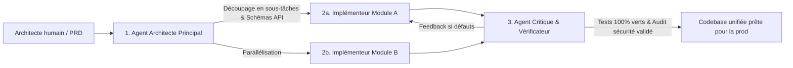

Bienvenue dans le cinquième volet de notre analyse technique du cours **Stanford CS146S : The Modern Software Developer**.

Dans les cours précédents, nous avons étudié le prompt engineering, le protocole MCP et les bancs de test auto-réparateurs. Tous reposaient sur un postulat implicite : une **session LLM unique** interagissant avec un développeur ou une codebase.

Cependant, dès qu'un projet dépasse quelques milliers de lignes de code et s'étend sur plusieurs microservices, ce paradigme monolithique s'effondre sous l'effet de la **saturation de contexte, de la dilution d'attention (*Attention Dilution*) et des biais d'auto-confirmation**.

Dans ce cours, les professeurs de Stanford dévoilent le futur de l'ingénierie logicielle IA-native : les **Systèmes Multi-Agents (MAS) et l'orchestration en essaim**. Nous examinons comment la séparation stricte des rôles entre **Architecte, Implémenteur et Critique** démultiplie la fiabilité et l'échelle des projets logiciels.

{/* truncate */}

---

### 1. Le pattern Architecte - Implémenteur - Critique (AIC)

Stanford propose une séparation fonctionnelle claire pour briser les biais cognitifs des modèles uniques :

1. **Lead Architect Agent** : Décompose le problème en un graphe orienté acyclique (DAG) et fige les interfaces.
2. **Implementer Agents** : Travaillent en parallèle dans des contextes isolés sans polluer leur mémoire de travail.
3. **Critic & Verifier Agent** : Effectue les revues de code et les tests de conformité. N'ayant pas écrit le code, il est totalement immunisé contre le biais d'auto-confirmation.

---

### 📌 Synthèse Exécutive (3–5 lignes)
1. **Échec des modèles monolithiques** : Les agents uniques souffrent de dilution d'attention et d'amnésie sur les grands projets.
2. **Séparation des responsabilités** : L'architecture Architecte-Implémenteur-Critique garantit un développement parallèle et un contrôle qualité indépendant.
3. **Workflows en graphes DAG** : Les dépendances asynchrones permettent d'exécuter les modules sans blocage mutuel.
4. **Protocoles structurés** : Des échanges de messages au format JSON strict évitent les dérives d'interprétation.

### Références & Supports de cours
- **Playlist officielle des cours** : [Stanford CS146S: The Modern Software Development (YouTube Playlist)](https://www.youtube.com/playlist?list=PLxpwjSdVZQ95OWe3QvkVEcU1f1X-6NDj9)
- **Institution** : Université Stanford, Département d'Informatique
