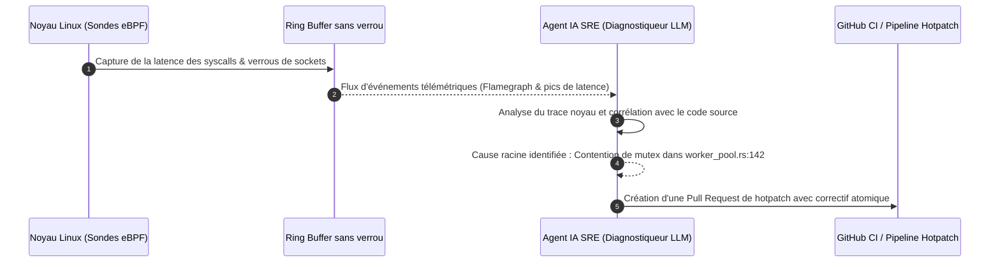

Bienvenue dans le sixième volet de notre analyse technique du cours **Stanford CS146S : The Modern Software Developer**.

Dans le cours précédent, nous avons abordé la coordination d'essaims multi-agents. Cependant, même les logiciels les plus rigoureusement testés finissent par affronter le chaos du monde réel en production.

À 3h du matin, lorsqu'un interblocage (*deadlock*) paralyse un cluster de paiement ou qu'une requête SQL non indexée fait bondir la latence à 12 secondes, les approches traditionnelles s'avèrent inopérantes. Les `printf` invasifs modifient les timings et masquent le problème (*effet Heisenbug*), et les agrégateurs de logs noient les ingénieurs SRE sous des gigaoctets de données inutiles.

Dans ce cours, les professeurs de Stanford dévoilent la nouvelle frontière de la résilience logicielle : **le débogage assisté par IA et le profilage d'exécution**. En combinant la puissance sans surcoût d'**extended Berkeley Packet Filters (eBPF)** avec des **agents LLM spécialisés en diagnostic SRE**, les équipes capturent les états du noyau en temps réel, identifient la cause racine et déploient des correctifs en quelques minutes.

{/* truncate */}

---

### 1. Observabilité noyau avec eBPF + Agent SRE

eBPF permet d'exécuter du bytecode sécurisé directement dans le noyau Linux, sans recompiler ni charger de modules externes, éliminant tout impact sur les performances :

---

### 📌 Synthèse Exécutive (3–5 lignes)
1. **Limites du débogage classique** : Les logs invasifs perturbent les conditions de course (Heisenbugs) et saturent les ingénieurs sous le bruit des logs.
2. **Précision sans surcoût d'eBPF** : Capture les appels système et contentions au niveau du noyau Linux avec un impact quasi nul.
3. **Diagnostic automatisé** : Les agents SRE analysent la télémétrie en temps réel et localisent précisément le goulot d'étranglement dans le code source.
4. **Correction express** : Du diagnostic à la synthèse d'un patch d'urgence, la durée de résolution des incidents est réduite de plusieurs heures à quelques minutes.

### Références & Supports de cours
- **Playlist officielle des cours** : [Stanford CS146S: The Modern Software Development (YouTube Playlist)](https://www.youtube.com/playlist?list=PLxpwjSdVZQ95OWe3QvkVEcU1f1X-6NDj9)
- **Institution** : Université Stanford, Département d'Informatique