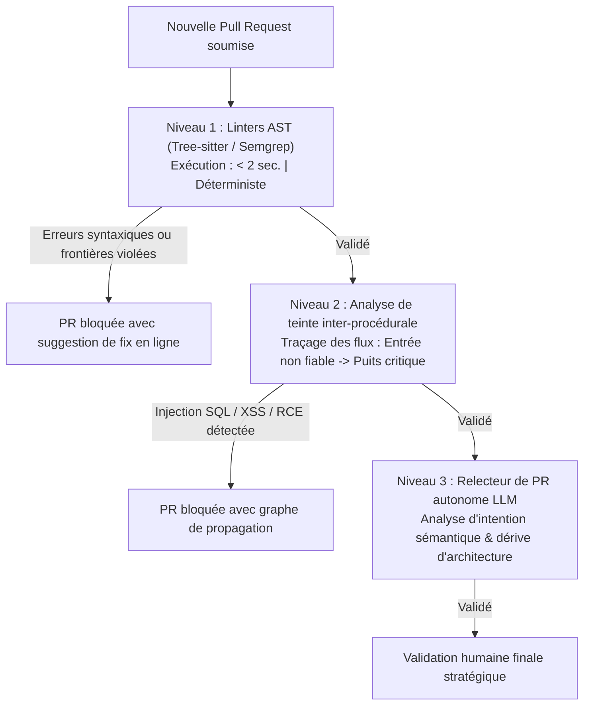

Bienvenue dans le septième volet de notre analyse technique du cours **Stanford CS146S : The Modern Software Developer**.

Dans le cours précédent, nous avons traité la résolution d'incidents en production via eBPF. Cependant, comme tout leader technique le sait : le bug le plus économique est celui qui **n'est jamais fusionné dans la branche principale**.

Dans les organisations à haute vélocité, la revue de Pull Request (PR) est le rempart garantissant la qualité, l'intégrité architecturale et la sécurité. Mais avec la croissance des équipes, la revue humaine devient un gouffre opérationnel : les ingénieurs seniors passent 15 à 20 heures par semaine sur des détails futiles de formatage (*Bikeshedding*) et, épuisés par les volumineuses PR de 1 000 lignes (*Review Fatigue*), laissent passer de graves failles de sécurité.

Dans ce cours, les professeurs de Stanford présentent le schéma directeur d'une **Revue de code automatisée à l'échelle**. En superposant **linters AST**, **analyse de teinte de sécurité (*Taint Analysis*)** et **relecteurs autonomes par LLM**, les équipes éliminent 90 % de la pénibilité manuelle tout en interceptant les failles critiques.

{/* truncate */}

---

### 1. La hiérarchie automatisée en trois niveaux

Stanford propose une stricte division du travail de relecture :

---

### 📌 Synthèse Exécutive (3–5 lignes)
1. **Automatisation contre l'épuisement** : Les revues purement humaines échouent face aux volumineuses PR en raison de la fatigue cognitive et du bikeshedding.
2. **Défense en trois niveaux** : Linters AST pour la syntaxe, analyse de teinte pour la sécurité des flux de données et LLM sémantique pour l'architecture.
3. **Accélération drastique** : 90 % des vérifications mécaniques sont validées immédiatement dans la chaîne CI/CD.
4. **Recentrage sur la valeur** : Les développeurs seniors se concentrent exclusivement sur la stratégie de conception et les décisions critiques.

### Références & Supports de cours
- **Playlist officielle des cours** : [Stanford CS146S: The Modern Software Development (YouTube Playlist)](https://www.youtube.com/playlist?list=PLxpwjSdVZQ95OWe3QvkVEcU1f1X-6NDj9)
- **Institution** : Université Stanford, Département d'Informatique
