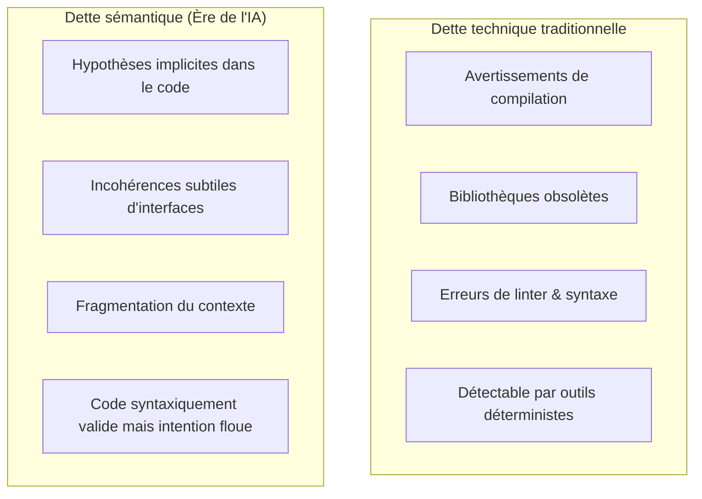

Bienvenue dans le huitième volet de notre analyse technique du cours **Stanford CS146S : The Modern Software Developer**.

Dans les cours précédents, nous avons abordé les compétences individuelles des agents et le débogage. Dans ce **Cours 8**, le programme analyse l'impact systémique à long terme du déploiement massif d'agents IA : **Comment concevoir des architectures logicielles que les agents IA peuvent explorer et modifier sans s'effondrer sous une complexité incontrôlable ? Et comment utiliser l'IA pour découpler les monolithes historiques ?**

Les architectures traditionnelles — caractérisées par des états mutables globaux et des monolithes tentaculaires de 100 000 lignes — saturent rapidement le raisonnement des LLMs. Les professeurs de Stanford formalisent ici le concept de **dette sémantique (*Semantic Debt*)**, posent les règles de l'**architecture IA-native** et détaillent la méthode de **découplage assisté par AST**.

{/* truncate */}

---

### 1. Dette technique vs Dette sémantique

La dette technique classique (compilateurs, linters) concerne le code obsolète ou mal typé. Mais à l'ère de l'IA, une menace bien plus insidieuse émerge : **la dette sémantique**.

La dette sémantique survient lorsque le code compile parfaitement mais que sa logique conceptuelle est tellement fragmentée qu'aucun modèle ne peut en reconstituer le sens global.

---

### 📌 Synthèse Exécutive (3–5 lignes)
1. **La dette sémantique** : Le vrai danger moderne réside dans le code syntaxiquement valide dont l'intention métier est floue et fragmentée.
2. **Architecture IA-Native** : Modularité stricte, interfaces typées et graphes de dépendances acycliques sont indispensables au raisonnement des agents.
3. **Découplage par l'AST** : Les graphes d'appels AST permettent aux agents de localiser objectivement les frontières de découpage et de générer des façades propres.
4. **Validation par shadow run** : L'exécution miroir en parallèle valide la stricte équivalence comportementale avant la bascule en production.

### Références & Supports de cours
- **Playlist officielle des cours** : [Stanford CS146S: The Modern Software Development (YouTube Playlist)](https://www.youtube.com/playlist?list=PLxpwjSdVZQ95OWe3QvkVEcU1f1X-6NDj9)
- **Institution** : Université Stanford, Département d'Informatique