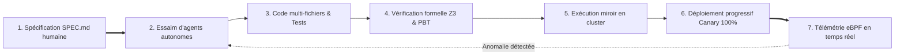

Bienvenue dans le **dixième et dernier volet** de notre série technique d'analyse du cours **Stanford CS146S : The Modern Software Developer**.

Au fil des neuf cours précédents, nous avons déconstruit le développement logiciel classique :
- **Cours 1** : Du dactylographe au chef d'orchestre de systèmes.
- **Cours 2** : Mécanique des tokens et prompt engineering.
- **Cours 3** : Intégration d'outils standardisée avec le Model Context Protocol (MCP).
- **Cours 4** : Spec-Driven Development (SDD) et boucles d'auto-réparation.
- **Cours 5** : Essaims multi-agents (Architecte-Implémenteur-Critique).
- **Cours 6** : Télémétrie d'exécution noyau et résolution d'incidents avec eBPF.
- **Cours 7** : Linters AST et analyse de teinte de sécurité dans la CI/CD.
- **Cours 8** : Modularité IA-native et découplage de monolithes.
- **Cours 9** : Preuves mathématiques et solveurs SMT Z3.

Dans cette **apothéose finale**, le cursus de Stanford réunit ces innovations en une vision unifiée : **L'usine logicielle autonome (*The Autonomous Software Factory*)**. Nous explorons la gouvernance de flottes de centaines d'agents, les autoroutes de déploiement continu sans intervention humaine et le rôle pérenne de l'ingénieur de demain.

{/* truncate */}

---

### 1. Le pipeline de déploiement sans intervention humaine : « Dark Factories » du code

Dans l'industrie, une « Dark Factory » désigne une usine entièrement robotisée fonctionnant sans personnel au sol, sans lumière et sans chauffage.

En génie logiciel émerge le même principe : **les autoroutes de déploiement continu Zero-Human** :

1. **Prise de spécification** : L'architecte humain définit les objectifs et les contraintes de sécurité.
2. **Implémentation autonome** : Les agents implémenteurs produisent code, migrations et tests en parallèle.
3. **Portails de vérification formelle** : Les solveurs Z3 certifient l'exactitude avant toute fusion.
4. **Déploiement progressif automatisé** : Rollout progressif et rollback instantané à la moindre anomalie détectée par eBPF.

---

### 2. Le mot de la fin : L'ingénieur chef d'orchestre

> **« L'IA ne remplacera pas les ingénieurs logiciels. Mais les ingénieurs qui dirigent des agents d'IA remplaceront ceux qui s'obstinent à écrire du code ligne par ligne. »**

Libéré de la saisie répétitive, l'ingénieur s'élève vers sa véritable vocation : **concepteur de systèmes, garant éthique et chef d'orchestre de la puissance computationnelle**.

---

### 📌 Synthèse Exécutive (3–5 lignes)
1. **L'usine logicielle autonome** : L'union des spécifications, essaims d'agents, solveurs Z3 et sondes eBPF permet des déploiements fluides sans intervention humaine.
2. **Gestion de flottes IA** : Le pilotage de centaines d'agents requiert des budgets de tokens stricts et des bacs à sable sécurisés.
3. **Du dactylographe au chef d'orchestre** : La valeur se déplace de la production de syntaxe vers l'architecture de systèmes et la formalisation d'invariants.
4. **Renaissance des fondamentaux** : La maîtrise des systèmes d'exploitation, des réseaux et de la logique formelle est plus cruciale que jamais.

### Références & Supports de cours
- **Playlist officielle des cours** : [Stanford CS146S: The Modern Software Development (YouTube Playlist)](https://www.youtube.com/playlist?list=PLxpwjSdVZQ95OWe3QvkVEcU1f1X-6NDj9)
- **Institution** : Université Stanford, Département d'Informatique
