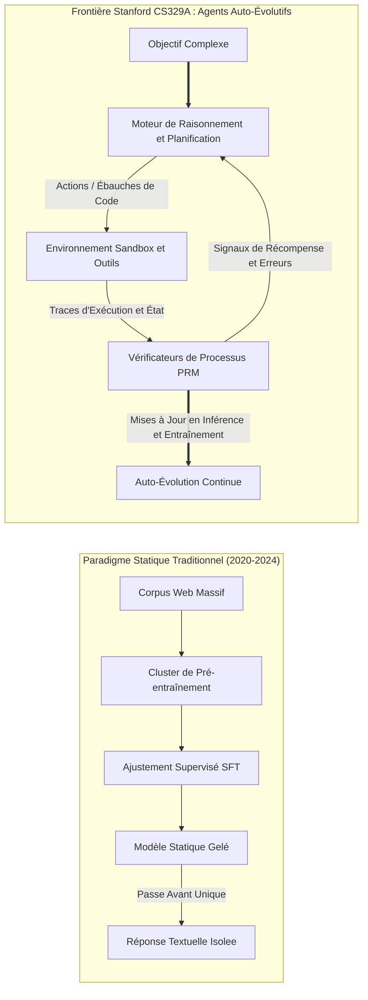

Bienvenue dans l'analyse technique approfondie du cours **CS329A de l'Université Stanford : Self-Improving AI Agents (Agents d'IA Auto-Évolutifs, Automne 2025)**.

Au cours des quatre dernières années, l'écosystème de l'intelligence artificielle a été gouverné par un dogme unique et prédominant : *le pré-entraînement de modèles toujours plus vastes sur des corpus textuels gigantesques engendre des capacités cognitives croissantes de manière prévisible*. Si ce paradigme a déclenché la révolution de l'IA générative moderne — donnant naissance à GPT-4, Claude 3.5 et Gemini —, la frontière de la recherche en apprentissage automatique a désormais atteint un point d'inflexion critique.

Les modèles fondationnels statiques (Static Foundation Models), quel que soit leur nombre astronomique de paramètres, souffrent de limitations intrinsèques fondamentales : ce sont des prédicteurs passifs et autorégressifs du token suivant fonctionnant en boucle ouverte (open-loop). Une fois leurs poids gelés à l'issue de l'entraînement, ils sont incapables d'allouer dynamiquement du calcul supplémentaire aux problèmes complexes, de vérifier de façon autonome l'exactitude factuelle de leurs réponses, ou de corriger itérativement leurs erreurs à partir des retours de leur environnement.



Stanford CS329A pose la question centrale de la décennie d'IA à venir : **Comment concevoir des agents logiciels capables non seulement de générer du texte, mais d'inspecter, de vérifier, de planifier et d'améliorer continuellement leur propre raisonnement et leur code source ?**

Dans cette conférence inaugurale, nous décortiquons la trajectoire évolutive depuis les LLMs de base jusqu'aux architectures agentiques, formalisons les mathématiques des lois d'échelle et de l'allocation du calcul à l'inférence, analysons les quatre modèles fondamentaux de flux de travail agentiques et isolons le goulot d'étranglement majeur de l'intelligence autonome : l'**Écart Générateur-Vérificateur (Generator-Verifier Gap)**.

{/* truncate */}

---

### 1. La Trajectoire Évolutive : Comment Sommes-Nous Arrivés Ici ?

Pour appréhender l'horizon des agents auto-évolutifs, il convient d'analyser les trois phases historiques de l'ingénierie des modèles fondationnels :

```
  Phase 1 : Pré-entraînement (Prédiction Autorégressive Non Supervisée)
  [Scraping Web / Trillions de Tokens] ───> LLM de Base (Compléteur Probabiliste)
                                                    │
  Phase 2 : Alignement Post-Entraînement            ▼
  [Paires Prompt-Réponse Sélectionnées] ─> SFT (Suivi Rigoureux des Instructions)
  [Préférences Humaines (RLHF/DPO)]    ─> Chatbot Conversationnel Alignée
                                                    │
  Phase 3 : La Frontière CS329A                     ▼
  [Feedback d'Exécution + Vérification PRM] ──> Agent Autonome Auto-Évolutif
```

#### Phase 1 : Pré-entraînement Non Supervisé (Unsupervised Pre-Training)
Un modèle de langage de base est entraîné sur des milliers de milliards de tokens en minimisant la perte d'estimation du maximum de vraisemblance (MLE) :
$$\mathcal{L}_{\text{MLE}}(\theta) = - \sum_{i=1}^{T} \log P_\theta(x_i \mid x_{1:i-1})$$
Bien que cet objectif contraigne le réseau à condenser la syntaxe, la connaissance générale et les relations sémantiques dans des centaines de milliards de poids, le modèle reste un imitateur statistique non contraint. À la requête *"Quelle est la capitale de la France ?"*, il est tout aussi susceptible de poursuivre par *"Quelle est la capitale de l'Allemagne ?"* que de formuler la réponse, les deux formulations se côtoyant fréquemment sur le web.

#### Phase 2 : Réglage d'Instructions et RLHF (La "Recette ChatGPT")
Afin de convertir un moteur de complétion brut en un assistant interactif fiable, l'industrie a instauré un pipeline en deux étapes :
1. **Supervised Fine-Tuning (SFT) :** Entraînement sur des démonstrations de haute qualité pour doter le modèle d'un comportement conversationnel coopératif.
2. **Apprentissage par Renforcement avec Rétroaction Humaine (RLHF) / DPO :** Optimisation selon un modèle de récompense $r_\psi(x, y)$ reflétant les préférences humaines :
$$\max_\theta \mathbb{E}_{(x, y) \sim \mathcal{D}} \left[ r_\psi(x, y) \right] - \beta \, \mathbb{D}_{\text{KL}}\left(\pi_\theta(y \mid x) \,||\, \pi_{\text{ref}}(y \mid x)\right)$$
Si le RLHF a garanti l'obéissance et la sécurité des dialogues, il n'a pas conféré aux modèles une réelle autonomie de résolution. Un chatbot aligné produit toujours sa sortie en une seule passe sans réflexion préalable, sans validation logique ni manipulation d'outils.

#### Phase 3 : La Frontière CS329A — Les Boucles Agentiques Autonomes
Les agents auto-évolutifs s'affranchissent du carcan de la passe avant unique. En intégrant des outils externes (compilateurs, navigateurs web, environnements Python REPL), des hiérarchies de mémoire structurée et des boucles de validation automatisées, le système devient un agent actif : il sonde l'environnement, agit concrètement, analyse les résultats intermédiaires et ajuste ses états internes jusqu'à la démonstration rigoureuse du résultat attendu.

---

### 2. Mathématiques des Lois d'Échelle : Entraînement vs. Inférence

Le socle de l'apprentissage profond contemporain repose sur l'**Hypothèse d'Échelle (Scaling Hypothesis)**. En 2020, Kaplan et al. (OpenAI) puis en 2022 Hoffmann et al. (DeepMind Chinchilla) ont établi que la perte d'entropie croisée de test $L$ d'un modèle autorégressif suit une loi de puissance vis-à-vis du budget de calcul $C$, du volume de paramètres $N$ et de la taille du jeu de données $D$ :

$$L(N, D) = E + \frac{A}{N^\alpha} + \frac{B}{D^\beta}$$

où $E$ désigne l'entropie irréductible du langage naturel, $A$ et $B$ sont des constantes d'échelle, et $\alpha \approx 0.34, \beta \approx 0.28$ représentent les exposants empiriques.

```
Perte d'Entropie Croisée L
 ▲
 │ ╲  10^21 FLOPs (Ère GPT-2)
 │  ╲
 │   ╲  10^23 FLOPs (Ère GPT-3)
 │    ╲
 │     ╲  10^25 FLOPs (Ère GPT-4)
 │      └─── Mur du Pré-entraînement (Épuisement des données et seuils énergétiques)
 └─────────────────────────────────────────────────────────────►
                       Budget de Calcul C (FLOPs)
```

Néanmoins, la mise à l'échelle du pré-entraînement se heurte désormais à des barrières physiques et financières infranchissables :
- **Le Mur des Données :** Les données textuelles de haute qualité rédigées par l'humain sur le web public seront intégralement consommées d'ici la fin de la décennie.
- **Densité Énergétique et Capitale :** Exploiter des clusters dépassant $10^{26}$ FLOPs requiert des sous-stations électriques dédiées à l'échelle du gigawatt et des centaines de millions de dollars d'investissements matériels.

#### La Seconde Frontière : Mise à l'Échelle du Calcul d'Inférence (Test-Time Scaling)
Au lieu d'engager des fortunes pour recalculer des poids de modèle figés : **peut-on libérer une intelligence supérieure en allouant davantage de calcul au moment même de l'inférence (Test-Time) ?**

Face à une énigme mathématique ou un problème d'ingénierie délicat, un expert humain ne rédige jamais la solution parfaite d'un seul jet ; il formule des conjectures, valide des lemmes intermédiaires, détecte des impasses et rebrousse chemin (backtracking).

La **Mise à l'Échelle du Calcul d'Inférence** répartit les FLOPs de test selon trois dimensions clés :
1. **Échantillonnage Répété (Best-of-$N$ / Hypothèse des Grands Singes du Langage) :** Générer $N$ trajectoires candidates depuis la politique $\pi_\theta$ et retenir la meilleure à l'aide d'un vérificateur. La probabilité d'obtenir au moins une solution valide suit la métrique $\text{Pass@}k$ :
$$\text{Pass@}k = \mathbb{E}\left[ 1 - \frac{\binom{n - c}{k}}{\binom{n}{k}} \right]$$
où $n$ est l'échantillonnage total et $c$ le nombre de trajectoires correctes.
2. **Vérification Étape par Étape (PRM vs. ORM) :** Les modèles de récompense de résultat (ORM) ne notent que l'état final $r(x, y)$, rendant indétectables les erreurs intermédiaires. Les modèles de récompense de processus (PRM) attribuent une récompense scalaire $r_t = R(x, y_{1:t})$ à chaque jalon logique, autorisant une attribution de crédit chirurgicale.
3. **Algorithmes de Recherche Arborescente (MCTS, Beam Search) :** Explorer le graphe combinatoire des raisonnements par la recherche arborescente de Monte-Carlo, équilibrant l'exploitation d'états intermédiaires fertiles et l'exploration de chemins inédits.

Comme l'illustrent les modèles de frontière (OpenAI o1, DeepSeek-R1), multiplier par $100\times$ à $1\,000\times$ le calcul d'inférence engendre des gains spectaculaires aux Olympiades Internationales de Mathématiques (IMO) et sur SWE-bench, dépassant de loin la simple expansion brute des paramètres.

---

### 3. Les Quatre Modèles Fondamentaux de Flux de Travail Agentiques

Concevoir un système autonome sur un prompt monolithique expose l'agent à des dérives stochastiques incontrôlables. Stanford CS329A structure les topologies agentiques en quatre modèles modulaires :

```mermaid
flowchart TD
    subgraph Modele1 ["1. Enchaînement de Prompts (Prompt Chaining)"]
        P1_In[Entrée de Tâche] --> P1_M1[Modèle Étape 1]
        P1_M1 -->|Résultat Intermédiaire| P1_M2[Modèle Étape 2]
        P1_M2 --> P1_Out[Livrable Final]
    end

    subgraph Modele2 ["2. Routage Dynamique (Dynamic Routing)"]
        P2_In[Requête] --> P2_Router{Routeur d'Intention}
        P2_Router -->|Mathématiques| P2_Math[Moteur Symbolique]
        P2_Router -->|Codebase| P2_Code[Agent SWE]
        P2_Router -->|Général| P2_LLM[LLM Polyvalent]
    end

    subgraph Modele3 ["3. Parallélisation (Parallelization)"]
        P3_In[Tâche] --> P3_A[Agent 1 : Conservateur]
        P3_In --> P3_B[Agent 2 : Créatif]
        P3_In --> P3_C[Agent 3 : Critique]
        P3_A --> P3_Agg[Agrégateur de Consensus]
        P3_B --> P3_Agg
        P3_C --> P3_Agg
    end

    subgraph Modele4 ["4. Orchestrateur-Ouvriers (Orchestrator-Worker)"]
        P4_In[Spécification PRD] --> P4_Orch[Agent Orchestrateur]
        P4_Orch -->|Sous-tâche 1| P4_W1[Ouvrier 1]
        P4_Orch -->|Sous-tâche 2| P4_W2[Ouvrier 2]
        P4_W1 -->|Retour d'État| P4_Orch
        P4_W2 -->|Retour d'État| P4_Orch
        P4_Orch --> P4_Out[Système Final Déployé]
    end
```



#### 1. Enchaînement de Prompts (Prompt Chaining : Décomposition Séquentielle)
Scinde une tâche complexe en phases déterministes où le résultat de l'étape $k$ devient le contexte structuré de l'étape $k+1$. Des portes de validation intermédiaires (ex. : élaboration du plan $\to$ vérification de complétude $\to$ rédaction $\to$ révision) endiguent la propagation des erreurs.

#### 2. Routage Dynamique (Dynamic Routing : Spécialisation)
Classifie la requête initiale pour la déléguer au modèle spécialisé ou à l'outil le plus efficient. Les requêtes algébriques sont transmises à un bac à sable Python, tandis que les refactorisations logicielles massives sont déléguées à un agent SWE dédié.

#### 3. Parallélisation (Parallelization : Découpage et Vote)
- **Découpage (Sectioning) :** Traitement simultané de sous-problèmes mutuellement indépendants par plusieurs instances.
- **Vote et Consensus (Voting) :** Génération concurrente de réponses issues d'amorces ou de températures variées pour neutraliser les anomalies statistiques par décision majoritaire.

#### 4. Orchestrateur-Ouvriers (Orchestrator-Worker : Délégation Hiérarchique)
Un chef d'orchestre décompose l'objectif stratégique en un Graphe Acyclique Dirigé (DAG), missionne des agents ouvriers spécialisés, supervise les incidents d'exécution en temps réel et synthétise le livrable final.

---

### 4. Le Goulot d'Étranglement Crucial : L'Écart Générateur-Vérificateur

Pourquoi concevoir des agents auto-évolutifs s'avère-t-il si complexe ?
L'explication fondamentale réside dans l'**Asymétrie Générateur-Vérificateur** :

$$\text{Complexité}(\text{Vérification}) \ll \text{Complexité}(\text{Génération}) \quad \text{en domaines formels clos (maths, code, Lean 4)}$$
$$\text{Complexité}(\text{Vérification}) \approx \text{Complexité}(\text{Génération}) \quad \text{en domaines ouverts en langage naturel}$$

```
Capacité de Vérification
 ▲
 │   Domaines Formels (Mathématiques, Code Python, Vérification de types)
 │   ┌────────────────────────────────────────────────────────┐
 │   │ Vérificateur (Compilateur / Suite de tests / Solveur Z3)│
 │   │ Déterministe, peu coûteux et fiable à 100%            │
 │   └────────────────────────────────────────────────────────┘
 │
 │   Domaines Ouverts (Essais, Stratégie, Négociation juridique)
 │   ┌────────────────────────────────────────────────────────┐
 │   │ Vérificateur (Juge LLM)                                │
 │   │ Bébéficie de peu d'ancrage, sujet aux biais de longueur │
 │   └────────────────────────────────────────────────────────┘
 └─────────────────────────────────────────────────────────────►
                     Complexité de Génération
```

Dans les environnements formels tels que le développement logiciel et les preuves de théorèmes, la vérification est binaire : le code compile ou échoue ; les tests unitaires réussissent ou échouent. Dès lors, l'auto-évolution fonctionne en boucle fermée : concevoir des patchs, exécuter les tests, rejeter les échecs et assimiler les correctifs validés.

En revanche, dans les domaines naturels non contraints, **juger si une réponse est optimale exige une sagacité cognitive presque identique à celle nécessaire pour la créer de toutes pièces**. Recourir à un LLM pour arbitrer un autre LLM engendre un cercle vicieux : le juge souffre des mêmes hallucinations, favorise les réponses artificiellement longues (biais de verbosité) et valide par complaisance des raisonnements erronés.

Combler cet écart par la compilation neuro-symbolique d'intentions en invariants formels et par l'ancrage dans des environnements d'exécution objectifs forme le cœur scientifique de CS329A.

---

### 5. Programme Pédagogique de Stanford CS329A : Feuille de Route en 4 Volets

Le cursus académique de CS329A se déploie selon quatre paliers d'ingénierie progressifs :

```
┌─────────────────────────────────────────────────────────────────────────────┐
│                    Pile Architecturale de Stanford CS329A                   │
├─────────────────────────────────────────────────────────────────────────────┤
│  Partie 4 · Frontières (L13 - L17)                                          │
│  - Démonstrations mathématiques formelles (AlphaProof, Lean 4)              │
│  - Fiabilité des systèmes autonomes et frontières de sécurité AI Control    │
│  - Agents robotiques multimodaux et incarnés (VLA, RT-2, π0)                │
│  - Grand Final : Problèmes ouverts futurs et érosion de l'alignement        │
├─────────────────────────────────────────────────────────────────────────────┤
│  Partie 3 · Ingénierie des Agents (L10 - L12)                               │
│  - Agents de génie logiciel (SWE-bench, interface ASI)                      │
│  - Architectures de mémoire hiérarchique façon OS (MemGPT, CacheBlend)      │
│  - Évaluation de tâches à long horizon et valeur économique (METR Horizons) │
├─────────────────────────────────────────────────────────────────────────────┤
│  Partie 2 · Entraînement et Évolution (L6 - L9)                             │
│  - Mise à l'échelle à l'entraînement et RL (DeepSeekMath & GRPO)            │
│  - Évolution ouverte et recherche d'architecture (ADAS, AlphaEvolve)        │
│  - Flux de recherche approfondie autonome (AlphaCode, Search-o1)            │
│  - L'évolution post-entraînement : SFT -> RLHF -> RLVR -> Agent RL          │
├─────────────────────────────────────────────────────────────────────────────┤
│  Partie 1 · Fondations (L1 - L5)                                            │
│  - Calcul d'inférence et frontières optimales de Snell                      │
│  - Vérificateurs supervisés par processus (PRM800K)                         │
│  - Intégration d'outils et rétroaction de code (ReAct, RLEF)                │
│  - Planification multi-étapes et recherche arborescente (LATS MCTS)         │
└─────────────────────────────────────────────────────────────────────────────┘
```

---

### 6. Points Clés à Retenir et Questions Académiques

#### Points Clés
1. **Rupture de Paradigme :** L'intelligence artificielle passe d'une prédiction textuelle statique et passive à des boucles de rétroaction autonomes où action, vérification et réflexion s'articulent continuellement.
2. **Double Frontière d'Échelle :** L'accroissement des paramètres de pré-entraînement se conjugue désormais avec la mise à l'échelle du calcul d'inférence (Best-of-$N$, PRM, recherche arborescente), permettant à des modèles compacts de surpasser des géants par un raisonnement approfondi.
3. **L'Armature Universelle :** Tout système agentique performant repose sur le triptyque : **Générer $\to$ Vérifier $\to$ Boucler**.
4. **L'Obstacle de la Vérification :** La cadence d'auto-amélioration d'un agent est strictement bridée par l'objectivité et l'intégrité de son signal de validation.

---

#### Questions Académiques

**Q. En quoi la mise à l'échelle du calcul d'inférence diffère-t-elle du simple prompting ou du Chain-of-Thought (CoT) classique ?**
**R.** Le CoT traditionnel génère un raisonnement linéaire en une passe irréversible. Si une erreur de calcul survient à l'étape 2, celle-ci pollue l'intégralité des tokens suivants. La mise à l'échelle du calcul d'inférence implémente des arbres de recherche externes et des jalons de vérification : chaque étape intermédiaire est évaluée par un modèle de récompense de processus (PRM) ou un compilateur, autorisant l'exploration de branches fécondes et l'élagage immédiat des voies sans issue.

**Q. Pourquoi ne pas simplement entraîner un LLM colossal pour agir en arbitre universel de toutes les tâches humaines ?**
**R.** Parce que les réseaux de neurones probabilistes ne peuvent corriger leurs propres errances sans un ancrage physique ou déterministe dans le monde réel (Ground-truth Anchor). Dans le texte libre, les juges LLM affichent des biais de complaisance et une nette inclination pour les réponses volumineuses. Une vérification fiable exige d'adosser les affirmations à des artefacts exécutables : suites de tests unitaires, transactions SQL, théorèmes en Lean 4 ou retours de capteurs robotiques.

---

### Aperçu de la Prochaine Conférence

Dans la **Conférence 2**, nous plongerons dans les rouages mathématiques de la **Mise à l'Échelle du Calcul d'Inférence (Test-Time Compute Scaling)** :
- Les frontières de calcul optimal selon Snell et al.
- L'arbitrage entre la couverture d'échantillonnage et la profondeur de recherche séquentielle.
- Comment des architectures comme *Archon* et *Large Language Monkeys* équilibrent harmonieusement les budgets de génération et de vérification.

Poursuivons ensemble l'exploration de l'intelligence artificielle auto-évolutive !