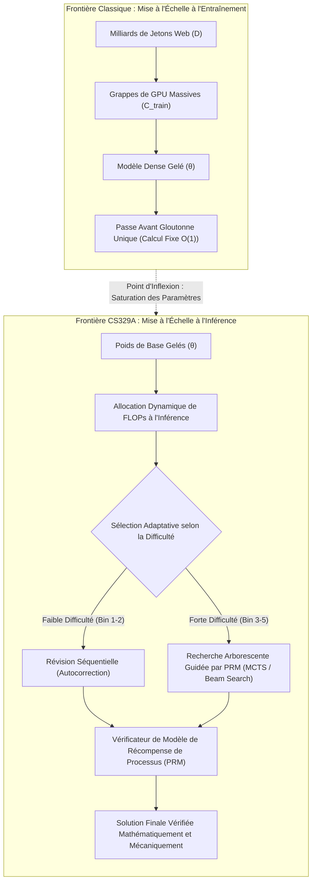
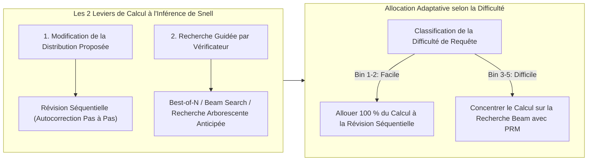

Bienvenue dans le deuxième volet de notre analyse technique approfondie du cours d'élite de l'**Université de Stanford, CS329A : Self-Improving AI Agents (Automne 2025)**.

Lors du cours inaugural, nous avons exposé le changement de paradigme macroéconomique transformant les prédicteurs statiques de prochain jeton en boucles agentiques autonomes fermées sur leur environnement. Aujourd'hui, nous nous attaquons au pilier computationnel indispensable à cette autonomie : **la mise à l'échelle du calcul au moment de l'inférence (Test-Time Compute Scaling / Inference-Time Scaling)**.

Pendant plus d'une demi-décennie, le dogme dominant de l'IA a été dicté par les lois d'échelle du pré-entraînement (Kaplan et al., Chinchilla) : *construire des grappes de GPU gigantesques, élargir le volume de paramètres N et absorber des dizaines de milliers de milliards de jetons web*. Cependant, une fois les poids θ du modèle gelés, que se passe-t-il si nous refusons une réponse gloutonne (greedy) précipitée en 50 millisecondes ? Que se passe-t-il si un agent consacre **10 secondes, 1 minute ou 10 minutes à explorer délibérément des arbres de raisonnement, à vérifier des étapes intermédiaires et à réviser ses hypothèses** ?

À travers les découvertes empiriques de *Large Language Monkeys* (Brown et al., 2024), l'étude *Compute-Optimal Scaling* de Snell et al. (Stanford/UC Berkeley, 2024) et le framework d'architecture modulaire *Archon*, nous formalisons mathématiquement comment l'investissement de FLOPs d'inférence en substitution de la taille des paramètres redéfinit l'intelligence artificielle contemporaine.



{/* truncate */}

---

### 1. Mise à l'Échelle Classique vs Calcul à l'Inférence : Le Changement de Paradigme

L'apprentissage profond moderne s'est établi sur le constat empirique selon lequel la perte de validation diminue sous forme d'une loi de puissance (power-law) par rapport au calcul d'entraînement :

```text
L(N, D) = E + A / N^α + B / D^β
```

où N est le nombre de paramètres hors plongement et D le volume de données d'entraînement en jetons. Cependant, cette formulation classique traite le calcul d'inférence comme une constante triviale : exactement 2 FLOPs par paramètre et par jeton produit lors du décodage autorégressif.

#### Les Limites Physiques de la Croissance du Pré-Entraînement
Lorsque l'industrie a dépassé 10^26 FLOPs (classe GPT-4), le pré-entraînement s'est heurté à trois verrous sévères :
1. **La Limite d'Épuisement des Données Humaines :** Le volume de texte de haute qualité disponible sur le Web est fini (~10^14 jetons). Générer des données synthétiques de manière récursive sans vérificateur fiable induit l'effondrement du modèle (Model Collapse) et une perte de diversité entropique.
2. **L'Explosion Exponentielle des Coûts :** Gagner 1 % de précision sur la queue aplatie d'une loi de puissance exige de décupler les FLOPs de pré-entraînement, soit des investissements de centaines de millions de dollars (CAPEX).
3. **Le Piège de la Passe Avant Statique :** Qu'un modèle compte 7 milliards ou 1 000 milliards de paramètres, le décodage autorégressif génère chaque jeton t_i au moyen d'un nombre invariant de multiplications matricielles :

```text
t_i ~ Softmax( W_u · LayerNorm( h_L(t_{1:i-1}) ) )
```

Les démonstrations mathématiques formelles et la correction de bugs complexes répartis sur plusieurs dizaines de fichiers logiciels exigent du retour sur trace (backtracking), de la spéculation et une validation d'étapes que la passe linéaire est incapable de fournir.

---

### 2. Le Retour du Théorème du Singe Infini : Large Language Monkeys

Dans la théorie classique des probabilités, le *Théorème du Singe Infini* d'Émile Borel postule qu'un singe frappant au hasard les touches d'un clavier pendant une durée infinie rédigera presque sûrement l'œuvre complète de William Shakespeare.

Fin 2024, des chercheurs de l'UC Berkeley et de Google Research ont testé cette hypothèse sur des LLMs de pointe : **《Large Language Monkeys: Scaling Inference Compute with Repeated Sampling》** (Brown et al., 2024).

```
Couverture (Pass@k %)
 ▲
100│                                     ┌────────────── Limite Supérieure Théorique Pass@k
 90│                                ┌────┘ (Atteint 99 % sur MATH et CodeContests)
 80│                           ┌────┘
 70│                      ┌────┘
 60│                 ┌────┘ ◄── SWE-bench Lite: DeepSeek-Coder-V2 (k=250 -> 56.0%)
 50│            ┌────┘
 40│       ┌────┘   ◄── Claude 3.5 Sonnet Exécution Unique (43.0%)
 30│  ┌────┘
 20│ ┌┘
 10│┌┘  ◄── Gemma-2B Pass@1 (0.02%)
  0└┴──────┬──────────┬──────────┬──────────┬──────────►
    k=1    k=10       k=100      k=1,000    k=10,000   (Nombre d'Échantillons k)
```

#### Formulation Mathématique de l'Estimateur sans Biais pass@k
Lors de l'échantillonnage de N réponses indépendantes, dont exactement C réussissent les tests automatisés (tests unitaires), l'estimateur sans biais à variance minimale (MVUE) pour pass@k est défini par :

```text
Pass@k = (1 / P) · ∑_{i=1}^P [ 1 - C(N - C_i, k) / C(N, k) ]
```

où P est le nombre total de problèmes, C_i le nombre de solutions réussies pour le problème i, et C(n, r) le coefficient binomial. Pour éviter les dépassements de capacité arithmétique lorsque N = 10 000, les pipelines de production exploitent cette boucle multiplicative numériquement stable :

```text
Pass@k = 1 - ∏_{j=0}^{k-1} ( 1 - C_i / (N - j) )
```

#### Percées Empiriques : Les Petits Modèles Dépassent les Géants
L'échantillonnage répété à l'inférence a produit des résultats spectaculaires :
* **SWE-bench Lite (Résolution de Bugs Réels sur GitHub) :**
  * Le modèle open source `DeepSeek-Coder-V2-Instruct` affichait à k=1 un taux de réussite modeste de **15,9 %**.
  * En étendant l'échantillonnage à k=250, pass@250 a grimpé en flèche à **56,0 %**.
  * Ce résultat a dépassé l'ensemble GPT-4o et Claude 3.5 Sonnet (43,0 %) de **13 points de pourcentage**.
* **CodeContests (Programmation Compétitive de Haut Niveau) :**
  * Le modèle ultraléger `Gemma-2B` avait un pass@1 de **0,02 %** (quasiment nul).
  * Porté à k=10 000, son pass@10 000 a atteint **7,1 %**, soit une multiplication par **355x** de sa performance.
* **L'Inversion Économique :**
  * Atteindre 29,62 % sur SWE-bench avec DeepSeek-Coder-V2 (k=5) a coûté **10,80 $**.
  * En comparaison, l'exécution unique de GPT-4o (24,0 %) a coûté **39,00 $ (3,6x plus cher)** et Claude 3.5 Sonnet (26,7 %) a coûté **51,00 $ (4,7x plus cher)**.

```text
┌───────────────────────────────┬──────────┬────────────┬─────────────┐
│ Modèle & Stratégie d'Inférence│ SWE-bench│ Coût ($)   │ Multiplicat.│
├───────────────────────────────┼──────────┼────────────┼─────────────┤
│ DeepSeek-Coder-V2 (k=5)       │ 29.62%   │ $10.80     │ 1.0x (Base) │
│ GPT-4o (k=1 Glouton Unique)   │ 24.00%   │ $39.00     │ 3.6x Coût   │
│ Claude 3.5 Sonnet (k=1)       │ 26.70%   │ $51.00     │ 4.7x Coût   │
│ DeepSeek-Coder-V2 (k=250)     │ 56.00%   │ $540.00    │ État de l'Art│
└───────────────────────────────┴──────────┴────────────┴─────────────┘
```

#### L'Écart Couverture-Précision : Le Mur du Vérificateur
Cependant, l'échantillonnage répété se heurte à un goulet d'étranglement structurel : **l'écart couverture-précision (Coverage-Precision Gap)**.

Dans les domaines formels clos dotés d'oracles déterministes (compilateurs ou tests unitaires), **la Couverture équivaut au Succès** : si 1 candidat sur 250 valide les tests, il est extrait sans ambiguïté.

Dans les domaines ouverts ou informels dépourvus d'oracles externes :
* Sur le jeu de données MATH, `Llama-3-8B-Instruct` a atteint une couverture de **98,44 %** à k=10 000 (98 % des réservoirs contenaient la bonne démonstration).
* Pourtant, l'application du **Vote à la Majorité (Majority Voting)** n'a fait passer la précision que de 40,5 % à **41,41 %** (+0,9 %p seulement).
* La sélection **Best-of-N** par modèle de récompense de résultat (ORM) a plafonné dès k=100 en raison de faux positifs et de dérive d'évaluation (Reward Hacking).

> **Règle d'Ingénierie :** Augmenter le nombre d'échantillons sans vérificateur précis revient à agrandir la meule de foin. Même si la probabilité que l'aiguille (la solution) se trouve dans la meule approche 99 %, il est impossible de la retrouver sans un aimant puissant (le vérificateur).

---

### 3. L'Allocation Optimale de Snell : Échanger des Paramètres contre des FLOPs

Comment dépenser au mieux un budget d'inférence imparti plutôt que de jeter aveuglément les dés 10 000 fois ?

Fin 2024, Charlie Snell, Jaehoon Seo, Hao Liu, Aviral Kumar et Sergey Levine (Stanford et UC Berkeley) ont publié une recherche fondamentale : **《Scaling LLM Test-Time Compute Optimally can be More Effective than Scaling Model Parameters》**.



#### Les Deux Leviers du Calcul à l'Inférence
Snell et al. ont articulé les méthodes d'inférence selon deux axes orthogonaux :
1. **Modification de la Distribution Proposée (Proposeur) :** Conditionner le modèle pour qu'il produise de meilleures trajectoires par révision séquentielle :
   ```text
   y_{t+1} ~ P_θ( y | x, y_1, ..., y_t, Critique_t )
   ```
2. **Recherche Guidée par Vérificateur (Vérificateur) :** Explorer méthodiquement l'arbre de raisonnement guidé par un modèle de récompense de processus (PRM) :
   ```text
   Score(Node_t) = PRM_ψ( x, y_{1:t} )
   ```

#### Le Principe d'Inversion selon la Difficulté
L'apport majeur de l'équipe Stanford-Berkeley réside dans la démonstration que **la stratégie optimale s'inverse totalement selon la difficulté du problème** :

```text
Difficulté Bin 1-2 (Problèmes Faciles)    ───>  La Révision Séquentielle domine
Difficulté Bin 3-5 (Problèmes Difficiles) ───>  La Recherche Beam avec PRM domine
```

1. **Problèmes Faciles (Bins 1–2) :** 
   * Le premier jet du modèle de base est déjà très proche de la solution.
   * Y appliquer une recherche arborescente complexe introduit du bruit de vérification, provoquant une dégradation par sur-optimisation.
   * **Stratégie Optimale :** La révision séquentielle (demander au modèle de corriger ses étourderies arithmétiques) atteint une précision maximale avec un coût minimal.
2. **Problèmes Difficiles (Bins 3–5) :**
   * Face à des problèmes de concours mathématiques ardus, l'autocorrection linéaire échoue car la trajectoire initiale s'égare dans une impasse logique.
   * **Stratégie Optimale :** La recherche par faisceau (Beam Search) guidée par un PRM évalue chaque étape et élague les impasses.
3. **Le Gain d'Efficacité Computationnelle :**
   * Une politique optimale allouant la révision aux questions simples et la recherche PRM aux questions complexes atteint la même précision que Best-of-N en consommant **4 fois moins de calcul (4x)**.

#### L'Équivalence 14x Paramètres
Le résultat le plus frappant de Snell et al. a été la confrontation directe entre **multiplier la taille des paramètres par 14x** et **octroyer 14x plus de calcul d'inférence à un petit modèle** :

```text
Modèle à 14x Paramètres (Décodage Glouton)   vs   Modèle 1x + 14x Calcul d'Inférence
```

* Pour les requêtes faciles à intermédiaires sur MATH et GSM8K, le petit modèle doté d'un calcul d'inférence optimisé a égalé ou dépassé le grand modèle dense 14 fois plus volumineux.
* Pour les tâches d'extrême complexité (Bin 5), l'échelle des paramètres pré-entraînés demeure néanmoins irremplaçable : si le modèle de base ne dispose pas des représentations sémantiques indispensables pour formuler une hypothèse, la recherche s'effondre en hallucinations.

---

### 4. Ingénierie des Systèmes : L'Architecture Multi-Agents Modulaire Archon

Comment intégrer ces lois d'échelle théoriques au sein d'applications logicielles sans empiler des prompts fragiles ?

Le framework **Archon** (arxiv:2409.15254) répond à cette exigence en découpant les fonctions des LLMs en **couches de pipeline modulaires** :

```mermaid
flowchart TD
    Q[Spécification / Requête Utilisateur] --> G[Couche 1: Ensemble de Générateurs]
    G -->|Trajectoires Candidates| C[Couche 2: Critique Multiperspective]
    C -->|Critiques & Failles Détectées| R[Couche 3: Évaluateur par Tournoi (Ranker)]
    R -->|Meilleurs Candidats Top-k| F[Couche 4: Synthétiseur de Fusion (Fuser)]
    F -->|Solution Unifiée| V[Couche 5: Bac à Sable de Tests Unitaires (Verifier)]
    V -->|Résultats d'Exécution| Dec{Tests Validés ?}
    Dec -- Oui --> Final[Livrable Validé en Production]
    Dec -- Non (Boucle de Raffinement) --> G
```

#### Les Cinq Couches Logicielles d'Archon
1. **Couche Génératrice (Generator) :** Génère des réponses candidates diversifiées en variant les températures (T=0,2 à 0,8) ou en panachant des modèles hétérogènes (Claude 3.5 Sonnet + DeepSeek-V2).
2. **Couche Critique (Critic) :** Analyse les trajectoires pour isoler les failles logiques, les omissions d'hypothèses et les erreurs de typage.
3. **Couche de Classement (Ranker) :** Procède à des tournois comparatifs 1 contre 1 entre candidats via des grilles d'évaluation rigoureuses.
4. **Couche de Fusion (Fuser) :** Réassemble les meilleurs arguments des candidats de tête en une réponse consolidée unique (+8,9 % d'amélioration).
5. **Couche de Vérification (Verifier) :** Fait rédiger 5 à 10 tests unitaires par un LLM et les exécute dans un bac à sable isolé (+56 % de performance en programmation).

Grâce à l'**Optimisation Bayésienne (Bayesian Optimization)**, Archon explore un espace de conception de **9 576 topologies d'architectures**, identifiant automatiquement la canalisation optimale au sens de Pareto pour toute contrainte budgétaire.

---

### 5. Étude de Cas : Démystification d'OpenAI o1 et des Modèles de Raisonnement

Les principes de Stanford CS329A Cours 2 éclairent d'une lumière limpide le fonctionnement des modèles de raisonnement comme OpenAI o1 et DeepSeek-R1 :

```
┌────────────────────────────────────────────────────────────────────────┐
│                   Dans la Trace de "Pensée" d'OpenAI o1                │
├────────────────────────────────────────────────────────────────────────┤
│ 1. Délibération Dissimulée (Jetons de Test-Time) :                     │
│    Le modèle produit des milliers de jetons de réflexion internes avant│
│    de renvoyer le premier caractère visible à l'utilisateur.           │
│                                                                        │
│ 2. Évaluation de Processus et Retour sur Trace :                       │
│    Entraîné par apprentissage par renforcement (RL) sur des récompenses│
│    d'étapes, le modèle détecte les impasses et revient en arrière.     │
│                                                                        │
│ 3. Révision Séquentielle Autonome (Snell Revision) :                   │
│    Les formulations du type "Attendez, cela me paraît erroné..." sont  │
│    l'émanation de politiques apprises d'autocorrection séquentielle.   │
└────────────────────────────────────────────────────────────────────────┘
```

La réflexion visible d'OpenAI o1 n'est pas un mystère magique : elle constitue l'implémentation neurale de la **Mise à l'Échelle à l'Inférence**, combinant révision séquentielle, vérification PRM et élagage arborescent au sein d'une seule boucle autorégressive.

---

### 6. Résumé et Enseignements Clés pour l'Ingénieur

1. **Deux Axes d'Expansion :** L'intelligence des modèles ne dépend plus uniquement du pré-entraînement. Le calcul d'inférence constitue un axe de scaling orthogonal permettant à des modèles compacts de surclasser des modèles géants.
2. **Le Principe Couverture-Précision :** L'échantillonnage répété (pass@k) démultiplie la couverture potentielle (DeepSeek-Coder-V2 passant de 15,9 % à 56,0 %), mais cette réserve ne peut être exploitée sans un vérificateur PRM de précision chirurgicale.
3. **L'Allocation Optimale de Snell :** Répartir les ressources selon la difficulté est 4 fois plus sobre : adoptez la Révision Séquentielle pour les problèmes simples et la recherche Beam PRM pour les problèmes ardus.
4. **Architectures Modulaires :** Comme l'illustre Archon, la structure logicielle reliant générateurs, critiques et bacs à sable influe tout autant sur la fiabilité finale que le nombre de paramètres bruts.

---

### À Suivre dans Stanford CS329A :
Lors du **Cours 3**, nous analyserons le composant stratégique des agents autonomes : **《Robust Verification : Modèles de Récompense de Processus (PRM), Ensembles et Supervision Évolutive (Scalable Oversight)》**. Nous examinerons comment concevoir des vérificateurs capables de résister au piratage de récompense pour établir la vérité terrain en toute autonomie. Ne le manquez pas !