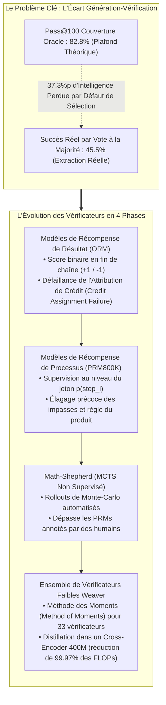
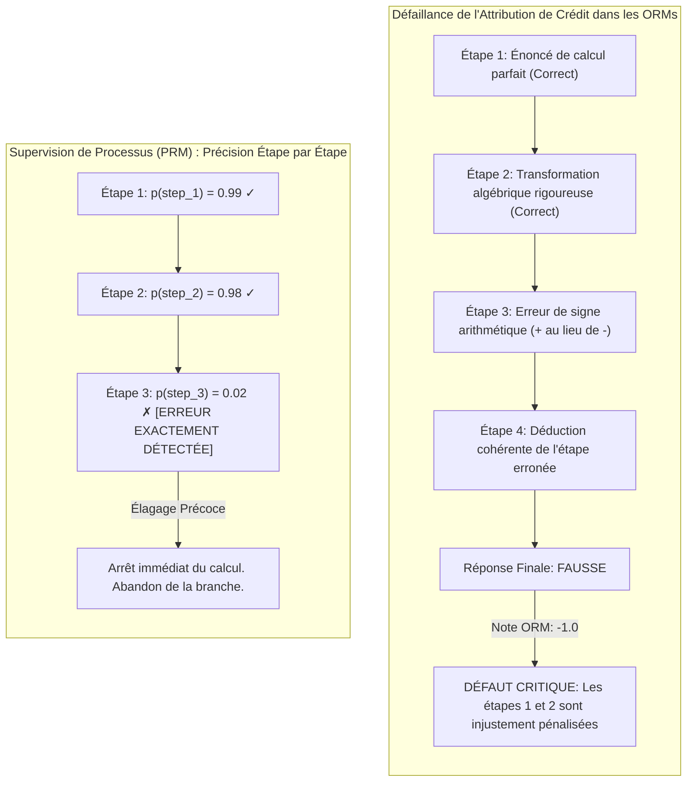
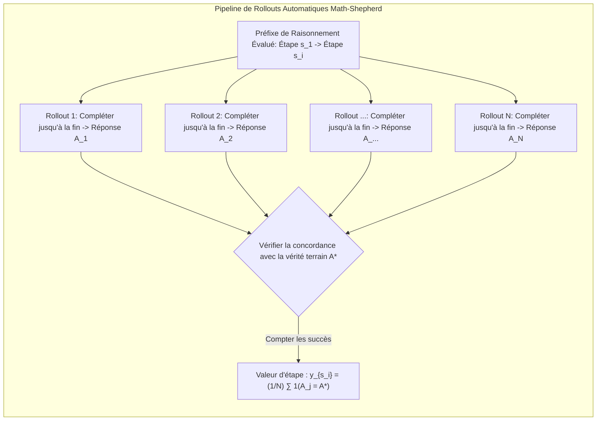
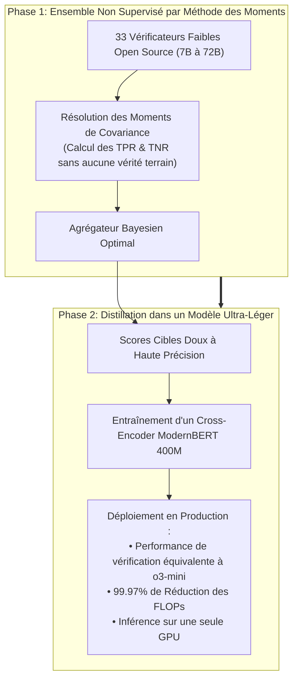

Bienvenue dans le troisième volet de notre analyse technique approfondie du cours de cycle supérieur de l'**Université de Stanford, CS329A : Self-Improving AI Agents (Automne 2025)**.

Lors du Cours 2, nous avons exploré la mise à l'échelle du calcul à l'inférence et dégagé un constat implacable : bien que la génération de milliers de trajectoires ($pass@k$) porte la couverture théorique au-delà de 99 %, ce réservoir reste inexploitable sans un vérificateur (Verifier) de haute précision. En appliquant un vote à la majorité naïf, la précision plafonne rapidement.

Aujourd'hui, nous étudions le sous-système architectural qui brise ce verrou : **la Vérification Robuste (Robust Verification)**.

Un mathématicien ou un ingénieur logiciel résout rarement une énigme complexe d'un seul jet linéaire ; il pose une étape, en vérifie la validité algébrique, rectifie une erreur de signe et procède à un retour arrière (backtracking) avant de poursuivre. À l'inverse, les modèles de langage autorégressifs standards projettent leurs jetons exclusivement vers l'avant. Dès qu'un premier dérapage survient, le modèle échafaude des hallucinations de plus en plus sophistiquées pour justifier son erreur initiale.

Comment concevoir des vérificateurs indépendants capables d'auditer les étapes de raisonnement intermédiaires, d'isoler les sophismes et de guider les agents vers des solutions prouvées – sans exiger des millions de dollars d'annotation humaine ?

Des travaux fondateurs de Cobbe et al. (GSM8K, OpenAI, 2021) à la supervision de processus de Lightman et al. (PRM800K, 2023), en passant par les rollouts de Monte-Carlo automatisés de *Math-Shepherd* (Yu et al., 2023) et le cadre d'ensemble *Weaver* (NeurIPS 2025), nous allons décortiquer l'état de l'art de l'**Ingénierie des Vérificateurs**.



{/* truncate */}

---

### 1. L'Écart Génération-Vérification : Formalisation Mathématique du Goulot d'Étranglement

Avant d'analyser les topologies de vérificateurs, formalisons l'écart entre le potentiel de génération et le rendement d'extraction effectif :

```text
Gap(K) = Pass@K - Actual_Success_Rate
```

Sur des bancs d'essai rigoureux comme GPQA Diamond, des modèles open-weights comme `Llama-3.3-70B-Instruct` atteignent un $Pass@100$ de **82,8 %**. Cela prouve que dans plus de 8 cas sur 10, au moins une démonstration rigoureuse existe dans le lot de 100 candidats.

Cependant, en appliquant le traditionnel **Vote à la Majorité (Majority Voting)** sur ces 100 solutions, la précision s'effondre à **45,5 %**.

```
Précision (%)
 ▲
100│                                     ┌────────────── Pass@100 Frontière Oracle (82.8%)
 90│                                ┌────┘
 80│                           ┌────┘
 70│                      ┌────┘
 60│                 ┌────┘
 50│            ┌────┘ ◄── 37.3%p d'Intelligence Perdue
 40│  ──────────┴──────────────────────── Palier du Vote à la Majorité (45.5%)
 30│
 20│
 10│
  0└┴────────────────────────────────────────────────► Budget d'Échantillons K
```

Ce sont **37,3 points de pourcentage d'intelligence latente qui s'évaporent**, simplement en raison d'un mauvais tri. Lorsque plusieurs raisonnements erronés convergent vers un même leurre séduisant (Plausible Distractor), les heuristiques de fréquence retiennent des faux positifs.

#### La Genèse des Vérificateurs Découplés : Cobbe et al. (GSM8K, 2021)
Pour combler cette faille, Karl Cobbe et l'équipe d'OpenAI ont publié le benchmark **GSM8K** et proposé l'architecture à **vérificateur indépendant** :

1. **Poids Découplés :** Générateur et vérificateur ne partagent pas leurs poids à l'inférence. Le générateur est affiné sur seulement 2 époques pour préserver l'entropie d'échantillonnage ; le vérificateur est entraîné sur les solutions générées.
2. **Têtes de Valeur au Niveau du Jeton :** Au lieu de noter uniquement la fin du texte, une tête de régression linéaire est branchée sur chaque jeton du Transformer :
   ```text
   V(t_i) = W_v · h_L(t_i) + b_v
   ```
   La perte globale conjugue modélisation du langage et erreur quadratique moyenne (MSE) :
   ```text
   L_total = L_LM(θ) + λ · || V(t_end) - y_true ||^2
   ```
3. **Le Dividende de Paramètres 30x :**
   * Un **vérificateur compact de 6B paramètres** sélectionnant la meilleure réponse parmi 100 candidats a égalé la précision d'un **modèle géant de 175B**.
   * Découpler génération et vérification a procuré un gain d'efficacité équivalant à un facteur **30x en taille de modèle**.

---

### 2. Supervision de Résultat vs Processus : Lightman et al. (PRM800K)

Bien qu'innovant, le vérificateur de Cobbe demeurait bridé par la **Supervision de Résultat (Outcome Reward Models, ORMs)**.

En mai 2023, Hunter Lightman et OpenAI ont publié une contribution majeure : **《Let's Verify Step by Step》** (Lightman et al., 2023).



#### Le Problème d'Attribution de Crédit (Credit Assignment Problem)
Considérons une démonstration mathématique en 10 étapes :
* **Le Piège du Faux Négatif :** Le modèle raisonne impeccablement des étapes 1 à 6. À l'étape 7, une étourderie de calcul fausse le résultat final.
  * *Verdict de l'ORM :* Assigne $-1$. Les déductions brillantes des étapes 1 à 6 sont sanctionnées, corrompant le signal d'entraînement.
* **Le Piège du Faux Positif (Succès Fortuit) :** À l'étape 3, le modèle commet une grossière erreur de logique, mais à l'étape 8, une seconde bévue annule la première, menant par chance au bon entier.
  * *Verdict de l'ORM :* Assigne $+1$. Le modèle est récompensé pour une logique absurde, favorisant le piratage de récompense (Reward Hacking).

Ce défaut d'attribution temporelle de crédit constitue le frein majeur au scaling des ORMs.

#### Formulation Mathématique des PRMs
Lightman et al. ont compilé **PRM800K**, un corpus de 800 000 annotations humaines pas à pas sur 75 000 solutions du benchmark MATH.

Leur astuce méthodologique consistait en la **Règle d'Arrêt au Premier Erreur** : les annotateurs cessaient leur lecture dès la première faille logique, les étapes suivantes étant sans valeur épistémique.

Le PRM estime la probabilité que l'étape $s_i$ soit correcte :

```text
p(s_i) = σ( W_p · h_L( Token_{\text{newline}, i} ) )
```

La note synthétique attribuée à la trajectoire $S = (s_1, s_2, ..., s_M)$ s'obtient via la **Règle du Produit** :

```text
Score_PRM(S) = ∏_{i=1}^M p(s_i \text{ is correct})
```

#### Supériorité Démontrée des PRMs
Sur le benchmark MATH sous recherche Best-of-N jusqu'à $N = 1 860$ :

```text
┌───────────────────────────────┬──────────────┬──────────────┬─────────────┐
│ Stratégie de Sélection        │ Best-of-1    │ Best-of-100  │ Best-of-1860│
├───────────────────────────────┼──────────────┼──────────────┼─────────────┤
│ Vote à la Majorité            │ 52.4%        │ 68.3%        │ 69.6%       │
│ Modèle de Résultat (ORM)      │ 52.4%        │ 70.1%        │ 72.4%       │
│ Modèle de Processus (PRM)     │ 52.4%        │ 74.8%        │ 78.2%       │
└───────────────────────────────┴──────────────┴──────────────┴─────────────┘
```

1. **Trajectoires de Scaling Divergentes :** Alors que le vote et les ORMs s'essoufflent vers $N = 100$, la précision du PRM progresse de façon monotone sur des milliers d'échantillons.
2. **Taxe d'Alignement Négative :** Contrairement au RLHF classique qui sacrifie parfois l'agilité mathématique (la fameuse « taxe d'alignement »), la supervision de processus renforce la transparence et la sécurité tout en maximisant la performance brute.

---

### 3. Supervision Autonome : Math-Shepherd et Rollouts de Monte-Carlo

Malgré les résultats de PRM800K, une contrainte rédhibitoire persistait : **l'annotation humaine de 800 000 étapes est financièrement insoutenable**.

Fin 2023, Yu, Shen, Zhou et al. ont proposé **Math-Shepherd**, un pipeline d'annotation automatique inspiré de la recherche arborescente de Monte-Carlo (MCTS).



#### L'Intuition Algorithmique
La machine évalue la machine :
> Si une étape intermédiaire $s_i$ est mathématiquement fondée, poursuivre la résolution $N$ fois depuis ce point doit fréquemment aboutir à la réponse exacte $A^*$. Si $s_i$ est erronée, les terminaisons n'atteindront presque jamais $A^*$.

#### Estimation Dure vs Douce
Math-Shepherd introduit deux cibles de supervision :

1. **Estimation Dure (Hard Estimation, HE) :** Vaut $+1$ si au moins l'un des $N$ rollouts atteint la bonne réponse, $0$ sinon :
   ```text
   y^{HE}_{s_i} = 1( ∃ j \in {1, ..., N} : A_j = A^* )
   ```
2. **Estimation Douce (Soft Estimation, SE) :** Fréquence empirique de réussite parmi les $N$ rollouts, sous forme de probabilité continue :
   ```text
   y^{SE}_{s_i} = (1 / N) · ∑_{j=1}^N 1( A_j = A^* )
   ```

#### Le Résultat : Les Données Synthétiques Battent les Humains
Math-Shepherd a généré **1,7 million d'étapes annotées** (plus du double de PRM800K) à coût humain nul.

* **Humains vs Machines :** Sur des modèles LLaMA ouverts, un PRM entraîné avec Math-Shepherd a **surpassé PRM800K sur le benchmark MATH**.
* **Origine du Gain :** Les humains de PRM800K n'ont noté que du GPT-4, ignorant les particularités d'autres modèles. Math-Shepherd s'est entraîné directement sur les distributions natives du modèle cible.
* **RL avec Récompenses de Processus :** En appliquant un entraînement PPO avec les récompenses de Math-Shepherd, `Mistral-7B` est passé de 28,6 % à **43,5 % sur MATH**.

---

### 4. Théorie des Ensembles : Le Cadre Weaver (NeurIPS 2025)

Même avec Math-Shepherd, un vérificateur individuel compact de 7B ou 13B commet des erreurs résiduelles. Déployer des modèles de 70B en production est cependant hors de prix.

Des chercheurs de Stanford et d'UW-Madison ont résolu ce compromis lors de NeurIPS 2025 : **《Weaver: Shrinking the Generation-Verification Gap with Weak Verifiers》** (Zhang et al., 2025).



#### Agrégation sans Supervision par la Méthode des Moments
Weaver rassemble 33 vérificateurs imparfaits (de 7B à 72B). Dans un contexte sans vérité terrain, **à quel vérificateur accorder sa confiance ?**

Weaver modélise le problème sous forme d'un **Modèle Naive Bayes à Variable Latente** :
* La correction réelle `Y in {0, 1}` est une variable latente inconnue.
* Chaque vérificateur `k` possède une sensibilité (``w_{k,1}``) et une spécificité (``w_{k,0}``) inconnues :
  ```text
  `w_{k,1}` = P(S_k = 1 | Y = 1), \quad `w_{k,0}` = P(S_k = 0 | Y = 0)
  ```
* Sous hypothèse d'indépendance conditionnelle sachant $Y$, la probabilité conjointe que deux vérificateurs s'accordent s'exprime sous forme d'équations de covariance.

Grâce à la **Méthode des Moments (Method of Moments)**, Weaver inverse ce système et **détermine les poids de fiabilité exacts ``(`w_{k,1}`, `w_{k,0}`)`` des 33 vérificateurs sans la moindre étiquette** de référence.

La probabilité a posteriori bayésienne optimale s'écrit :

```text
P( Y=1 | S_1, ..., S_K ) = 1 / ( 1 + exp( - ( l_0 + ∑_{k=1}^K l_k(S_k) ) ) )
```

#### Résultats Phares
1. **Dépassement d'OpenAI o3-mini :**
   * En combinant `Llama-3.3-70B-Instruct` avec l'ensemble Weaver sur des épreuves STEM compétitives, le score final atteint **87,7 %**.
   * Cela bat nettement les modèles propriétaires de pointe, dont **OpenAI o3-mini (86,7 %) et GPT-4o (69,0 %)**.
2. **Distillation dans un Cross-Encoder de 400M :**
   * L'équipe a distillé les prédictions d'ensemble dans un modèle **`ModernBERT-Large` de 400M paramètres**.
   * Ce modèle élève a préservé **98,7 % de la précision de l'ensemble complet** tout en **diminuant les calculs (FLOPs) de 99,97 %**, rendant l'évaluation en direct possible sur une seule carte graphique standard.

---

### 5. Guide d'Ingénierie : Grille de Conception pour Vérificateurs Industriels

Recommandations issues du Cours 3 :

```text
┌────────────────────────────────────────────────────────────────────────┐
│             Checklist d'Architecture pour Vérificateurs Industriels    │
├────────────────────────────────────────────────────────────────────────┤
│ 1. Domaines Clos Déterministes (Code, Preuves Formelles) :             │
│    • Déployer des compilateurs et tests unitaires en oracles stricts.  │
│    • ORMs adossés à des bacs à sable d'exécution (gVisor / Docker).    │
│                                                                        │
│ 2. Domaines de Déduction Ouverts (Analyse Financière, Contrats) :      │
│    • PRMs entraînés par rollouts automatisés (Math-Shepherd).          │
│    • Notation des candidats via la Règle du Produit.                   │
│    • Élagage précoce des étapes sous le seuil p < 0.2.                 │
│                                                                        │
│ 3. Maîtrise des Coûts et de la Latence :                               │
│    • Construction hors-ligne d'un ensemble via la Méthode des Moments. │
│    • Distillation vers un cross-encoder inférieur à 1B de paramètres.  │
│    • Inférence en moins de 10 ms sur une GPU individuelle.             │
└────────────────────────────────────────────────────────────────────────┘
```

---

### 6. Résumé et Principes Clés

1. **La Sélection Fixe le Plafond :** Le goulot d'étranglement n'est plus la génération mais la sélection. Pour effacer les 30 % de déficit de sélection, un vérificateur découplé est obligatoire.
2. **Avantage Majeur du PRM :** Les ORMs échouent sur les chaînes de raisonnement par défaut d'attribution de crédit. Seuls les PRMs étape par étape permettent un scaling stable sur des milliers d'échantillons.
3. **Triomphe de l'Auto-Supervision :** L'annotation humaine est dépassée ; les rollouts de Monte-Carlo (Math-Shepherd) génèrent gratuitement des données alignées sur les biais propres au modèle.
4. **Ensemble & Distillation :** L'estimation par les moments (Weaver) surclasse les modèles monolithiques, et la distillation dans un modèle 400M supprime 99,97 % de la facture de calcul.

---

### Au Programme du Cours 4 de Stanford CS329A :
Lors du **Cours 4**, nous confronterons l'agent au juge suprême : le retour d'exécution du monde numérique : **《Tool Use & Code Feedback : Compilateurs, Bacs à Sable et Boucles d'Autocorrection》**. Nous analyserons comment un agent dialogue avec des interpréteurs Python et des terminaux Bash pour corriger lui-même son code. À très bientôt !