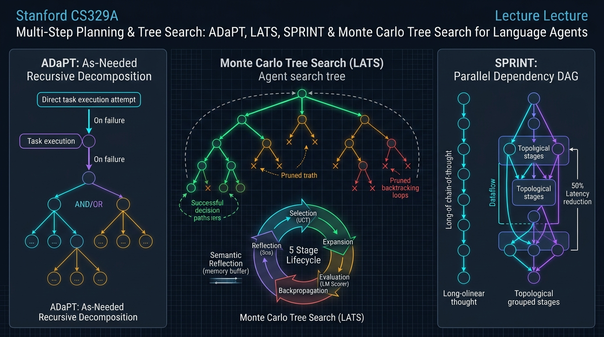
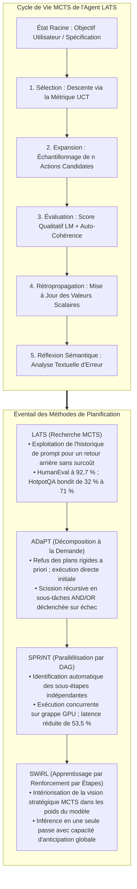
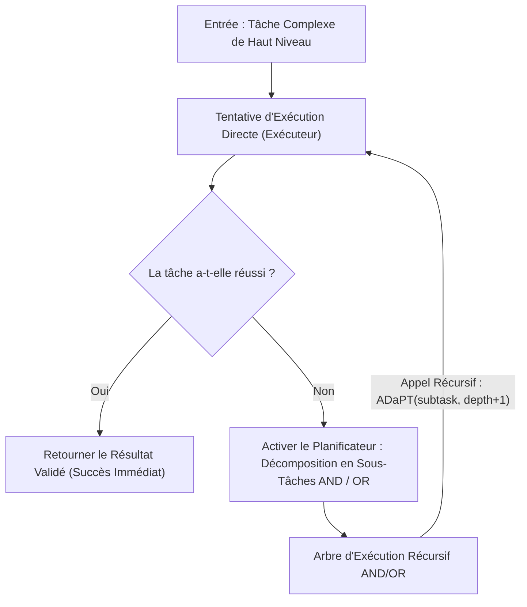
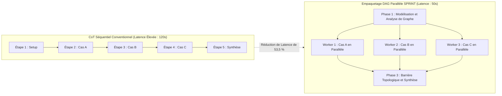

Bienvenue dans le cinquième volet de notre analyse technique approfondie du cours de master de l'**Université Stanford, CS329A: Self-Improving AI Agents (Automne 2025)**.

Dans le cours 4, nous avons vu comment les agents brisent les limites de la mémoire statique en interagissant avec des outils externes et en corrigeant leur code via les boucles de rétroaction de compilateurs (ReAct, RLEF). Cependant, résoudre une erreur de syntaxe locale est sans commune mesure avec la conception architecturale d'un système logiciel complexe de 100 000 lignes ou la résolution de problèmes scientifiques à long horizon.

Les approches conventionnelles basées sur ReAct ou les chaînes de pensée (CoT) sont intrinsèquement des **recherches gloutonnes à trajectoire unique (Greedy Single-Path)** : elles évaluent l'étape immédiatement suivante et avancent de façon irréversible. À l'image d'un joueur d'échecs débutant qui ne calcule que le coup suivant et se retrouve échec et mat trois tours plus tard, un modèle linguistique autorégressif qui commet une déduction initiale erronée se retrouve irrémédiablement piégé dans une impasse.

Le **cours 5** constitue le grand final de la **Partie 1 (Fondations)** du cursus de Stanford : **la Planification Multi-Étapes (Multi-Step Planning) et la Recherche Arborescente (Tree Search)**.

En intégrant le moteur algorithmique d'AlphaGo — la **Recherche Arborescente de Monte-Carlo (MCTS)** — aux modèles de langage autorégressifs, nous transformons des prédicteurs textuels réactifs en grands maîtres stratèges. Nous décortiquons des architectures capables d'anticiper des dizaines de coups à l'avance, d'élaguer dynamiquement les impasses, de revenir en arrière dans l'arbre décisionnel (Backtracking) et de paralléliser les flux de raisonnement :
1. **Unification de la déduction, de l'action et de la planification :** Language Agent Tree Search (**LATS**, Zhou et al., 2023).
2. **Décomposition récursive à la demande :** Découpage modulaire déclenché uniquement en cas d'échec via **ADaPT** (Allen AI, 2023).
3. **Parallélisation par DAG de dépendances :** Réduction de la latence d'inférence de 53,5 % via **SPRINT** (Stanford Future Data, 2025).
4. **Bifurcation adaptative par échantillonnage de Thompson :** Résolution du dilemme largeur/profondeur avec **AB-MCTS** (Sakana AI, 2025).
5. **Intériorisation de la planification dans les poids neuronaux :** **SWiRL** (Step-Wise RL, 2025).



{/* truncate */}

---

### 1. Le Piège Glouton : Pourquoi la Trajectoire Unique Échoue sur les Longs Horizons

Pour des requêtes élémentaires, le décodage autorégressif glouton ou une chaîne de pensée (CoT) classique suffisent, car l'espace de recherche est dense et tolérant. En revanche, dès que la profondeur des décisions interconnectées s'accroît ($H > 10$), le traitement séquentiel subit une **propagation exponentielle des erreurs** :

```text
P(Succès) = ∏_{t=1}^H P(Action_Correcte_t | Historique_{<t})
```

Même si chaque étape de déduction ou appel d'outil individuel affiche une précision respectable de 90 %, la probabilité de succès globale d'un agent engagé dans un projet logiciel en 15 étapes s'effondre de manière dramatique :

```text
P(Succès) = 0.90^{15} ≈ 0.2059  (Taux de Succès Global d'environ 20,6 %)
```

Dans les modèles autorégressifs standards, lorsqu'une décision erronée intervient à $t=3$, les tokens défectueux s'ancrent définitivement dans le contexte. Le modèle ne possède aucun mécanisme natif pour remonter le temps et rejeter les embranchements improductifs. Pour atteindre une réelle autonomie, les agents doivent opérer sur un **Arbre de Recherche d'États (Search Tree of States)**.

---

### 2. Fusion des Agents de Langage et du MCTS : LATS (Zhou et al., 2023)

Dans les jeux classiques comme le Go ou les Échecs, le MCTS s'appuie sur un moteur de jeu déterministe (le Modèle du Monde) pour simuler des futurs virtuels. Comment un agent peut-il simuler des scénarios futurs dans des domaines ouverts comme la programmation ou la recherche sans simulateur physique formalisé ?

L'intuition fondatrice de **LATS (Zhou et al., 2023, UIUC et Google DeepMind)** a été d'identifier une propriété structurelle des modèles de langage :

> **« Chez un agent de langage, tout état de l'environnement est intégralement matérialisé par l'historique textuel de son prompt. Revenir à un état décisionnel antérieur ne nécessite aucun simulateur complexe : il suffit de réinjecter le texte du prompt correspondant à cet instant passé pour permettre au modèle d'explorer une voie alternative ! »**

Les LLMs offrent une **réversibilité d'état parfaite (Backtracking) sans aucun surcoût matériel**.

#### Le Cycle en 5 Phases de LATS

LATS attribue à un unique LLM trois rôles complémentaires — **Acteur (Agent)**, **Évaluateur (Critique)** et **Réflecteur (Analyste Rétrospectif)** — à travers cinq phases itératives :

```text
                           [ Racine : Objectif Utilisateur ]
                                          │
                         1. Sélection (Formule UCT)
                                          ▼
                            [ Nœud Prometteur s ]
                                          │
                         2. Expansion (Échantillonnage de n actions)
                                          ▼
                          [ Exécution en Sandbox & Obs ]
                                          │
                         3. Évaluation (Score LM + SC)
                                          ▼
                         4. Rétropropagation (Mise à Jour)
                                          │
                         5. Réflexion (Sur Échec : Critique Sémantique)
```

#### 1. Sélection via la Formule UCT (Upper Confidence Bound for Trees)
Depuis la racine, LATS descend dans l'arbre en sélectionnant à chaque étape le nœud enfant qui maximise le score UCT, assurant l'équilibre parfait entre exploitation des branches performantes et exploration des nœuds peu visités :

```text
UCT(s) = V(s) + w * sqrt( ln N(p) / N(s) )
```

Où :
* $V(s)$ représente la valeur moyenne estimée de l'état $s$.
* $N(s)$ est le compteur de visites de l'état $s$.
* $N(p)$ est le compteur de visites du nœud parent $p$.
* $w$ est le coefficient de pondération de l'exploration (usuellement $w = sqrt(2)$).

#### 2. Expansion
Arrivé à un nœud feuille $s$, l'agent échantillonne $n$ actions candidates distinctes $`a^(1), ..., a^(n)`$. Chaque action est soumise à un bac à sable sécurisé (ex. REPL Python ou terminal), produisant les observations réelles correspondantes $`o^(1), ..., o^(n)`$.

#### 3. Évaluation de la Valeur
La récompense scalaire $V(s)$ est synthétisée à partir d'une notation qualitative et d'un score d'auto-cohérence :

```text
V(s) = λ * LM_Score(s) + (1 - λ) * Self_Consistency(s)
```

* **`LM_Score(s)` :** Le modèle évalue la cohérence logique de la trajectoire sur une échelle de 1 à 10 en analysant les retours de l'environnement.
* **`Self_Consistency(s)` :** Fréquence à laquelle des trajectoires multiples issues de l'état $s$ aboutissent à la même conclusion finale.

#### 4. Rétropropagation
Le gain scalaire $r$ obtenu à la feuille est propagé le long de la branche jusqu'à la racine, révisant incrémentalement les compteurs de visite et les moyennes de valeur :

```text
N(s_i) = N(s_i) + 1
V(s_i) = ( V(s_i)_old * N(s_i)_old + r ) / N(s_i)_new
```

#### 5. Réflexion Sémantique (Semantic Reflection)
Lorsqu'un chemin aboutit à une impasse (erreur d'assertion ou blocage environnemental), le MCTS classique se contente d'appliquer une pénalité brute ($r = -1$). LATS y adjoint la **Réflexion Sémantique** :
Le modèle est interrogé : *« Pour quelle raison cette tentative a-t-elle échoué ? Quelle prémisse était fausse ? »*.
L'analyse textuelle produite est archivée dans un tampon de mémoire épisodique et réinjectée dynamiquement dans le prompt système des itérations futures, immunisant l'agent contre la répétition de la même erreur.

#### Succès Éclatants sur les Benchmarks
* **HotpotQA (Raisonnement Complexe Multi-Sauts) :** ReAct plafonnait à 32,0 %. LATS a propulsé le score à **71,0 %** (plus du doublement de la précision).
* **HumanEval (Génération de Code Python) :** LATS a enregistré un record de **92,7 % Pass@1**, battant les approches précédentes comme Reflexion (91,0 %) et les modèles de base (80,1 %).
* **Analyses d'Ablation :** La substitution du MCTS par une recherche en profondeur simple (DFS) a fait chuter la réussite à 42 %, démontrant le caractère incontournable de la sélection UCT.

---

### 3. Décomposition Récursive à la Demande : ADaPT (Allen AI, 2023)

Tandis que LATS se focalise sur l'exploration horizontale de trajectoires parallèles, **ADaPT (Allen Institute for AI, 2023)** domine la réduction verticale de la complexité des tâches.

Les cadres classiques « Planifier et Exécuter » dressent des plannings rigides de 10 étapes avant de commencer. Pourtant, si l'étape 2 rencontre une anomalie imprévue, les 8 étapes suivantes deviennent immédiatement obsolètes.

ADaPT calque la démarche pragmatique des développeurs expérimentés :

> **« Ne sur-planifiez jamais en amont. Confiez d'abord l'intégralité de la tâche complexe à un unique Exécuteur (Executor). Ce n'est que si celui-ci échoue et signale son impuissance que le Planificateur (Planner) intervient pour décomposer récursivement l'objectif en 3 à 5 sous-tâches modulaires. »**



#### Moteur d'Exécution Récursive AND / OR

ADaPT modélise le plan via des opérateurs logiques :
* **Nœuds AND :** Sous-tâches séquentielles qui doivent toutes réussir (ex. `Collecte` $\to$ `Transformation` $\to$ `Écriture DB`).
* **Nœuds OR :** Hypothèses exploratoires alternatives où le succès d'une seule branche valide la mission (ex. `Vérifier Cache Local` OR `Interroger API Distante`).

#### Efficacité Opérationnelle
* Sur les tâches de manipulation complexe d'ALFWorld (*Pick2*), les agents ReAct ont échoué en dessous de 12 % de succès, tandis qu'ADaPT a atteint **52,9 %**.
* En résolvant les cas triviaux en une seule passe et en n'approfondissant que les blocages réels, ADaPT a diminué la consommation totale de tokens de **plus de 40 %** par rapport aux approches de planification statique.

---

### 4. L'Autoroute Parallèle de la Déduction : SPRINT (Stanford Future Data, 2025)

Début 2025, les modèles de raisonnement long (tels que DeepSeek-R1) ont prouvé que l'intensification du calcul à l'inférence débloquait des capacités inédites. Cependant, l'intégration industrielle s'est heurtée à un écueil majeur : **des temps de réponse atteignant deux minutes par requête**.

L'équipe **SPRINT** du laboratoire Stanford Future Data a examiné ces longues chaînes textuelles et a mis en évidence un gaspillage structurel :

> **« Les modèles autorégressifs génèrent des milliers de tokens à la queue leu leu. Pourtant, d'un point de vue causal, vérifier le Lemme A, examiner le Cas B et analyser la Réfutation C sont des opérations strictement indépendantes. Pourquoi les contraindre à attendre en série alors qu'elles peuvent être regroupées dans un DAG parallèle ? »**



#### L'Algorithme d'Empaquetage Topologique

SPRINT modélise le raisonnement sous la forme d'un Graphe Aciclique Dirigé (DAG). En analysant les dépendances causales $D$, l'algorithme attribue à chaque sous-étape $S_i$ un niveau topologique $\sigma(S_i)$ :

```text
σ(S_i) = {
    1,                                                         (si Parents(S_i) = ∅)
    max_{S_p ∈ Parents(S_i)} ( σ(S_p) + 1[ E_p ≠ ∅ ] ),        (dans les autres cas)
}
```

Toutes les étapes partageant le même rang topologique $\sigma$ sont distribuées simultanément sur plusieurs nœuds GPU et **exécutées en parallèle**. Une barrière de synchronisation agrège les retours avant d'activer l'étape de planification suivante :

```text
Planification  ──►  Distribution Parallèle  ──►  Synchronisation  ──►  Re-Planification
```

#### Résultats : Précision Rehaussée et Latence Divisée par Deux
* Sur le banc d'essai mathématique **MATH-500**, la précision est passée de **89,1 % à 92,5 %** par rapport à l'exécution séquentielle (grâce à la validation croisée entre branches parallèles).
* Parallèlement, le délai d'attente utilisateur s'est réduit de **53,5 %**, ramenant des résolutions complexes de 120 secondes à moins de 50 secondes.

---

### 5. Exploration Adaptative et Ancrage Synaptique : AB-MCTS et SWiRL

L'industrialisation de la recherche arborescente s'articule aujourd'hui autour de deux axes d'avant-garde :

#### 1. AB-MCTS : Le Dilemma Largeur / Profondeur (Sakana AI, 2025)
Le MCTS conventionnel repose sur des facteurs de branchement prédéfinis. **AB-MCTS (Adaptive Branching MCTS)** arbitre dynamiquement entre creuser une idée ou explorer de nouvelles options grâce à **l'échantillonnage de Thompson** :
* Sélectionner un nœud existant poursuit l'analyse en profondeur (*Deeper*).
* Sélectionner l'action virtuelle `GEN` génère une nouvelle branche sœur, élargissant le spectre de recherche (*Wider*).
* En modélisant les gains sous forme de distributions de probabilité a posteriori, AB-MCTS franchit les étapes évidentes en 1 ou 2 tours et concentre la recherche sur les verrous critiques.

#### 2. SWiRL : Imprimer la Prévoyance dans les Poids Neuronaux (2025)
Déployer un arbre MCTS complet à chaque inférence est financièrement lourd. **SWiRL (Step-Wise Reinforcement Learning)** internalise cette capacité de recherche :
* Il segmente les trajectoires en transitions individuelles et utilise des modèles de récompense génératifs pour noter la pertinence logique des plans intermédiaires.
* Par optimisation PPO par étapes, le modèle apprend à **simuler implicitement des arbres de recherche dans ses propres activations**, délivrant une vision stratégique remarquable en une seule passe d'inférence.

---

### 6. Architecture Industrielle : Maillage Hiérarchique de Planification MCTS

Déployer un moteur de planification MCTS en production requiert une architecture modulaire assortie de garde-fous stricts :

```text
┌────────────────────────────────────────────────────────────────────────┐
│             Architecture Industrielle de Planification MCTS            │
├────────────────────────────────────────────────────────────────────────┤
│                                                                        │
│  [ Objectif Métier / Spécification PRD ]                               │
│          │                                                             │
│          ▼                                                             │
│  ┌──────────────────────────────────────────────────────────────────┐  │
│  │                  Orchestrateur de Planification Adaptative       │  │
│  │  • Phase 1 : Tentative Directe en Passe Unique (Coût MCTS = 0)   │  │
│  │  • Phase 2 : En Cas d'Échec -> Décomposition ADaPT AND/OR        │  │
│  │  • Phase 3 : Tâches Ambiguës -> Lancement de l'Arbre MCTS LATS   │  │
│  └───────────────────┬──────────────────────────────▲───────────────┘  │
│                      │ DAG de Sous-Tâches           │ Signaux de Valeur│
│                      ▼                              │ des États        │
│  ┌──────────────────────────────────────────────────┴───────────────┐  │
│  │                     Distributeur Parallèle SPRINT                │  │
│  │  • Moteur de Tri Topologique et d'Analyse de Dépendances         │  │
│  │  • Grappe de Workers GPU Asynchrones (Modèles 7B/8B Économiques) │  │
│  │  • Barrière de Synchronisation et Consolidation de Contexte      │  │
│  ├──────────────────────────────────────────────────────────────────┤  │
│  │                     Garde-Fous et Disjoncteurs de Sécurité       │  │
│  │  • Élagage UCT (Suppression précoce des branches avec V < 0.2)   │  │
│  │  • Arrêt Anticipé (Fin dès validation à 100 % des tests unitaires)│ │
│  │  • Tampon de Mémoire Épisodique de Réflexion Sémantique          │  │
│  └──────────────────────────────────────────────────────────────────┘  │
│                                                                        │
└────────────────────────────────────────────────────────────────────────┘
```

#### Trois Règles d'Exploitation Indispensables
1. **Disjoncteur d'Arrêt Anticipé (Early-Stopping) :** Dès qu'une branche valide l'intégralité des tests déterministes (ex. 100 % de tests unitaires réussis), la recherche MCTS est immédiatement interrompue et la solution est délivrée.
2. **Distribution Hiérarchique des Modèles :** Confier l'échantillonnage volumineux des feuilles à des modèles légers (7B/8B) et réserver les modèles de pointe (70B+) exclusivement à la cotation des nœuds clés pour économiser plus de 80 % des coûts.
3. **Plafonds de Ressources :** Borner strictement la profondeur maximale ($`d_max` \le 6$) et le volume maximal d'itérations ($N \le 30$) pour prévenir tout emballement de facturation cloud.

---

### 7. Questions Techniques Clés et Enseignements Pratiques

**Q : Dans SPRINT, si des branches parallèles s'exécutent simultanément, une erreur dans une branche ne risque-t-elle pas de vicier la synthèse finale ?**
**A :** C'est précisément là que réside la rigueur de SPRINT. Le système ne parallélise pas à l'aveugle : il n'exécute de concert que les étapes **dépourvues de toute dépendance causale de données**. Si l'étape B nécessite les conclusions de l'étape A, le tri topologique garantit que B attendra la fin et la validation formelle de A. Par ailleurs, la confrontation des résultats lors de la synthèse opère comme un vote d'ensemble qui consolide la justesse globale (+3,4 points sur MATH-500).

**Q : En quoi la Réflexion Sémantique surpasse-t-elle la rétropropagation scalaire classique du MCTS ?**
**A :** Le MCTS numérique conventionnel ne propage que des moyennes chiffrées ($N, V$). Or, face à un script erroné, un chiffre n'explique ni *pourquoi* une boucle a échoué, ni *quelle* règle a été enfreinte. La Réflexion Sémantique consigne un bilan textuel dans la mémoire de travail de l'agent. Lors de futures traversées d'états conceptuels proches, cette note explicite oriente la politique pour contourner les écueils répertoriés.

---

### 8. Synthèse et Enseignements Majeurs

1. **Dépassement de la Déduction Gloutonne :** Les modèles autorégressifs accumulent fatalement des erreurs sur les tâches longues. Le MCTS leur confère des capacités d'exploration, d'élagage et de retour arrière indispensables.
2. **Réversibilité sans Surcoût via le Prompt :** LATS exploite le fait que l'historique du prompt constitue l'état intégral de l'agent, permettant un MCTS complet sans simulateur externe.
3. **Décomposition à la Demande :** ADaPT bannit les calendriers rigides, privilégie l'exécution directe et ne subdivise les missions en arbres AND/OR qu'en cas de défaillance avérée.
4. **Accélération par DAGs Parallèles :** SPRINT brise la contrainte séquentielle en empaquetant les étapes indépendantes dans des DAGs concurrents, réduisant la latence de 53,5 % tout en renforçant la précision.
5. **Intériorisation Synaptique :** SWiRL grave l'intuition tactique du MCTS directement dans les poids neuronaux via le renforcement par étapes, autorisant une planification stratégique en un seul passage.

---

### Félicitations : Partie 1 (Fondations) Validée !
Avec l'achèvement de ce cours 5, nous clôturons avec succès la **Partie 1 : Fondations (Cours 1 à 5)** de Stanford CS329A :
* **L1 :** La mutation des LLMs vers des agents autonomes auto-évolutifs.
* **L2 :** Lois d'échelle du calcul à l'inférence et lois de puissance de couverture.
* **L3 :** Vérification pas-à-pas avec les modèles PRM et ensembles Weaver.
* **L4 :** Utilisation d'outils (ReAct), rétroaction de code (RLEF) et IA Constitutionnelle.
* **L5 :** Planification MCTS (LATS), décomposition adaptative (ADaPT) et parallélisation DAG (SPRINT).

Nous maîtrisons désormais l'ensemble des fondements mathématiques permettant aux agents de penser, d'agir, de valider et de planifier.

Dans notre prochain épisode s'ouvrira la **Partie 2 : Entraînement et Évolution (Cours 6 à 9)**, franchissant un cap décisif : **comment les modèles mettent à jour leurs propres poids neuronaux via l'apprentissage par renforcement et les algorithmes évolutifs**.

Le prochain cours débutera avec :
**《Cours 6 : Train-Time Scaling & RL : DeepSeekMath, GRPO et Optimisation du Raisonnement à Grande Échelle》**.
Nous disséquerons l'algorithme Group Relative Policy Optimization (GRPO) pour comprendre comment s'affranchir des modèles critiques onéreux. Rendez-vous au prochain chapitre !