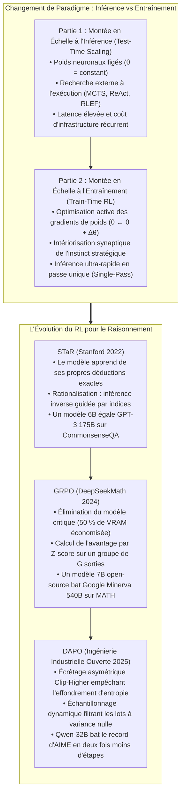
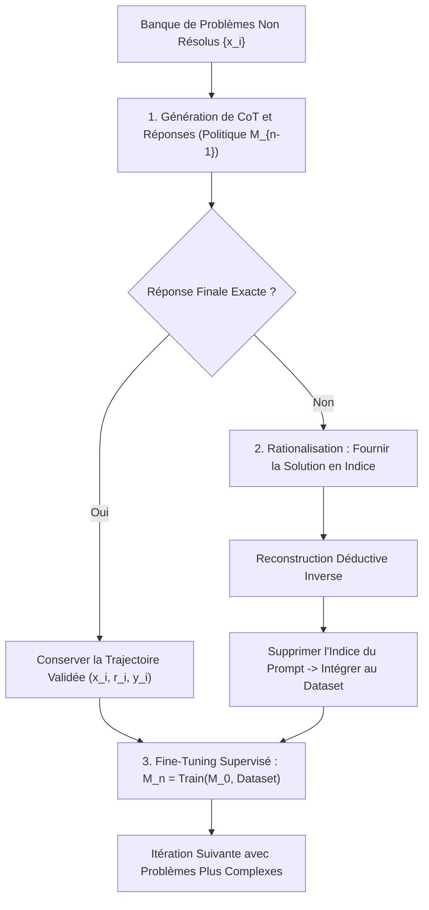
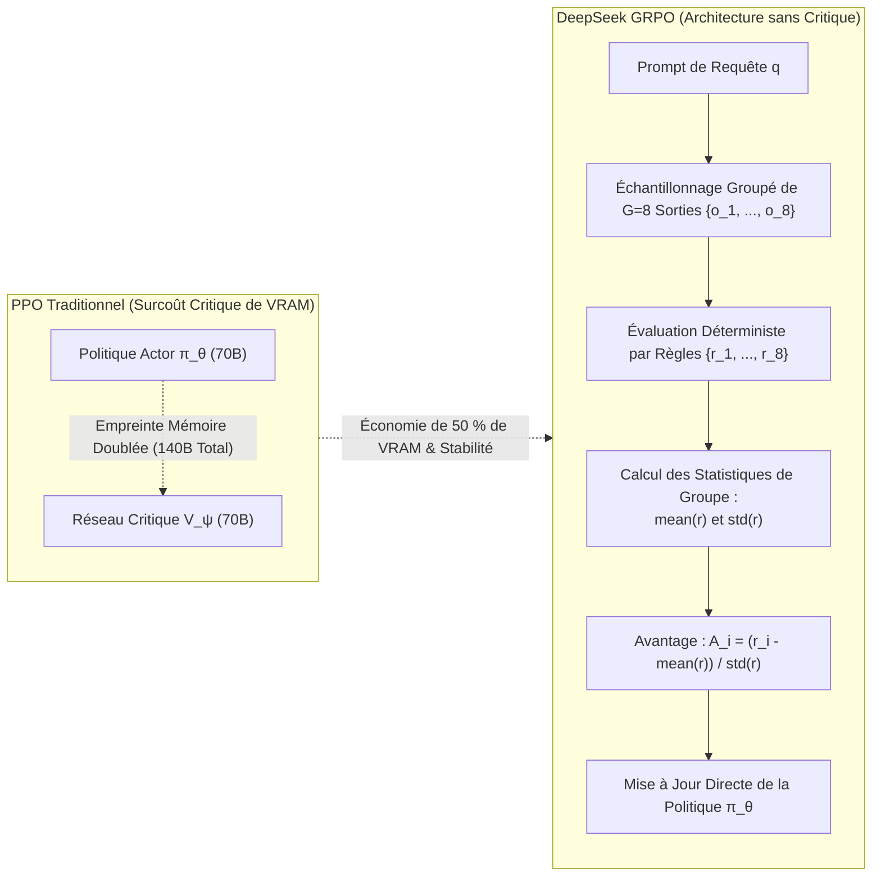

Bienvenue dans ce sixième volet de notre analyse technique consacrée au cours de master de l'**Université Stanford, CS329A: Self-Improving AI Agents (Automne 2025)**.

Tout au long des cours 1 à 5 (Partie 1 : Fondations), nous avons appris à tirer le potentiel maximal de modèles pré-entraînés figés en leur allouant du calcul lors de l'inférence (Test-time Compute) : déploiement d'arbres de recherche MCTS, intégration des erreurs de compilateur et filtrage par comités de vérificateurs.

Cependant, une vérité mathématique s'impose :
Accorder dix minutes supplémentaires à un élève de primaire lors d'un examen ne lui permettra pas d'établir une démonstration d'analyse infinitésimale. Si les connexions synaptiques figées d'un modèle (paramètres de poids, $\theta$) n'intègrent pas intrinsèquement les concepts mathématiques requis, générer 10 000 trajectoires ou recourir à des faisceaux de recherche ne relève pas de l'intelligence, mais de la pure chance stochastique.

Aujourd'hui débute la **Partie 2 : Entraînement et Évolution (Cours 6 à 9)**, répondant à la question fondamentale suivante :
> **« Plutôt que de gaspiller des ressources considérables à chaque inférence, comment investir un calcul massif durant l'entraînement pour réécrire définitivement les poids neuronaux du modèle et en faire un raisonneur d'élite ? »**

Dans ce **cours 6**, nous disséquons les trois piliers méthodologiques qui ont aboli les goulets d'étranglement de l'annotation humaine et révolutionné le raisonnement via **l'Apprentissage par Renforcement Post-Entraînement (Post-Training RL)** :
1. **L'auto-amorçage du raisonnement déductif :** Self-Taught Reasoner (**STaR**, Zelikman et al., Stanford 2022).
2. **La fin du modèle critique :** Group Relative Policy Optimization (**GRPO**, DeepSeekMath 2024).
3. **Le passage à l'échelle sur 1 000 GPUs :** Élagage découplé et échantillonnage dynamique (**DAPO**, 2025).



{/* truncate */}

---

### 1. Montée en Échelle à l'Entraînement vs Inférence : La Redistribution du Calcul

Pour comprendre pourquoi la recherche de pointe s'est massivement orientée vers le RL post-entraînement, il convient d'analyser l'équation de répartition du budget de calcul (FLOPs) :

```text
Compute_Total = Compute_Train + Compute_Inference
```

1. **Montée en échelle à l'inférence (Inference-Time Scaling) :** Le vecteur de paramètres $\theta$ demeure statique. Le calcul est mobilisé pour l'échantillonnage répété, la recherche par faisceaux et les arbres MCTS. Bien qu'efficace pour des requêtes isolées, cette méthode transfère une latence considérable et des coûts d'infrastructure permanents à chaque utilisateur final.
2. **Montée en échelle à l'entraînement (Train-Time Scaling) :** Le calcul est investi massivement en amont pour optimiser les poids $\theta$ via l'apprentissage par renforcement :

```text
θ* = argmax_θ E_{x ~ D, y ~ π_θ(·|x)} [ R(x, y) ]
```

Lorsque l'agent découvre des schémas déductifs supérieurs, la rétropropagation ancre directement ces stratégies dans les matrices d'attention et les couches denses. En production, le modèle manifeste alors **une vision stratégique digne d'un grand maître en une seule passe avant (Single Forward Pass), sans aucun mécanisme de recherche externe**.

---

### 2. Auto-Amorçage du Raisonnement : STaR (Zelikman et al., Stanford 2022)

Le fine-tuning supervisé (SFT) conventionnel réclame des dizaines de milliers d'exemples détaillés (Problème $\to$ Raisonnement $\to$ Réponse). Cependant, salarier des docteurs en mathématiques ou des architectes logiciels pour rédiger des millions de résolutions pas-à-pas est financièrement intenable.

En 2022, l'équipe d'Eric Zelikman à Stanford a posé une hypothèse audacieuse :
> **« Si nous pouvons vérifier de façon déterministe et automatisée l'exactitude de la réponse finale, pourquoi ne pas laisser le modèle formuler ses propres raisonnements, filtrer les chaînes ayant abouti à la solution exacte et réentraîner le modèle sur ses propres succès ? »**

Ainsi est né le **Self-Taught Reasoner (STaR)**.



#### Fondement Mathématique : Approximation du Gradient de Politique

STaR n'est pas un simple artifice empirique ; il s'agit d'une approximation discrète rigoureuse du gradient de politique (Policy Gradient) sous une fonction de récompense indicatrice $`1(y_hat = y*)`$ :

```text
∇_θ J(θ) = ∑_i E_{r_hat, y_hat ~ π_θ(·|x_i)} [ 1(y_hat = y_i*) * ∇_θ log π_θ(r_hat, y_hat | x_i) ]
```

Pour les trajectoires erronées, $\mathbb{1} = 0$, le gradient s'annule et l'échantillon est ignoré. Pour les trajectoires exactes ($\mathbb{1} = 1$), une montée de gradient classique par maximum de vraisemblance (MLE) opère, orientant continuellement la distribution du modèle vers des chaînes logiques vérifiées.

#### La Rationalisation : Bâtir des Ponts Déductifs Inverses

Une lacune évidente du filtrage naïf est l'incapacité du modèle à apprendre de problèmes qu'il échoue systématiquement à résoudre. En cas d'échec total, aucune donnée d'entraînement positive n'est produite.

STaR a contourné cet obstacle par la **Rationalisation** :
1. En cas d'échec, la solution exacte est ajoutée à la fin du prompt sous forme d'indice : *« Indice : La réponse finale est 42. Explique rétroactivement pourquoi 42 est mathématiquement nécessaire. »*
2. Connaissant l'aboutissement, le modèle parvient à reconstituer la passerelle causale inverse.
3. **L'étape décisive :** Avant d'intégrer l'exemple au corpus d'entraînement, **l'indice est intégralement supprimé du texte** :

```text
Entrée du Dataset : Prompt [ x_i ] ──► Raisonnement Cible [ r_inverse ] + Réponse [ y_i* ]
```

Le modèle s'entraîne comme s'il avait élaboré la démonstration sans aucune assistance, intériorisant les mécanismes d'inférence pour résoudre des cas similaires ultérieurement.

#### Résultats Éloquents
* Sur le banc d'essai **CommonsenseQA**, l'application de STaR à un modèle **GPT-J de seulement 6 milliards de paramètres** a porté sa précision de 60,0 % à **72,5 %**.
* Le modèle 6B a ainsi égalé les performances d'un **GPT-3 spécialisé de 175 milliards de paramètres (73,0 %)**, pourtant 30 fois plus volumineux.

---

### 3. La Disparition du Critique : DeepSeekMath et GRPO (2024)

Si STaR reposait sur un auto-amorçage supervisé, le véritable essor du RL en ligne pour le raisonnement complexe découle des travaux de l'équipe DeepSeek au printemps 2024 avec **DeepSeekMath et l'algorithme GRPO (Group Relative Policy Optimization)**.

#### L'Échec du PPO Conventionnel dans le Raisonnement Formel

L'algorithme standard PPO (Proximal Policy Optimization), utilisé à l'origine pour ChatGPT, requiert l'hébergement simultané de deux réseaux jumeaux en mémoire GPU :
1. Le **Réseau de Politique (Actor, $\pi_\theta$)**, émettant les tokens ;
2. Le **Réseau de Valeur (Critic, $V_\psi$)**, prédisant le gain attendu à chaque étape.

Entraîner un modèle Actor de 70B exige ainsi un modèle Critic de 70B, doublant les besoins en mémoire VRAM.
Plus grave encore, dans les démonstrations de plusieurs milliers de tokens où une note scalaire unique ($+1$ ou $-1$) intervient en toute fin, **ajuster un réseau de valeur précis pour chaque token intermédiaire est mathématiquement instable, provoquant des ruptures de gradient**.

#### La Révolution GRPO : Supprimer le Réseau de Valeur

L'équipe DeepSeek a adopté un parti pris radical :
> **« Pourquoi allouer des milliards de paramètres à un modèle de valeur ? Pour une requête `q`, échantillonnons un groupe de `G` réponses distinctes $`{o_1, ..., o_G}`$ avec la politique actuelle. Calculons la moyenne et l'écart-type de leurs récompenses et normalisons par Z-score. Ce classement statistique relatif constitue l'avantage (Advantage) parfait ! »**



#### Fonction Objectif Mathématique de GRPO

GRPO optimise la politique $\pi_\theta$ sous contrainte de divergence KL vis-à-vis d'un modèle de référence $`pi_ref`$, sans aucun modèle critique :

```text
J_GRPO(θ) = E_{q, {o_i}_{i=1}^G} [ 
    (1 / G) * ∑_{i=1}^G (1 / |o_i|) * ∑_{t=1}^{|o_i|} {
        min(
            ( π_θ(o_{i,t}) / π_old(o_{i,t}) ) * A_hat_{i,t},
            clip( π_θ(o_{i,t}) / π_old(o_{i,t}), 1 - ε, 1 + ε ) * A_hat_{i,t}
        )
    } - β * D_KL( π_θ || π_ref )
]
```

L'avantage `A_hat_{i,t}` associé à chaque solution `o_i` est calculé directement à partir des statistiques de groupe :

```text
A_hat_{i,t} = r_tilde_i = ( r_i - mean({r_1, ..., r_G}) ) / ( std({r_1, ..., r_G}) + δ )
```

#### Supervision par Résultat vs Supervision par Processus
1. **Supervision par Résultat (Outcome) :** Si la réponse finale de $o_i$ est juste, $r_i = +1$ ; sinon, $-1$. L'avantage standardisé `r_tilde_i` est dupliqué uniformément sur tous les tokens de la séquence.
2. **Supervision par Processus (Process) :** Des récompenses partielles sont octroyées à chaque étape, et la somme actualisée des gains futurs est attribuée à chaque token.

#### Triomphes sur les Benchmarks : 7B Surpasse 540B
* `DeepSeekMath-Base 7B`, pré-entraîné sur 120 milliards de tokens mathématiques, **a devancé le modèle Minerva 540B de Google**.
* L'adjonction de GRPO a propulsé le score sur le benchmark MATH de 46,8 % à **51,7 %**, marquant la première fois où un modèle 7B open-source a franchi la barre des 50 % sans recourir à un calculateur externe.
* Avec 64 échantillons d'auto-cohérence (Self-Consistency), la précision a atteint **60,9 %**.

---

### 4. Du Papier aux Grappes de 1 000 GPUs : DAPO (2025)

Toutefois, lorsque les laboratoires ont cherché à appliquer la formulation théorique de GRPO à des compétitions d'élite comme **AIME 2024**, ils se sont heurtés à un plafond inattendu :
* Alors que DeepSeek-R1-Zero culminait à 47 points sur AIME, les implantations ouvertes de GRPO plafonnaient à **environ 30 points**.

En mars 2025, le framework **DAPO (Decoupled Clip and Dynamic Sampling Policy Optimization)** a dévoilé quatre impératifs d'ingénierie indispensables pour stabiliser l'apprentissage à grande échelle :

```text
GRPO Naïf (30 pts) 
  ──► + Filtre de Longueur (36 pts) 
  ──► + Clip-Higher (38 pts) 
  ──► + Perte au Niveau Token (42 pts) 
  ──► DAPO Complet (50 pts, Surpassant DeepSeek-R1-Zero !)
```

#### Secret 1 : Écrêtage Asymétrique Clip-Higher ($`eps_low` = 0,20, `eps_high` = 0,28$)
* **Le Problème :** L'écrêtage symétrique ($\pm 0,2$) inhibe l'exploration. Lorsqu'un modèle formule un token de raisonnement rare mais innovant d'une probabilité initiale de 0,01, le plafond $1 + 0,2 = 1,2\times$ bride sa progression à 0,012, tandis qu'un token banal (0,9) progresse sans entrave.
* **La Conséquence :** Le modèle renonce aux pistes audacieuses et s'enferme dans un **effondrement d'entropie (Entropy Collapse)**, produisant des réponses stéréotypées.
* **La Solution DAPO :** Maintenir $`eps_low` = 0,20$ pour sanctionner les mauvaises pistes, mais relever le plafond à **$`eps_high` = 0,28$** (+40 %), offrant aux tokens exploratoires à haute valeur ajoutée la marge nécessaire pour s'imposer.

#### Secret 2 : Échantillonnage Dynamique (Filtrage des Lots Inertes)
* **Le Problème :** Si un exercice est trop élémentaire, les $G$ trajectoires réussissent ($r_i = 1$). S'il est inaccessible, les $G$ échouent ($r_i = 0$).
* Dans les deux cas, `formula`, l'avantage s'annule et **des milliers de processeurs calculent des gradients rigoureusement nuls**.
* **La Solution DAPO :** Éliminer systématiquement les lots ne satisfaisant pas `0 < Correct Rollouts < G`, garantissant que 100 % des calculs exploitent une variance informative réelle.

#### Secret 3 : Normalisation de la Perte au Niveau Token
Le moyennage par échantillon dilue les fautes graves au sein des déductions longues. DAPO normalise la fonction de perte sur la somme cumulée de tous les tokens $\sum_i |o_i|$, interdisant aux modèles d'échapper aux sanctions en produisant du remplissage textuel.

#### Secret 4 : Façonnement Progressif des Réponses Trop Longues
Lorsqu'un modèle approfondit sa réflexion, il risque d'atteindre le seuil maximal de contexte (ex. 16 384 tokens). Sanctionner ce dépassement d'une pénalité abrupte de $-1$ anéantit des raisonnements prometteurs. DAPO applique une décroissance linéaire douce sur les 4 096 derniers tokens, apprenant au modèle à conclure ses preuves dans les limites allouées.

---

### 5. Architecture Industrielle : Infrastructure Distribuée pour RL de Raisonnement

L'industrialisation de modèles entraînés par GRPO/DAPO impose une topologie de calcul découplée à haut débit :

```text
┌────────────────────────────────────────────────────────────────────────┐
│             Infrastructure Industrielle Distribuée pour GRPO/DAPO      │
├────────────────────────────────────────────────────────────────────────┤
│                                                                        │
│  [ Banque Curriculaire de Tâches (Mathématiques / Compilateurs) ]      │
│          │                                                             │
│          ▼                                                             │
│  ┌──────────────────────────────────────────────────────────────────┐  │
│  │                    Moteur de Lot et d'Échantillonnage Dynamique  │  │
│  │  • Équilibreur de Difficulté : Rejet des lots à 100% succès/échec│  │
│  │  • Optimisation et Bin-Packing selon la longueur de contexte     │  │
│  └───────────────────┬──────────────────────────────────────────────┘  │
│                      │ Lots à Forte Variance                           │
│                      ▼                                                 │
│  ┌──────────────────────────────────────────────────────────────────┐  │
│  │                    Flotte d'Inférence vLLM / TensorRT-LLM        │  │
│  │  • Nœuds Dédiés à la Génération Parallèle Asynchrone (G=8)       │  │
│  │  • Gestion de Mémoire KV-Cache Distribuée via PagedAttention     │  │
│  └───────────────────┬──────────────────────────────▲───────────────┘  │
│                      │ Traces Générées {o_1..o_G}   │ Poids            │
│                      ▼                              │ Synchronisés θ   │
│  ┌──────────────────────────────────────────────────┴───────────────┐  │
│  │                    Vérificateurs Déterministes par Règles        │  │
│  │  • Bacs à Sable Sécurisés Docker/gVisor (Python et SymPy)        │  │
│  │  • Validation de Structure de Balises `<think> ... </think>`     │  │
│  │  • Standardisation de l'Avantage de Groupe : A_i = (r - μ) / σ   │  │
│  └───────────────────┬──────────────────────────────────────────────┘  │
│                      │ Flux d'Avantages par Token                      │
│                      ▼                                                 │
│  ┌──────────────────────────────────────────────────────────────────┐  │
│  │                    Grappe d'Entraînement Megatron / DeepSpeed    │  │
│  │  • Modèle de Politique Unique (Sans modèle critique)             │  │
│  │  • Moteur de Gradient Asymétrique Clip-Higher (ε_high = 0.28)    │  │
│  │  • Optimisation de Perte par Token via FlashAttention-3          │  │
│  └──────────────────────────────────────────────────────────────────┘  │
│                                                                        │
└────────────────────────────────────────────────────────────────────────┘
```

#### Principes Directeurs en Exploitation
1. **Éviction Totale des Retours Humains du Bucle RL :** Ne former les modèles que sur des objectifs déterministes vérifiables (compilateurs, solveurs formels, tests unitaires). Ne jamais intégrer de jugements humains subjectifs dans le RL de raisonnement.
2. **Cloisonnement Matériel des Flottes :** Séparer physiquement les grappes d'inférence (vLLM) des grappes d'optimisation de gradient (Megatron-LM), reliées par des interconnexions RDMA ultra-rapides.
3. **Contraintes Strictes de Format :** Exiger le respect des balises `<think>` sous peine de pénalité de règle afin d'empêcher le modèle de deviner la solution sans étape de déduction.

---

### 6. Questions Techniques Clés et Enseignements Pratiques

**Q : Pourquoi la pénalité de divergence KL demeure-t-elle indispensable dans GRPO, et quand peut-on la relâcher ?**
**A :** Le terme KL ($\beta `D_KL`(\pi_\theta \parallel `pi_ref`)$) empêche le **piratage de récompense (Reward Hacking)** et l'oubli catastrophique. Sans ce garde-fou, l'agent produit rapidement des artefacts syntaxiques visant à duper l'analyseur de code. Cependant, pour favoriser l'émergence de longs raisonnements déductifs (comme sur DeepSeek-R1-Zero), les chercheurs fixent délibérément $\beta \to 0$ au tout début de l'entraînement afin de libérer l'exploration, avant de réintroduire une régularisation KL mesurée en phase de stabilisation.

**Q : Dans STaR, la Rationalisation n'incite-t-elle pas le modèle à tricher en se reposant sur les indices ?**
**A :** La sécurité réside dans la **dissociation chronologique stricte entre la génération de la trace et la mise à jour des poids**. L'indice n'est fourni que pour aider le modèle à rétablir la causalité lors de la phase d'écriture. Dès que la trajectoire est retenue, l'indice est **physiquement effacé du prompt**. Durant la descente de gradient, le réseau de neurones apprend la démonstration comme si elle avait été conçue sans aide extérieure.

---

### 7. Synthèse et Enseignements Majeurs

1. **La Frontière de l'Entraînement :** La recherche à l'inférence ne peut inventer ce que les synapses n'ont pas appris. La montée en échelle à l'entraînement grave les capacités de planification stratégique directement dans les poids neuronaux.
2. **Auto-Amorçage Validé :** STaR prouve que les modèles peuvent s'auto-entraîner en filtrant leurs propres succès et en raisonnant à rebours, rivalisant avec des architectures 30 fois plus vastes.
3. **Suppression du Critique :** GRPO de DeepSeek s'affranchit du réseau de valeur, réduisant l'empreinte mémoire de 50 % et extrayant des signaux d'avantage fiables par normalisation au sein du groupe.
4. **Ingénierie de Haute Précision :** DAPO stabilise l'apprentissage à grande échelle grâce à l'écrêtage asymétrique Clip-Higher ($\epsilon=0,28$), au filtrage dynamique et à la normalisation par token, surpassant DeepSeek-R1-Zero en deux fois moins d'étapes.

---

### À Suivre dans Stanford CS329A :
Dans le **cours 7**, nous franchirons une nouvelle étape : nous passerons de la résolution d'exercices prédéterminés à la découverte scientifique autonome :
**《Cours 7 : Évolution Ouverte : ADAS, The AI Scientist, AlphaEvolve et Architectures d'Agents Auto-Évolutifs》**.
Nous explorerons comment les agents conçoivent de nouvelles architectures d'apprentissage automatique et rédigent leurs propres publications scientifiques. Restez à l'écoute !