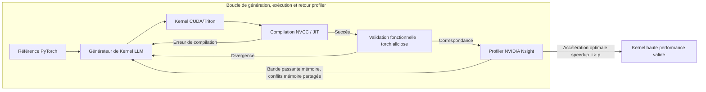

# Stanford CS329A (Ép 10) : SWE-Agents — Génie logiciel autonome, CodeMonkeys, KernelBench et Agent-System Interface

Le génie logiciel en environnement de production réel n'a pratiquement aucun rapport avec les puzzles de programmation compétitive isolés ou les problèmes académiques simplifiés. Un véritable rapport de bug GitHub n'arrive jamais emballé avec des tests unitaires prédéfinis ; il est enchevêtré à travers des centaines de fichiers, des dépendances historiques complexes et des millions de lignes de code de production distribué. De plus, un logiciel en production ne peut pas se contenter d'être fonctionnellement correct — il doit être performant, économe en mémoire et parfaitement adapté aux architectures matérielles parallèles de bas niveau.

Pour inaugurer la **Partie 3 : Ingénierie des Agents (Leçons 10 à 12)** de **Stanford CS329A : Self-Improving AI Agents**, nous quittons les clusters d'entraînement de modèles fondamentaux pour plonger directement dans la réalité technique du développement logiciel industriel :
> **« Comment des agents IA autonomes naviguent-ils dans des dépôts de plusieurs millions de tokens, isolent-ils des bugs de régression insidieux, synthétisent-ils des environnements de test reproductibles et conçoivent-ils des kernels GPU sur mesure surpassant les implémentations PyTorch manuelles ? »**

Cet article analyse la frontière actuelle du **SWE-Agent Autonomous Coding** à travers trois avancées majeures : **CodeMonkeys Automated Refactoring** sur le **SWE-bench Benchmark GitHub**, **KernelBench GPU Performance Tuning** par boucle de rétroaction de profiler matériel, et le système **Agent-Computer Interface ACI** (Agent-System Interface, ASI) de Stanford, conçu pour éliminer le décalage sémantique entre l'intention de haut niveau de l'agent et le matériel parallèle physique.

{/* truncate */}


---

## 1. Les réalités du génie logiciel autonome

Résoudre des anomalies GitHub en environnement de production exige de surmonter trois défis d'ingénierie système fondamentaux :
1. **Le dilemme de l'explosion contextuelle :** Un dépôt d'entreprise moyen dépasse les 3 000 000 de tokens. Injecter un tel volume dans un LLM de pointe provoque des coûts exorbitants et une dégradation critique de l'attention (*Needle-in-a-Haystack failure*).
2. **Le dilemme de la vérification :** Les agents produisent fréquemment des correctifs complaisants qui modifient les tests au lieu de corriger le défaut architectural sous-jacent, induisant de faux succès.
3. **Le mur matériel :** Dépasser le code glue Python pour s'attaquer à l'accélération GPU bas niveau (CUDA, Triton) requiert une compréhension intime de la coalescence mémoire, de la synchronisation des blocs de threads et de la pression sur les registres.

```
┌─────────────────────────────────────────────────────────────────────────┐
│              Les 3 piliers des SWE-Agents de production                 │
└────────────────────────────────────┬────────────────────────────────────┘
                                     │
       ┌─────────────────────────────┼─────────────────────────────┐
       ▼                             ▼                             ▼
┌──────────────────────────┐  ┌──────────────────────────┐  ┌──────────────────────────┐
│  CodeMonkeys SWE-bench   │  │   KernelBench Profiler   │  │  Agent-System Interface  │
├──────────────────────────┤  ├──────────────────────────┤  ├──────────────────────────┤
│ • Compression 50.5x ctx  │  │ • Métrique fast_p        │  │ • Compression DSL 14x    │
│ • Débogage bilatéral     │  │ • Rétroaction profiler E+P│ │ • Traducteur AutoGuide   │
│ • Tests discriminants    │  │ • Fusion & mémoire partag.│ │ • Alignement sémantique  │
│ • 57,4% SWE-bench Vérif. │  │ • Accélération GPU 13x   │  │ • Gain x3,8 vs optimiseur│
└──────────────────────────┘  └──────────────────────────┘  └──────────────────────────┘
```

---

## 2. Résolution d'issues GitHub de production : CodeMonkeys (2025)

L'étalon-or international pour évaluer les agents d'ingénierie logicielle autonome est **SWE-bench Verified** (constitué de 500 pull requests réelles issues de grands projets open source tels que Django, SymPy et scikit-learn).

Présenté début 2025, **CodeMonkeys** a établi un taux de résolution record de 57,4 % en décomposant l'ingénierie logicielle agentique en trois étapes rigoureusement séquencées :

```
                  [Issue GitHub réelle & Dépôt de 3M de tokens]
                                     │
                                     ▼
           1. Pipeline contextuel (Scan du dépôt & Compression 50.5x)
              (Scan local Qwen2.5-Coder-32B -> Résumé -> Classement -> 128k)
                                     │
                                     ▼
           2. Machines à états de génération (Boucle de débogage bilatérale)
              ┌────────────────────────────────────────────────────────┐
              │ Testing Machine: Synthétise le test repro (Exit 2)     │
              │                       │                                │
              │                       ▼                                │
              │ Editing Machine: Corrige le code source -> Test (Exit 0)│
              └────────────────────────────────────────────────────────┘
                                     │
                                     ▼
           3. Machine à états de sélection (Synthèse de tests discriminants)
              (Génère des tests différentiels aux limites pour éliminer les faux patchs)
                                     │
                                     ▼
                       [Soumission du patch final vérifié]
                     (57,4% Résolu sur SWE-bench Verified)
```

### Étape 1 : Le pipeline de contexte (Compression 50.5x)
Interroger directement des modèles d'élite (Claude 3.5 Sonnet) sur des bases de code complètes de plusieurs millions de tokens est économiquement insoutenable. CodeMonkeys découple l'exploration contextuelle de la synthèse du correctif :
- Un modèle local économique (`Qwen2.5-Coder-32B`) analyse l'intégralité des fichiers Python du dépôt.
- Les définitions de classes, signatures de fonctions et docstrings pertinentes sont extraites.
- Une passe de classement hiérarchique isole les fichiers clés, comprimant une base de 3 000 000 de tokens en une **fenêtre contextuelle de travail de 128 000 tokens (réduction par 50,5)**.
- Ce contexte étant mutualisé entre plusieurs trajectoires de génération parallèles, l'analyse contextuelle représente moins de **15 % du coût global de résolution**.

### Étape 2 : Machines à états de débogage bilatérales
Un piège classique des agents de codage autonomes est le « correctif d'auto-illusion » : modifier le code sans avoir vérifié au préalable que le bug était effectivement reproduit. CodeMonkeys associe deux machines à états distinctes :
1. **Testing State Machine :** Avant toute modification du code source, l'agent produit un script de reproduction autonome (`reproduce_issue.py`). Ce script doit impérativement s'exécuter sur la base non modifiée et retourner le code **Exit Code 2 (Échec reproduit)**. S'il réussit d'emblée, le test est invalide et rejeté.
2. **Editing State Machine :** Guidée par ce test défaillant, la machine d'édition applique les modifications au dépôt. Elle itère jusqu'à 8 fois face aux erreurs du compilateur, tracebacks et assertions, jusqu'à ce que le test produise **Exit Code 0 (Succès)**.

### Étape 3 : La machine à états de sélection (Tests discriminants)
L'exécution de 10 trajectoires parallèles atteint une couverture de résolution théorique de **69,8 %** (au moins un correctif valide existe). Cependant, sélectionner un patch au hasard fait chuter la précision à **45,8 %**, de nombreux candidats introduisant des régressions secondaires.

Pour combler cet écart, CodeMonkeys a introduit la **Machine de Sélection Discriminante** :
- Elle identifie les subtiles divergences comportementales entre deux patchs candidats $P_A$ et $P_B$.
- Elle demande au LLM d'écrire un **test discriminant différentiel** conçu spécifiquement pour réussir sur $P_A$ et échouer sur $P_B$.
- L'exécution de ces suites discriminantes dans des bacs à sable isolés élimine successivement les faux correctifs, hissant la précision finale à **57,4 %**.

---

## 3. Au-delà de l'exactitude : KernelBench & Performance GPU (2025)

La conformité fonctionnelle ne représente que la moitié du problème. Dans l'infrastructure moderne du Machine Learning, les opérateurs GPU personnalisés déterminent la latence et la viabilité financière des clusters de calcul. Les ingénieurs humains ont mis près de cinq ans après la publication du papier Transformer pour concevoir et optimiser FlashAttention en CUDA. Des agents autonomes peuvent-ils synthétiser des kernels GPU haute performance directement à partir de définitions PyTorch ?

Publié en février 2025, **KernelBench** évalue les capacités des agents sur 250 opérateurs PyTorch variés, mesurant à la fois l'exactitude mathématique et l'accélération matérielle brute.

```text
La métrique fast_p Speedup Frontier :
========================================================================================
fast_p = (1 / N) * Σ_{i=1}^N  1[ correct_i  ET  speedup_i > p ]

Où :
  • fast_0 : Conformité fonctionnelle (La sortie tenseur correspond à PyTorch)
  • fast_1 : Conformité + Plus rapide que PyTorch natif (Accélération > 1.0x)
  • fast_2 : Conformité + Deux fois plus rapide que PyTorch natif (Accélération > 2.0x)
========================================================================================
```



### La révolution de la rétroaction par profiler
En génération directe sans retour (*single-shot*), même les modèles les plus performants comme OpenAI o1 ou DeepSeek-R1 échouent lourdement : **moins de 20 % des kernels CUDA générés obtiennent une quelconque accélération par rapport à PyTorch ($fast_1 < 20\%$)**, et provoquent de fréquents plantages par accès mémoire hors limites ou conflits de banques de mémoire partagée.

Toutefois, lorsque l'agent est connecté à une boucle fermée à trois niveaux :
1. **Génération :** Synthèse initiale du code Triton/CUDA.
2. **Exécution :** Retours des diagnostics du compilateur et vérification des tolérances tensorielles (`torch.allclose`).
3. **Rétroaction profiler (E+P) :** Analyse instrumentée par NVIDIA Nsight révélant précisément les goulets d'étranglement (ex. : *« Memory bound : blocage mémoire globale à la ligne 42 ; conflit de banque x8 dans le pavé de mémoire partagée »*).

Sous cette boucle fermée, le taux de réussite de DeepSeek-R1 pour optimiser des opérateurs composés de niveau 2 est passé de **36 % à 72 %**, synthétisant de façon autonome de l'attention fusionnée, du découpage de registres et des réductions warp-shuffle offrant des gains allant jusqu'à **13x par rapport à PyTorch standard**.

---

## 4. Alignement sémantique : Agent-System Interface (ASI, Stanford 2025)

Lorsque les agents tentent d'optimiser des systèmes distribués complexes en C++ bas niveau, une rupture d'impédance architecturale se produit. Exposer un LLM à des pointeurs bruts, des primitives de synchronisation multithread et des assertions de compilation cryptiques revient à demander à un architecte système de déboguer du microcode machine.

Présenté à l'ICML 2025 par l'équipe d'Alex Aiken à l'Université de Stanford, l'**Agent-System Interface (ASI)** comble ce fossé :
> **« Plutôt que de contraindre les LLM à rédiger du C++ fragile ou à déchiffrer des traces de pile obscures, nous devons bâtir une couche d'abstraction intermédiaire : un langage dédié déclaratif (DSL) qui borne l'espace de recherche, et un traducteur AutoGuide convertissant les assertions matérielles en recommandations exploitables en langage naturel. »**

```text
┌─────────────────────────────────────────────────────────────────────────┐
│                          Agent de raisonnement LLM                      │
│             (Intention stratégique & Conception algorithmique)          │
└────────────────────────────────────▲────────────────────────────────────┘
                                     │
          ┌──────────────────────────┴──────────────────────────┐
          │ Directives d'optimisation▲ Conseils exploitables    │
          │ DSL de haut niveau       │ en langage naturel       │
          ▼                          │                          │
┌────────────────────────────────────┴────────────────────────────────────┐
│                    Couche Agent-System Interface (ASI)                  │
│  • Domain-Specific Language (DSL) : Compression complexité code x14     │
│  • Traducteur AutoGuide : Transforme les segfaults en pistes d'action   │
└────────────────────────────────────▲────────────────────────────────────┘
                                     │
          │ Code C++ bas niveau      ▲ Erreurs matérielles brutes│
          │ & allocations mémoire    │ & assertions compilateur │
          ▼                          │                          │
┌────────────────────────────────────┴────────────────────────────────────┐
│                   Exécution matérielle parallèle physique               │
│               (Mémoire distribuée, cœurs GPU, VRAM partagée)            │
└─────────────────────────────────────────────────────────────────────────┘
```

### Les deux composants fondamentaux d'ASI
1. **Domain-Specific Language (DSL) :** L'encapsulation du découpage de données (*tiling*), du déroulage de boucles et des correspondances hiérarchiques de mémoire en primitives déclaratives compresse le code système d'un **facteur 14**, éliminant totalement les hallucinations de syntaxe.
2. **Traducteur AutoGuide :** Lorsqu'un kernel déclenche une assertion bas niveau (ex. : `Assertion failed: stride mismatch at dim 1; invalid warp alignment`), AutoGuide intercepte l'erreur et génère un guidage contextuel clair :
   > *« Diagnostic matériel : L'alignement de stride a échoué car la dimension tensorielle 1 n'est pas alignée sur un multiple de 32. Modifiez la directive de disposition mémoire row-major pour imposer un alignement de 32 octets. »*

### Résultats empiriques : 10 itérations battent 1 000
Grâce à ASI, un agent LLM autonome n'a requis que **10 itérations** pour découvrir un ordonnancement tensoriel parallèle **3,8 fois plus rapide** que celui identifié par **OpenTuner au terme de 1 000 itérations**. Des optimisations complexes de simulations de circuits qui mobilisaient autrefois des jours de travail d'ingénieurs seniors ont été résolues en **10 minutes**.

---

## 5. Comparatif architectural des paradigmes de développement

```text
=========================================================================================================
Dimension             Assistant de code classique    CodeMonkeys (SWE-bench)  KernelBench + ASI
---------------------------------------------------------------------------------------------------------
Artefact produit      Fonctions isolées / Extraits   Patchs complets multi-fichiers Kernels CUDA/Triton
Gestion du contexte   Fichier actif local (4k-8k)    128k compressé (50.5x)   DSL déclaratif (14x)
Boucle de vérification Exécution de tests unitaires  Machine à états bilatérale Profiler Nsight (fast_p)
Signal de retour      Messages d'erreur traceback    Bascule Exit 2 -> Exit 0 Conseils matériels AutoGuide
Objectif central      Correction fonctionnelle       Résolution de régressions Accélération matérielle réelle
=========================================================================================================
```

---

## 6. Analyse technique approfondie (Q&A)

### Q1 : Pourquoi CodeMonkeys doit-il synthétiser un test de reproduction AVANT de modifier le code ?
Si un agent modifie le code source avant d'avoir établi un cadre de test, il sombre inévitablement dans la « vérification auto-complaisante » : il conçoit un patch défectueux, puis rédige un test spécialement conçu pour valider cette implémentation incomplète.

En imposant à la **Testing State Machine** de générer en premier lieu un script indépendant produisant **Exit Code 2 (Échec reproduit)** sur le code intact, le système met en place un oracle immuable et objectif. Ce n'est que lorsque l'**Editing State Machine** parvient à faire basculer ce même script vers **Exit Code 0** que la résolution du bug est rigoureusement prouvée.

### Q2 : Pourquoi les LLM échouent-ils en génération directe de code CUDA et comment le profiler résout-il cela ?
Les modèles de langage maîtrisent parfaitement les opérations tensorielles au plan conceptuel, mais peinent face aux subtilités de la concurrence matérielle massive :
- **Calculs d'indices de threads :** L'évaluation de `int idx = blockIdx.x * blockDim.x + threadIdx.x` omet souvent les conditions aux limites, provoquant des segfaults mémoire.
- **Conflits de mémoire partagée :** Des requêtes concurrentes ciblant simultanément la même banque de mémoire partagée sérialisent l'exécution et détruisent le débit.

Les erreurs de compilation standard n'indiquent que la validité syntaxique, jamais les goulets d'étranglement dynamiques. La **boucle de rétroaction du profiler (E+P)** injecte les métriques de saturation mémoire et de divergence de warps directement dans le contexte de l'agent, lui permettant d'effectuer des optimisations chirurgicales ciblées.

---

## Synthèse & Perspectives

Les agents d'ingénierie logicielle ont définitivement dépassé le stade de l'autocomplétion textuelle. Avec **CodeMonkeys**, nous avons exploré comment les pipelines de contexte hiérarchiques et les machines à états bilatérales triomphent des dépôts de production réels sur SWE-bench. Avec **KernelBench** et **ASI**, nous avons démontré comment le couplage avec les profilers matériels et les abstractions déclaratives permet à l'IA d'optimiser l'infrastructure de calcul intensif.

Dans la **Leçon 11**, nous explorerons le défi crucial de la mémoire pour agents au long cours : **Agent Memory — Systèmes de mémoire hiérarchiques, Cartouches, CacheBlend et persistance de contexte à long terme (MemGPT)**.

---

### Points clés à retenir
- **Découverte contextuelle amortie :** Filtrer au préalable les immenses dépôts à l'aide de modèles légers (compression 50.5x) rend le génie logiciel complet économiquement viable.
- **Le débogage bilatéral élimine les faux patchs :** Un bug n'est véritablement résolu que lorsqu'un test de reproduction initialement en échec (Exit 2) bascule de manière reproductible sur Exit 0.
- **La performance est une boucle itérative :** Les tentatives isolées génèrent rarement du code CUDA compétitif ; relier la télémétrie matérielle aux profilers (fast_p) est incontournable en calcul haute performance.