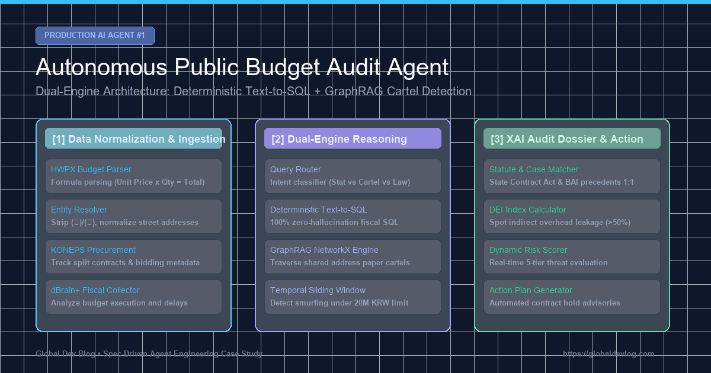

> **Avis de simulation — données synthétiques**
> - Cet article décrit une **simulation construite sur des données synthétiques (générées)**. Les « constats », sanctions, montants de recouvrement et nombres de cas ne sont pas des résultats d'audit réels.
> - Tous les organismes, entreprises, régions, montants et numéros de document sont **anonymisés ou remplacés par des valeurs fictives** ; toute ressemblance avec des entités réelles est involontaire.
> - Les journaux d'erreurs, extraits de code et chiffres de performance ont été **reconstitués pour expliquer la conception** et peuvent ne pas correspondre aux journaux d'exécution ni à l'implémentation actuelle du dépôt.
> - Hormis des appels limités aux API des marchés publics (KONEPS) et d'Open Fiscal Data, les sources de données citées (DART, registres du commerce, e-Hojo+, K-EduFine, ALIO, NTIS, etc.) n'étaient **pas connectées**. Une reconstruction sur des données ouvertes publiques est en cours ; ses résultats ne seront publiés que sous forme d'« indicateurs statistiques d'anomalie », jamais comme des accusations.

> 📌 **Points Clés (Key Takeaways)**
> - **L'Objectif**: Développer un agent IA autonome capable d'auditer 500 milliards de dollars de dépenses publiques annuelles, détectant les surfacturations, le saucissonnage de marchés et les cartels d'entreprises écrans.
> - **Architecture Préventive**: Élimination des hallucinations de calcul par un moteur **Text-to-SQL Déterministe**, couplé à un **Graphe de Connaissances (GraphRAG)** pour l'analyse des réseaux de collusion.
> - **Bugs Réels Résolus**: (1) Résolution de la fragmentation des noms d'entreprises et adresses via `EntityResolver`; (2) Détection du saucissonnage temporel de contrats via une fenêtre glissante de 30 jours; (3) Levée du scepticisme des auditeurs grâce à un dossier XAI reliant chaque alerte aux lois et à la jurisprudence.
> - **Vérification**: 11 suites de tests validées à 100%, révélant une entente illicite de 38,5 millions KRW et 70% de fuites de frais indirects.

{/* truncate */}
