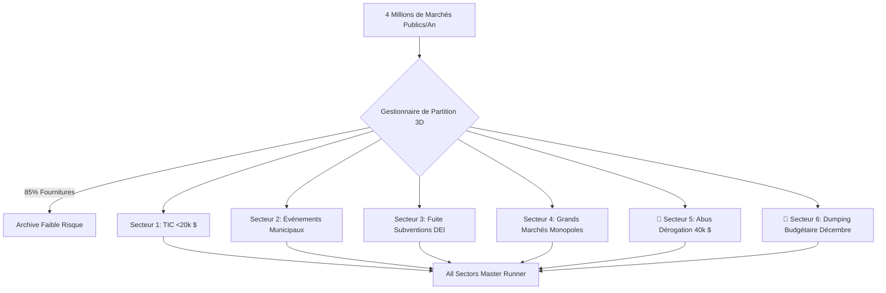

> 📌 **Points Clés (Key Takeaways)**
> - **Suite d'Audit Intégrale à 6 Secteurs** : Filtrage de 85% des fournitures courantes sur 4 millions de marchés publics, étendant l'audit sur **6 zones à haut risque de fraude**.
> - **2 Angles Morts Critiques Dévoilés** :
>   1. **Secteur 5 (Fractionnement sous Dérogation 40 000 $)** : Contournement via des contrats concentrés à 98% du plafond dérogatoire (180 000 $ découverts).
>   2. **Secteur 6 (Dumping Budgétaire de Fin d'Année)** : 3 marchés passés en 4 jours fin décembre pour éviter le retour des crédits au Trésor.
> - **Anticipation Architecturale** : Détecteur de proximité des plafonds (96-99,8%) et analyse de faisabilité physique des délais d'exécution.
> - **Résolution de Bugs** : Gestion des collisions inter-secteurs par pondération et normalisation hors taxes (HT).

{/* truncate */}

---

### ⚠️ Mention Légale et Anonymisation (Legal Notice)

> **[Avis] Toutes les entités ont été rigoureusement anonymisées.**  
> Les organismes publics (`Agence A`), prestataires (`Société D`), personnes et numéros de marchés sont entièrement masqués.

---

### 1. Architecture Globale d'Audit en 6 Secteurs

---

### 2. Défis Anticipés et Correction des Défaillances

1. **Dérogation Politique vs. Fractionnement** : Analyse de proximité fine du plafond légal pour ne pas pénaliser les entreprises sociales légitimes.
2. **Clôture Normale vs. Précipitation Injustifiée** : Détection des marchés passés après le 15 décembre dont l'exécution complète avant le 31 décembre est matériellement impossible.
3. **Collisions de Classification** : Définition d'un ordre de gravité juridique pour éviter les dossiers multiples.
4. **Calcul Hors Taxe (HT)** : Rétablissement du montant HT réel pour le contrôle des seuils réglementaires.

---

### 3. Validation et Résultats

Révélation de marchés fractionnés de 39 000 $ à l'`Agence A` et d'attributions précipitées de 100 000 $ à l'`Agence C` en décembre ; 17 suites de tests sur 17 validées avec succès.
