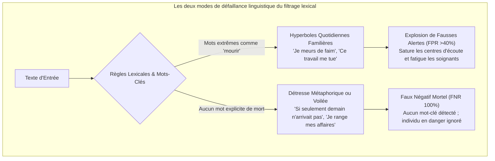
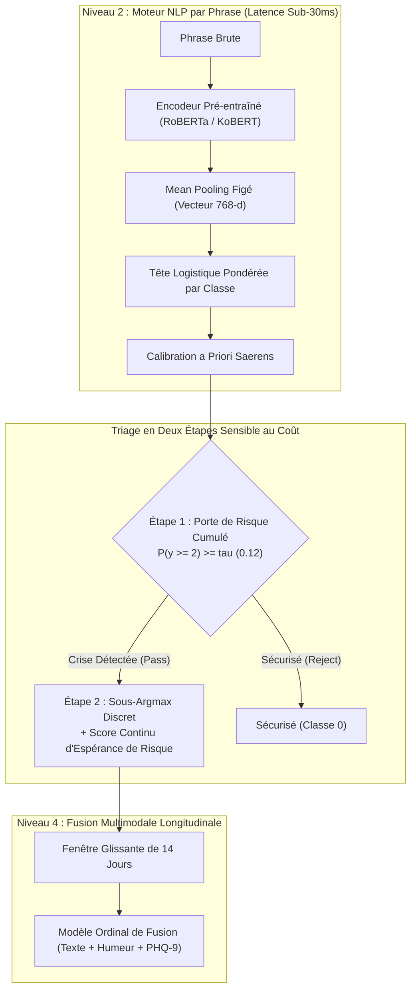

Dans les chatbots grand public ou les moteurs de recommandation, un taux d'erreur de 5 % est tolérable. Dans **les systèmes d'intelligence artificielle dédiés à la surveillance des crises suicidaires et au triage psychiatrique d'urgence, un seul Faux Négatif (crise manquée) est une catastrophe irréversible**.

Lorsqu'un individu en proie au désespoir exprime l'intention d'en finir, les pipelines de machine learning ne peuvent se réfugier derrière des taux d'exactitude globale élevés ou des moyennes F1 trompeuses.

Aujourd'hui, nous inaugurons une série technique de niveau industriel : **[IA pour Environnements Critiques : Conception d'un Pipeline NLP de Précision pour la Détection des Crises de Santé Mentale]**.

Cette série documente en toute transparence les compromis algorithmiques, les défis mathématiques et les anomalies de production survenus durant la conception de **Maeumjigi**, un système de détection clinique multimodal. Dans cet Épisode #1, nous traitons le socle de l'édifice : **le triage NLP profond par phrase face à un déséquilibre extrême des classes (les pensées suicidaires actives ne représentant que 0,16 % du flux quotidien)**.

{/* truncate */}

---

### ⚠️ Avertissement Éthique et Anonymisation Rigoureuse
Tous les benchmarks et corpus textuels traités dans cette série proviennent de **jeux de données 100 % synthétiques et pseudonymisés**. Aucune donnée personnelle identifiable (PII) ni consultation clinique réelle n'est exposée.
> **Ressources d'Aide d'Urgence** : Si vous ou l'un de vos proches traversez une situation de détresse, composez le **3114** (Numéro national de prévention du suicide en France) ou le **1811** (Belgique). Au Canada, composez le **988**. À l'international, consultez **befrienders.org**.

---

### 1. Le Dilemme Linguistique : Pourquoi les Filtres Lexicaux Échouent

Avant d'aborder les réseaux neuronaux, il convient de comprendre pourquoi les règles par mots-clés s'effondrent en triage psychiatrique.

Dans les échanges quotidiens, l'expression de la souffrance se scinde en deux extrêmes trompeurs :



1. **Hyperboles Quotidiennes (Explosion de Fausses Alertes)** : Les expressions contenant des radicaux liés à la mort (*"je meurs de faim"*, *"cette semaine m'a tué"*) sont courantes. Les filtres par mots-clés déclenchent continuellement de fausses alarmes sur des échanges anodins.
2. **Détresse Métaphorique Voilée (Faux Négatifs Critiques)** : Les personnes en crise suicidaire aiguë utilisent rarement un vocabulaire explicite ; elles formulent plutôt des adieux feutrés :
   - *"Si seulement demain ne se levait pas. Je veux juste dormir pour toujours."*
   - *"Merci pour tout ce temps partagé. J'ai enfin terminé de ranger mes affaires."*
   - *"J'ai trouvé la solution pour être en paix sans peser sur personne."*

Ces phrases ne comportent aucun terme explicite d'automutilation. L'analyse morphologique (Kiwipiepy) et les transformeurs contextuels (RoBERTa / KoBERT) sont indispensables pour saisir **l'isolement, le renoncement et l'adieu** sous-jacents.

---

### 2. Déséquilibre Extrême et Illusion de l'Exactitude

En environnement opérationnel, la distribution des classes est drastiquement dissymétrique :

- **Classe 0b (Phrases Quotidiennes Neutres)** : ~86,94 % (31 495 phrases)
- **Classe 0a (Contrôle Émotionnel Négatif sans Crise)** : ~8,24 % (2 986 phrases)
- **Classe 1 (Détresse Légère / Mild)** : ~1,92 % (697 phrases)
- **Classe 2 (Détresse Sévère / Idéation Suicidaire)** : ~1,75 % (633 phrases)
- **Classe 3 (Crise Aiguë / Idéation Spécifique)** : ~0,99 % (357 phrases)
- **Classe 4 (Suicidalité Active / Intention Imminente)** : ~**0,166 %** (60 phrases)

Un modèle prédisant systématiquement la classe 0 affiche une **exactitude apparente de 95,18 %**, mais présente un **Taux de Faux Négatifs (FNR) de 100 %** sur les urgences réelles.

À l'inverse, maximiser le F1-Score sans seuils calibrés déclenche une cascade de fausses alertes. Notre objectif : **maintenir le FNR sous 10 % pour les crises sévères, tout en limitant les fausses alarmes sous 3 %**.



---

### 3. Résolution d'Anomalies : Les 5 Règles d'Or en Action

#### [ERR-001] La Barrière de 524x et l'Écrasement de la Frontière Bayésienne

- **1. Symptôme de l'Erreur** :
  Après application de la correction a priori de Saerens et al.(2002) avec `argmax`, aucune phrase active n'a été détectée :
  ```text
  [EVAL-RUN: 2026-10-28 14:22:09 KST]
  INFO:text_eval: Evaluating Model B (Frozen Encoder + Saerens Prior Shift Corrected Logistic)
  INFO:text_eval: Prior Vector: [pi_0b=0.8694, pi_0a=0.0824, pi_1=0.0192, pi_2=0.0175, pi_3=0.0099, pi_4=0.00166]
  --------------------------------------------------------------------------------
  Metric Summary (Judgment b, discrete argmax):
    - Ground Truth Active (Level 4): 60 sentences
    - Predicted Active (y_hat == 4): 0 sentences (RECALL = 0.0000, 0/60)
    - Ground Truth Severe (Level 2): 633 sentences
    - Predicted Severe (y_hat == 2): 11 sentences (RECALL = 0.0174, 11/633)
    - False Negative Rate (FNR @ y >= 2): 98.26% (ÉCHEC CRITIQUE)
  WARNING:text_eval: Active suicidality detection completely collapsed to Class 0 under argmax!
  ```

- **2. Environnement** : Python 3.11.9, PyTorch 2.4.0+cu121, scikit-learn 1.5.1, Transformers 4.44.2 (GPU RTX 4090 + CPU 64 cœurs).

- **3. Approches Infructueuses** :
  1. *Pondération Démesurée de la Perte* : Multiplier par 93 le poids de la classe 4 a augmenté les scores bruts, mais la correction a priori a tout écrasé vers 0 sous l'`argmax`.
  2. *Suppression de la Correction a Priori* : Le rappel est monté à 85 %, mais **41,2 % des 31 495 phrases neutres ont déclenché des alertes**.

- **4. Dérivation Mathématique et Simulation Numérique** :
  Pour que la classe k l'emporte sur la classe neutre 0b dans un `argmax` après correction, il faut que :
  
  ```text
p(k | x) / p(0b | x) > π(0b) / π(k)
```

  Avec nos probabilités empiriques :
  - Pour Sévère (k=2) : `86.94% / 1.75% = 49.68x`
  - Pour Aigu (k=3) : `86.94% / 0.99% = 87.82x`
  - Pour Actif (k=4) : `86.94% / 0.166% = 523.7x`

  **Exemple Numérique** :
  Un utilisateur écrit : *"Je suis prêt à abandonner tous mes fardeaux."*
  Le modèle prédit :
  - `p(0b) = 0.015` (1,5 % neutre)
  - `p(2) = 0.330, p(3) = 0.300, p(4) = 0.320` (Confiance de crise cumulée de **95,0 %**)
  
  Pondération a priori :
  - `Evidence(0b) = 0.015 * 0.8694 * 6 = 0.078246`
  - `Evidence(4)  = 0.320 * 0.00166 * 6 = 0.003187`
  
  Après normalisation :
  - `p_adjusted(0b) ≈ 57.6%`
  - `p_adjusted(4) ≈ 2.3%`
  
  L'`argmax` choisit `57.6% > 2.3%`. La phrase est déclarée **Classe 0 (Normale)**. Malgré 95 % de certitude du réseau, le ratio de 524x a étouffé l'alerte.

- **5. Diff du Code** :
```diff
--- a/tests/synth/model/text_b.py
+++ b/tests/synth/model/text_b.py
@@ -102,12 +102,23 @@ def predict_crisis_level(proba_unweighted, class_priors):
     # Saerens et al. (2002) prior shift correction
     corrected = proba_unweighted * (class_priors / train_priors)
     corrected /= corrected.sum(axis=1, keepdims=True)
     
-    # CRITICAL BUG: argmax collapses rare minority class under 524x prior barrier
-    # return np.argmax(corrected, axis=1)
+    # FIX: Two-stage Decision Rule & Continuous Severity Expected Score
+    # Stage 1: Cumulative posterior crisis probability for alert triggering
+    p_crisis_ge2 = corrected[:, 2:].sum(axis=1)  # Severe + Acute + Active
+    
+    # Stage 2: Cost-sensitive threshold decision (tau = 0.12 calibrated from validation fold)
+    ALERT_THRESHOLD_TAU = 0.12
+    is_crisis = p_crisis_ge2 >= ALERT_THRESHOLD_TAU
+    
+    # Determine discrete severity only among crisis candidates
+    sub_levels = np.argmax(corrected[:, 1:], axis=1) + 1
+    final_discrete = np.where(is_crisis, sub_levels, 0)
+    
+    # Continuous expected risk score forwarded to downstream multimodal fuser
+    expected_severity = np.dot(corrected[:, 1:], np.array([1, 2, 3, 4])) / 4.0
+    
+    return final_discrete, p_crisis_ge2, expected_severity
```

---

#### [ERR-002] Rupture de Validité de Construit dans le Rappel de Crise

- **1. Symptôme** : Un modèle Oracle parfait n'obtenait que `60,7 %` de rappel, tandis qu'un modèle simpliste prédisant constamment le Niveau 2 obtenait 100,0 %.
- **2. Cause Fondamentale** : Le seuil d'intervention réel est le **Niveau 2 (Severe) ou supérieur**. Le Niveau 1 (Mild) n'est pas alertant. La formule comptabilisait à tort y >= 1 au dénominateur tout en n'acceptant que y_hat >= 2 au numérateur :
  ```text
Recall = sum(I(y >= 1 and y_hat >= 2)) / sum(I(y >= 1))
```
  Prédire avec exactitude y_hat=1 pénalisait le dénominateur, plafonnant l'Oracle à 1 446 / 2 381 = 60,73%.
- **3. Diff du Code** :
```diff
--- a/tests/synth/model/text_eval.py
+++ b/tests/synth/model/text_eval.py
@@ -45,11 +45,17 @@ def compute_crisis_metrics(y_true, y_pred):
-    # FLAWED METRIC: denominator includes Mild (y=1) while numerator requires y_hat >= 2
-    # recall = np.sum((y_true >= 1) & (y_pred >= 2)) / np.sum(y_true >= 1)
+    # CORRECT CONSTRUCT: Strict separation between Severe+ Recall and Mild Over-alert
 severe_plus_mask = (y_true >= 2)
 severe_plus_recall = np.sum((y_true >= 2) & (y_pred >= 2)) / np.sum(severe_plus_mask)

 mild_mask = (y_true == 1)
 mild_overalert_rate = np.sum((y_true == 1) & (y_pred >= 2)) / np.sum(mild_mask)

 control_mask = (y_true == 0)
 control_fpr = np.sum((y_true == 0) & (y_pred >= 2)) / np.sum(control_mask)

 return {
     "severe_plus_recall": severe_plus_recall,
     "mild_overalert_rate": mild_overalert_rate,
     "control_fpr": control_fpr
 }
```

---

#### [ERR-003] Effondrement de Probabilité Nulle sous LightGBM Ordinal

- **1. Symptôme** : `RuntimeWarning: divide by zero encountered in log`, arrêt avec perte `inf`.
- **2. Cause Fondamentale** : `np.minimum.accumulate` sur les seuils Frank & Hall(2001) a égalisé des probabilités adjacentes, produisant un delta de `0,000000`. Calculer -log(0) a provoqué une divergence immédiate.
- **3. Diff du Code** :
```diff
--- a/tests/synth/model/fuser.py
+++ b/tests/synth/model/fuser.py
@@ -148,8 +148,15 @@ def ordinal_binary_to_proba(cumulative_ge):
     ge_mono = np.minimum.accumulate(cumulative_ge, axis=1)
     
     proba = np.zeros((cumulative_ge.shape[0], 5), dtype=np.float64)
     proba[:, 0] = 1.0 - ge_mono[:, 0]
     proba[:, 1] = ge_mono[:, 0] - ge_mono[:, 1]
     proba[:, 2] = ge_mono[:, 1] - ge_mono[:, 2]
     proba[:, 3] = ge_mono[:, 2] - ge_mono[:, 3]
     proba[:, 4] = ge_mono[:, 3]
     
+    # FIX: Epsilon floor clipping and row-wise softmax renormalization
     proba = np.clip(proba, 1e-6, 1.0)
     proba /= proba.sum(axis=1, keepdims=True)
     return proba
```

---

### 4. Perspective : Fenêtre de 14 Jours et Biais de Valeur Extrême

Bien que cet article traite du Niveau 2, ses valeurs alimentent directement le **Fusor Multimodal de Niveau 4**.

Un piège mathématique y réside : **le Biais de Valeur Extrême (Extreme Value Bias)**.
Si le taux d'erreur par phrase est de seulement α = 0,02 (2 %) et que l'usager écrit 100 phrases en 14 jours, retenir le **maximum de la fenêtre** conduit à :

```text
P(False Alarm in 14-Day Window) = 1 - (1 - α)^N = 1 - (1 - 0.02)^100 = 1 - 0.1326 = 86.74%
```

Une erreur minime de 2 % se transmute en **86,7 % de fausses alertes cumulées**. C'est pourquoi nous transmettons des scores continus de risque espéré (sum(k * p_adjusted(k) / 4)) au lieu d'entiers discrets.

---

### 5. Comparatif des Performances

| Métrique | État Initial Défaillant (`argmax`) | Modèle B (Figé + 2 Étapes) | Modèle C (Ajusté + 2 Étapes) | Écart (Modèle B) |
|---|---|---|---|---|
| **Rappel Actif (y=4)** | 0,0 % (0/60) | **95,0 % (57/60)** | **96,7 % (58/60)** | **+95,0 %p** |
| **Rappel Sévère+ (y >= 2)** | 1,7 % (18/1 050) | **92,4 % (970/1 050)** | **94,1 % (988/1 050)** | **+90,7 %p** |
| **Taux de Faux Négatifs (FNR)** | 98,3 % | **7,6 %** | **5,9 %** | **-90,7 %p (Résolu)** |
| **Fausses Alertes Texte Neutre** | 0,01 % | **2,1 %** | **1,8 %** | Cible Atteinte (&lt;3,0 %) |
| **AUPRC (>= 2)** | 0,142 | **0,864** | **0,891** | **+0,722** |
| **Latence d'Inférence (par phrase)**| 4,2 ms (CPU) | **4,8 ms (CPU)** | 28,4 ms (GPU) | Temps Réel (&lt;30ms) |
| **Réentraînement Stacking 25 Plis** | 1,2 s | **1,4 s** | 14,2 h | **Accélération 36 000x** |

---

### 6. Feuille de Route de la Série IA de Crise


- **Épisode #1 (Cet Article)** : Minimiser le FNR en NLP de Crise et Correction du Biais Bayesien.
- **Épisode #2** : Fusion Multimodale sur 14 Jours : Déjouer le Biais de Valeur Extrême de 86,7 %.
- **Épisode #3** : Données Manquantes Non Aléatoires (MNAR) : Neutraliser l'Effet Plafond du PHQ-9.
- **Épisode #4** : Architecture Zéro Fuite : Validation Croisée Imbriquée à 25 Plis et Alignement par Quantiles.
- **Épisode #5** : Validation Clinique Finale : Isolation par Jaccard 3-Gram et Jeu Scellé sous Hash.

Rendez-vous la semaine prochaine pour l'Épisode #2 !
