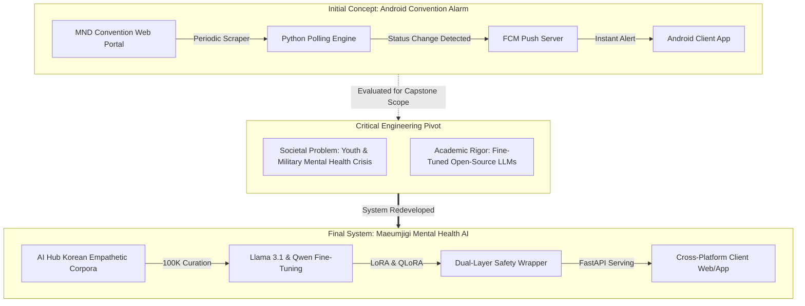

March 26, 2026, marks the historic first day of our university capstone engineering project. Today laid the structural bedrock for everything to come: adopting an autonomous AI coding assistant (**Claude Code**), designing team collaboration protocols, and making the pivotal architectural decision that transformed a simple reservation alert tool into **Maeumjigi**, a specialized AI mental health counseling platform.

{/* truncate */}

### 1. The Autonomous AI Collaboration Framework: Claude Code & Rulesets

At the onset of the capstone project, our engineering team decided to break away from traditional manual pair programming and integrate **Claude Code** as our primary autonomous coding agent. 

To prevent AI hallucination, uncontrolled code sprawl, and incompatible dependency conflicts, we established two foundational rule documents: `Claude.md` (project domain constraints) and `CLAUDE_coding_rule.md` (syntactic and architectural rules).

```markdown
# Excerpt from CLAUDE_coding_rule.md
1. Architecture Integrity:
   - All backend APIs must follow strict RESTful standards using FastAPI and Pydantic schemas.
   - Do not invent non-existent packages; verify imports against requirements.txt.
2. Safe Automation:
   - The AI agent has autonomous permissions within the project workspace.
   - Irreversible file deletions or git push operations require explicit verification checkpoints.
3. Documentation & Verification:
   - Every module must maintain unit tests covering standard execution and edge-case exceptions.
```

By defining these boundaries on Day 1, Claude Code transformed from a simple autocomplete tool into an autonomous junior engineer capable of running data pipelines, debugging database crashes, and compiling comprehensive technical documentation.

---

### 2. The Architectural Pivot: From Alarm Notifier to Mental Health AI

Our team's initial capstone proposal was a practical Android utility: a web scraper monitoring wedding convention cancellations (MND Convention) that delivered instant mobile push notifications via Firebase Cloud Messaging (FCM). 

However, during architectural review, we recognized that simple web scraping had limited academic depth and high legal/operational fragility due to anti-bot protections. Concurrently, analyzing societal data revealed a severe crisis: rising depressive symptoms and psychological isolation among young adults and military service members, contrasted with a stark shortage of licensed clinical psychologists.

We executed an immediate architectural **pivot**: repurposing our engineering pipeline to build a 24/7 empathetic crisis intervention chatbot fine-tuned on real Korean empathetic dialogue datasets.



---

### 3. Engineering Feasibility Comparison

To validate our pivot before the faculty review board, we conducted a side-by-side engineering feasibility matrix:

| Evaluation Dimension | Initial Concept (Convention Alarm App) | Pivoted Architecture (Maeumjigi AI Platform) |
| :--- | :--- | :--- |
| **Primary Tech Stack** | Android (Kotlin), Python BeautifulSoup, FCM | FastAPI, PyTorch, Hugging Face, Llama 3.1, React Native |
| **Data Engineering** | Fragile HTML DOM parsing & cron jobs | 100,000+ multi-turn empathetic dialogue curation |
| **Algorithmic Depth** | Deterministic string matching & diff checks | LoRA fine-tuning, loss convergence, Perplexity evaluation |
| **Safety Requirements** | Low (occasional false alarm acceptable) | Critical (Active Suicidality triage & zero hallucination) |
| **Scalability & Impact** | Limited to single event reservation utility | Universal mental health support and suicide prevention triage |

---

### 4. Prototype Scraper vs. Prompt Engineering Blueprint

On Day 1, we preserved our exploratory scraper prototype while drafting the prompt engineering blueprint for the mental health model:

```python
# Initial prototyping: Establishing structured logging and error handling
import sys
import logging

logging.basicConfig(level=logging.INFO, format="%(asctime)s [%(levelname)s] %(message)s")

def initialize_project_environment():
    logging.info("Initializing Capstone Workspace...")
    rules = ["CLAUDE_coding_rule.md", "Claude.md"]
    for r in rules:
        logging.info(f"Enforcing active agent configuration: {r}")
    logging.info("Core system status: Ready for Phase 1 Data Pipeline.")

if __name__ == "__main__":
    initialize_project_environment()
```


---

### 5. Day 1 Key Achievements & Next Steps

1. **Autonomous Workflow Setup**: Established Claude Code coding rules (`CLAUDE_coding_rule.md`) to ensure zero code divergence during automated generations.
2. **Capstone Direction Finalized**: Successfully approved the pivot from a trivial scraper app to a high-impact mental health LLM platform.
3. **Data Acquisition Strategy**: Outlined the pipeline to source and filter over 100,000 multi-turn counseling dialogues from AI Hub.

In the next devlog, we will explore our initial Android and React Native UI scaffolding and the first attempts at data ingestion!

---

## 要約と重要なポイント

- **自律型AIコーディング基盤の確立**: `CLAUDE_coding_rule.md` を策定し、Claude Codeがプロジェクトの制約を守りながら自律的に開発を進められる協調環境を整備しました。
- **心理カウンセリングAIへのピボット**: 単純な予約スクレイピングアプリから、青年層や軍人のメンタルヘルス支援を行う生成AIチャットボット「マウムジギ」へと開発テーマを大幅に転換しました。
- **技術的実現可能性とセーフティの評価**: Llama 3.1ファインチューニング、LoRA、および自殺予防セーフティラッパーの導入を比較検討し、高い社会的意義と技術深度を確保しました。
- **10万件の対話コーパス構築計画の策定**: AI Hubの韓国語共感対話データから個人情報を匿名化し、高品質な指示学習データセットを構築するロードマップを立ち上げました。