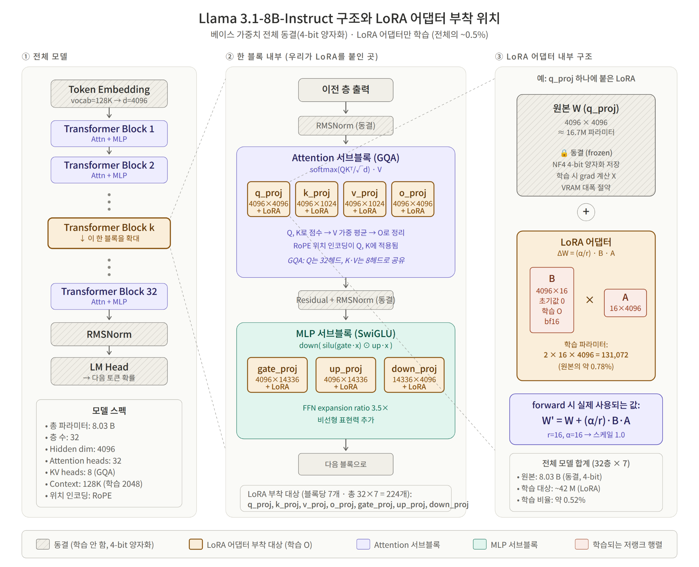

4月9日、昨日野心的に完成させたColabノートブックを使って、ついに人工知能モデル（Llama 3.1）の最初の学習（ファインチューニング）を試みました。しかし、現実はやはり甘くなく、数多くのエラーに直面しなければなりませんでした。同時に卒業研究6週目の中間発表資料まで作らなければならない過酷な一日でした。

{/* truncate */}

### Colabファインチューニングエラーとの終わりのない死闘

- **問題**: 昨日作成した`llama31_finetuning_colab.ipynb`を実行するやいなや、各種エラーが降り注ぎました。
- **過程**: 
  > 「llama31_finetuning_colab (3).ipynbでM1ファインチューニングの進行中にエラーが発生した理由は何でしょうか？」
  > 「実行した結果にeos_tokenが含まれています。なぜこのような問題が発生するのでしょうか？」
- **結果**: 人工知能(AI)モデルが学習データを吐き出す過程で特殊トークン（`eos_token`）の処理が正しく行われない問題、メモリオーバーフロー問題などが立て続けに発生しました。発生したエラーログ全体をClaudeにコピーして投げ（Pasted text）、解決策を受け取ってコードを修正するプロセスを何度も繰り返しました。結局、紆余曲折の末に学習が完了し、`学習データ別学習結果.png`という意味のある結果グラフを抽出することができました！

### AIアシスタントの発表資料(PPT)作成

- **問題**: モデル訓練で徹夜している中、すぐに来週の発表のために6週目のフロントエンドとデータベースの進行状況PPTを作成しなければなりませんでした。
- **過程**:
  > 「キャプディ_6週目_Frontend.pptxはこれまで進行した概要を紹介する画像集です。これを活用して今週の進行状況の発表資料を作ってください。」
  > 「データベース設計のテーブルをbackendに実装されたテーブルの関係を参考にして関係が見えるように表現して... テーブルが大きすぎてバラバラです。Userテーブルを中心にして配置してください。」
- **結果**: 驚くべきことに、AIはフロントエンドの画像スクリーンショットを組み合わせて発表スクリプトとスライドの骨組みを作ってくれました。さらに、私がバックエンドコードに基づいて複雑なデータベースERD（Entity Relationship Diagram）を描いてほしいと執拗にフィードバック（User中心配置）を与えると、完璧にデータベース関係図まで整理して説明してくれました。

今日はLlama 3.1という最新の言語モデルを直接自分の手（とAIの頭）でチューニングしてみる快感を感じた日です。同時に、コーディングだけでなく発表資料の作成、データベース(DB)アーキテクチャ図の設計まで、AIを100％活用する方法を身につけています。果たして私たちのマウムジギAIはどれくらい賢くなったのでしょうか？次回、そのテスト結果を公開します！

---

## 要約と重要なポイント

- **Llama 3.1 8Bの初回ファインチューニング完遂**: Google Colab環境において、`eos_token`の処理不備やメモリ溢れエラーをデバッグし、初のLoRA微調整を成功させました。
- **データセット別学習損失の可視化**: 学習プロセ스를改善し、データセットごとの損失収束グラフ（`학습데이터별학습결과.png`）を抽出してモデルの学習を確認しました。
- **AIを活用した発表スライド（PPT）の自動作成**: フロントエンド画面のスクリーンショットから、第6週の中間発表スライド構成と発表スクリプトを迅速に生成しました。
- **User中心のデータベースERD設計**: バックエンドコードのテーブル定義を基に、AIと協調してUserテーブルを中心とした関係図（ERD）を効率的に再設計しました。

