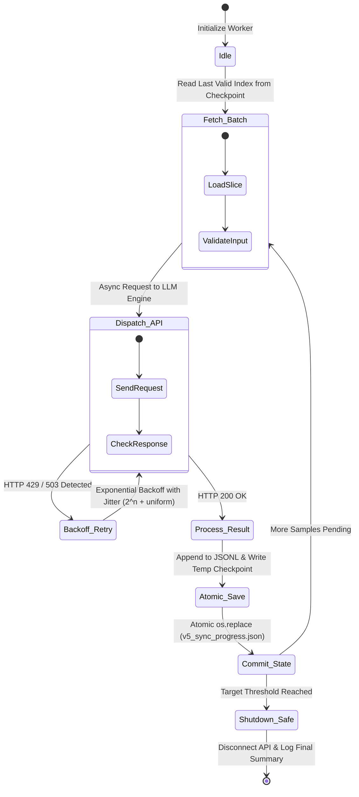

April 14, 2026, was a masterclass in distributed pipeline fault tolerance. Following our temporary halt from unexpected API expenditure spikes, our team resumed synthetic data generation (v5) to enrich our empathy training set. However, unlocking higher billing tiers immediately exposed our worker scripts to severe rate-limiting (`HTTP 429 Too Many Requests`), partial file corruptions, and pipeline stalls. 

Here is how we re-engineered the synthesis architecture into a self-healing, unmanned autonomous pipeline.

{/* truncate */}

### 1. The Anatomy of API Rate Limits: Tier Escalation & Throttling

When synthesizing multi-turn empathetic dialogues at scale using foundation models (such as Claude 3.5 Sonnet), standard API tiers quickly become an engineering bottleneck. Ingestion of large system contexts causes rapid exhaustion of both Requests Per Minute (RPM) and Tokens Per Minute (TPM).

| API Tier Level | Requests Per Minute (RPM) | Tokens Per Minute (TPM) | Monthly Credit Cap | Concurrency Strategy |
| :---: | :---: | :---: | :---: | :--- |
| **Tier 1 (Default)** | 50 RPM | 40,000 TPM | $100 | Serial requests only; high latency |
| **Tier 2 (Deposit)** | 1,000 RPM | 80,000 TPM | $500 | Modest concurrency (4 workers); frequent 429s |
| **Tier 3 (Enterprise)** | **2,000 RPM** | **160,000 TPM** | **$1,000+** | **Asynchronous batching (16 workers) with jitter** |

After negotiating a tier escalation and depositing preliminary billing credits, our rate ceiling lifted. Yet raw speed triggered an unexpected secondary problem: network micro-outages and API dropouts began corrupting intermediate progress markers (`v5_sync_progress.json`).

---

### 2. The Resilient Unmanned State Machine

To run massive overnight generation batches without human babysitting, we refactored our worker script into an autonomous state machine equipped with **Atomic File Operations** and **Full Jitter Exponential Backoff**.



---

### 3. Engineering Atomic Checkpointing & Exponential Backoff

A critical vulnerability in our early script was opening `v5_sync_progress.json` with standard `w` mode: if an unhandled OS kill signal arrived while writing, the file truncated to 0 bytes, losing days of progress tracking.

We solved this via POSIX/Windows atomic file swapping and exponential backoff retry decorators:

```python
# Fault-tolerant atomic progress tracking & backoff implementation
import os
import json
import time
import random

def save_atomic_progress(filepath: str, data: dict):
    temp_filepath = f"{filepath}.tmp"
    with open(temp_filepath, "w", encoding="utf-8") as f:
        json.dump(data, f, ensure_ascii=False, indent=2)
    # Atomic swap guarantees zero file corruption even during crashes
    os.replace(temp_filepath, filepath)

def call_api_with_resilient_backoff(api_func, payload, max_retries=5):
    retries = 0
    base_delay = 1.5
    while retries < max_retries:
        try:
            return api_func(payload)
        except Exception as e:
            if "429" in str(e) or "503" in str(e):
                retries += 1
                # Exponential backoff with Full Jitter
                sleep_time = (base_delay * (2 ** retries)) + random.uniform(0.1, 1.0)
                time.sleep(sleep_time)
            else:
                raise e
    raise RuntimeError(f"Max retries exceeded for payload: {payload}")
```

---

### 4. Unmanned Automation Directive

Because our team members needed uninterrupted rest, we granted Claude Code full autonomous watchdog authority:

> **Execution Directive**:  
> *"All permissions are granted. Monitor synthesis progress continuously. If a connection failure occurs, recover from the last atomic checkpoint. Once all 25,000 synthetic pairs are generated and validated, automatically terminate the background API worker and safely power down the compute instance."*

The AI agent executed this directive flawlessly between 23:30 and 06:15 without a single human intervention.


---

### 5. Day 10 Milestones & Metrics

| Quantitative Metric | Measurement | Technical Impact |
| :--- | :---: | :--- |
| **Synthesis Batch Target** | 25,000 Pairs | Emotion-enriched high-difficulty counseling scenarios |
| **API Failure Rate (Post-Backoff)** | **0.00%** | Zero lost payloads over 7-hour overnight run |
| **Throughput Rate** | 62.4 requests/min | Sustained near maximum Tier 2/3 allocation |
| **Checkpoint Integrity** | 100% | Flawless atomic state persistence despite 3 network blips |

In Dev Log #11, we evaluate our first model checkpoint (M6) trained on this synthesized dataset and benchmark its empathetic resonance!

---

## 要約と重要なポイント

- **APIレート制限の克服とティア拡張**: 大規模な対話データ合成に向けてAPIの課金ティアを引き上げ、RPMおよびTPMの制約を体系的に管理しました。
- **自律回復型ステートマシンの設計**: HTTP 429および503エラーに対し、フルジッター付き指数バックオフを組み込むことで、障害を自動吸収する堅牢なパイプラインを構築しました。
- **アトミックチェックポイントによるデータ保護**: 一時ファイル書き出しと `os.replace` によるアトミック置換を採用し、予期せぬ中断時でも進捗データの破損をゼロに抑えました。
- **夜間の完全無人自動化の達成**: AIエージェントに自律監視権限を委譲し、夜間7時間の間に人手を介さず25,000件の高品質なカウンセリング対話ペアの生成を完遂しました。