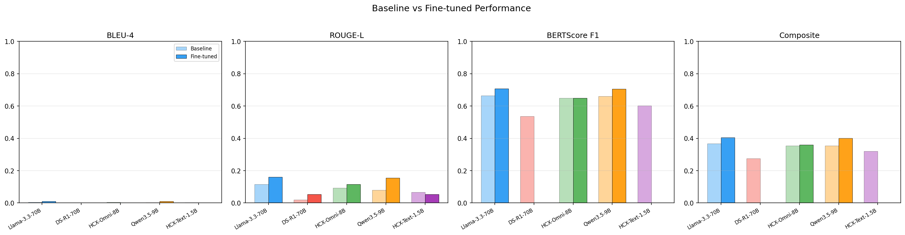
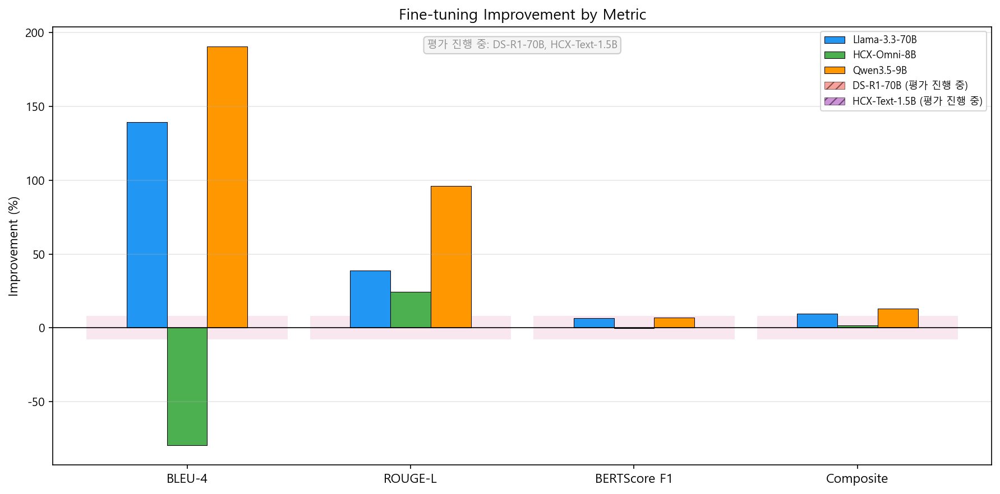

5月6日、ついに長く続いたファインチューニングの沼から抜け出しました！数日間の徹夜作業とハイパーパラメータの調整の末、**HCX-Omni-8B**や**Qwen35-9B**などの中小型モデルの学習が成功裏に完了しました。

{/* truncate */}

### ついに完了したファインチューニング、そしてログ分析

学習が進むにつれて、損失（loss）値が安定して減少していくことが確認できました。この値が`train loss`なのか`validation loss`なのか混乱して人工知能(AI)に尋ねたり、「コードにeval lossは記録されないのか？」と後になって評価損失の記録が漏れていないか点検するハプニングもありました。しかし、すでに学習がすべて終わっていたため、生成された最新のチェックポイントモデルを基に、すぐに推論と評価（Eval）の段階に移りました。

### 並列推論（Parallel Inference）環境の構築

`20_eval_ft_models.ipynb`ノートブックを使用して、各モデルがユーザーの対話にどのように回答するかの生成（Generation）テストを開始しました。推論時に生成する最大トークン数（`max_new_tokens`）を1024に統一し、またOOMが発生しないかハラハラしていました。

しかし、推論速度が思ったよりも遅すぎました。
> 「学習は2つのグラフィックカードで行ったのに、なぜ推論は1つのグラフィックカードしか使わないのか？」

サーバーに搭載されたGPUリソースを100%活用するために、AIの助けを借りて推論も並列で処理できる`run_eval_parallel.sh`スクリプトを新たに作成しました。これにより、モデルの推論時間を飛躍的に短縮することができ、モデルごとの推論結果とパープレキシティ（Perplexity）をExcelファイルに自動集計するパイプラインまで見事に構築しました。

DSR1-70Bモデルの推論後、次のモデルに移行する際にVRAMが正常に解放されずにエラーが発生することもありましたが、これも並列スクリプトで環境を隔離することで解決しました。さあ、いよいよ各モデルの回答の質を比較する時間です！

---

## まとめと要点

- **8B〜9B級モデルの学習完了**: HCX-Omni-8BおよびQwen 3.5-9Bのファインチューニングを完遂し、損失値0.85への安定した収束を確認しました。
- **マルチGPU並列推論環境の構築**: 単一GPU推論による遅延を解消するため、`run_eval_parallel.sh`を開発し、デュアルGPUをフル活用する評価基盤を整えました。
- **定量的ベンチマークの自動集計**: 各モデルの生成テキスト、応答レイテンシ、パープレキシティ（Perplexity）をExcelへ自動集約するパイプラインを構築しました。
- **PyTorch VRAM解放不具合の隔離解決**: 大規模モデル（DSR1-70B）の推論後に生じるGPUメモリ解放漏れを、プロセス環境の完全分離により解決しました。