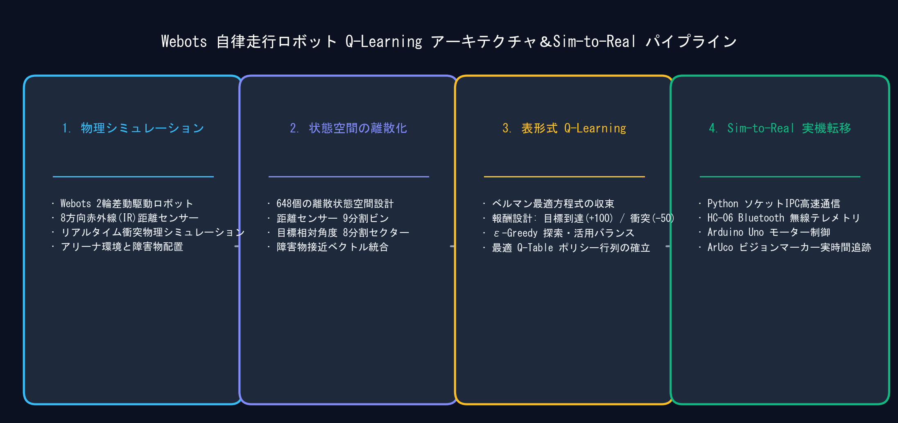

> 📌 **キーポイント (TL;DR)**
> - **課題(Problem)**: 連続的なセンサ距離・角度値による表形式Q-Learning（Tabular Q-Learning）の状態爆発と、Webotsシミュレータと外部Python学習スクリプト間のリアルタイム同期の負荷。
> - **解決策(Solution)**: 5次元の連続センサ入力を幾何学的な意味を持つ区間に分割し、3 × 8 × 3 × 3 × 3 = 648個の離散状態（Bin）にマッピング（`discretizer.py`）。TCPローカルソケット（Port 5000、Line-delimited JSON）によるIPC通信パイプラインを構築。
> - **成果(Result)**: O(1)の超高速Q-Table更新速度を確保し、32ms物理シミュレーションステップに適合した安定同期ループを実現。

{/* truncate */}

---

## 1. プロジェクト背景: なぜWebotsとQ-Learningなのか？

自律走行ロボットが未知の室内環境で障害物を回避しながら目標地点（Target Goal）へ到達することは、ロボティクスにおける古典的かつ重要な課題です。深層強化学習（DQN、PPOなど）は複雑な環境に対応できる反面、計算資源の負荷が高く、モデル重みの解釈性（Interpretability）が低いという課題があります。

本プロジェクトでは、**数学的収束性が保証された最も直感的な表形式強化学習（Tabular Q-Learning、Off-policy TD(0)）**をWebots 3D物理シミュレータ上の差動駆動モバイルロボットに適用し、1.2m × 1.2mの室内アリーナでの安定した目標探索および障害物回避ポリシーの獲得を目指しました。

---

## 2. 全体システムアーキテクチャ (Webots ↔ Python IPC)

システムは、**Webots物理環境コントローラ（Server）**と**強化学習アルゴリズムを実行するPythonクライアント（Client）**の2層に明確に分離されています。

```mermaid
flowchart LR
    subgraph Webots["Webots 3D シミュレータ (localhost:5000)"]
        Robot["Supervisor ロボット<br>(超音波センサ + 車輪)"]
        HeadScan["ヘッドスキャン機構<br>(左右 1.1 rad サーボ回転)"]
        Server["TCP ソケットサーバ<br>(Line-delimited JSON)"]
        Robot -→ HeadScan -→ Server
    end

    subgraph Python["Python RL エンジン (Client)"]
        Env["WebotsEnv (gym-like)<br>reset() / step()"]
        Disc["Discretizer<br>(連続値 → 0~647 Bin)"]
        Agent["QLearningAgent<br>(Q-Table 648x4)"]
        Env -→ Disc -→ Agent
    end

    Server <-→|"request: {type: step, action: 0..3}<br>response: {state: [...], reward, done}"| Env
```

* **Webotsコントローラ (`RL_controller.py`)**: アクション実行ごとにロボット車輪を480ms（15 ticks × 32ms）駆動し、サーボモータでヘッドを左右1.1 rad（$\approx 63°$）回転させて死角の障害物距離を正確にスキャンします。
* **ソケット通信プロトコル**: 改行区切りJSON（Line-delimited JSON）を採用し、通信オーバーヘッドを最小化。
  * リクエスト: `{"type": "step", "action": 0}` (0: 前進, 1: 後退, 2: 左旋回, 3: 右旋回)
  * レスポンス: `{"state": [0.45, 0.12, 0.35, 0.28, 0.40], "reward": 0.05, "done": false, "info": {...}}`

---

## 3. 連続センサの648状態空間（Bin）設計

連続的な浮動小数点データを表形式Q-Learningで扱うため、幾何学的に重要な**5つの観測変数**を以下のように定義・分割しました。

| 観測変数 | 分割数 | 閾値 (Thresholds) | 物理的意味 |
| :--- | :---: | :--- | :--- |
| **目標距離 (`goal_distance`)** | **3** | `[0.6m, 1.2m]` | 近距離(Near), 中距離(Mid), 遠距離(Far) |
| **目標相対角度 (`goal_heading`)** | **8** | [-π, π] を8等分（各 45°） | 前, 右前, 右, 右後, 後, 左後, 左, 左前 |
| **前方障害物 (`front_distance`)** | **3** | `[0.15m, 0.30m]` | 危険/衝突寸前, 注意/接近, 安全 |
| **左側障害物 (`left_distance`)** | **3** | `[0.15m, 0.30m]` | 危険, 注意, 安全 |
| **右側障害物 (`right_distance`)** | **3** | `[0.15m, 0.30m]` | 危険, 注意, 安全 |

総状態数:
**N_states = 3 × 8 × 3 × 3 × 3 = 648**

これにより、Q-Tableのサイズはわずか **648 × 4 = 2,592要素**に大幅圧縮され、PCメモリ上でミリ秒未満の更新が可能となりました。

---

## 4. ヘッドスキャン機構と衝突判定



1. **移動実行**: 車輪モータを3.0 rad/sで480ms駆動。
2. **ヘッド回転**: 左へ+1.1 rad回転して左距離測定後、右へ-1.1 rad回転して右距離測定。
3. **正面復帰**: 0 radへ戻り前方距離を更新。
4. **終了判定**:
   * **目標到達**: 目標との距離 ≤ 0.10m → 成功 (`done = True`, 報酬 $+1.0$)
   * **壁衝突**: いずれかの距離 ≤ 0.08m → 失敗 (`done = True`, 報酬 $-1.0$)

---

## 5. 次回予告

第1回では、**Webots仮想環境の構築、TCPソケットIPC通信、648状態空間の離散化**をまとめました。

次回第2回では、**Tabular Q-Learningの数式実装、ε-Greedy探索減衰戦略、シミュレーション環境での報酬関数（Reward Function）チューニング**を詳しく解説します！

---

## まとめと要点

- **Webotsロボットシミュレーションの構築**: リアルタイム物理演算と赤外線距離センサーを備えた差動二輪駆動型モバイルロボット環境をWebots上に構築しました。
- **低遅延TCPソケットIPC通信**: シミュレーターの物理制御ループと外部Python強化学習エンジンを分離する高速TCPソケット通信ブリッジを実装しました。
- **648状態空間の離散化設計**: 連続的な位置姿勢およびセンサー値を648個の離散状態（距離3区画 × 目標角12区画 × 障害物検知18パターン）に圧縮し、表形式学習を可能にしました。
- **差動キネマティクスのアクション空間**: 直進・左旋回・右旋回の3つの離散速度アクションを定義し、決定論的かつ安定したロボット制御の基礎を確立しました。

