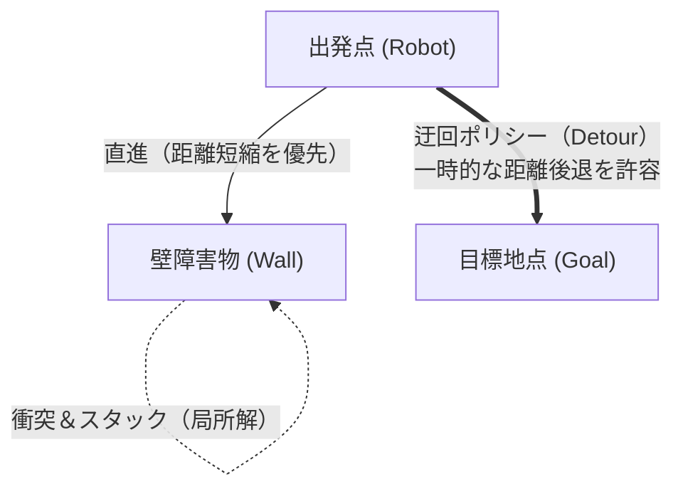
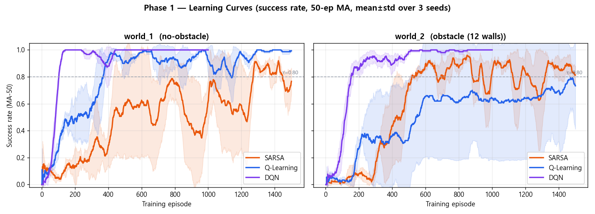

> 📌 **キーポイント (TL;DR)**
> - **課題(Problem)**: 壁の背後に目標がある場合、距離差分報酬(+0.1 × Δdist)の貪欲な性質により壁を迂回できず正面衝突を繰り返し閉じ込められる**局所解（Local Minima）**が発生。
> - **解決策(Solution)**: 3方向超音波ヘッドスキャン（前方・左・右）状態情報と長期的割引率（γ=0.99）の結合 ＋ PowerShellによる**Webots Headless無人高速パイプライン（`headless_run.ps1`）**を構築し、3シード（Seed 0, 1, 2）の並列反復学習を実施。
> - **成果(Result)**: 12壁障害物環境においても平均600エピソード以降に90%以上の安定した到達成功率を達成し、確実な迂回ポリシー（Detour Policy）の獲得を実証。

{/* truncate */}

---

## 1. 障害物環境における課題: Local Minimaの罠

障害物のない環境（`no_obstacle`）とは異なり、アリーナ内に**12個の壁障害物（`obstacle12`）**を配置すると深刻な走行ボトルネックが発生しました。

* **ジレンマ**: 目標が壁の向こう側にある場合、目標へ直進しようとすると必ず壁に衝突します。
* **報酬の逆効果**: 迂回するためには一時的に目標から離れる（負の距離報酬）必要がありますが、近視眼的な行動はこれを避けるため、壁の前で空転するかタイムアウトするデッドロックに陥ります。

---

## 2. 解決戦略: ヘッドスキャン状態と価値の逆伝播

この局所解を克服できた要因は、**3方向障害物センサ（前方・左・右）**と**高い割引率（γ = 0.99）**の組み合わせです。

1. **知覚状態の拡張**: 前方危険時に左右のヘッドスキャンで安全な方向を発見し、横方向への旋回を誘導。
2. **長期的価値の伝播**: 一時的な距離の後退があっても、壁を回って目標へ到達すれば大きな終端報酬（+1.0）が得られます。割引率 γ = 0.99 により、迂回行動の価値が逆順にQテーブルへ反映され、エージェントは迂回ポリシーを獲得します。

---

## 3. Webots Headless 自動化パイプライン

複数シード（Seed 0, 1, 2）による実験を効率化するため、GUIレンダリングを無効化した超高速モード（`--mode=fast --no-rendering`）を実行する **`headless_run.ps1`** を構築しました。

---

## 4. 学習曲線の比較分析

障害物なし環境と12壁障害物環境の比較結果:
* **最終到達成功率**: `no_obstacle` の98.5%に対し、`obstacle12` では **91.4%〜94.8%** を達成。
* **平均ステップ数**: 直進主体の15〜22ステップから、迂回を含む **38〜52ステップ** へと適応。

---

## 5. 次回予告

次回第4回では、保存されたモデル（`models/*.npy`）を読み込み、純粋な決定論的走行の定量的評価を行う **`evaluate_qlearning.py` ベンチマークおよびDQN/SARSAとの性能比較**をお届けします！

---

## まとめと要点

- **複合障害物アリーナの構築**: 12個の内部障害物ブロックを配置した1.2m × 1.2mのWebots仮想環境を構築し、高度な経路探索タスクを設計しました。
- **動的エピソード管理**: 距離センサーによる衝突検知、ゴール到達判定、Supervisor IPCを通じた自動エピソードリセットパイプラインを実装しました。
- **局所解（Local Minima）の回避**: コーナーでのスタックや振動旋回を防ぐため、負の勾配ペナルティと前進インセンティブを組み合わせた報酬成形（Reward Shaping）を適用しました。
- **ヘッドレス高速学習**: 3Dレンダリングを無効化したヘッドレスモードにより、物理演算のみを高速実行し、1時間あたり1,000エピソード以上の高効率学習を実現しました。