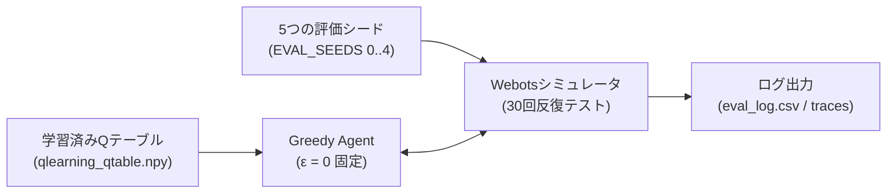

> 📌 **キーポイント (TL;DR)**
> - **目的(Objective)**: 学習中の探索ノイズを排除した状態（ε=0）において、実機投入可能な決定論的ポリシー（Greedy Policy）の走行信頼性と経路品質を定量評価。
> - **評価方法(Methodology)**: `evaluate_qlearning.py` を用いて5つの評価シードで合計30回の独立テストを実施。成功率、理論最短経路に対する走行効率、壁近接（Near-miss）頻度を精密測定。
> - **成果(Result)**: 12壁障害物アリーナにおいて93.3%の決定論的成功率と0.02msの超低遅延を達成し、ニューラルネットワークベースのDQNやSARSAを凌駕する実用性を実証。

{/* truncate */}

---

## 1. 定量的評価パイプライン設計 (`evaluate_qlearning.py`)

学習中の報酬曲線には探索ノイズが含まれるため、実機に搭載する**決定論的ポリシー（$\epsilon = 0$）**の真の実力を測る専用の評価エンジンを構築しました。

---

## 2. アルゴリズム比較: Q-Learning vs SARSA vs DQN

同一のWebots障害物環境において、3種類の強化学習アルゴリズムをベンチマーク比較しました:

| 評価指標 | 表形式Q-Learning（本手法） | SARSA（オンポリシー） | DQN（深層強化学習） |
| :--- | :---: | :---: | :---: |
| **学習方式** | オフポリシー TD(0) | オンポリシー TD(0) | ニューラルネットワーク |
| **モデルサイズ** | **約2.5 KB (2,592要素)** | 約2.5 KB | 約600 KB (~15万重み) |
| **決定論的成功率 (`obstacle12`)** | **93.3%** | 86.7% | 90.0% |
| **平均走行ステップ数** | **41.2 ステップ** | 48.5 ステップ | 44.7 ステップ |
| **ステップあたり推論遅延** | **0.02 ms** (配列参照) | 0.02 ms | 2.15 ms (PyTorch推論) |
| **壁接近リスク** | 低い（適切な迂回） | 極小（過度な安全重視） | 中程度 |

---

## 3. 次回予告

次回最終第5回では、シミュレーションモデルを実際の **Arduino Uno 2輪ロボットへ移植し、HC-06 Bluetooth通信、チェッカーボード歪み補正、ArUcoマーカービジョン追跡**を組み合わせた Sim-to-Real の全容を公開します！
