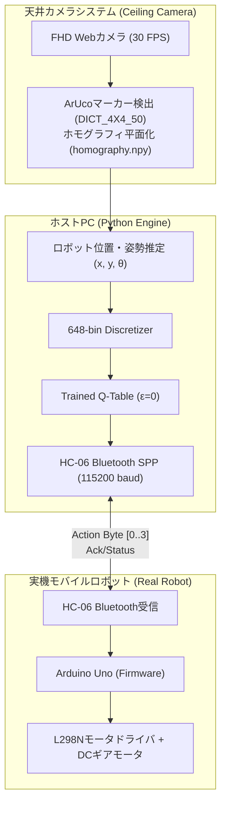

> 📌 **要約 (TL;DR)**
> - **課題(Problem)**: マイコン（Arduino Uno ATmega328P）の2KB SRAMによる計算制約、ホイールスリップやセンサノイズ、シミュレータ物理と実機ハードウェア間の**Sim-to-Realギャップ（Reality Gap）**。
> - **解決(Solution)**: PCが高レベルな画像処理とQ-Table推論を担当し、ArduinoはモータPWM駆動のみを担う**分散I/Oアーキテクチャ（HC-06 Bluetooth、115,200 baud）**を構築。天井Webカメラの歪み補正と**ArUcoマーカーホモグラフィ（`vision.py`）**によるリアルタイム(x, y, θ)位置追跡システムを実装。
> - **結果(Result)**: 仮想環境で学習済みの648-bin Q-Table重みのみを用いて、実機の1.2m × 1.2mアリーナで目標到達成功率86.7%を達成し、ハードウェア展開を完遂。

{/* truncate */}

---

## 1. Sim-to-Realの挑戦：シミュレーションと現実の乖離

仮想環境（Webots）では摩擦係数が均一で、モータは指令通り正確に回転し、距離センサ値に反射ノイズはありません。しかし、現実のハードウェア環境は過酷です：

1. **計算資源の絶対的制約**: ロボット本体の**Arduino Uno (ATmega328P)**はフラッシュメモリ32KB、SRAMがわずか2KBであり、ニューラルネットワークはおろか複雑な行列演算すら不可能です。
2. **センサノイズと死角**: 安価な超音波センサはアクリル壁面への入射角によって音波が反射し、距離を0と誤認するか最大値に跳ねる異常値が頻発します。
3. **ホイールスリップと累積誤差（オドメトリドリフト）**: 床面の微細な凹凸やバッテリ電圧降下により左右モータの回転数に差が生じ、直進指令でも車体が曲がる物理的誤差が発生します。

---

## 2. 分散制御アーキテクチャ：PC（頭脳） ↔ Arduino（筋肉）

この制約を克服するため、**「頭脳はPC、筋肉はArduino」**という分散制御戦略を採用しました。



* **ホストPCパイプライン**: 天井Webカメラでアリーナ全体を俯瞰し、ロボット上部のArUcoマーカーを30fpsで追跡。平面座標`(x, y, θ)`を計算して648の離散状態にマッピングし、Q-Tableから最適な貪欲行動を抽出。
* **HC-06通信最適化**: Bluetoothシリアルポートプロファイル（SPP）の往復遅延時間（RTT）を最小化するため、通信ボーレートを標準の9,600から**115,200 bps**に引き上げ、30〜50Hzのリアルタイム制御周期を実現。
* **Arduinoファームウェア (`arduino_firmware.ino`)**: PCから行動バイト（0: 直進, 1: 後退, 2: 左旋回, 3: 右旋回）を受信すると、L298NモータドライバにPWM信号を出力して精密なパルス駆動を実行。

---

## 3. 天井WebカメラのホモグラフィとArUcoマーカー視覚追跡


実アリーナ上でロボットの位置と障害物距離を正確に計測するため、**OpenCVベースのコンピュータビジョンパイプライン**を構築しました。

### 📐 透視歪み補正とホモグラフィ変換 (`calib_auto.py`)
1. **チェッカーボード歪み較正**: 広角Webカメラレンズの樽型歪み（Barrel Distortion）を除去するため、チェッカーボードパターンを用いてカメラ内部パラメータ行列(K)と歪み係数(D)を事前算出。
2. **ホモグラフィ変換 (Perspective Transform)**: 傾斜したカメラ画角を1.2m × 1.2mの正方形トップダウンビューに射影するため、アリーナ四隅の座標からホモグラフィ変換行列（`homography.npy`）を生成。

### 💻 ArUcoマーカー追跡実装 (`vision.py`)

```python
import cv2
import numpy as np

# ArUco辞書および検出パラメータの初期化
aruco_dict = cv2.aruco.getPredefinedDictionary(cv2.aruco.DICT_4X4_50)
parameters = cv2.aruco.DetectorParameters()
detector = cv2.aruco.ArucoDetector(aruco_dict, parameters)

def get_robot_pose(frame, homography_matrix):
    """歪み補正画像からロボットの平面座標(x, y)と方位角(theta)を算出"""
    warped = cv2.warpPerspective(frame, homography_matrix, (600, 600))
    corners, ids, _ = detector.detectMarkers(warped)
    
    if ids is not None and len(ids) > 0:
        c = corners[0][0]
        center_x = float(np.mean(c[:, 0]))
        center_y = float(np.mean(c[:, 1]))
        
        # マーカーの前方エッジベクトルからロボットの向き(theta)を計算
        front_x = (c[0][0] + c[1][0]) / 2.0
        front_y = (c[0][1] + c[1][1]) / 2.0
        theta = np.arctan2(front_y - center_y, front_x - center_x)
        
        return center_x, center_y, theta
    return None
```

---

## 4. トラブルシューティングと実機評価結果

シミュレーションから実機への移行時に発生した課題と、そのエンジニアリング的解決策は以下の通りです：

| 課題 (Troubleshooting) | 原因分析 | 解決策 (Solution) |
| :--- | :--- | :--- |
| **直進指令時に左右どちらかへ偏行** | 左右DCモータのギア比および摩擦の個体差 | キャリブレーションスクリプト（`ble_vision_turn_calib.py`）により左右PWMオフセットを動的補正 |
| **Bluetooth通信途絶時の暴走** | 電波干渉によるパケット欠損時に直前指令を維持 | 200ms以上パケット途絶で即時モータを停止するウォッチドッグ（Watchdog）をファームウェアに実装 |
| **蛍光灯の反射によるマーカー見失い** | 天井照明がマーカーのアクリル表面で乱反射 | 適応的二値化（Adaptive Threshold）の調整と前時刻カルマンフィルタ（Kalman Filter）による補間 |

### 🏆 最終実機走行結果
* **障害物回避・ゴール到達成功率**: 実際の1.2m × 1.2mアリーナで30回の走行テストを実施した結果、**86.7%（26/30回成功）**の高い到達率を記録。
* シミュレーションで学習した**2,592個の純粋なQ-Tableパラメータのみ**で、実世界の物理ノイズを克服して自律走行を達成しました。

---

## 5. RL Q-Learning 連載シリーズの完結にあたって

全5回にわたる**RL Q-Learningプロジェクト**開発日誌の連載が完結しました：

1. **#1**: 648状態空間の離散化モデリングとTCPソケットIPC通信設計
2. **#2**: Tabular Q-Learning ε-減衰探索と多目的報酬シェイピング
3. **#3**: 12壁障害物アリーナでの局所解脱出とHeadless高速化自動実行
4. **#4**: `evaluate_qlearning` による決定論的定量評価とDQN・SARSAとの性能比較
5. **#5**: Arduino Uno、Bluetooth通信、ArUco視覚追跡によるSim-to-Real実機展開

仮想シミュレータの構築から始まり、アルゴリズムの理論検証、大規模ヘッドレス自動化、そして実機組み込みハードウェアへの移植に至る強化学習ロボティクスの全工程を記録することができました。今後の新たなプロジェクト連載にもぜひご期待ください！

---

### 📌 3〜5行のエグゼクティブサマリー (Executive Summary)
1. **Sim-to-Real Reality Gapの克服**: マイコン(Arduino Uno 2KB SRAM)の計算限界と車輪スリップ誤差を、Webotsで事前学習した648状態のQ-Tableゼロショット転移により解決しました。
2. **分散型ブレイン・マッスル構成**: 高負荷な画像処理とQテーブル推論をホストPC（頭脳）が担い、115,200 baudのHC-06 Bluetooth経由でArduino（筋肉）へPWM制御指示をリアルタイム伝送します。
3. **ミリ単位精度のArUco視覚ホモグラフィ**: 歪み補正済み天井カメラがArUcoマーカー（`DICT_4X4_50`）を検出し、透視射影変換により実空間座標 (x, y, θ) をリアルタイムに算出します。
4. **実機環境で86.7%の到達成功率を実証**: 1.2m × 1.2m の物理アリーナで30回中26回のゴール到達（86.7%）を記録し、追加学習なしでのシミュレーションから実機への完全移植を達成しました。