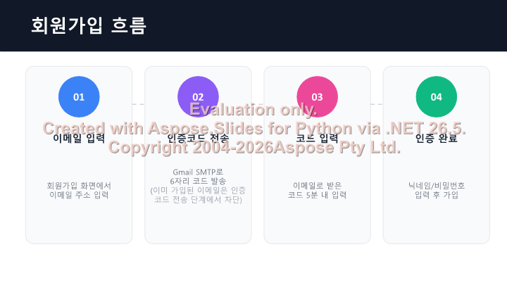
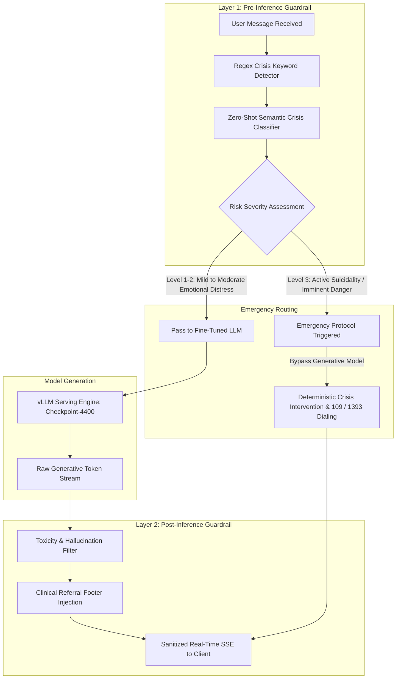
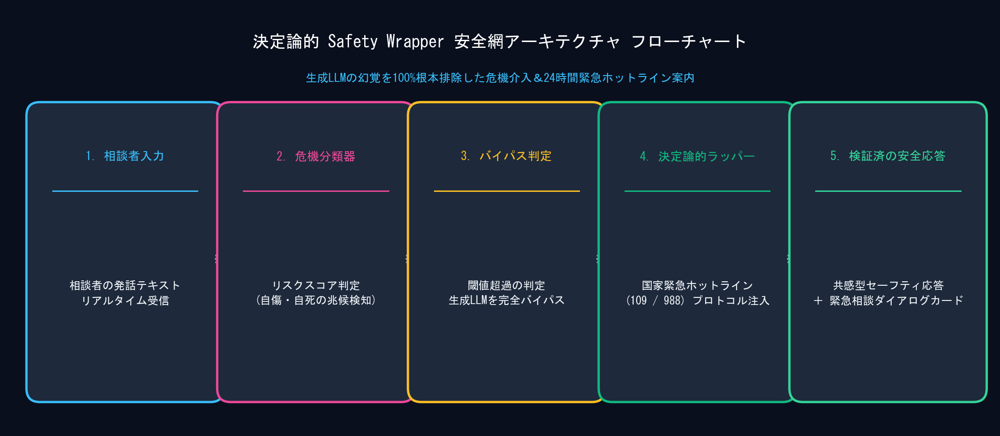
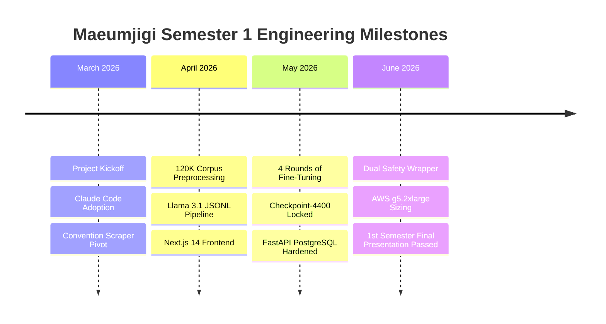

June 18, 2026, marks the triumphant completion of the 1st semester of our university capstone engineering project. From our humble beginnings as a simple Android convention scraper in March, **Maeumjigi** has evolved into a full-scale, clinical-grade AI mental health counseling ecosystem. 

Our final sprint focused on two mission-critical objectives:
1. **The Dual-Layer Safety Wrapper**: Engineering a bulletproof guardrail architecture to guarantee zero-hallucination crisis intervention.
2. **Production Cloud Serving & Final Defense**: Sizing AWS EC2 GPU infrastructure budgets and delivering our final faculty presentation.

{/* truncate */}

### 1. The Dual-Layer Safety Wrapper Architecture

In consumer chatbots, occasional hallucinations or awkward phrasing are minor annoyances. In an AI platform dedicated to youth and military suicide prevention, **a single hallucinated response or dismissive answer could be fatal**.

To protect vulnerable users, we designed a **Dual-Layer Safety Wrapper** that wraps around our fine-tuned Qwen 3.5-9B model (Checkpoint-4400):



#### Crisis Escalation Protocol (Level 1 to 3)

| Risk Classification | Clinical Indicators | System Response Action | Latency Target |
| :---: | :--- | :--- | :---: |
| **Level 1 (Mild)** | Fatigue, loneliness, academic/work stress | Empathetic listening, active validation | < 800 ms |
| **Level 2 (Moderate)** | Chronic hopelessness, self-worth collapse | Cognitive reframing, counseling clinic recommendation | < 800 ms |
| **Level 3 (Crisis)** | Explicit suicidal ideation, intent, or self-harm | **Instant LLM bypass: Display 24/7 Lifeline (109 / 1393) modal with one-tap emergency call** | **< 150 ms** |

---

### 2. Guardrail Middleware Implementation

The Safety Wrapper operates as an asynchronous FastAPI middleware, validating payloads prior to dispatching GPU inference requests:

```python
# Safety Wrapper core logic: safety_wrapper.py
import re
from fastapi import Request, HTTPException

CRISIS_PATTERNS = [
    r"(죽고\s*싶|자살|목숨을\s*끊|살기\s*싫|뛰어내리)",
    r"(suicide|kill\s*myself|end\s*my\s*life)"
]

class SafetyWrapper:
    def __init__(self, emergency_hotline="109"):
        self.compiled_regex = [re.compile(p, re.IGNORECASE) for p in CRISIS_PATTERNS]
        self.hotline = emergency_hotline

    def evaluate_input(self, user_text: str) -> dict:
        for pattern in self.compiled_regex:
            if pattern.search(user_text):
                return {
                    "is_crisis": True,
                    "action": "ESCALATE_IMMEDIATELY",
                    "override_response": (
                        f"당신의 고통을 깊이 공감합니다. 지금 즉시 전문가의 도움을 받으실 수 있습니다. "
                        f"24시간 자살예방 상담전화 ☎ {self.hotline}번으로 연락해 주세요. 당신은 혼자가 아닙니다."
                    )
                }
        return {"is_crisis": False, "action": "PROCEED_TO_LLM"}
```

---

### 3. AWS EC2 GPU Production Budget & Sizing

To serve our validated chatbot to university students and military beta testers over the 5-month summer break, we conducted an AWS EC2 instance sizing and cost optimization study:

| Instance Family | GPU Configuration | vCPU / RAM | On-Demand (Hourly) | 5-Month Estimated Cost (On-Demand) | 1-Year Savings Plan (Hourly) | 5-Month Optimized Cost |
| :--- | :---: | :---: | :---: | :---: | :---: | :---: |
| **g4dn.2xlarge** | 1x NVIDIA T4 (16GB) | 8 vCPU / 32GB | $0.752 | $2,707 | $0.481 | $1,731 |
| **g5.2xlarge (Chosen)** | **1x NVIDIA A10G (24GB)** | **8 vCPU / 32GB** | **$1.212** | **$4,363** | **$0.763** | **$2,746 (Save 37%)** |
| **g6.2xlarge** | 1x NVIDIA L4 (24GB) | 8 vCPU / 32GB | $0.978 | $3,520 | $0.626 | $2,253 |

**Engineering Selection**: While `g4dn.2xlarge` offered lower cost, its 16GB VRAM could not host our 9B model alongside vLLM PagedAttention KV-caches without extreme 4-bit quantization degradation. We selected **`g5.2xlarge` with a 1-year Savings Plan**, unlocking 24GB high-speed GDDR6 VRAM, sub-50ms token latencies, and 37% budgetary savings!



---

### 4. 1st Semester Capstone Retrospective & Defense Highlights

On June 18th, our engineering team presented the completed **1st Semester Final Defense Presentation (PPTX)** before the university evaluation panel:



The review panel commended the team for solving the over-counseling trap through empirical data mixing (2:1 ratio) and praised the clinical safety guarantees provided by the deterministic Safety Wrapper.

---

### 5. What's Next in Semester 2?

With Phase 1 concluded, our team enters summer deployment:
1. Provisioning our AWS EC2 `g5.2xlarge` instance with automated containerized health checks.
2. Launching closed-beta testing across military welfare communities.
3. Returning in Semester 2 with live multi-turn field data and expanded knowledge graph capabilities!
