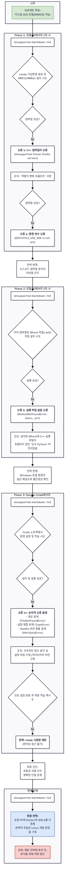
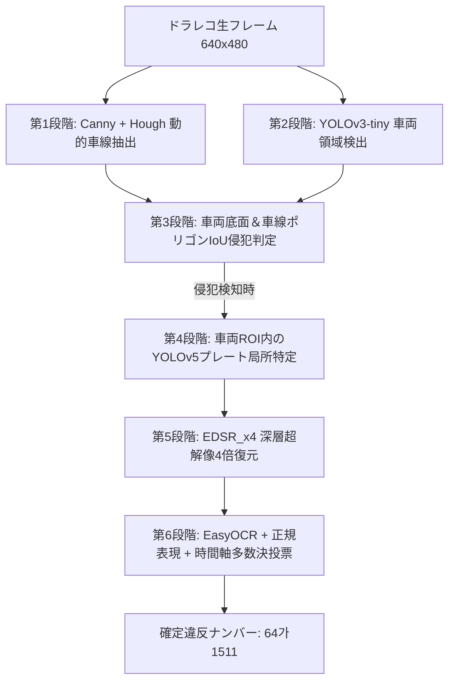

> 📌 **Key Takeaways (要約)**
> - **課題**: ドラレコの低解像度映像は、車体振動、逆光、モーションブラー、強いH.264圧縮ノイズにより、ナンバープレートが著しく潰れ、車線侵犯のリアルタイム追跡が極めて困難です。
> - **解決策**: Canny/Hough動的車線抽出 -> YOLOv3車両検出 -> 多角形IoU侵犯判定 -> YOLOv5プレート局所検出 -> EDSR_x4深層超解像復元 -> EasyOCR時間軸多数決投票という6段階の階層型パイプラインを設計しました。
> - **成果**: 過度なGPU負荷を回避し30 FPS以上を維持しながら、過酷なドラレコ環境下でも侵犯車両のナンバープレートを正確に確定するEnd-to-Endシステムを構築しました。

{/* truncate */}

---

## 1. プロジェクト背景: なぜドラレコ映像の認識は難しいのか？

高度道路交通システム（ITS）や自動交通違反取締において、**リアルタイム車線侵犯検知と自動ナンバープレート認識（ANPR）**は中核となる技術です。しかし実際の車載ドラレコ映像を処理する際には、多くの光学的・物理的障害に直面します:

1. **極端な低解像度とテクスチャの潰れ**: 640x480フレーム内において、対象車両のナンバープレート領域はわずか30x15〜50x25ピクセル程度しかなく、文字の線画が完全に一体化してしまいます。
2. **路面振動とローリングシャッター歪み**: 走行中の段差や急ブレーキ、急な車線変更による角度変化が直線の幾何学的推定を妨げます。
3. **リアルタイム処理のレイテンシ**: 重大なフレーム単位の重層モデル適用は深刻なフレーム落ちを引き起こし、実時間の追跡を破綻させます。

---

## 2. 6段階の階層型パイプラインアーキテクチャ




---

## 3. 主要システム設定値 (`CONFIG`)

```python
CONFIG = {
    "output_width": 640,
    "output_height": 480,
    "conf_threshold_vehicle": 0.5,
    "nms_threshold_vehicle": 0.4,
    "min_vehicle_w": 70,
    "min_vehicle_h": 70,
    "lane_iou_threshold": 0.05,
    "detection_interval": 15,
    "min_plate_area_for_ocr": 1200,
    "plate_history_size": 7,
    "plate_confirm_threshold": 3,
    "sr_model": "EDSR_x4.pb",
    "yolo_plate_model": "lp_det.pt"
}
```

---

## 4. 次回予告

第2編では、**Cannyエッジ検出、確率的ハフ変換（HoughLinesP）、傾きフィルタリング数学**、および車両バウンディングボックスと車線間の**動的ポリゴンIoU侵犯判定アルゴリズム**を詳しく解説します。
