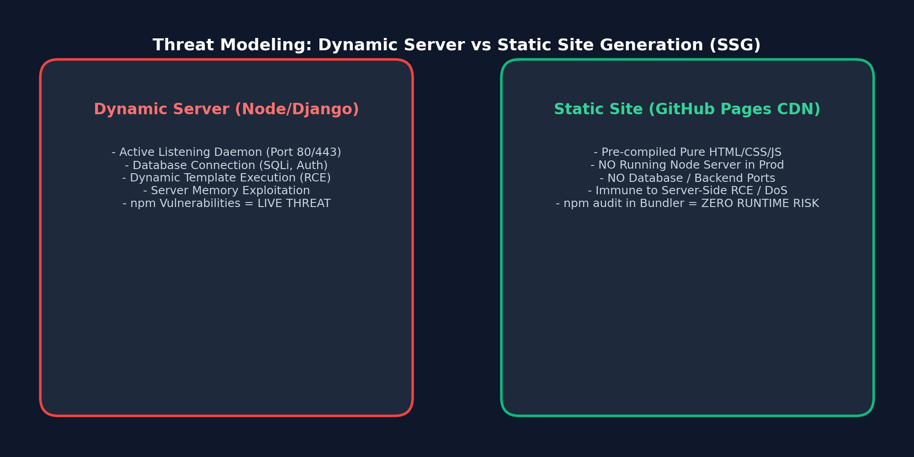
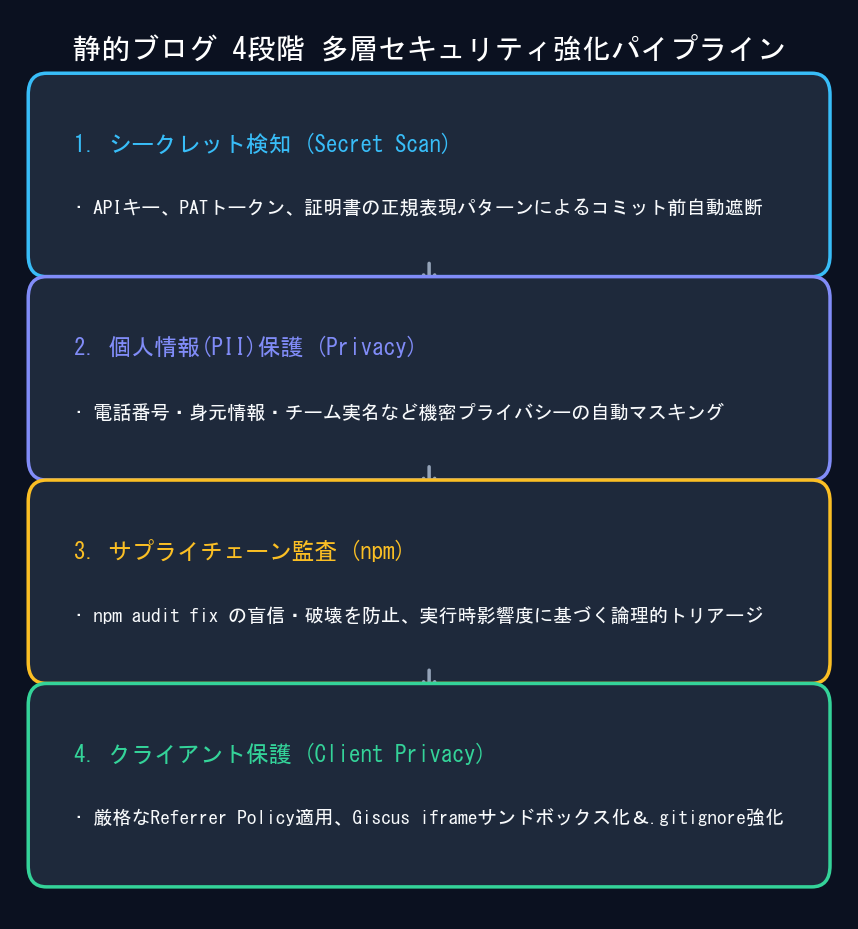

モダンなフロントエンドやドキュメントサイトを運用するエンジニアであれば、一度は血の気が引くような経験をしたことがあるはずです。何気なく `npm audit` を実行した瞬間、コンソールに警告が溢れ出します：

```text
45 vulnerabilities (15 moderate, 15 high, 15 critical)
To address all issues (including breaking changes), run:
  npm audit fix --force
```

**Critical**、**Remote Code Execution (RCE)**、**Prototype Pollution** といった不穏な単語を目にすると、反射的に `npm audit fix --force` を実行して赤い警告を消したくなります。

しかし、DocusaurusやNext.jsなどの **静的サイトジェネレーター(SSG)** をGitHub PagesやAWS S3にデプロイするアーキテクチャでは、この無分別なダウングレードこそが最新フレームワークを破壊する最大の原因になります。

本記事では、**静的サイトの脅威モデル (Threat Model)** を明確にし、ビルドツールとランタイム脆弱性の本質的な違いを分析した上で、実際に守るべき **4層のセキュリティ対策** を共有します。

{/* truncate */}

---



---

## 1. 3行まとめ：エンジニアリングの判断基準

1. **ビルド時ツール != 本番ランタイム**: 警告されたパッケージ（`tinypool`、`serialize-javascript` など）は、ローカルPCで `npm run build` を実行するときだけ動作するバンドラー依存関係です。
2. **CDN上に稼働するサーバーはない**: ビルド後のGitHub Pagesには純粋なHTML/CSS/JSしか残りません。**稼働中のNode.jsデーモンも、リッスンしているポートも、データベース接続も存在しません。**
3. **`--force` の危険性**: `--force` で無理に依存関係を書き換えると、Docusaurusが古いバージョン(3.7.0)に巻き戻され、React 19やMDX v3との互換性が完全に壊れます。
4. **静的サイトの本当の脅威**: 狙われるのはサーバーではなく、**Git履歴内のAPIキー流出**、**データセット内の個人情報(PII)**、**クライアントのリファラー漏洩**です。

---

## 2. 45件の脆弱性の正体：ビルド時 vs ランタイム

### A. Tinypool のプロトタイプ汚染 (`GHSA-5gmw-xhrv-c9v3` - Critical)
- `tinypool` はビルドタスクをローカルCPUコアに分散するためのライブラリです。入力値は自身の `docusaurus.config.ts` のみであり、外部の攻撃者がCDN経由でビルドワーカーに悪意あるペイロードを送信することは不可能です。

### B. Serialize-JavaScript の RCE (`GHSA-5c6j-r48x-rmvq` - High)
- Webpackが静的チャンクを書き出す際に使用します。出力されたJSファイルは単なる静的ファイルとして配信されるだけであり、サーバー上で逆シリアル化が実行されることはありません。

### C. PostCSS Selector Parser の DoS (`GHSA-rj75-hqrm-r3gf` - Moderate)
- パース対象のCSSは開発者が作成したスタイルシートです。GitHubリポジトリの書き込み権限が奪われない限り、悪意ある外部CSSが混入することはありません。

結論として、SSG環境で `npm audit fix --force` を叩くことは、**存在しない脅威を防ぐために正常に動作しているシステムを破壊する行為**に他なりません。

---

## 3. 実践的4層セキュリティ・ブループリント



### 第1層：Gitプリコミット・シークレットスキャン自動化
最も致命的なリスクは、APIキー（OpenAI `sk-...`、GitHub PAT `ghp_...`、AWS `AKIA...`）を誤って公開コミットすることです。Gitの追跡ファイルを正規表現で一括検査する監査スクリプト（`tools/audit_security.py`）を構築し、リリース前にゼロ漏洩を保証します。

### 第2層：個人情報(PII)とデータセット保護
AI相談やナンバープレート認識プロジェクトでは、実データの代わりにLLMパイプラインで生成した **合成対話データ (`synth_gen`)** を活用し、医療倫理やプライバシー侵害を根本から排除しています。

### 第3層：堅牢な `.gitignore` 設定
`.env`、SSL秘密鍵（`*.pem`, `*.key`）、CSV解析ダンプファイル（`*.csv`）が誤って公開リポジトリにプッシュされないよう設定を強化しました。

### 第4層：クライアント側プライバシー保護
- **厳格なリファラーポリシー**: `strict-origin-when-cross-origin` を適用し、外部サイトへ遷移する際にブログの詳細URLパスが漏洩しないよう保護。
- **Giscus iframeサンドボックス**: `emitMetadata="0"`, `loading="lazy"` を設定し、第三者スクリプトによるセッション干渉を遮断。

---

## 4. エンジニアへの提言

- **赤い警告に惑わされない**: その脆弱性が「ローカルのビルドツール」なのか「本番サーバー」なのかを切り分けることがセキュリティの本質です。
- **真の攻撃対象に注力する**: シークレットの検出自動化、個人情報の排除、適切なプライバシー設定こそが、技術ブログの信頼性を高める鍵となります。