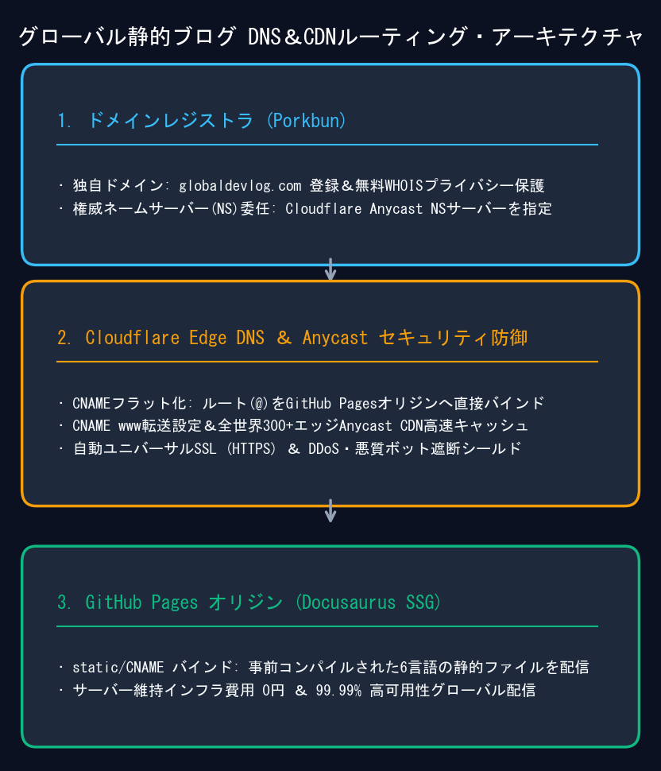
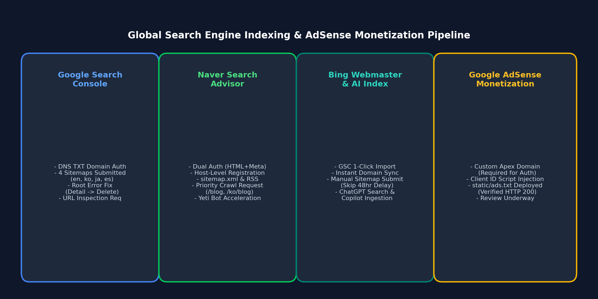

GitHub Pagesの無料サブドメイン（`username.github.io/project`）上で技術ブログを運営することは手軽で便利ですが、プロフェッショナルな収益化を目指す段階で大きな技術的障壁に直面します。**Google AdSenseは `*.github.io` などの無料サブドメインでのサイト登録を厳格に禁止**しているためです。AdSenseの審査を通過し、ドメイン評価（Domain Authority）を蓄積するためには、独自の**ネイキッド／カスタムドメイン（Apex Domain）**が不可欠です。

静的サイトジェネレーター（SSG）におけるドメイン移行は、単なるDNSレコードの書き換えにとどまりません。レジストラ（Porkbun）のネームサーバー委任、エッジSSL終端、CNAMEフラット化、ビルドルートの再設定、`ads.txt` のホスティング、そして各国検索エンジンのUIトラップの回避が必要です。

本記事では、`jbjihwan.github.io/global_blog` から独自ドメイン `https://globaldevlog.com` へのゼロダウンタイム移行アーキテクチャと、Google Search Console、Naver Search Advisor、Bing Webmaster Toolsのトラブルシューティングを包括的に解説します。

{/* truncate */}

---



---

## 1. アーキテクチャ戦略: Porkbun + Cloudflare + GitHub Pages

GitHub Pagesにネイキッドドメインを接続する際、GitHubのIPアドレスに対して素の `A` レコードを直接指定する従来の手法は、エッジキャッシュ、DDoS保護、自動SSL更新の観点で脆弱です。

そこで、高可用性を担保する**3層アーキテクチャ**を採用しました:

| レイヤー | プロバイダー | 主な役割 |
| :--- | :--- | :--- |
| **レジストラ** | **Porkbun** | ドメイン（`globaldevlog.com`）取得、無料WHOISプライバシー保護、CloudflareへのNS委任 |
| **エッジDNS & セキュリティ** | **Cloudflare** | グローバルAnycast DNS、ルートCNAMEフラット化、Universal SSL暗号化、Bot防御 |
| **オリジンSSG** | **GitHub Pages** | Docusaurus静的アーティファクト配信、サーバー管理不要・維持費0円、`gh-pages`自動同期 |

### Porkbun ネームサーバー委任
Porkbunの管理コンソールで、デフォルトのネームサーバーをCloudflare指定のものに切り替えます:
```text
NS: roan.ns.cloudflare.com
NS: sneh.ns.cloudflare.com
```

### Cloudflare CNAME Flattening設定
RFC 1034の制限により、通常ルートドメイン（`@`）にCNAMEは設定できませんが、Cloudflareの **CNAME Flattening** 技術により、GitHub Pagesへの直接プロキシが可能になります:
- **Type**: `CNAME` | **Name**: `@` | **Target**: `jbjihwan.github.io` | **Proxy status**: Proxied
- **Type**: `CNAME` | **Name**: `www` | **Target**: `jbjihwan.github.io` | **Proxy status**: Proxied
- **SSL/TLSモード**: **Full**（またはFull Strict）を選択し、エンドツーエンドの暗号化を確保します。

---

## 2. Docusaurus 設定マイグレーション

サブパス（`/global_blog/`）からドメインルート（`/`）へスムーズに移行するため、`docusaurus.config.ts` を修正します:

```typescript
const config: Config = {
  title: 'Global Dev Blog',
  url: 'https://globaldevlog.com',
  baseUrl: '/',
  organizationName: 'jbjihwan',
  projectName: 'global_blog',
  trailingSlash: false,
  // ...
};
```

### 静的 CNAME ファイルの配置
GitHub Pagesが正しいリポジトリにルーティングできるよう、`static/CNAME` を作成します:
```text
globaldevlog.com
```
デプロイコマンド（`npm run deploy`）により、`static/` 配下のファイルはすべてビルドルート（`gh-pages` ブランチの最上位）へ自動配置されます。

---

## 3. 静的サイト向け Google AdSense 審査設定

Google AdSenseの審査プロセスには、サイト所有権の確認、広告スクリプトの挿入、ルートパスにおける `ads.txt` のクロール検証が含まれます。

### A. パブリッシャースクリプトの非同期挿入
`docusaurus.config.ts` の `scripts` 配列にコードを挿入します:

```typescript
  scripts: [
    {
      src: 'https://pagead2.googlesyndication.com/pagead/js/adsbygoogle.js?client=ca-pub-4654073335496617',
      async: true,
      crossorigin: 'anonymous',
    },
  ],
```

### B. ルート `ads.txt` の配置と稼働検証
`static/ads.txt` を作成し、パブリッシャー情報を記述します:
```text
google.com, pub-4654073335496617, DIRECT, f08c47fec0942fa0
```
本番環境で HTTP 200 が返ることを確認します:
```bash
curl -I https://globaldevlog.com/ads.txt
# HTTP/2 200
# content-type: text/plain; charset=utf-8
```

---



---

## 4. 検索エンジン別 SEO & トラブルシューティング

### A. Google Search Console: サイトマップ削除UIの落とし穴
誤ってルートURL（`https://globaldevlog.com/`）をサイトマップとして送信してしまった場合、テーブル行右側の3点リーダー（`⋮`）をクリックしても削除ボタンが表示されず、無効化された「インデックス登録を表示」しか見当たりません。

**解決手順:**
1. 表右端のメニューではなく、**エラーが発生しているURLテキストそのものを直接クリック**して詳細ビューを開きます。
2. 詳細画面右上のヘッダーにある縦3点リーダー（`⋮`）をクリックします。
3. 表示されるメニューから **[サイトマップの削除]** を選択すると、誤登録が即座に消去されます。
4. 一時的に「取得できませんでした」となった多言語サイトマップ（例: `es/sitemap.xml`）は、上の入力欄から再送信することで即時**成功**に転換します。

### B. Naver Search Advisor: 「URLをホスト単位で入力してください」
韓国最大手ポータルNaverの登録手順におけるポイント:
1. **ホスト単位エラーの回避**: 最初の「サイト登録」画面でサイトマップURLを入力するとエラーダイアログが出ます。ドメイン名のみで登録を完了させた後、管理画面内の **[リクエスト] > [サイトマップ送信]** にて `sitemap.xml` を入力します。
2. **HTML認証＋メタタグの二重配備**: `static/naver<hash>.html` と設定ファイル内メタタグの双方を配備し、確実な所有権認証を実現します。
3. **Yetiクローラーの優先巡回**: **[リクエスト] > [ウェブページの収集]** にて `blog`, `ko/blog` 等の主要パスをリクエストし、インデックス反映を促進します。

### C. Bing Webmaster Tools & AI検索（Copilot / ChatGPT）連携
- **GSCワンクリックインポート**: Googleアカウント連携により、検証済みドメインと登録サイトマップを1秒で複製同期します。
- **48時間の同期遅延を短縮**: Googleからのデータ自動反映を待つことなく、左側メニュー **[Sitemaps]** から `https://globaldevlog.com/sitemap.xml` を手動送信することで、Bingクローラーの即時巡回を促せます。

---

## 5. 本番検証チェックリスト

- [x] **DNS正常性**: `globaldevlog.com` および `www` がSSL警告なしで正常に応答
- [x] **CNAME配置**: GitHub Pagesデプロイ先ルートに `CNAME` が存在
- [x] **ads.txt検証**: 配信パスでパブリッシャーIDが正常出力
- [x] **多言語サイトマップ**: 全言語用サイトマップ（`sitemap.xml`, `ko/`, `ja/`, `es/`）がHTTP 200を返却
- [x] **主要検索エンジンの設定完了**: Google, Naver, Bing すべてで所有権確認およびインデックス収集進行中

これにより、サーバー運用費完全0円のまま、高速なエッジCDN、多言語SEOインフラ、そしてGoogle AdSenseの収益基盤が万全に整いました。

---

### 📌 3〜5行のエグゼクティブサマリー (Executive Summary)
1. **運用費0円の高可用性エッジ基盤**: 無料の `github.io` からPorkbun、Cloudflare DNS、GitHub Pagesの3層構成へ移行し、サーバー費完全ゼロでAnycast配信と常時SSL化を達成します。
2. **CNAME Flattening と正規化ルーティング**: DNSのルート制約をCloudflareの平坦化技術で突破し、`www` からネイキッドドメインへの正規化リダイレクトを安全に統合します。
3. **アドセンス審査と ads.txt の完全対策**: 静的 `<head>` への確認タグ直埋め込みと `static/ads.txt` のルート配信により、クローラーの404エラーや審査脱落を確実に防止します。
4. **3大検索エンジンへの網羅的インデックス**: 多言語サイトマップとRSSフィードをGoogle、Naver、Bingに正確に連携し、ホストエラーを回避してグローバル検索流入を最大化します。