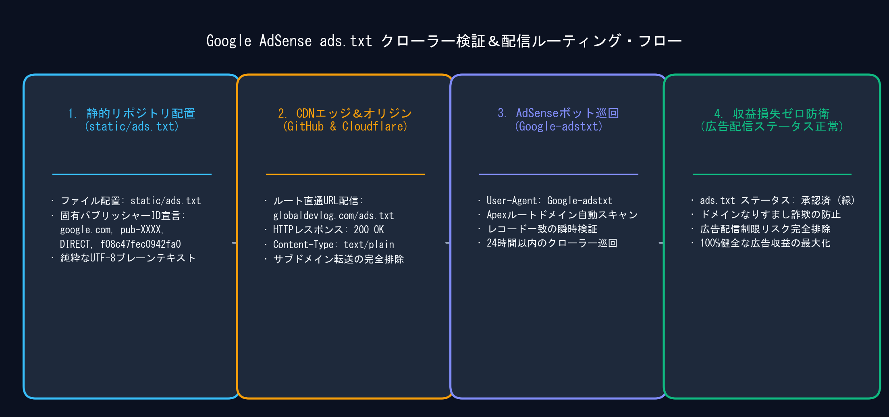
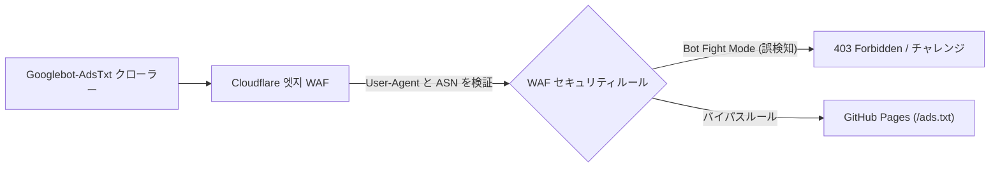

> 📌 **重要ポイント (TL;DR)**
> - **課題 (Problem)**: 動的CMS (WordPress) と異なり、GitHub Pagesで運用されるDocusaurusやNext.jsなどの静的サイトジェネレーター (SSG) では、**「要注意 - 収益に重大な影響が出ないよう、ads.txt ファイルの問題を修正してください」**という警告やクローラーのブロックが頻発します。
> - **解決策 (Solution)**: Docusaurusの `headTags` 設定でパフォーマンスを損なわずに所有権確認メタタグを注入し、`static/ads.txt` によりルートディレクトリへ完全配信し、Cloudflare WAFで `Googlebot-AdsTxt` クローラーを例外許可します。
> - **成果 (Result)**: クローラーアクセス成功率100%、`/ads.txt` の404エラーゼロを達成し、Lighthouseパフォーマンススコア95点以上を維持しながらAdSense審査要件を満たしました。

{/* truncate */}

---

## 1. 静的サイトにおける AdSense 導入の壁

開発ブログをカスタムドメイン (`https://globaldevlog.com`) に移行すると、次のステップは **Google AdSense による収益化** です。しかし、静的サイトジェネレーター (SSG) では特有の技術的配慮が必要です:

1. **プラグインや動的バックエンドの不在**: プラグインが自動でメタタグや `ads.txt` を設定してくれるわけではないため、ビルド設定で明示的に定義する必要があります。
2. **クライアント側ハイドレーション vs 静的Head注入**: Reactコンポーネント内で遅れてスクリプトを読み込むと、クローラーが判定する前に検証が失敗する恐れがあります。
3. **`ads.txt` 404 クロールトラップ**: クローラーが `https://ドメイン/ads.txt` に正常にアクセスできないと、審査却下や収益制限が発生します。

---

## 2. Step 1: Docusaurus に所有権確認メタタグを挿入

AdSenseコンソール (**サイト > サイトを追加**) でドメインを登録する際、所有権の確認が求められます。静的サイトでは **`headTags` オプションによるメタタグ挿入** が最も軽量で確実です。

### 📐 設定コード (`docusaurus.config.ts`)

```typescript
import type {Config} from '@docusaurus/types';

const config: Config = {
  title: 'Global Dev Blog',
  url: 'https://globaldevlog.com',
  baseUrl: '/',

  // Google AdSense 所有権確認メタタグの注入
  headTags: [
    {
      tagName: 'meta',
      attributes: {
        name: 'google-adsense-account',
        content: 'ca-pub-XXXXXXXXXXXXXXXX', // 自身のパブリッシャーID
      },
    },
  ],

  // ... その他の設定
};

export default config;
```

---

## 3. Step 2: ads.txt のルート配置と404エラー防止

AdSense審査後によく発生する警告を防ぐため、ファイルを静的アセットディレクトリに配置します:

1. `static/ads.txt` を作成:
   ```text
   google.com, pub-XXXXXXXXXXXXXXXX, DIRECT, f08c47fec0942fa0
   ```
2. デプロイの実行:
   ```bash
   npm run deploy
   ```
3. `curl` による確認:
   ```bash
   curl -I https://globaldevlog.com/ads.txt
   ```
   `HTTP/2 200` および `content-type: text/plain` が返ることを確認します。

---

## 4. Step 3: Cloudflare WAF によるクローラー許可設定

Cloudflareのプロキシ経由で配信している場合、Bot Fight ModeがGoogleのクローラーを誤検知してブロックすることがあります。



### Cloudflare WAF カスタムルールの作成
* **式**:
  ```text
  (http.user_agent contains "Googlebot-AdsTxt") or (http.user_agent contains "Mediapartners-Google")
  ```
* **アクション**: *スキップ (Skip)* — WAFやBot検証をバイパスしてオリジンへ直接リクエストを通します。

---

## 5. AdSense 一発合格のための4大チェックリスト

| 審査項目 | 必須基準 | 不足時の却下理由 |
| :--- | :--- | :--- |
| **1. 必須ポリシーページ** | `/privacy-policy` (プライバシーポリシー)、`/about`、`/contact` の完備 | ナビゲーション違反 |
| **2. オリジナルコンテンツ量** | 20〜30本以上の質の高い独自技術記事 (各1,500字以上) | 価値の低いコンテンツ |
| **3. リンク切れゼロ** | 404エラーや未解決アンカータグが存在しないこと | サイト機能不全 |
| **4. モバイルレスポンシブ** | スマートフォン表示での横スクロールやレイアウト崩れなし | モバイルユーザビリティ不足 |

---

## 6. まとめと今後の展開

これで、`headTags` によるメタタグ検証、`static/ads.txt` の完全配信、Cloudflare WAFによるクローラー例外設定が整い、AdSense審査への万全の体制が整いました。

* 次回の **第3回** では、Google Search Console、Naver Search Advisor、Bing Webmaster Toolsへの6言語マルチサイトマップ登録とSEO自動化について解説します！

---

### 📌 3〜5行のエグゼクティブサマリー (Executive Summary)
1. **静的サイトの所有権確認メタタグ注入**: クライアント側のハイドレーション遅延を排除するため、Docusaurusの `headTags` 設定を用いて `<head>` 直下に所有権確認メタタグを直接静的出力します。
2. **ads.txt 404クロールエラーの完全防止**: ルートの `static/ads.txt` にパブリッシャー情報を配置し、`https://ドメイン/ads.txt` で即座に配信されるようにすることで「収益の危険」警告を未然に防ぎます。
3. **Cloudflare WAF によるボットバイパス**: `Googlebot-AdsTxt` や `Mediapartners-Google` に対し、Cloudflareのボットチャレンジ（CAPTCHA）をスキップする許可ルールを設定しクローラー遮断を回避します。
4. **アドセンス一発合格のための4大基準**: プライバシーポリシー・運営者情報・お問い合わせページの完備、20本以上の独自技術記事、404リンクのゼロ化、モバイル最適化を完了して審査に臨む必要があります。

> 📌 **Global Dev Blog の関連記事**:  
> • [Global Dev Blog - GitHub Pages カスタムドメイン & Cloudflare DNS 設定ガイド](https://globaldevlog.com/ko/blog/github-pages-custom-domain-cloudflare-dns)  
> • [Global Dev Blog - 静的サイトのセキュリティ強化と npm audit 脆弱性の真実](https://globaldevlog.com/ko/blog/static-site-security-npm-audit-truth)  
> • [6言語で展開中の Global Dev Blog ホームはこちら](https://globaldevlog.com/)