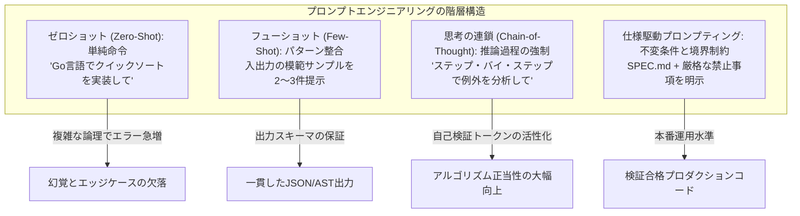
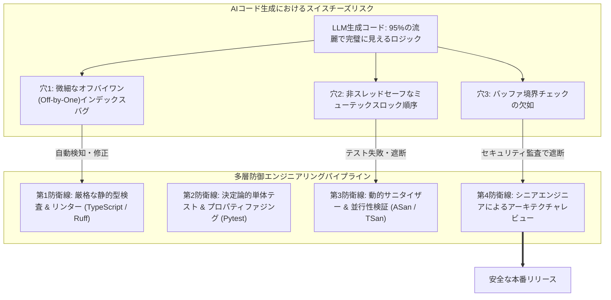

スタンフォード大学の最先端ソフトウェア工学講義 **CS146S: 現代のソフトウェア開発者 (The Modern Software Developer)** 第2講の深層技術解説へようこそ。

第1講では、開発者が単なる構文のタイピストから、自律型AIエージェントチームを統率する「オーケストラの指揮者」へと進化するパラダイムシフトを概観しました。**第2講 (Week 1)** では、この革命を支える計算エンジンである **コーディング大規模言語モデル (Coding LLMs)** の内部動作メカニズムと、これらを制御するソフトウェア工学手法である **プロンプトエンジニアリング (Prompt Engineering)** を徹底的に解剖します。

Andrej Karpathyの *Deep Dive into LLMs*、OpenAIの *How OpenAI Uses Codex*、Google CloudおよびDAIR.AIの最新研究に基づき、モデルがプログラミング言語を習得する数学的プロセス、一見完璧に見えるAIコードに潜む致命的な欠陥（**スイスチーズモデル**）、そしてそれを防衛する **「信頼せよ、されど検証せよ (Trust but Verify)」** のアーキテクチャを完全網羅します。

{/* truncate */}

---

### 1. LLMの内部解剖：3段階のトレーニングパイプライン

AIコーディングモデルを正確に操りデバッグするためには、その重み（Weights）がどのような過程を経て鍛造されたかを理解する必要があります。現代の大規模言語モデルは単一のルールエンジンではなく、厳格な **3段階パイプライン** を経て構築されます：

```mermaid
flowchart LR
    subgraph ステップ1 ["ステップ1: 事前学習 (Pre-training)"]
        D1[Webデータ & GitHubコード<br/>数兆トークン] --> N1[Transformerベースモデル<br/>次トークン確率予測 P(w_t | Context)]
    end

    subgraph ステップ2 ["ステップ2: 教師あり微調整 (SFT)"]
        N1 --> D2[高品質な対話ペア<br/>指示応答プロトコル注入]
        D2 --> N2[指示追従型アシスタント<br/>開発者ペルソナの確立]
    end

    subgraph ステップ3 ["ステップ3: 人間のフィードバックによる強化学習 (RLHF)"]
        N2 --> D3[人間の選好ランキング評価<br/>報酬モデル(Reward Model)調整]
        D3 --> N3[プロダクションコーディングLLM<br/>安全かつ整列されたコード生成]
    end
```

#### 1.1. 事前学習 (Pre-training): 教師なしの知識吸収
事前学習において、デコーダー専用(Decoder-only)のTransformerモデルはペタバイト規模のWebテキストとオープンソースリポジトリを処理します。テキストは文字や単語単位ではなく、**BPE (Byte-Pair Encoding)** によってサブワードトークンに分割されます：
- 1トークンは約3〜4文字、または頻出する構文断片（`def `, `return `, `const ` など）に相当します。
- 損失関数は非常にシンプルな **「次トークン予測 (Next-Token Prediction)」** です：

```text
P(w_t | w_1, w_2, ..., w_t-1) = Softmax(W_v * h_t-1)
```

- 数兆トークンのコードを通じて、モデルは構文木、アルゴリズムパターン、標準ライブラリのAPI仕様を潜在空間に埋め込みます。しかし、事前学習のみを終えたベースモデルは単なる「超巨大な自動補完エンジン」に過ぎず、開発者の指示に従って対話することはできません。

#### 1.2. 教師あり微調整 (SFT): 対話プロトコルの注入
自動補完エンジンを有能なペアプログラマーに変貌させるため、**SFT (Supervised Fine-Tuning)** を実施します。
- 熟練エンジニアが作成した数万件の高品質な `<指示, 模範コード解答>` ペアを学習させます。
- これにより、Markdownコードブロックのフォーマット、エッジケースの解説、丁寧な技術解説トーンを身につけます。

#### 1.3. RLHF と DPO (Direct Preference Optimization) によるアライメント
SFTモデルであっても、非効率、安全性の低いコード、または過度に冗長な実装を出力することがあります。
- 同一のプログラミング問題に対してモデルが生成した複数の候補コードを、人間のレビュアーが品質・安全性・可読性で順位付けします。
- この順位データを用いて **報酬モデル (Reward Model)** を学習させ、PPOやDPOアルゴリズムを通じて人間の意図に合致するよう重みを最適化します。

> **核心概念**: IDE上でAIが提示するコードは、意識を持った知性の発露ではなく、*世界中のトップエンジニアが書いたであろう「理想のコード」を統計学的に超高速シミュレーションした結果*です。

---

### 2. Codexはどのようにコードを理解するのか？

OpenAIの研究論文 *How OpenAI Uses Codex* によれば、LLMが自然言語よりもプログラミング言語において極めて優れた能力を示す理由は3つあります：

1. **決定論的構文と抽象構文木 (AST)**: 自然言語と異なり、コードは文脈自由文法 (CFG) に厳格に従い、曖昧さなく **抽象構文木 (AST)** にパースできます。
2. **長距離依存関係 (Long-range Invariants)**: 5行目で宣言された型は80行目の関数呼び出しと厳密に一致する必要があります。Transformerのマルチヘッド自己注意機構 (Self-Attention) は、この長距離構文制約を追跡するのに数学的に最適です。
3. **GitHubの大規模事前学習**: 何億ものオープンソースリポジトリを事前学習したことで、現代のフレームワークやデザインパターンを網羅しています。

しかし、コーディングLLMはトークン生成中に実際にコードをコンパイルしたり実行したりしません。統計的パターンに基づいて生成するため、非推奨となったAPIの引数を渡したり、微妙な競合状態を生み出すコードを悪意なく平然と出力します。

---

### 3. ソフトウェア工学としてのプロンプトエンジニアリング

プロンプトエンジニアリングは単なる「対話のコツ」ではありません。スタンフォードCS146Sでは、**確率的モデルから決定論的 (Deterministic) な成果物を引き出すための厳格なソフトウェア設計手法** と定義されます。



#### 3.1. ゼロショット vs フューショット
- **ゼロショット**: 例示を与えずに直接命令する方法。単純なボイラープレート変換（例: JSONスキーマからTypeScript型定義への変換）に適しています。
- **フューショット**: 2〜3件の入出力例をプロンプト内に含める手法。モデルの重みを更新することなく **インコンテキストラーニング (In-context Learning)** を活用し、社内のAPI規約やJSON形式を遵守させます。

#### 3.2. 思考の連鎖 (Chain-of-Thought, CoT)
複雑な並行処理やアルゴリズムを要求する際、即座にコードを書かせると論理エラーが多発します。
そこで次の指示を注入します：
> *"コードを書く前に、発生しうる3つの競合状態(Race Condition)を段階的に分析し、メモリバリアの不変条件をテキストで明示してください。"*

Transformerは直前に生成されたトークンを参照して次を生成するため、**推論ステップを先に出力させることで自己検証コンテキストが形成され、コードの正答率が飛躍的に向上**します。

---

### 4. AIコード生成の「スイスチーズモデル」

第2講で最も強調されたメンタルモデルは、Andrej Karpathyが提唱した **スイスチーズモデル (Swiss Cheese Model)** です。

安全工学においてJames Reasonが提唱したスイスチーズモデルは、複数の防護壁に空いた穴が偶然一直線に重なったときに大事故が起きるという理論です。AIコーディングではこれが逆向きに作用します：



#### なぜコーディングLLMには穴が空いているのか？
AIは200行の数学的に見事な動的計画法コードを瞬時に出力しますが、187行目に境界外参照エラーを潜ませたり、デッドロックを引き起こすロック順序を含ませたりします。

コードが極めて綺麗に書かれているため、人間はシステムを盲信する **自動化バイアス (Automation Bias)** に陥ります。AI生成コードを無批判にマージすると、その穴をすり抜けて本番障害が発生します。

---

### 5. 「信頼せよ、されど検証せよ」エンジニアリングアーキテクチャ

スタンフォードCS146Sが提唱する防御的ハーネス設計です：

```mermaid
sequenceDiagram
    autonumber
    actor Dev as 設計者 (ソフトウェアエンジニア)
    participant Spec as SPEC.md 不変条件
    participant LLM as コーディングLLM (Claude Code / Cursor)
    participant Gate as 自動検証ゲート (Verification Gate)
    participant Prod as 本番Mainブランチ

    Dev->>Spec: 正式な仕様と不変条件を定義
    Dev->>LLM: SPECとコンテキストを与えて実装指示
    LLM->>LLM: 思考の連鎖(CoT)による推論実行
    LLM->>Gate: コードと単体テストを自動コミット

    rect rgb(30, 41, 59)
        note over Gate: 自動化多層検証パイプライン
        Gate->>Gate: 1. 厳格な静的型チェック (tsc / mypy)
        Gate->>Gate: 2. 単体・統合テストの実行 (Pytest)
        Gate->>Gate: 3. プロパティベースの境界ファジング (Fuzzing)
    end

    alt 検証失敗
        Gate-->>LLM: スタックトレースをフィードバック (ループ工学)
        LLM->>Gate: 自己修復パッチを再提出
    else 全ゲート合格
        Gate-->>Dev: 100%合格メトリクスとGit Diffを提出
        Dev->>Dev: アーキテクチャおよびセキュリティ最終レビュー
        Dev->>Prod: 本番環境へマージ
    end
```



---

### 6. プロンプトパラダイム比較マトリクス

| 評価軸 | 対話型ゼロショット | フューショット・スキーマ | スタンフォードCS146S 仕様駆動 (SDD) |
| :--- | :--- | :--- | :--- |
| **入力形式** | 自然言語チャット (`"このバグ直して"`) | システムプロンプト + JSON入出力例2〜3件 | 正式なMarkdown仕様書 (`SPEC.md`) + 不変条件 |
| **モデルの推論** | 制約のない単発トークン生成 | サンプルスキーマに合わせた条件付き生成 | 思考の連鎖 (CoT) + MCPツール呼び出しループ |
| **幻覚(ハルシネーション)率** | **高** (未知のエッジケースで30〜45%) | 構文上は**低**、業務論理は**中** | **極めて低** (自動テストハーネスで完全防衛) |
| **再現性** | 低（表現の揺らぎで結果が変動） | 高（定型スキーマの抽出） | 完全（Gitで仕様とテストコードをバージョン管理） |
| **主たる適用領域** | アイデア出し、構文検索 | データ構造変換、APIパーサー開発 | 本番機能開発、リファクタリング、インフラ自動化 |

---

### 7. スタンフォード講義Q&A：大規模コードベースにおける課題

> **Q. なぜLLMは小さな競技プログラミング問題は完璧に解くのに、10万行の大規模企業リポジトリになると急に幻覚を起こしてコードを壊すのですか？**

**教員回答:**
これこそが **「コンテキスト飽和 (Context Saturation)」と「アテンションの希釈 (Attention Dilution)」** の問題です。
1. 数万行のコードを無差別にコンテキストウィンドウへ投入すると、Transformerの自己注意重みが不要なトークン全体へ分散します。
2. コンテキストが長大化すると **「Lost in the Middle (中央位置の情報の忘却)」** 現象が生じ、冒頭の指示と直前の入力ばかりに注目し、中央にある重要な不変条件を無視してしまいます。
3. したがって現代のAI工学では、コード全体を渡すのではなく、**ASTシンボルマップと依存関係グラフのみを高密度に抽出して注入する技術** が不可欠です。（第3講のMCPおよび第4講で詳解します）。

---

### 8. 第2講のまとめ

1. **マシンの本質を理解せよ**: コーディングLLMは統計的シミュレーターです。
2. **思考の連鎖を活用せよ**: CoTで中間推論トークンを生成させ、正答率を高めてください。
3. **スイスチーズを警戒せよ**: 綺麗なコードほど自動化バイアスを捨て、隠れたバグを疑ってください。
4. **信頼せよ、されど検証せよ**: 自動化されたテストハーネスを構築し、人間はアーキテクチャの検証に注力してください。

---

### 参考文献 & 公式教材
- **公式YouTubeプレイリスト**: [Stanford CS146S: The Modern Software Development (YouTube Playlist)](https://www.youtube.com/playlist?list=PLxpwjSdVZQ95OWe3QvkVEcU1f1X-6NDj9)
- **主要文献**: Andrej Karpathy, *Deep Dive into LLMs*; OpenAI, *How OpenAI Uses Codex*; Google Cloud & DAIR.AI, *Prompt Engineering Guide*.
- **提供機関**: スタンフォード大学 コンピュータサイエンス学科
