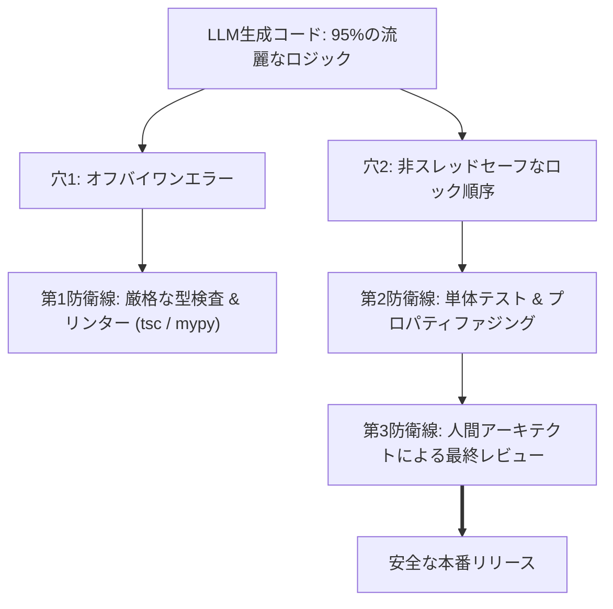

スタンフォード大学の最先端ソフトウェア工学講義 **CS146S: 現代のソフトウェア開発者 (The Modern Software Developer)** 第2講の技術解説へようこそ。

第1講では、開発者が単なる構文のタイピストから、複数のAIエージェントを指揮する「オーケストラの指揮者」へと進化するパラダイムシフトを概観しました。**第2講 (Week 1)** では、この革命を支える計算エンジンである **コーディング大規模言語モデル (Coding LLMs)** の動作メカニズムと、これらを制御する **プロンプトエンジニアリング (Prompt Engineering)** の真髄に迫ります。

Andrej Karpathyの *Deep Dive into LLMs*、OpenAIの *How OpenAI Uses Codex*、Google Cloud / DAIR.AIの最新研究に基づき、事前学習・RLHFの3段階パイプライン、AIコードに潜む **スイスチーズモデル (Swiss Cheese Model)**、そして **「信頼せよ、されど検証せよ (Trust but Verify)」** の防御的アーキテクチャを解説します。

{/* truncate */}

---

### 1. LLMの3段階トレーニングパイプライン

AIコーディングモデルを正確に操るためには、その重み（Weights）がどのように構築されたかを理解することが不可欠です。

```mermaid
flowchart LR
    subgraph ステップ1 ["ステップ1: 事前学習 (Pre-training)"]
        D1[Webデータ & GitHubコード<br/>数兆トークン] --> N1[Transformerベースモデル<br/>次トークン予測 P(w_t | w_{<t})]
    end

    subgraph ステップ2 ["ステップ2: 教師あり微調整 (SFT)"]
        N1 --> D2[高品質な対話ペア<br/>指示応答プロトコル]
        D2 --> N2[指示追従アシスタント]
    end

    subgraph ステップ3 ["ステップ3: 人間のフィードバックによる強化学習 (RLHF)"]
        N2 --> D3[人間の選好ランキング<br/>報酬モデル(Reward Model)評価]
        D3 --> N3[プロダクションLLM<br/>安全かつ整列されたコード生成]
    end
```

1. **事前学習 (Pre-training)**: バイトペアエンコーディング (BPE) トークンを基に、数兆トークンのコードから次トークンの生起確率を最大化します。
2. **教師あり微調整 (SFT)**: 人間が作成した優れたコード対話ペアを学習させ、実用的なアシスタントとして振る舞う規則を注入します。
3. **RLHF / DPO**: 人間の好みに合致する安全で効率的なコードを選択する報酬モデルを用い、強化学習でアライメントを行います。

---

### 2. スイスチーズモデルと「信頼せよ、されど検証せよ」

AIモデルは一見美しく完璧なコードを出力しますが、極稀に致命的な境界外参照や競合状態という「穴」を残します（**スイスチーズモデル**）。



### 参考文献 & 公式教材
- **公式YouTubeプレイリスト**: [Stanford CS146S: The Modern Software Development (YouTube Playlist)](https://www.youtube.com/playlist?list=PLxpwjSdVZQ95OWe3QvkVEcU1f1X-6NDj9)
- **主要文献**: Andrej Karpathy, *Deep Dive into LLMs*; OpenAI, *How OpenAI Uses Codex*; Google Cloud & DAIR.AI, *Prompt Engineering Guide*.
- **提供機関**: スタンフォード大学 コンピュータサイエンス学科
