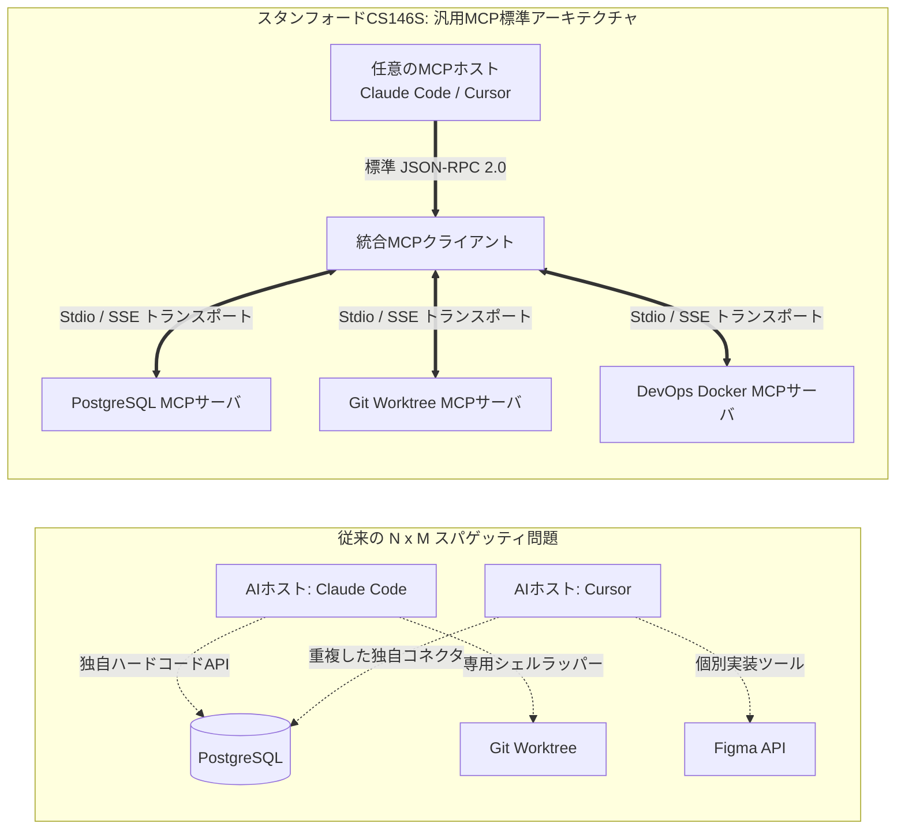
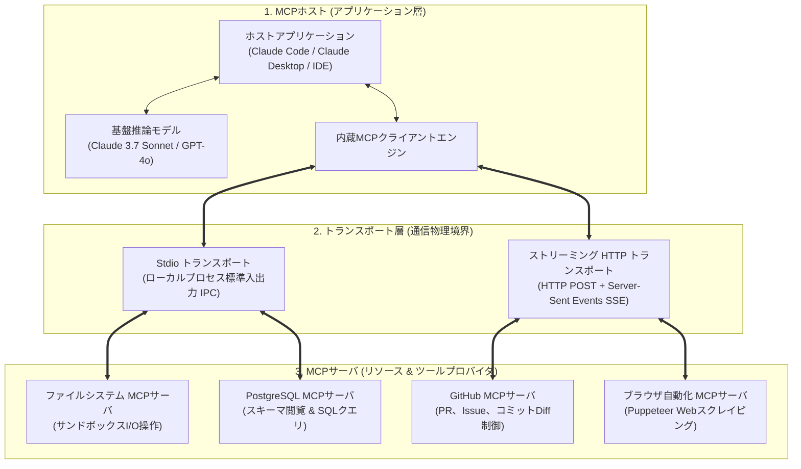

スタンフォード大学の最先端ソフトウェア工学講義 **CS146S: 現代のソフトウェア開発者 (The Modern Software Developer)** 第3講の深層技術解説へようこそ。

第1講ではコードタイピストからAI指揮者への進化を学び、第2講ではコーディングLLMの統計的本質と「スイスチーズモデル」に対する多層防御ハーネスを考察しました。今回の **第3講 (Week 2)** では、現代のAIシステム工学における最大のボトルネックを直接解決します：**「孤立した大規模言語モデルを、外部のツール、データベース、ターミナルとどのように安全かつ標準化された方法で連携させるか？」**

2024年以前、AIにデータベースやGitを接続するには、ツールごとに固有のカスタム統合コードをハードコーディングする必要がありました。Anthropicが主導するオープン標準であり、スタンフォード講義の中核をなす **モデルコンテキストプロトコル (Model Context Protocol, MCP)** は、かつてマイクロソフトの **LSP (Language Server Protocol)** が開発エディタ生態系を統一したように、AIエージェント生態系を標準化する汎用アダプターとして確立されました。

{/* truncate */}

---

### 1. 分断の危機：なぜ「AIのためのLSP」が必要だったのか？

かつては、Claude Code、Cursor、GitHub Copilotなどの新しいAIツールが登場するたび、同一の企業内リソース（Gitリポジトリ、PostgreSQL、Slack、クラウド環境）に接続するために、各ツール開発者が重複したカスタムグルーコード（Glue Code）を量産していました。

2010年代、マイクロソフトは各エディタが各プログラミング言語の構文解析器を個別実装する非効率を、**言語サーバプロトコル (LSP)** によって一網打尽に解消しました。

**Model Context Protocol (MCP)** は、AIエージェント生態系において全く同一の革命を達成しました。モデルの推論エンジンとツールの物理的実行を完全に分離し、**JSON-RPC 2.0を基盤としたプラグ＆プレイの標準仕様** を策定したのです。

---

### 2. MCPの3層システムアーキテクチャ

MCP仕様は、2つの物理層にまたがる3つの主要参加者によって構成されます：

1. **MCPホスト (Host)**: ユーザ体験を統括し、コンテキストウィンドウを管理し、人間の実行承認（パーミッション）を制御する最上位アプリケーション（Claude Code CLI、Cursor等）。
2. **MCPクライアント (Client)**: ホスト内部に常駐し、各MCPサーバとの1対1接続を維持し、ライフサイクル初期化とプロトコル交渉を担当する通信エンジン。
3. **MCPサーバ (Server)**: データリソースや実行可能な関数を軽量かつ安全に外部へ公開する専用プロセス。

---

### 3. 2つのトランスポート層：Stdio vs Streamable HTTP/SSE

MCP仕様はメッセージの意味論（Semantics）と物理的な伝送チャネルを完全に切り離しています：

| トランスポート軸 | Stdio トランスポート (ローカル高速IPC) | Streamable HTTP/SSE (リモート接続) |
| :--- | :--- | :--- |
| **通信チャネル** | 子プロセスの標準入力(`stdin`)および標準出力(`stdout`)パイプ | クライアント要求はHTTP POST、サーバストリームはSSE |
| **遅延とオーバーヘッド** | **遅延ゼロ** (ネットワーク/TLSハンドシェイクなし) | ネットワーク往復遅延 + TLS暗号化オーバーヘッド |
| **セキュリティ境界** | ローカルOSのファイルシステム権限およびプロセス分離 | OAuth 2.0 Bearerトークン、mTLS、ファイアウォール |
| **代表的なユースケース** | ワークスペースのファイル編集、Git操作、ローカルDB操作 | エンタープライズDBクラスタ、社内共有ナレッジベース |

---

### 4. MCPの3大コア・プリミティブ (Core Primitives)

1. **リソース (Resources - 読み取り専用コンテキスト)**: GETエンドポイントに類似。ファイル内容、DBスキーマ、ログなどの静的・動的データをURI(`postgres://db/users`)形式でモデルに安全に提供します。副作用（Side-effect）を伴いません。
2. **ツール (Tools - 実行可能関数)**: モデルが能動的に呼び出せる関数。厳格なJSON Schemaで引数型を定義し、ホストは実行前に必ず人間の承認を要求します。
3. **プロンプト (Prompts - 再利用可能な構造化テンプレート)**: サーバ側で管理される標準ワークフロー定義（例: `/security-review`, `/generate-tests`）。

---

### 5. Claude Codeにおける実戦ツール実行ループ (Tool-Calling Loop)

講義で実演された、Claude CodeにおけるMCPツール実行サイクルです：

```mermaid
sequenceDiagram
    autonumber
    actor Dev as 開発者
    participant Host as Claude Code (ホスト)
    participant Model as Claude 3.7 Sonnet (LLM)
    participant Client as MCPクライアント
    participant Server as PostgreSQL MCPサーバ

    Dev->>Host: "ユーザID 8492の決済失敗原因を診断して"
    Host->>Client: 利用可能ツール一覧の要求 (tools/list)
    Client->>Server: JSON-RPC tools/list
    Server-->>Client: [query_orders, inspect_logs] を返却
    Client-->>Host: ツール仕様をシステムプロンプトに注入

    Host->>Model: プロンプト + ツール定義 + ユーザ質問
    Model->>Model: 思考の連鎖(CoT): 注文データの確認が必要と判断
    Model-->>Host: 停止理由: tool_use (query_orders, args: {id: 8492})

    rect rgb(30, 41, 59)
        note over Host,Dev: ヒューマン・イン・ザ・ループ承認ゲート
        Host->>Dev: DB照会ツールを実行しますか？ query_orders(8492) [Y/n]
        Dev-->>Host: 承認: Y
    end

    Host->>Client: ツール実行要求をディスパッチ
    Client->>Server: JSON-RPC tools/call (query_orders)
    Server-->>Client: JSONデータ: {status: 'failed', error: '残高不足'} を返却
    Client-->>Host: Tool Result ペイロード転送

    Host->>Model: ツール実行結果をコンテキストウィンドウに再注入
    Model->>Model: 根本原因の分析と回答合成
    Model-->>Host: "決済失敗はStripe Webhookにおける残高不足例外が原因です。"
    Host-->>Dev: 最終診断レポートの提示
```

---

### 6. スタンフォードCS146S 第3講 Q&A

> **Q. MCPと従来のOpenAI Function CallingやLangChainツールは何が決定的に違うのですか？**

**教員回答:**
Function Callingは単なる **「LLM APIの一機能」** です。モデルがJSON引数を出力するだけで、その関数を誰が実行し、どう認証し、他人がどう再利用するかという仕様が皆無でした。そのため各社がスパゲッティコードを書いていました。

MCPは機能ではなく **「産業オープン標準プロトコル」** です。本日作成したPostgreSQL MCPサーバは、Claude Codeでも、Cursorでも、将来登場する新たなAIエージェントでも、コードを1行も変えずにそのまま動作します。

---

### 7. 第3講のまとめ

1. **オープン標準を採用せよ**: AIツール連携を独自ハードコードせず、MCP標準サーバとしてモジュール化してください。
2. **頭脳と手を分離せよ**: LLMには論理推論に専念させ、物理的なI/Oと状態変更はMCPサンドボックスに委任してください。
3. **人間の承認ゲートを維持せよ**: 破壊的な状態変更ツールは必ず人間の明示的確認を必須として設計してください。

---

### 参考文献 & 公式教材
- **公式YouTubeプレイリスト**: [Stanford CS146S: The Modern Software Development (YouTube Playlist)](https://www.youtube.com/playlist?list=PLxpwjSdVZQ95OWe3QvkVEcU1f1X-6NDj9)
- **主要文献**: Model Context Protocol Specification (modelcontextprotocol.io); Anthropic Claude Tool Use Architecture; Microsoft Language Server Protocol (LSP).
- **提供機関**: スタンフォード大学 コンピュータサイエンス学科
