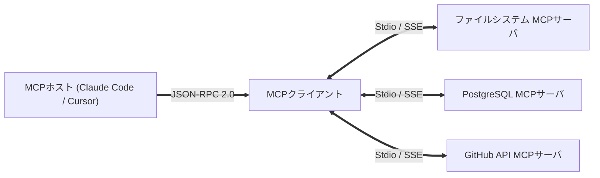

スタンフォード大学の最先端ソフトウェア工学講義 **CS146S: 現代のソフトウェア開発者 (The Modern Software Developer)** 第3講の技術解説へようこそ。

第3講では、AI工学の最大の課題であった「孤立した大規模言語モデルを外部ツールやデータベースとどのように安全かつ標準化された方法で連携させるか」を解決する **Model Context Protocol (MCP)** と自律ツール利用（Tool Use）を深掘りします。

{/* truncate */}

---

### 1. AIのためのLSP：MCPのアーキテクチャ

マイクロソフトの言語サーバプロトコル(LSP)がエディタとコンパイラの連携を統一したように、Anthropicが提唱するMCPはAIエージェントと外部コンテキストの接続をJSON-RPC 2.0で標準化します。

### 参考文献 & 公式教材
- **公式YouTubeプレイリスト**: [Stanford CS146S: The Modern Software Development (YouTube Playlist)](https://www.youtube.com/playlist?list=PLxpwjSdVZQ95OWe3QvkVEcU1f1X-6NDj9)
- **主要文献**: Model Context Protocol Specification (modelcontextprotocol.io); Anthropic Claude Tool Use Architecture; Microsoft Language Server Protocol (LSP).
- **提供機関**: スタンフォード大学 コンピュータサイエンス学科
