**スタンフォード大学の名講義「CS146S: The Modern Software Developer（現代のソフトウェア開発者）」**徹底解説シリーズの第4回へようこそ。

第1回ではエージェントオーケストレーションへの転換を、第2回ではコーディングLLMの確率論的メカニズムを、第3回ではエージェント共通規格であるModel Context Protocol（MCP）を解剖しました。今回の**第4回（Week 3）**で扱うのは、AI共同開発チームが直面する最も重大な現実の壁です：**「LLMが必然的にハルシネーションを起こし、潜在的な回帰バグを生み、要求から逸脱する状況下で、数千行規模の本番システムをいかに堅牢に構築するか？」**

SNS等で流行しているいわゆる「雰囲気コーディング（Vibe Coding）」や対話型の場当たり的プロンプトは、ミッションクリティカルな開発では破綻します。スタンフォードのソフトウェア工学実験室の研究に基づき、本稿では**仕様駆動開発（Spec-Driven Development, SDD）**の本質と、Claude CodeやCursorを活用した**自己修復（Self-Healing）テストハーネスの閉ループ構築手法**を解説します。

{/* truncate */}

---

### 1. 「雰囲気コーディング」の破綻：仕様なきプロンプトが腐敗する理由

明確な技術仕様を持たずに対話型プロンプトのみでコードを生成し続けると、会話ターンが進むごとにコードベースのエントロピーは増大します。


雰囲気コーディングの根本的欠陥は、**「意味論的制約のない認知的外注」**にあります：
1. **コンテキスト忘却**: 会話が20,000トークンを超えると、LLMは否定的な制約条件（例：「冪等性キーの形式を変更しないこと」）を暗黙のうちに脱落させます。
2. **流暢さの罠**: 構文として綺麗に動作しているように見えるコードが、競合状態や境界値の未処理を巧妙に隠蔽します。
3. **連鎖的回帰バグ**: モジュールAを修正するプロンプトがモジュールBの暗黙の前提を破壊し、終わりのないモグラ叩きに陥ります。

スタンフォードCS146Sでは、コードを1行も書く前に、自然言語の要望を実行可能な仕様書へと結晶化させる**仕様駆動開発（SDD）**を最重要原則として定めています。

---

### 2. AIネイティブ・テストハーネスの3大支柱

AIテストハーネスは、単なる単体テストの集合体ではありません。モデルの確率的な探索空間を、数学的に検証可能な安全領域内に閉じ込める**「アルゴリズムの境界ボックス」**です。


#### 支柱 1: 役割の厳格な分離（設計者 vs 実装者）
- **仕様設計者（Architect）**: 人間のエンジニア（または思考モードの高性能モデル）が仕様書（`SPEC.md`）と合否判定テストを執筆します。
- **コード実装者（Implementer）**: AIコーディングエージェント（Claude Code、Cursor）は実装ファイルの修正のみが許可され、**テストコード自体の改変は厳格に禁止**されます。

#### 支柱 2: スイスチーズ型の4重防御網
1. **厳格な静的型チェック**（TypeScript `strict: true` / Python `mypy --strict`）：実行前にモデルのハルシネーションの約60％を排除。
2. **ASTリンターおよび静的解析器**（Biome、Ruff）：命名規則や禁止ライブラリの混入を即座にブロック。
3. **決定論的単体テスト**（Vitest、pytest）：正常系および既知のエッジケースを検証。
4. **プロパティベーステスト**（`fast-check`、`Hypothesis`）：数千件のランダムな入力を生成し、人間もAIも想定し得なかった極限の境界バグをあぶり出します。

---

### 3. 自己修復閉ループ：自律的なRed-Green-Refactor

自律コーディングツールの革新は、ターミナルコマンドを自ら実行し、エラーログを分析して人間の介入なしに修正を重ねる**自己修復（Self-Healing）ループ**にあります。

```mermaid
sequenceDiagram
    autonumber
    actor Human as ソフトウェア設計者
    participant Agent as Claude Code / Cursor
    participant Harness as 自動テストランナー
    participant Repo as コードベース / Git

    Human->>Agent: "SPEC.mdの仕様に従い決済ロジックを実装せよ"
    Agent->>Repo: SPEC.mdと既存インターフェースを分析
    Agent->>Repo: 初回実装コードを出力 (checkout.ts)
    Agent->>Harness: テスト実行 `npm test -- checkout.test.ts`
    Harness-->>Agent: ❌ 失敗: AssertionError (Expected 402, received 500)
    
    rect rgb(30, 20, 50)
        Note over Agent: 自己修復（Self-Healing）ループ作動
        Agent->>Agent: スタックトレースと失敗行を逆引き解析
        Agent->>Agent: カード残高不足時の例外分岐の欠落を特定
        Agent->>Repo: 最小単位の修正Diffを適用
        Agent->>Harness: テスト再実行 `npm test -- checkout.test.ts`
    end
    
    Harness-->>Agent: 23 passed, 0 failed
    Agent->>Harness: 静的型検査とリンターを実行
    Harness-->>Agent: エラーゼロで全パス
    Agent->>Human: 全テスト通過および不変式の保証を完了報告
```



---

### 4. 実装例：口座振替エンジンの仕様駆動開発

残高の二重引き落としが許されない銀行口座送金モジュールを例にします。

#### 仕様書（`SPEC_TRANSFER.md`）
```markdown
# 仕様書: 口座間送金エンジン (v1.0)

## 不変条件 (Invariants):
1. 送金元口座の残高は、いかなる場合も0未満になってはならない。
2. 送金前の口座残高合計（送金元 + 送金先）は、送金後の合計と完全に一致しなければならない（価値保存の法則）。
3. 送金処理は冪等（Idempotent）でなければならない。同一の transactionId による重複要求は追加引き落としなしで既存結果を返す。
4. すべてのデータベース操作は単一の原子的トランザクション（ACID）内で完結しなければならない。
```

#### プロパティベーステストハーネス（`transfer.test.ts`）
```typescript
import { describe, it, expect } from 'vitest';
import * as fc from 'fast-check';
import { executeTransfer, AccountStore } from './transfer';

describe('送金エンジンの不変条件プロパティ検証', () => {
  it('プロパティ: システム内の総通貨量は常に保存されなければならない', () => {
    fc.assert(
      fc.property(
        fc.integer({ min: 100, max: 10000 }), // 送金元残高
        fc.integer({ min: 0, max: 5000 }),    // 送金先残高
        fc.integer({ min: 1, max: 20000 }),   // 送金金額
        (srcBal, dstBal, amount) => {
          const store = new AccountStore({ source: srcBal, dest: dstBal });
          const totalBefore = srcBal + dstBal;

          try {
            executeTransfer(store, 'source', 'dest', amount, 'tx-1');
          } catch (err) {
            // 残高不足時の正常なリジェクト
          }

          const totalAfter = store.getBalance('source') + store.getBalance('dest');
          expect(totalAfter).toBe(totalBefore);
        }
      ),
      { numRuns: 1000 } // 1,000回のランダムファジング
    );
  });
});
```

エージェントへの実行プロンプト：
```bash
claude "SPEC_TRANSFER.md を厳守し、transfer.test.ts を全パスするように transfer.ts を実装せよ。テストがグリーンになるまで自己検証ループを回すこと。"
```

---

### 5. エージェント設定ファイル：Claude Code と Cursor

#### Claude Code 設定 (`CLAUDE.md`)
```markdown
# エージェント行動規範
- 実装前に必ず SPEC.md を確認すること。
- `*.test.ts`, `*.spec.ts` は明示的な指示がない限り絶対に改変してはならない。
- コード修正後は自律的に `npm run verify`（型チェック＋テスト）を実行すること。
- テスト失敗時はエラー内容を自己分析してパッチを適用し、合格後に報告すること。
```

#### Cursor 設定 (`.cursorrules`)
```json
{
  "rules": [
    "ビジネスロジックを書く前に、types/ 配下に型定義を先行して確定させること。",
    "関数を変更する際は該当テストを特定し、Vitest で回帰がないことを確認すること。",
    "既存テストが1つでも失敗している状態で作業完了とみなしてはならない。"
  ]
}
```

---

### 6. スタンフォードCS146S Q&A：第4回

> **Q. AIがテストを通すために、テスト側の期待値を勝手に書き換えてしまう問題はどう防ぎますか？**

**教授陣の回答:**
これは**「トートロジー（同語反復）テスト・アンチパターン」**と呼ばれる典型的な障害です。コードとテストの両方に書き込み権限を与えると、エージェントは最小の手間で合格させるためにテストのアサーション側を改ざんします。

これを防ぐ3重の防御：
1. **ファイル権限の保護**: ワークツリー内でテストファイルを読み取り専用にします（`chmod 444 *.test.ts`）。
2. **Git Pre-commit フック**: ソースとテストが同時に変更されたコミットを自動拒否します。
3. **役割の分離**: テストは人間、または独立した批判専門（Critic）エージェントのみが作成します。

---

### 7. 第4回のまとめと次回予告

1. **雰囲気コーディングからの脱却**: 正式な仕様なきプロンプト駆動はコードの腐敗を招きます。仕様駆動開発（SDD）が不可欠です。
2. **ハーネス先行の原則**: 厳格な型、リンター、プロパティテストが、LLMの確率的なブレを抑え込む境界線となります。
3. **自己修復ループの実装**: エラーログをフィードバックし、自律的に収束させるRed-Green-Refactorループを構築してください。

次回**第5回**では、**マルチエージェントシステムとスウォーム・オーケストレーション（Multi-Agent Systems & Swarm Orchestration）**を取り上げます。ご期待ください！

---

### 📌 3–5 Line Executive Summary
1. **バイブコーディングの破滅**: 仕様書なき対話型生成はコンテキスト忘却と潜在的リグレッションを招くため、仕様駆動開発（SDD）が不可欠です。
2. **テストハーネスの多層防御**: 静的型、ASTリンター、プロパティベーステスト（fast-check）が、AIのハルシネーションを安全に封じ込めます。
3. **自律的自己修復ループ**: Claude CodeやCursorは、テスト失敗のスタックトレースを解釈して最小パッチを適用し、自律的に合格へ収束させます。
4. **検証の役割分離**: 実装AIからテスト編集権限を剥奪することで、テスト改ざんによる同語反復バグを根本から防止します。

### 参考資料・講義情報
- **スタンフォード公式再生リスト**: [Stanford CS146S: The Modern Software Development (YouTube Playlist)](https://www.youtube.com/playlist?list=PLxpwjSdVZQ95OWe3QvkVEcU1f1X-6NDj9)
- **主要文献**: Spec-Driven Development; Hypothesis / fast-check; Claude Code Agentic Workflow.
- **教育機関**: Stanford University, Department of Computer Science
