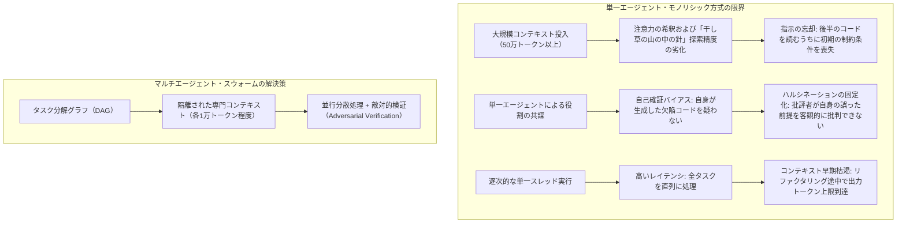
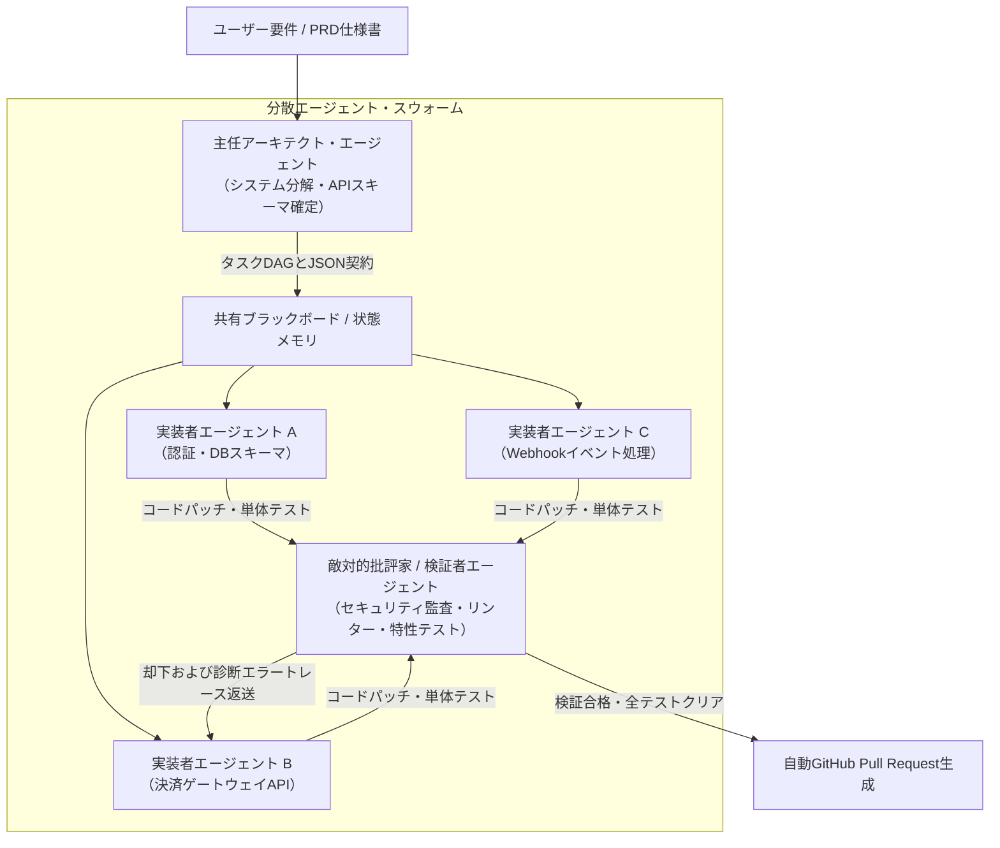

**スタンフォード大学 CS146S（現代のソフトウェア開発者: The Modern Software Developer）** 深掘りシリーズ第5講へようこそ。

これまでの講義では、プロンプトエンジニアリング、コーディング特化モデルの内部機構、Model Context Protocol（MCP）による自律ツール活用、そして自己修復型テストハーネスを学んできました。これまでのすべてのパラダイムには、ある共通の暗黙の前提がありました。それは、**単一の主要LLMセッション**が開発者や単一のIDEワークスペースと対話的に作業するという点です。

しかし、ソフトウェアプロジェクトが数千行を超え、分散マイクロサービスや数十万行の大規模リポジトリへとスケールした瞬間、この単一エージェントパラダイムは破綻します。モノリシックな単一エージェントは、**コンテキストウィンドウの飽和、注意力の希釈（Attention Dilution）、認知的スラッシング（Cognitive Thrashing）**に直面します。

本講義では、スタンフォード大学の研究陣が次世代AIネイティブエンジニアリングの決定打となる**マルチエージェントシステム（MAS）とスウォーム・オーケストレーション（Swarm Orchestration）**を明かします。**設計者（Architect）、実装者（Implementer）、批評家（Critic）**という専門的な役割を厳格に分離し、有向非巡回グラフ（DAG）と構造化メッセージバスで統制することで、コード生成の精度と開発規模を劇的に拡張する手法を解説します。

{/* truncate */}

---

### 1. 単一コンテキスト・モノリシックLLMのスケーリング限界

なぜ50万行のエンタープライズコードベースを100万トークンのコンテキストウィンドウを持つ最新LLMに丸ごと投入し、「決済パイプラインをリファクタリングして」と頼むだけでは失敗するのでしょうか？

スタンフォードの研究者たちは、単一エージェントのスケーリングを阻む3大ボトルネックを次のように定義しています:



1. **注意力の希釈と「中央の忘却（Lost in the Middle）」**: コンテキストが10万トークンを超えると、アテンション機構の検索再現率が低下します。中間ファイルに埋もれた細かなDB制約やAPIルールが無視されやすくなります。
2. **役割の共謀と確証バイアス**: 1つのLLMが設計者、コーダー、テスターを兼任すると、深刻な自己確証バイアスが生じます。自ら生成したコードの境界値エッジケースを客観的に見抜くことは困難です。
3. **コンテキスト汚染とスラッシング**: 1つの対話セッションで15個のファイルを連続修正していくと、途中の差分、コンパイラエラー、ボツになった仮説でバッファが汚染され、思考停止や誤出力を引き起こします。

---

### 2. 3権分立スウォーム・アーキテクチャ: 設計者・実装者・批評家

商用プロダクション級の堅牢性を実現するため、スタンフォードCS146Sでは**3者エージェント・スウォームパターン（Tripartite Agent Swarm Pattern）**を提唱します:



#### 専門エージェントの役割分担:
1. **主任アーキテクト（Lead Architect Agent）**:
   - **入力**: ユーザー要件（PRD）、リポジトリ依存関係ツリー、ビジネス目標。
   - **出力**: 疎結合化されたタスクの有向非巡回グラフ（DAG）、厳格なJSON Schemaインターフェース定義。
   - **制約**: アーキテクトは実装コードを1行も書きません。全リソースを設計分解とインターフェース安定化に集中させます。
2. **実装者スウォーム（Implementer Swarm）**:
   - **入力**: DAGから割り当てられた単一タスク、API契約スキーマ、対象ディレクトリのファイルツリー。
   - **出力**: モジュール化されたコード、単体テスト、依存関係宣言。
   - **実行**: 複数の実装者エージェントが、完全に独立したサンドボックス環境で並行して並列開発を進めます。
3. **敵対的批評家 / 検証者（Adversarial Critic & Verifier Agent）**:
   - **入力**: 実装者が提出したコード差分、アーキテクトの仕様、自動テストログ。
   - **出力**: 静的解析結果、セキュリティ監査（AST検査・秘密情報漏洩チェック）、合否判定。
   - **自己修復**: 不合格の場合、スタックトレース付きの詳細な診断情報を当該実装者に直接返送し、自己修復ループを回します。

---

### 3. エージェント間通信トポロジー: カオスを防ぐ構造化制御

エージェント同士に自由なチャット対話を行わせると、ハルシネーションが増幅し無限ループに陥ります。CS146Sでは2つの決定論的制御トポロジーを推奨します:

#### A. 中央集権型ブラックボード（Blackboard）パターン
エージェント同士は直接会話し合わず、検証済みの共有JSONステートストアを介して非同期にデータを交換します:

```json
{
  "task_id": "TASK-402-AUTH",
  "status": "in_review",
  "dependencies": ["TASK-401-DB-SCHEMA"],
  "assigned_agent": "worker-claude-code-01",
  "contract_schema_hash": "sha256:7f8a92...",
  "artifacts": {
    "patch_path": "/workspace/patches/auth_service.patch",
    "test_coverage": 94.2
  },
  "critic_feedback": null
}
```

#### B. 有向非巡回グラフ（DAG）ワークフロー
タスクの依存関係をDAGとして定義します。モジュールBがモジュールAのスキーマに依存している場合、実装者Aのコードが批評家の厳格なテストをクリアするまで、実装者Bが起動することはありません。

---

### 4. 実装例: Pythonによる非同期スウォーム・オーケストレーター

Pydanticによる厳格なバリデーションを用いて、アーキテクト・実装者・批評家の協調ループを駆動する非同期オーケストレーターの実装です:

```python
# swarm_orchestrator.py - 本番級マルチエージェント・スウォームエンジン
import asyncio
from typing import List, Dict, Optional
from pydantic import BaseModel, Field

class SubTaskContract(BaseModel):
    task_id: str
    description: str
    file_targets: List[str]
    interface_schema: Dict[str, str]

class ArchitectPlan(BaseModel):
    plan_title: str
    subtasks: List[SubTaskContract]

class PatchResult(BaseModel):
    task_id: str
    code_diff: str
    unit_tests: str

class CriticAudit(BaseModel):
    passed: bool
    score: float = Field(ge=0.0, le=100.0)
    diagnostic_trace: Optional[str] = None

class SwarmOrchestrator:
    def __init__(self, architect_llm, coder_llm, critic_llm):
        self.architect = architect_llm
        self.coder = coder_llm
        self.critic = critic_llm

    async def execute_task(self, user_prd: str):
        print("[ORCHESTRATOR] ステップ1: アーキテクチャ計画の立案中...")
        plan: ArchitectPlan = await self.architect.generate_plan(user_prd)
        
        print(f"[ORCHESTRATOR] アーキテクトが {len(plan.subtasks)} 個のサブタスクDAGを生成しました。")
        
        # 複数の並行実装者ワーカーへタスクを非同期分散実行
        tasks = [self._worker_critic_loop(task) for task in plan.subtasks]
        results = await asyncio.gather(*tasks)
        
        print("[ORCHESTRATOR] すべてのサブタスクが検証を通過し統合されました！")
        return results

    async def _worker_critic_loop(self, task: SubTaskContract, max_retries: int = 3) -> PatchResult:
        attempt = 0
        error_context = None

        while attempt < max_retries:
            attempt += 1
            print(f"[{task.task_id}] 実装者がコーディング中 (試行 {attempt}/{max_retries})...")
            
            patch: PatchResult = await self.coder.implement_task(task, feedback=error_context)
            
            print(f"[{task.task_id}] 批評家エージェントがパッチを厳密検証中...")
            audit: CriticAudit = await self.critic.verify(task, patch)
            
            if audit.passed:
                print(f"[{task.task_id}] 検証合格 (スコア: {audit.score}/100)！")
                return patch
            
            print(f"[{task.task_id}] 批評家により却下: {audit.diagnostic_trace}")
            error_context = audit.diagnostic_trace

        raise RuntimeError(f"タスク {task.task_id} は {max_retries} 回の試行後も批評家の検証を通過できませんでした。")
```

---

### 5. 第5講のまとめと次回予告

1. **モノリシック単一エージェントの限界突破**: 注意力の希釈と自己確証バイアスを排除するため、大規模開発ではマルチエージェントへの責任分散が不可欠。
2. **3者専門性の分離**: アーキテクト（設計分解）、実装者（並行サンドボックス実装）、批評家（敵対的検証・セキュリティ監査）の役割を明確に切り離す。
3. **構造化された通信制御**: 自由会話を排し、Pydantic JSONスキーマとDAG依存関係管理によってスウォームの暴走を防止。

**第6講**では、**AI支援型デバッグとプロファイリング: eBPF、動的トレーシング、ランタイム障害修復LLMの活用法**を徹底解説します！

---

### 📌 要約 (Executive Summary)
1. **マルチエージェント化の必然性**: 単一LLMセッションにおける注意力の希釈、指示の忘却、自己確証バイアスを克服するため、タスクを自律分散スウォームへと再構築。
2. **3権分立モデル**: システム設計とAPI契約を担うアーキテクト、並行コーディングを行う実装者、厳密な監査とテストを行う批評家の3専門分業体制を確立。
3. **構造化制御によるカオス防止**: 自由形式のチャットではなく、Pydanticスキーマ、共有ブラックボード、有向非巡回グラフ（DAG）によってエージェント間の協調を決定論的に制御。
4. **非同期自己修復ループ**: 批評家による詳細なエラートレースを実装者にフィードバックし、すべての回帰テストをクリアするまで自律的に修正を完結。

### 参考文献およびスタンフォード講義情報
- **講義名**: Stanford CS146S (The Modern Software Developer), 2026.
- **提供**: スタンフォード大学 コンピュータサイエンス学科.
- **関連フレームワーク**: LangGraph, AutoGen, CrewAI, Anthropic Multi-Agent Orchestration Protocols.
