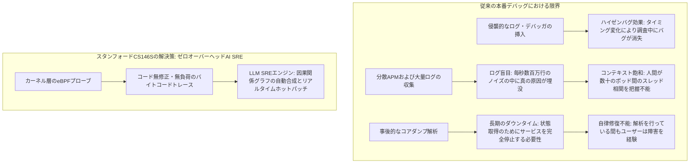
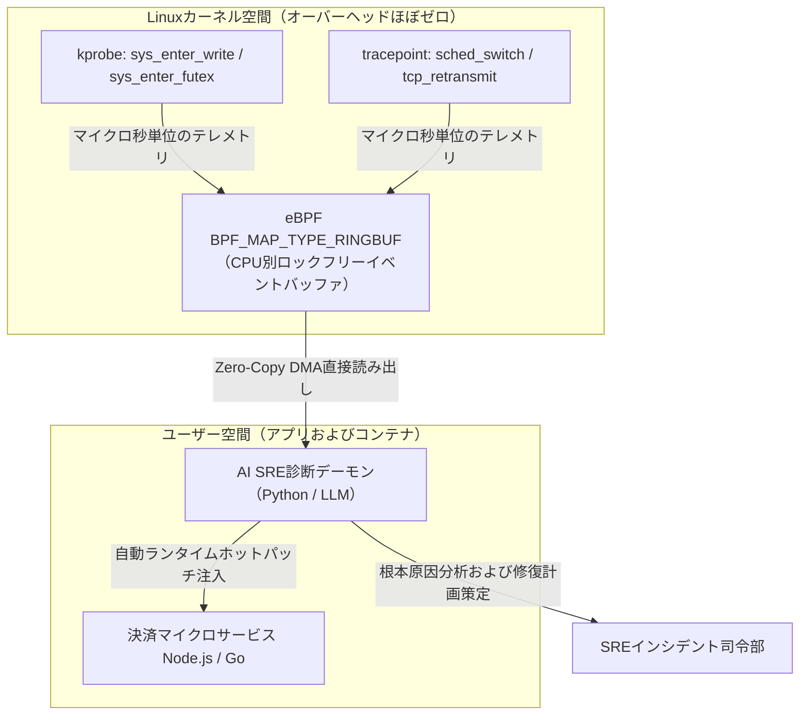

**スタンフォード大学 CS146S（現代のソフトウェア開発者: The Modern Software Developer）** 深掘りシリーズ第6講へようこそ。

前回の講義では、主任アーキテクト、並行実装者、敵対的批評家LLMを有向非巡回グラフ（DAG）で調和させ、大規模コードベースを構築するマルチエージェント・スウォームについて学びました。しかし、どれほど厳格にテストされたソフトウェアであっても、本番環境の混沌としたトラフィック負荷の中では予期せぬ障害に直面します。

深夜3時、分散決済クラスタで微細な並行デッドロックが発生してスレッドが停止したり、データベースのテールレイテンシが突如12秒へ跳ね上がった瞬間、開発者の従来のデバッグ手法は完全に無力化されます。静的解析では動的な競合状態（Race Condition）を予測できず、コードに安易にログ（`printf`）を差し込めばタイミングが変わってバグが消えてしまう**ハイゼンバグ（Heisenbug）効果**が生じます。さらに、分散APMツールは毎秒ギガバイト単位の無意味なログノイズでSREエンジニアを溺れさせます。

本講義では、スタンフォード大学の研究陣が提唱する自律型レジリエンスの最前線、**AI支援型デバッグとランタイムプロファイリング**を解説します。オーバーヘッドを極限まで排除した**eBPF（extended Berkeley Packet Filter）**によるカーネル層トレースと、**LLM専門SRE診断エージェント**を統合し、カーネル実行状態をリアルタイムに捉えて数分で根本原因を突き止め、ホットパッチを自律生成する手法を公開します。

{/* truncate */}

---

### 1. 本番インシデントの危機: 従来のデバッグが失敗する理由

高スループットのマイクロサービスが高負荷時に破綻する際、エンジニアは3つの致命的な可観測性（Observability）のパラドックスに直面します:



1. **ハイゼンバグ（Heisenbug）のジレンマ**: デバッグログを追加したりインタラクティブデバッガ（`gdb`）をアタッチした瞬間、スレッドが一時停止しロック取得順序が入れ替わり、間欠的な競合バグが調査中に忽然と消え去ります。
2. **テレメトリの洪水と文脈盲目**: 最新の監視システムはペタバイト級のログを排出します。しかし1つの障害が45個のアラートを同時多発させた場合、どれが真因（Root Cause）でどれが44個の二次症状（Symptom）なのかを切り分けるのに数時間を浪費します。
3. **カーネルとアプリ間の意味的断絶**: 「HTTP 504 Gateway Timeout」という上位エラーからだけでは、スレッドプールの枯渇なのか、TCPソケットバッファの肥大化なのか、あるいはLinux VFS層のダーティページフラッシュ遅延なのかを判別できません。

---

### 2. eBPF革命: OSカーネル層の非侵襲的可観測性

ハイゼンバグ問題を根絶するため、スタンフォードCS146Sは**eBPF（extended Berkeley Packet Filter）**を採用します。eBPFはカーネルソースコードの変更や危険なカーネルモジュールのロードを行うことなく、Linuxカーネル内部でサンドボックス化された検証済みバイトコードを安全に直接実行できる技術です。



#### AIデバッグにおいてeBPFが不可欠な理由:
- **極小のオーバーヘッド**: eBPFプログラムは厳格なカーネル検証機（Verifier）を経てネイティブ機械語へとJITコンパイルされ、全負荷状態でもCPU消費を1.5%未満に抑えます。
- **全方位の可観測性**: `kprobes`（カーネル関数進入）、`kretprobes`（カーネル関数退出）、`uprobes`（ユーザー空間シンボル）、ソケットフィルタにフックし、アプリ側のコードを1行も触ることなく全システムコールやロック競合を監視します。
- **ロックフリー・リングバッファ**: 毎秒数百万件のカーネルイベントをCPUごとのロックフリーリングバッファ（`BPF_MAP_TYPE_RINGBUF`）でユーザー空間へストリーミングし、監視自体による性能劣化を防ぎます。

---

### 3. 意味の断絶を埋める: カーネルトレースをLLM診断エージェントへ橋渡し

未加工のeBPFダンプ（16進数ポインタやナノ秒タイムスタンプ）をそのままLLMに投入すると、即座にトークンが枯渇しハルシネーションが発生します。

スタンフォードCS146Sでは、**2段階テレメトリ蒸留エンジン（Two-Stage Distillation Engine）**を定式化しています:

1. **決定論的圧縮とフレームグラフ・フォールディング**:
   - ユーザー空間デーモンがコールスタックを集約し、重み付きのフォールデッド形式（例: `process;thread;function_A;function_B;futex_wait 450ms`）へと圧縮します。
   - 健全時のベースライントレース分布と障害発生時の分布を差分比較（Differential Analysis）し、統計的異常値のみを抽出します。
2. **因果関係グラフと仮説検証**:
   - LLMには、抽出された異常デルタ、関連マイクロサービスのソースコード、Kubernetesポッドの状態のみを入力します。
   - **思考の連鎖（Chain-of-Thought, CoT）診断プロンプト**を用いて、カーネル層のブロッキングをアプリ側のロジック不備（例: 解放されないDBコネクションによる排他制御待ち）へとマッピングします。

---

### 4. 実装例: Python & CによるeBPF遅延追跡とLLM自律修復

BCC（BPF Compiler Collection）を利用して本番環境の遅延システムコールを捕捉し、非同期LLM SREエージェントを駆動するパイプラインの実装です:

```python
# ebpf_ai_debugger.py - eBPFオブザーバビリティおよびAI SRE自律修復パイプライン
import asyncio
import json
from bcc import BPF
from pydantic import BaseModel, Field
from typing import List, Optional

# 1. C言語によるeBPFカーネルプローブ
EBPF_PROGRAM = """
#include <uapi/linux/ptrace.h>
#include <linux/sched.h>

struct event_t {
    u32 pid;
    u64 latency_ns;
    char comm[TASK_COMM_LEN];
};

BPF_HASH(start_time, u32, u64);
BPF_PERF_OUTPUT(latency_events);

int trace_sys_enter_write(struct pt_regs *ctx) {
    u32 pid = bpf_get_current_pid_tgid() >> 32;
    u64 ts = bpf_ktime_get_ns();
    start_time.update(&pid, &ts);
    return 0;
}

int trace_sys_exit_write(struct pt_regs *ctx) {
    u32 pid = bpf_get_current_pid_tgid() >> 32;
    u64 *tsp = start_time.lookup(&pid);
    if (tsp == 0) return 0;

    u64 delta = bpf_ktime_get_ns() - *tsp;
    start_time.delete(&pid);

    // 50ms以上の重大なシステムコール停止のみを報告
    if (delta > 50000000) {
        struct event_t evt = {};
        evt.pid = pid;
        evt.latency_ns = delta;
        bpf_get_current_comm(&evt.comm, sizeof(evt.comm));
        latency_events.perf_submit(ctx, &evt, sizeof(evt));
    }
    return 0;
}
"""

class IncidentRemediationPlan(BaseModel):
    root_cause: str
    culprit_function: str
    confidence_score: float = Field(ge=0.0, le=1.0)
    remediation_script: str
    mitigation_strategy: str

class AIDiagnosticEngine:
    def __init__(self, llm_client):
        self.llm = llm_client

    async def diagnose_and_mitigate(self, event_data: dict, source_context: str) -> IncidentRemediationPlan:
        prompt = f"""
        [緊急インシデント診断アラート]
        カーネルテレメトリ: プロセス '{event_data['comm']}' (PID: {event_data['pid']}) で
        重大なシステムコール停止を検知: 遅延 {event_data['latency_ms']:.2f} ms。
        
        アプリケーションソースコード文脈:
        {source_context}
        
        根本原因を究明し、影響関数および即時緩和パッチを含む構造化JSON修復プランを出力せよ。
        """
        response = await self.llm.generate_structured(prompt, schema=IncidentRemediationPlan)
        return response

class eBPFTelemetryMonitor:
    def __init__(self, ai_engine: AIDiagnosticEngine):
        self.bpf = BPF(text=EBPF_PROGRAM)
        self.bpf.attach_kprobe(event="__x64_sys_write", fn_name="trace_sys_enter_write")
        self.bpf.attach_kretprobe(event="__x64_sys_write", fn_name="trace_sys_exit_write")
        self.ai = ai_engine

    def handle_event(self, cpu, data, size):
        event = self.bpf["latency_events"].event(data)
        latency_ms = event.latency_ns / 1_000_000.0
        print(f"[警告] {event.comm} (PID: {event.pid}) write()システムコールで {latency_ms:.2f}ms の遅延発生！")
        
        # 非同期LLM SREエージェントをキック
        asyncio.create_task(self.ai.diagnose_and_mitigate(
            event_data={"comm": event.comm, "pid": event.pid, "latency_ms": latency_ms},
            source_context="// 該当コントローラーソースコード..."
        ))

    def start_polling(self):
        self.bpf["latency_events"].open_perf_buffer(self.handle_event)
        print("[eBPF MONITOR] カーネルプローブ作動中。本番システムコール遅延を監視...")
        while True:
            self.bpf.perf_buffer_poll()
```

---

### 5. 第6講のまとめと次回予告

1. **非侵襲的可観測性の確立**: 本番デバッグではコード変更や重いプロファイラを排し、Linuxカーネル層のeBPF無負荷追跡を基盤とする。
2. **LLM投入前のデータ蒸留**: 大量の生トレースをフレームグラフ異常値へと圧縮して渡すことで、LLMのハルシネーションを防ぎ高精度な診断を実現。
3. **自律的SREへの進化**: AI診断エージェントとの連携により、受動的な事後分析からリアルタイムな障害検知とホットパッチ即時適用の予防的復旧へと転換する。

**第7講**では、**大規模コードレビューの自動化: AST対応型静的解析、セキュリティ汚染解析（Taint Analysis）、LLM自律PRレビューアー**を解説します！

---

### 📌 要約 (Executive Summary)
1. **本番デバッグのパラダイム転換**: アプリ改変によるハイゼンバグ効果や膨大なログノイズを、非侵襲的なeBPFカーネル動的トレーシングで克服。
2. **オーバーヘッドゼロのカーネル計測**: Linuxカーネルkprobeに検証済みバイトコードを常駐させ、ロックフリーリングバッファによりCPU負荷1.5%未満でマイクロ秒単位の遅延を捕捉。
3. **テレメトリ蒸留エンジン**: 生のシステムコールストリームをフレームグラフ異常値と因果グラフへ圧縮し、低レイヤーのカーネル挙動とアプリロジック間の意味的断絶を解消。
4. **自律型インシデント修復**: レイテンシの急騰を検知した瞬間にLLM SREエージェントが根本原因を特定し、リアルタイムなホットパッチ修復スクリプトを生成・自律実行。

### 参考文献およびスタンフォード講義情報
- **講義名**: Stanford CS146S (The Modern Software Developer), Fall 2026.
- **提供**: スタンフォード大学 コンピュータサイエンス学科.
- **関連技術**: Linux eBPF/BCC, bpftrace, Cilium, Pixie, OpenTelemetry, LangChain SRE.