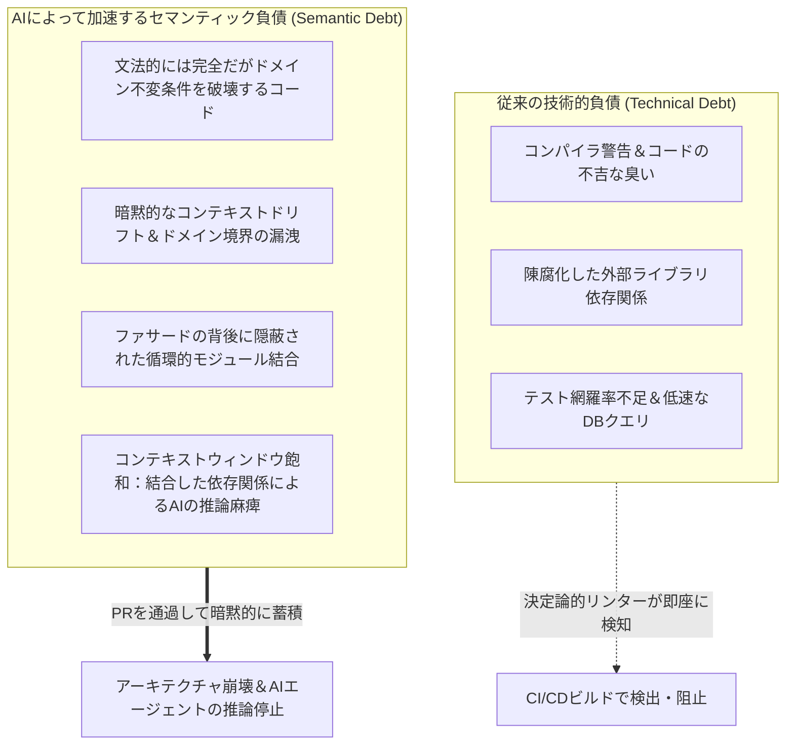
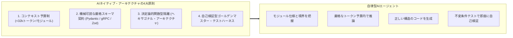
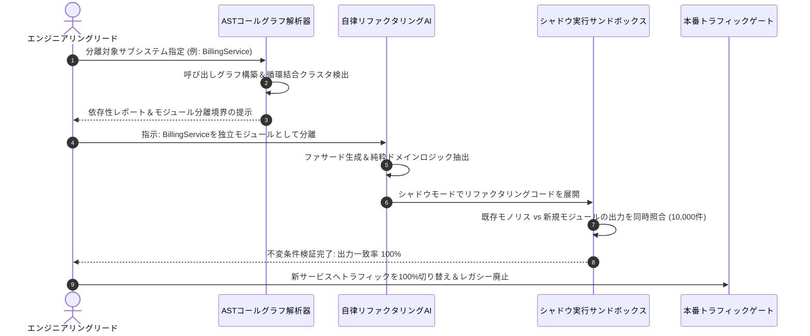

スタンフォード大学の最新ソフトウェア工学講座 **CS146S: The Modern Software Developer（現代のソフトウェア開発者）** 技術解説シリーズの第8回へようこそ。

これまでの講義では、コーディングLLMのプロンプト設計（第2講）、Model Context Protocol（MCP）による自律ツール連携（第3講）、自己修復テストハーネス（第4講）、マルチエージェント・スウォーム制御（第5講）、eBPFによるランタイムプロファイリング（第6講）、AST静的解析と汚染分析による自動コードレビュー（第7講）を詳細に検証してきました。

今回の**第8講**では、高速AIエージェントを本番リポジトリへ導入した際に直面する構造的かつ長期的な根本問題に挑みます：**「AIエージェントが肥大化した複雑性に押し潰されず、自律的に探索・修正できるソフトウェア構造をいかに設計するか？ そして、10年以上の歴史を持つレガシーモノリスをAIエージェントで安全にリファクタリング・分離するにはどうすべきか？」**

本講義では、AI時代における新たな構造的リスクである**セマンティック負債（Semantic Debt）**のメカニズムを定式化し、**AIネイティブ・アーキテクチャの4大不変原則**、そして**AST誘導型モノリス分解パイプライン**の完全なエンジニアリング・ブループリントを提示します。

{/* truncate */}

---

### 1. 開発速度の逆説：技術的負債 vs. セマンティック負債

従来のソフトウェア工学では、コンパイラ警告、古いライブラリ依存、低速なDBクエリ、テストカバレッジ不足などの**技術的負債（Technical Debt）**を指標にコードの健全性を評価してきました。

しかし、自律型AIコーディングエージェントの導入によって開発速度が爆発的に向上した結果、より致命的な破壊モードが生じるようになりました：それが**セマンティック負債（Semantic Debt）**です。



#### セマンティック負債とは何か？
セマンティック負債とは、LLMが生成したコードが**構文上完璧でローカル単体テストをパスするものの、システム全体のドメイン不変条件に違反し、暗黙的な循環結合を生み出してモジュール境界を破壊する現象**です：
1. **コンテキストウィンドウ飽和**: 注文キャンセル処理のロジックが決済・在庫・通知モジュールと循環DB呼び出しで複雑に絡み合っている場合、エージェントは1つの関数を修正するために10万トークンを超えるリポジトリ全体を読み込む必要が生じ、必然的に幻覚（ハルシネーション）とデグレを引き起こします。
2. **概念の断片化**: 複数の開発者が異なるAIプロンプトを用いて機能を追加した結果、同一ドメインのステータス判定処理が列挙型、ビットフラグ、真偽値関数などバラバラの実装で散在します。
3. **ゴースト抽象化**: エージェントが目前のプロンプト条件を局所的にクリアするためだけに、ドメイン実態と乖離した無意味なラッパークラスを乱造します。

---

### 2. AIネイティブ・ソフトウェアアーキテクチャの4大不変原則

AIエージェントと人間が恒久的に協調開発を継続できるよう、スタンフォードCS146Sは**AIネイティブ・アーキテクチャ（AI-Native Architecture）**を提唱します。

これは単にAI APIを呼び出すシステムではなく、**自律AIエージェントが自らコードを理解、修正、検証できるようにゼロから設計されたアーキテクチャ**を意味します。



#### 原則1: 厳格なコンテキスト予算制 (Strict Context Budgeting)
LLMの有効なアテンション能力は、過大なコンテキスト長（巨大リポジトリ全体）において低下します。AIネイティブ設計ではモジュール単位のコンテキスト上限を強制します：
- 各ドメインモジュールは、インターフェース、ロジック、単体テストを含めて**32kトークン以内**で完全に把握可能でなければなりません。
- 1つの不具合修正のために32kトークンを超えるコードベース探索が必要な場合、そのコンポーネントは境界違反として即座に分割リファクタリングの対象となります。

#### 原則2: 機械可読な厳格スキーマ契約 (Explicit Schema Contracts)
人間向けの曖昧な自然言語ドキュメントを排し、機械が静的かつ実行時に検証できるスキーマを徹底します（TypeScript/Zod、Python/Pydantic、Protobuf、OpenAPI 3.1）。

#### 原則3: ヘキサゴナル隔離 (Ports & Adapters)
純粋なビジネスドメインロジックを副作用（DB、外部REST API、メッセージキュー）から徹底的に分離します。AIエージェントは純粋関数的なコア領域でのみ安全にコード変更を行い、外部アダプターには手を触れさせません。

#### 原則4: ゴールデンマスター特性化テスト
AIエージェントにコアモジュールの分解を委ねる前に、本番トランザクションから収集した膨大な入出力スナップショットに基づく「ゴールデンマスター特性化テスト」を自動配備し、セマンティックな振る舞いの変質を0%に抑え込みます。

---

### 3. AST誘導型モノリス分解：ストラングラー・フィグパターンの進化

数百万行に及ぶ巨大レガシーモノリスを安全にAIネイティブ構造へ切り替えるため、スタンフォードCS146Sは高リスクな人間による手動再構築を否定し、**AST誘導型の自律分解手法**を採用します。



#### 実行手順
1. **ASTコールグラフ解析と強連結成分（SCC）の分離**: 抽象構文木（AST）から有向依存グラフを構築し、タスクを阻害する循環参照（A -> B -> A）をTarjanのSCCアルゴリズムで検出・解消します。
2. **自動ファサード構築**: レガシー本体と分離対象モジュールとの間に厳格なインターフェースファサードをAIが生成します。
3. **シャドウ・デュアルラン（Shadow Dual-Run）無停止検証**: 本番の読み込みリクエストを複製し、旧モノリスと新モジュールへ並列実行して完全一致を自動検証します。

---

### 4. 実践スクリプト: AST依存性解析＆循環結合チェッカー

以下は、リポジトリ内のコードをAST解析して依存グラフを抽出し、Tarjanアルゴリズムで循環結合を検知するとともに、AIコンテキスト予算の適合度を診断する実践的なPythonツールです。

```python
"""
ast_dependency_analyzer.py
スタンフォードCS146S - 自律アーキテクチャ・リファクタリングツール
コードベースのASTを解析してモジュール間依存グラフを作成し、
循環参照を検出し、AIエージェントのコンテキストトークン予算を診断します。
"""

import ast
import os
import sys
from typing import Dict, Set, List
from collections import defaultdict


class DependencyVisitor(ast.NodeVisitor):
    def __init__(self, current_module: str):
        self.current_module = current_module
        self.dependencies: Set[str] = set()

    def visit_Import(self, node: ast.Import):
        for alias in node.names:
            self.dependencies.add(alias.name.split('.')[0])
        self.generic_visit(node)

    def visit_ImportFrom(self, node: ast.ImportFrom):
        if node.module:
            self.dependencies.add(node.module.split('.')[0])
        self.generic_visit(node)


class CodebaseGraphAnalyzer:
    def __init__(self, root_dir: str):
        self.root_dir = root_dir
        self.graph: Dict[str, Set[str]] = defaultdict(set)
        self.module_token_estimates: Dict[str, int] = {}

    def scan_codebase(self) -> None:
        """ディレクトリを探索し、ASTを解析して依存グラフを構築します。"""
        for root, _, files in os.walk(self.root_dir):
            for file in files:
                if file.endswith('.py') and not file.startswith('__'):
                    filepath = os.path.join(root, file)
                    rel_path = os.path.relpath(filepath, self.root_dir)
                    module_name = rel_path.replace(os.path.sep, '.').replace('.py', '')

                    try:
                        with open(filepath, 'r', encoding='utf-8') as f:
                            content = f.read()
                            self.module_token_estimates[module_name] = len(content) // 4
                            tree = ast.parse(content, filename=filepath)

                        visitor = DependencyVisitor(module_name)
                        visitor.visit(tree)

                        for dep in visitor.dependencies:
                            if dep != module_name and os.path.exists(os.path.join(self.root_dir, dep + '.py')):
                                self.graph[module_name].add(dep)
                    except Exception as err:
                        print(f"Warning: {filepath} 解析失敗: {err}", file=sys.stderr)

    def find_strongly_connected_components(self) -> List[List[str]]:
        """循環参照クラスタを検出するTarjanアルゴリズムの実装。"""
        index = 0
        indices: Dict[str, int] = {}
        lowlinks: Dict[str, int] = {}
        on_stack: Dict[str, bool] = defaultdict(bool)
        stack: List[str] = []
        sccs: List[List[str]] = []

        nodes = list(self.graph.keys())
        for node in self.graph:
            for dep in self.graph[node]:
                if dep not in nodes:
                    nodes.append(dep)

        def strongconnect(node: str):
            nonlocal index
            indices[node] = index
            lowlinks[node] = index
            index += 1
            stack.append(node)
            on_stack[node] = True

            for successor in self.graph.get(node, []):
                if successor not in indices:
                    strongconnect(successor)
                    lowlinks[node] = min(lowlinks[node], lowlinks[successor])
                elif on_stack[successor]:
                    lowlinks[node] = min(lowlinks[node], indices[successor])

            if lowlinks[node] == indices[node]:
                scc = []
                while True:
                    w = stack.pop()
                    on_stack[w] = False
                    scc.append(w)
                    if w == node:
                        break
                if len(scc) > 1:
                    sccs.append(scc)

        for node in nodes:
            if node not in indices:
                strongconnect(node)

        return sccs

    def evaluate_ai_native_readiness(self, max_context_tokens: int = 8000) -> None:
        """モジュール性とセマンティック負債リスクを診断して出力します。"""
        print("=" * 70)
        print("スタンフォードCS146S - AIネイティブ・アーキテクチャ診断レポート")
        print("=" * 70)

        sccs = self.find_strongly_connected_components()
        if sccs:
            print(f"⚠️  警告: {len(sccs)}個の循環依存クラスタが検出されました！")
            for idx, cycle in enumerate(sccs, 1):
                print(f"   クラスタ #{idx} (AIリファクタリング前に分離必須):")
                print(f"   --> {' <---> '.join(cycle)}")
        else:
            print("✅ クリーンアーキテクチャ: 循環参照は検出されませんでした。")

        print("\n📊 コンテキスト予算分析 (目標: 1モジュールあたり 8,000トークン以下):")
        oversized = []
        for mod, tokens in sorted(self.module_token_estimates.items(), key=lambda x: x[1], reverse=True):
            status = "✅ 適合" if tokens <= max_context_tokens else "❌ 予算超過 (セマンティック負債リスク)"
            print(f" - {mod:<35} : ~{tokens:>5} トークン [{status}]")
            if tokens > max_context_tokens:
                oversized.append((mod, tokens))

        if oversized:
            print(f"\n🚨 推奨対応: {len(oversized)}個のモジュールが単一プロンプトのコンテキスト予算を超過しています。")
            print("   ストラングラー・フィグパターンを用いて自律分割を実施してください。")
        print("=" * 70)


if __name__ == "__main__":
    current_workspace = os.path.dirname(os.path.abspath(__file__))
    analyzer = CodebaseGraphAnalyzer(current_workspace)
    analyzer.scan_codebase()
    analyzer.evaluate_ai_native_readiness()
```

---

### 5. 講義の要約と次回予告

1. **速度の罠を回避せよ**: アーキテクチャの指針を持たずにAIで高速にコードを量産すると、コンテキスト飽和と暗黙的結合による「セマンティック負債」に陥ります。
2. **AIの認知特性に最適化せよ**: モジュールあたりのコンテキスト予算（< 32kトークン）、機械可読なスキーマ、純粋関数型のヘキサゴナル設計を採用してください。
3. **ASTグラフで安全に分解せよ**: AST依存性解析、Tarjanアルゴリズムによる循環結合の排除、シャドウ実行検証を組み合わせ、無停止で安全にモノリスを解体してください。

次回**第9講**では、**自律テスト駆動開発（ATDD）と形式手法（Formal Verification）：Z3 SMTソルバー制約検証とプロパティベーステスト（PBT）によるLLM生成コードの数学的完全性証明**を解説します。

---

### 📌 3〜5行エグゼクティブサマリー
1. **セマンティック負債の定式化**: 構文的には正常でもドメイン不変条件が破壊され、LLMのコンテキスト推論を麻痺させる新たな構造的負債の脅威を解明。
2. **AIネイティブ設計の4原則**: 厳格なコンテキスト予算（< 32kトークン）、厳格なスキーマ契約、ヘキサゴナル隔離、ゴールデンマスター検証を定義。
3. **AST誘導型自律モノリス分解**: 手動再構築を排し、AST呼び出しグラフ解析、Tarjan循環参照検知、シャドウ実行によるゼロダウンタイム分解手法を確立。
4. **診断ツールの提供**: リポジトリの依存関係と循環参照を検出し、AIコンテキスト予算の超過を自動判定する実動Pythonスクリプトを配布。

### 参考文献＆スタンフォードCS146S資料
- **講義**: Stanford CS146S (The Modern Software Developer), Fall 2026.
- **担当組織**: スタンフォード大学 コンピュータサイエンス学科.
- **関連ツール**: Python AST, Tarjan's SCC Algorithm, ArchUnit, Pydantic, Zod, OpenTelemetry, Docusaurus MDX.