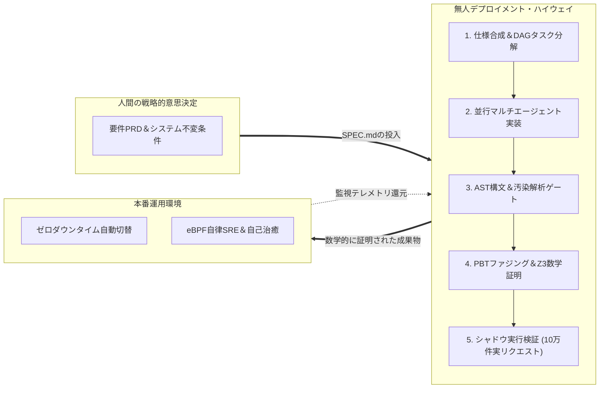

スタンフォード大学の最先端ソフトウェア工学講座 **CS146S: The Modern Software Developer（現代のソフトウェア開発者）** 技術解説シリーズ、いよいよ**最終第10講（完結編・グランドフィナーレ）**です。

過去9回の講義を通じて、私たちは開発手法の全階層を再構築してきました：
- **第1講**: タイピストからオーケストラ指揮者（Conductor）へのパラダイム転換
- **第2講**: コーディングLLMのトークン確率論と体系的プロンプト工学
- **第3講**: Model Context Protocol（MCP）による外部ツール標準化
- **第4講**: 仕様駆動開発（SDD）と自己修復テストループ
- **第5講**: Architect-Implementer-Criticによるマルチエージェント協調
- **第6講**: eBPFランタイム動的追跡とAI SRE障害緩和
- **第7講**: AST静的解析と汚染分析による自動コードレビュー
- **第8講**: AIネイティブ設計、コンテキスト予算、モノリス分離
- **第9講**: プロパティベース不変条件とZ3 SMTによる数学的完全証明

最終回となる**第10講**では、これらすべての工学的手法を統合した究極の青写真、すなわち**自律型ソフトウェア工場（The Autonomous Software Factory）**の全貌を提示します。

{/* truncate */}

---

### 1. 無人デプロイメント・ハイウェイ：ソフトウェアの「ダークファクトリー」

製造業において、作業員が不在で照明すら不要な完全自動化工場を「ダークファクトリー」と呼びます。スタンフォードCS146Sはソフトウェアにおける同等の概念として**無人デプロイメント・ハイウェイ**を定義します。



#### 5大自動検証ゲート
1. **契約スキーマ検証**: Pydantic/Protobuf等の厳格な型整合性を強制。
2. **ASTセキュリティ検証**: 32kトークン予算と循環結合を排除し、汚染分析で脆弱性を遮断。
3. **PBTファジング検証**: Hypothesisで10万件の無作為入力から不変条件を検査。
4. **Z3 SMT数学定理証明**: 論理充足可能性検査でバグの不在（UNSAT）を数学的に証明。
5. **シャドウ・デュアルラン検証**: 実トラフィックを複製し、100%出力一致を確認して無人切り替え。

---

### 2. 大規模AIフリート・オーケストレーション

単一エージェントとの対話を超え、数百から数千の自律エージェント群（フリート）を組織的に指揮する体制へ移行します：
- **分散ブラックボード**: 共有イベントバスによってエージェント間の文脈ドリフトと衝突を防ぐ。
- **階層的トークン経済学**: 軽量8Bモデルに定型作業を、最高峰モデル（Claude 3.7 Sonnet等）に定理証明やアーキテクチャ設計を配分。
- **ビザンチン合意形成**: 幻覚や意見の食い違いが発生した際、多数決または形式仕様に基づいて自動調停。

---

### 3. 自己進化型コードベース（Self-Evolving Codebase）

- **深夜の自律マイグレーション**: フレームワークの新版がリリースされると、夜間にエージェントがAST変換と検証を完了し、翌朝には検証済みPRが整う。
- **動的パフォーマンス自己治癒**: eBPFでボトルネックを検知したエージェントが、超高速なRust/C拡張への書き換えとZ3による等価性証明を自動実施。

---

### 4. 人間エンジニアの再定義：タイピストから最高意思決定者へ

AIの自律化によって人間のプログラマーは不要になるのか？ スタンフォードの結論は**「否（NO）」**です。人間のエンジニアは**システム総括指揮者（Chief Architect & System Governor）**へと進化します。

#### 人間にしか担えない4大領域
1. **問題定義（Why & What）**: 解くべき真の人間的課題の選定。
2. **倫理的境界とトレードオフ**: 公平性、プライバシー、偏見に対する価値判断。
3. **非対称リスクの許容決定**: どの水準の不確実性を事業として背負うかの経営的判断。
4. **ドメイン存在論（オントロジー）の設計**: 事業の本質的境界の創造的定義。

---

### 5. 実装コード: 自律フリート・ゲートキーパー

```python
"""
autonomous_fleet_gatekeeper.py
スタンフォードCS146S - 完結編自律デプロイメント・ゲートキーパー
"""

import time
from typing import Dict, Any, List

class VerificationGate:
    def __init__(self, name: str):
        self.name = name
    def evaluate(self, pr: Dict[str, Any]) -> bool:
        raise NotImplementedError

class SchemaContractGate(VerificationGate):
    def evaluate(self, pr: Dict[str, Any]) -> bool:
        print(f"[{self.name}] スキーマ契約とトークン予算の検証中...")
        return pr.get("has_schema_contract", False) and pr.get("context_tokens", 0) <= 32000

class ASTSecurityGate(VerificationGate):
    def evaluate(self, pr: Dict[str, Any]) -> bool:
        print(f"[{self.name}] AST汚染分析と循環依存の検査中...")
        return pr.get("taint_violations", 0) == 0 and pr.get("cyclic_dependencies", 0) == 0

class PropertyVerificationGate(VerificationGate):
    def evaluate(self, pr: Dict[str, Any]) -> bool:
        print(f"[{self.name}] PBTファジングとZ3 SMT数学証明の実行中...")
        return pr.get("pbt_passed", False) and pr.get("smt_proved", False)

class ShadowDualRunGate(VerificationGate):
    def evaluate(self, pr: Dict[str, Any]) -> bool:
        print(f"[{self.name}] 10万件の実リクエストによるシャドウ実行検証中...")
        return pr.get("shadow_diff_count", 0) == 0 and pr.get("latency_drift_pct", 0.0) <= 5.0

class AutonomousDeploymentOrchestrator:
    def __init__(self):
        self.pipeline = [
            SchemaContractGate("Gate 1: スキーマ契約"),
            ASTSecurityGate("Gate 2: ASTセキュリティ"),
            PropertyVerificationGate("Gate 3: PBT＆Z3証明"),
            ShadowDualRunGate("Gate 4: シャドウ実行"),
        ]
    def process_pr(self, pr: Dict[str, Any]) -> bool:
        print(f"=== 自律デプロイ検証開始: PR #{pr.get('pr_id')} ===")
        for gate in self.pipeline:
            if not gate.evaluate(pr):
                print(f"🚨 検証失敗: {gate.name} で却下されました。")
                return False
            time.sleep(0.05)
        print("🎉 全検証ゲート通過: 本番環境へ無人デプロイ完了！")
        return True

if __name__ == "__main__":
    orchestrator = AutonomousDeploymentOrchestrator()
    sample_pr = {
        "pr_id": 14610,
        "has_schema_contract": True,
        "context_tokens": 14200,
        "taint_violations": 0,
        "cyclic_dependencies": 0,
        "pbt_passed": True,
        "smt_proved": True,
        "shadow_diff_count": 0,
        "latency_drift_pct": -2.4
    }
    orchestrator.process_pr(sample_pr)
```

---

### 6. スタンフォードCS146S全10講の総括公理

| 講数 | 主要テーマ | 普遍のエンジニアリング公理 |
| :---: | :--- | :--- |
| **#1** | 現代の開発者 | 開発者はタイピストではなく指揮者である。 |
| **#2** | コーディングLLM | 検証のない確率的生成を決して信じるな。 |
| **#3** | MCP連携 | ツール連携を標準化し結合度を最小化せよ。 |
| **#4** | SDDと自己修復 | 精緻な仕様とテストハーネスに8割の力を注げ。 |
| **#5** | マルチエージェント | 設計・実装・批判の責任を明確に分離せよ。 |
| **#6** | eBPF動的追跡 | カーネルのテレメトリで障害を未然に防げ。 |
| **#7** | 自動コードレビュー | 機械的検査はASTに委ね、LLMは意図を検証せよ。 |
| **#8** | AIネイティブ設計 | 32kトークン予算を守り、循環結合を断て。 |
| **#9** | 形式検証と数学証明 | 単体テストを超え、Z3で数学的無欠性を証明せよ。 |
| **#10**| ソフトウェアの未来 | 無人ハイウェイを敷き、倫理とドメインを統括せよ。 |

---

### 📌 3〜5行エグゼクティブサマリー
1. **無人デプロイメントの確立**: 10週間の講座を結実させ、契約、AST、PBT、Z3証明、シャドウ実行による完全無人リリース体系を構築。
2. **AIフリート統括アーキテクチャ**: 分散ブラックボードと階層的トークン配分により、数百体規模のエージェントを破綻なく統御。
3. **自己進化型コードベース**: 夜間の自動マイグレーションとeBPF起点の自動ホットパッチによる恒常的負債解消を実現。
4. **人間指揮者の新時代**: 構文打ち込みから解放され、問題定義、倫理的境界、事業存在論を導く最高責任者としての役割を確立。

### 参考文献＆全講座完結
- **講義**: Stanford CS146S (The Modern Software Developer), Fall 2026.
- **担当組織**: スタンフォード大学 コンピュータサイエンス学科.
- **シリーズ完結**: 全10講の完全解説がGlobal Dev Blogに集結。
