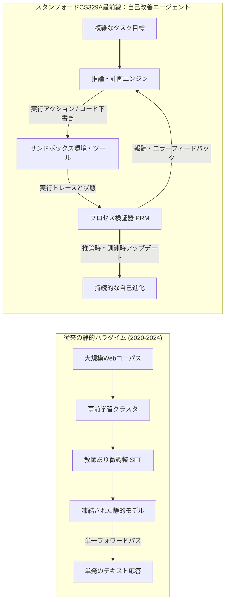

**スタンフォード大学（Stanford University）CS329A: Self-Improving AI Agents（自己改善型AIエージェント、2025年秋学期）**の技術解説へようこそ。

過去4年間、人工知能の研究と産業界は一つの強力なドグマに支配されてきました。それは、「*より大規模なテキストコーパス上で、より巨大なモデルを事前学習（Pre-training）するほど、認知能力は予測可能な形で向上する*」というスケーリング則（Scaling Laws）です。このパラダイムが現代の生成AI革命を牽引し、GPT-4、Claude 3.5、Geminiを生み出したことは間違いありませんが、機械学習フロンティアは今、決定的な転換点（Inflection Point）を迎えています。

静的な基盤モデル（Static Foundation Model）は、どれほどパラメータ数が膨大であっても、本質的な限界を抱えています。事前学習が完了して重みが凍結（Frozen）された後は、開ループ（Open-loop）で動作する受動的な自己回帰（Autoregressive）次トークン予測器に過ぎないという点です。難問に直面しても動的に計算リソースを追加配分できず、自身が生成した解の事実的正確性を検証できず、環境からのフィードバックをもとに誤りを自律修正することもできません。



スタンフォードCS329Aが投げかける中心的な問いは次の通りです：**「単にテキストを出力するだけでなく、自身の推論とコードを自ら検査、検証、計画し、改善し続けるソフトウェアエージェントをどのように構築するか？」**

本講義では、基盤LLMから自律型エージェントへの進化軌跡を解き明かし、事前学習スケーリング則と推論時計算量配分の数学的定式化を学び、4大標準エージェントワークフローパターンと、自律知能の最大のボトルネックである**「生成器・検証器ギャップ（Generator-Verifier Gap）」**を徹底的に解剖します。

{/* truncate */}

---

### 1. 進化の軌跡：私たちはどのようにしてここへ至ったのか

自己改善エージェントが向かう未来を理解するために、現代の基盤モデルエンジニアリングが辿った3つの歴史的フェーズを整理します：

```
  フェーズ1：事前学習（自己教師あり次トークン予測）
  [Webスクレイピング / 数兆トークン] ────> ベースLLM（自己回帰的補完エンジン）
                                                  │
  フェーズ2：事後学習アライメント                  ▼
  [厳選されたプロンプト-応答ペア]    ────> SFT（指示追従アシスタント）
  [人間の選好データ（RLHF/DPO）]     ────> アラインされた対話型チャットボット
                                                  │
  フェーズ3：CS329Aフロンティア                    ▼
  [実行フィードバック + PRM形式検証] ────> 自律的自己改善エージェント
```

#### フェーズ1：教師なし事前学習（Unsupervised Pre-Training）
ベース言語モデルは、最大尤度推定（MLE）目的関数によって数兆トークンを学習します：
$$\mathcal{L}_{\text{MLE}}(\theta) = - \sum_{i=1}^{T} \log P_\theta(x_i \mid x_{1:i-1})$$
この目的関数は、文法、世界知識、意味的関係を数百億から数千億の重みに圧縮することを強制しますが、ベースモデルは本質的に制約のない確率的模倣者に過ぎません。「フランスの首都は？」と問われた際、正解を答える代わりに、Web文書で頻出する「ドイツの首都はベルリンです」という文字列を続けて出力してしまう可能性が常に残ります。

#### フェーズ2：指示チューニングとRLHF（「ChatGPTレシピ」）
奔放な文章補完器を有用な対話アシスタントへと変貌させるため、二段階の事後学習パイプラインが確立されました：
1. **教師あり微調整（SFT）：** 高品質なプロンプト-応答ペアを学習させ、親切で礼儀正しい対話ペルソナをモデルに刷り込みます。
2. **人間フィードバックによる強化学習（RLHF）/ DPO：** 人間の選好を近似する報酬モデル $r_\psi(x, y)$ を用いて方針を最適化します：
$$\max_\theta \mathbb{E}_{(x, y) \sim \mathcal{D}} \left[ r_\psi(x, y) \right] - \beta \, \mathbb{D}_{\text{KL}}\left(\pi_\theta(y \mid x) \,||\, \pi_{\text{ref}}(y \mid x)\right)$$
RLHFは対話の従順さと安全性を解決しましたが、真の問題解決の自律性をモデルに与えたわけではありません。アラインされたチャットボットであっても、依然として単一のフォワードパスで、事後検証やツール活用なしに瞬時にトークンを吐き出す仕組みに縛られているからです。

#### フェーズ3：CS329Aフロンティア — 自律型エージェントループ
自己改善エージェントは、単一フォワードパスの制約から脱却します。コンパイラ、Webブラウザ、Python REPLといった外部ツール、階層型メモリ、そして自動検証ループを統合することで、能動的に環境を観察し、行動を実行し、中間結果を自己評価し、目標が数学的・論理的に満たされるまで内部状態を修正し続けます。

---

### 2. スケーリング則の数学：訓練時 vs. 推論時

現代の機械学習の根幹にあるのは**スケーリング仮説（Scaling Hypothesis）**です。2020年のKaplanら（OpenAI）および2022年のHoffmannら（DeepMind Chinchilla）の研究により、自己回帰言語モデルのテスト交差エントロピー損失 $L$ は、計算資源 $C$、パラメータ数 $N$、訓練データセット規模 $D$ に対してべき乗則（Power Law）に従うことが示されました：

$$L(N, D) = E + \frac{A}{N^\alpha} + \frac{B}{D^\beta}$$

ここで $E$ は自然言語が持つ既約エントロピー、$A, B$ はスケーリング係数、$\alpha \approx 0.34, \beta \approx 0.28$ は実証的なべき指数です。

```
交差エントロピー損失 L
 ▲
 │ ╲  10^21 FLOPs (GPT-2時代)
 │  ╲
 │   ╲  10^23 FLOPs (GPT-3時代)
 │    ╲
 │     ╲  10^25 FLOPs (GPT-4時代)
 │      └─── 事前学習の物理限界壁（公開データ枯渇と電力密度制約）
 └─────────────────────────────────────────────────────────────►
                       計算資源予算 C (FLOPs)
```

しかし、事前学習のスケーリングは過酷な物理的・経済的障壁に直面しています：
- **データ枯渇の壁：** インターネット上の高品質な人間作成テキストは、今後数年以内に底をつくと試算されています。
- **電力と資本コスト：** $10^{26}$ FLOPsを超える巨大クラスタの構築には、ギガワット（GW）級の専用変電所と数千億円の設備投資が必要です。

#### 第2のフロンティア：推論時（Inference-Time）計算スケーリング
事前学習時に重みを更新するために莫大な資金を投じる代わりに、**「答えを導き出す推論（Inference）の瞬間に、より多くの計算量を配分して高度な知性を獲得できないか？」**

難解な数学の証明やプログラミングに挑む際、人間の専門家は最初から完璧な答案を一息で書き上げることはありません。複数の仮説を立て、中間定理を検算し、行き詰まりを感じたら一歩戻って（バックトラック）別の解法を模索します。

**推論時コンピュート・スケーリング**は、テスト時のFLOPsを主に以下の3軸で配分します：
1. **反復サンプリング（Best-of-$N$ / Large Language Monkeys）：** 方策 $\pi_\theta$ から $N$ 個の候補軌跡を並列生成し、検証器を用いて最適な解を選択します。少なくとも1つの正解が含まれる確率は $\text{Pass@}k$ 指標に従います：
$$\text{Pass@}k = \mathbb{E}\left[ 1 - \frac{\binom{n - c}{k}}{\binom{n}{k}} \right]$$
ここで $n$ は総サンプル数、$c$ は正解軌跡数です。
2. **ステップレベル検証（PRM vs. ORM）：** 最終解答のみを評価する結果報酬モデル（ORM）は、多段階の推論において途中の誤り箇所を特定できません。一方、プロセス報酬モデル（PRM）は各推論ステップに対して $r_t = R(x, y_{1:t})$ のスカラー報酬を付与し、正確な信用割当（Credit Assignment）を可能にします。
3. **木探索アルゴリズム（MCTS、ビームサーチ）：** モンテカルロ木探索（MCTS）によって膨大な推論グラフを探索し、有望な中間ノードの活用（Exploitation）と未知の経路の探索（Exploration）のバランスをとります。

OpenAI o1やDeepSeek-R1が示すように、推論時計算量を100倍〜1,000倍にスケールさせる手法は、モデル自体のパラメータ拡大を凌駕するブレークスルーを国際数学オリンピック（IMO）やSWE-benchで叩き出しています。

---

### 3. エージェントワークフローの4大標準アーキテクチャ

単一のプロンプトだけに依存してエージェントを動かそうとすると、確率的ドリフトによって破綻が生じます。スタンフォードCS329Aでは、エージェントを以下の4つのモジュール設計パターンに体系化しています：

```mermaid
flowchart TD
    subgraph パターン1 ["1. プロンプトチェイニング (Prompt Chaining)"]
        P1_In[タスク入力] --> P1_M1[モデル ステップ1]
        P1_M1 -->|中間出力| P1_M2[モデル ステップ2]
        P1_M2 --> P1_Out[最終出力]
    end

    subgraph パターン2 ["2. 動的ルーティング (Dynamic Routing)"]
        P2_In[クエリ] --> P2_Router{意図分類ルーター}
        P2_Router -->|数式処理| P2_Math[記号計算エンジン]
        P2_Router -->|コード編集| P2_Code[SWEエージェント]
        P2_Router -->|一般的な質問| P2_LLM[汎用LLM]
    end

    subgraph パターン3 ["3. 並列化 (Parallelization)"]
        P3_In[入力課題] --> P3_A[エージェント1: 保守的]
        P3_In --> P3_B[エージェント2: 創造的]
        P3_In --> P3_C[エージェント3: 敵対的批判]
        P3_A --> P3_Agg[合意形成・統合集計器]
        P3_B --> P3_Agg
        P3_C --> P3_Agg
    end

    subgraph パターン4 ["4. オーケストレーター・ワーカー (Orchestrator-Worker)"]
        P4_In[要求仕様 PRD] --> P4_Orch[統括オーケストレーター]
        P4_Orch -->|サブタスク1| P4_W1[専門ワーカー1]
        P4_Orch -->|サブタスク2| P4_W2[専門ワーカー2]
        P4_W1 -->|状態フィードバック| P4_Orch
        P4_W2 -->|状態フィードバック| P4_Orch
        P4_Orch --> P4_Out[統合システム完成]
    end
```



#### 1. プロンプトチェイニング（Prompt Chaining：順次分解）
複雑なタスクを決定論的な一連のサブタスクに分解し、ステップ $k$ の出力をステップ $k+1$ の構造化入力として渡すパイプラインです。各段階の間に検証ゲート（例：アウトライン生成 $\to$ 網羅性チェック $\to$ 本文執筆 $\to$ 校正）を挟むことで、誤りの連鎖的増幅を防止します。

#### 2. 動的ルーティング（Dynamic Routing：専門分化）
入力された要求を分類し、最も適したドメイン特化モデルや専用ツールに振り分けます。数式はPythonサンドボックスへ、大規模リファクタリングはSWEエージェントへ振り分けることで、システム全体のコストとレイテンシを最小化します。

#### 3. 並列化（Parallelization：セクショニングと投票）
- **セクショニング（Sectioning）：** 互いに独立したサブタスクを複数のモデルインスタンスが並行して同時に処理します。
- **投票アンサンブル（Voting）：** 異なるプロンプトや温度パラメータを用いて複数の解答を同時生成し、多数決や合意形成によって確率的ノイズを低減します。

#### 4. オーケストレーター・ワーカー（Orchestrator-Worker：階層型指揮）
中央のオーケストレーターが上位目標を有向非巡回グラフ（DAG）に分解してワーカーに委任し、実行ログと例外をリアルタイムで監視しながら最終成果物を統合します。

---

### 4. 自律知能の最大のボトルネック：生成器・検証器ギャップ

自己改善型エージェントの構築がなぜこれほどまでに難しいのでしょうか？
その核心には、**生成と検証の非対称性**が存在します：

$$\text{計算量}(\text{検証}) \ll \text{計算量}(\text{生成}) \quad \text{閉じた形式的領域（数学、コード、Lean 4）}$$
$$\text{計算量}(\text{検証}) \approx \text{計算量}(\text{生成}) \quad \text{開かれた自然言語領域（小論文、戦略、法律）}$$

```
検証能力
 ▲
 │   形式的領域（数学証明、Pythonコード、型検査）
 │   ┌────────────────────────────────────────────────────────┐
 │   │ 検証器（コンパイラ / テストハーネス / Z3 SMTソルバー） │
 │   │ 決定論的であり、計算コストが低く、100%信頼できる       │
 │   └────────────────────────────────────────────────────────┘
 │
 │   開かれた自然言語領域（エッセイ、政策提言、ビジネス交渉）
 │   ┌────────────────────────────────────────────────────────┐
 │   │ 検証器（LLMジャッジ）                                  │
 │   │ ノイズが多く、バイアス（冗長性バイアス、同調）に脆弱   │
 │   └────────────────────────────────────────────────────────┘
 └─────────────────────────────────────────────────────────────►
                     生成の複雑さ
```

プログラミングや形式的定理証明のようなドメインでは、検証は決定論的です。コードが正常終了するか、テストケースをパスするかは自明です。したがって、この分野では自己改善ループが機能します：候補パッチを生成し、テストを実行し、失敗したものを破棄し、成功したパッチのみを取り込んで進化させることができます。

しかし、オープンエンドな自然言語領域において、「この回答が真に優れているか」を判定することは、ゼロから回答を作成することと同等の認知能力を必要とします。LLMを別のLLMの審査員（LLM-as-a-judge）として起用した場合、長い回答を過大評価する冗長性バイアス（Verbosity Bias）や、自身の誤りに気付けない閉塞した確率ループに陥ります。

この生成器・検証器ギャップを乗り越えるため、自然言語の意図を実行可能な制約にコンパイルし、客観的グラウンディングを実現するアプローチこそが、CS329Aの探求の根幹です。

---

### 5. スタンフォードCS329A カリキュラムロードマップ

本講義は以下の4層のアーキテクチャスタックで展開されます：

```
┌─────────────────────────────────────────────────────────────────────────────┐
│                    スタンフォードCS329A 全体アーキテクチャスタック           │
├─────────────────────────────────────────────────────────────────────────────┤
│  Part 4 · Frontiers（最前線：第13講〜第17講）                               │
│  - 数学的推論とAlphaProof、Lean 4形式検証                                   │
│  - 自律システムの信頼性3階層とAI Control安全境界                            │
│  - マルチモーダル・身体性ロボティクスエージェント（VLA, RT-2, π0）          │
│  - 完結編：未解決課題と自己改善アライメント浸食                             │
├─────────────────────────────────────────────────────────────────────────────┤
│  Part 3 · Agent Engineering（エンジニアリング：第10講〜第12講）             │
│  - ソフトウェアエンジニアリングエージェント（SWE-bench, ASIインターフェース）│
│  - 階層型OSメモリ構造（MemGPT, CacheBlend）                                 │
│  - 長時間タスク評価と経済的付加価値（METR Time Horizons）                   │
├─────────────────────────────────────────────────────────────────────────────┤
│  Part 2 · Training & Evolution（訓練と進化：第6講〜第9講）                  │
│  - 訓練時スケーリングと強化学習（DeepSeekMath & GRPO）                      │
│  - 開放型自己進化とアーキテクチャ探索（ADAS, AlphaEvolve）                  │
│  - 自律型ディープリサーチワークフロー（AlphaCode, Search-o1）               │
│  - 事後学習のパラダイムシフト：SFT -> RLHF -> RLVR -> Agent RL              │
├─────────────────────────────────────────────────────────────────────────────┤
│  Part 1 · Foundation（基礎：第1講〜第5講）                                  │
│  - 推論時計算スケーリングと最適配分則                                       │
│  - プロセス報酬モデルと回答検証（PRM800K）                                  │
│  - ツール利用とコード実行閉ループフィードバック（ReAct, RLEF）              │
│  - 多段階計画とモンテカルロ木探索（LATS MCTS）                              │
└─────────────────────────────────────────────────────────────────────────────┘
```

---

### 6. 要点まとめと学術Q&A

#### 要点まとめ
1. **パラダイムシフト：** 単発のテキスト補完から、観察・実行・検証・反省が連続する自律フィードバックループへと人工知能の軸足が移行しました。
2. **二重のスケーリングフロンティア：** 事前学習パラメータの拡大に加え、推論時計算量（Best-of-$N$、PRM検証、木探索）を動的に増やすことで、小型モデルでも難問を打破できるようになりました。
3. **普遍的骨格：** すべての優れたエージェントシステムは、**《生成 $\to$ 検証 $\to$ 循環》**の三位一体ループを実装しています。
4. **検証のボトルネック：** 自己改善の進化速度は、モデル自身が解の真偽をどれほど客観的かつ厳密に検証できるかによって決定されます。

---

#### 学術Q&A

**Q. 推論時計算スケーリングは、従来のプロンプト工夫や単純なChain-of-Thought（CoT）と何が違うのですか？**
**A.** 単純なCoTは、中間の思考過程を単一の不可逆なテキストとして一本道で出力するだけです。もし途中のステップ2で計算ミスを犯すと、その誤りは後続のトークンへと不可避に伝播します。対照的に、推論時計算スケーリングは外部探索木と検証チェックポイントを導入します。各推論ステップをプロセス報酬モデル（PRM）やコンパイラが評価し、有望な枝を深掘りし、誤った枝を刈り取って戻る能動的な計算資源の配分が行われます。

**Q. あらゆるタスクを完璧に検証できる究極の巨大LLMを審査員として学習させれば解決しないのですか？**
**A.** 確率的ニューラルネットワークは、客観的な外部環境との接地（Ground-truth Anchor）なしには、自身の確率的誤謬を自己修正できないためです。自然言語領域においてLLM審査員は、長い回答を無条件に好む冗長性バイアスや追従バイアス（Sycophancy）を本質的に排除できません。真の信頼性検証は、自然言語の主張を実行可能なコード、データベースクエリ、Lean 4の数学定理、物理ロボットのセンサー信号といった決定論的環境へ接地（Grounding）させることで初めて成立します。

---

### 次回講義の予告

**第2講（Lecture 2）**では、推論時計算スケーリングの深層数学メカニズムを本格的に掘り下げます：
- Snellらの計算最適スケーリング境界（Compute-Optimal Scaling Frontiers）
- 反復サンプリングのカバレッジと逐次探索の深さにおけるトレードオフ
- *Archon*および*Large Language Monkeys*が実証した生成予算と検証予算の最適黄金比

自律的に進化する人工知能の心臓部へ、共に踏み出しましょう！