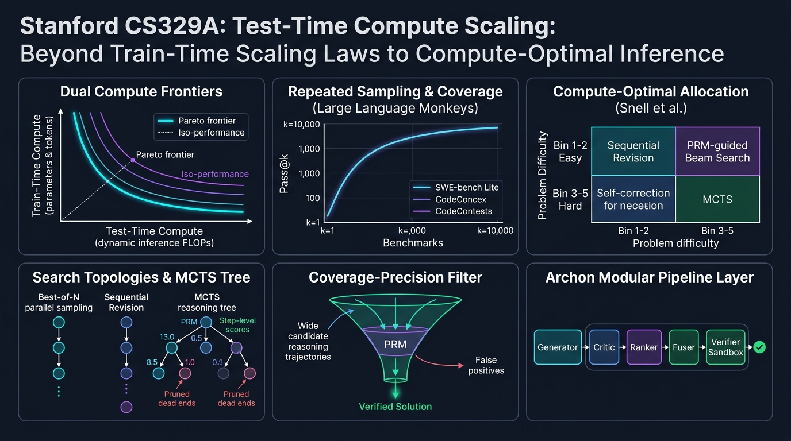
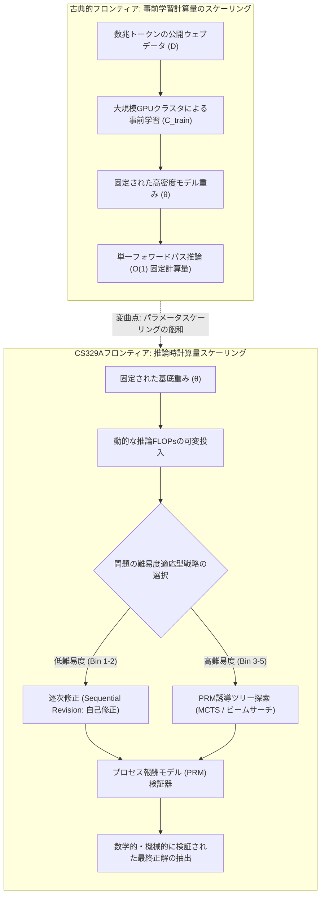
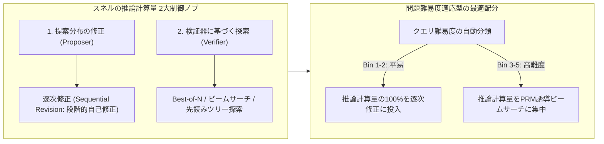

スタンフォード大学の2025年秋学期・最新大学院講座、**CS329A: Self-Improving AI Agents（自己改善AIエージェント）**の第2回エンジニアリング解説へようこそ。

第1講では、静的な次トークン予測器としてのLLMが、環境とフィードバックループを回す自律型エージェントへと変貌するパラダイムシフトを概括しました。本日扱う第2講のテーマは、この自律的な自己改善を支える最も本質的な計算基盤、すなわち**推론時計算量スケーリング（Test-Time Compute Scaling / Inference-Time Scaling）**です。

過去5年以上にわたり、AI業界を支配してきた唯一の教義は事前学習（Pre-training）のスケーリング則（Kaplanら、Chinchilla）でした。「GPUクラスタを巨大化し、パラメータ数Nを数千億に増やし、数十兆トークンのウェブデータを学習させる」。しかし、学習が完了し重みθが固定（Frozen）されたモデルに対し、0.05秒で貪欲（Greedy）に答えさせる代わりに、**10秒、1分、あるいは10分間深く思考させ、中間推論を検証し、仮説を自己修正させながら推論計算量（FLOPs）を投入したら**何が起きるでしょうか？

*Large Language Monkeys*（Brownら、2024）、スタンフォード・バークレーのCharlie Snell研究チームによる*Compute-Optimal Scaling*（Snellら、2024）、そして*Archon*モジュール型アーキテクチャフレームワークを通じて、**「推論計算量を投資してパラメータ容量を凌駕する現代AIの最適化法則」**を数理的・工学的に解き明かします。



{/* truncate */}

---

### 1. 古典的スケーリング則 vs 推論時計算量: パラダイムの大転換

現代のディープラーニングは、検証損失（Validation Loss）が訓練計算量に対するべき乗則（Power-law）に従って減少するという経験則の上に築かれました：

```text
L(N, D) = E + A / N^α + B / D^β
```

ここでNは非埋め込みパラメータ数、Dはデータセットのトークン数です。しかし、この古典的な定式化は、推論計算量を極めて単純な定数（自己回帰デコードにおけるトークン生成あたり2 FLOPs × パラメータ数）として扱っていました。

#### 事前学習スケーリングが直面した物理的限界
10^26 FLOPs（GPT-4クラス）を超えてモデルを事前学習するにつれ、3つの致命的な壁が顕在化しました：
1. **公開ウェブトークンの枯渇境界:** インターネット上の高品質な人間生成テキストは有限です（約10^14トークン）。信頼できる外部検証器なしに合成データ（Synthetic Data）を再帰学習させると、モデル崩壊（Model Collapse）やエントロピー縮退が発生します。
2. **指数関数的なコスト爆発:** べき乗曲線の平坦なテール部分でベンチマーク精度を1%向上させるには、訓練計算量を10倍以上投入する必要があり、数億ドル規模の巨額な設備投資（CAPEX）を要します。
3. **静的フォワードパスの限界:** モデルが7Bであれ1Tであれ、従来のデコードは固定回数の行列乗算で次のトークンt_iを決定論的に出力します：

```text
t_i ~ Softmax( W_u · LayerNorm( h_L(t_{1:i-1}) ) )
```

複雑なNP完全の数学証明や、数十のソースコードファイルに跨るバグ修正は、バックトラッキング（Backtracking）や試行錯誤、段階的検証を伴わなければ、単一の順伝播のみで解決することは不可能です。

---

### 2. 無限の猿定理の帰還: Large Language Monkeys

古典的確率論には、フランスの数学者エミール・ボレルが提唱した「無限の猿定理（Infinite Monkey Theorem）」があります。「無限に多くの猿にタイプライターをランダムに叩かせれば、いつかシェイクスピアのハムレット全巻を書き上げる」。

2024年末、UCバークレーとGoogle Researchの研究チームは、最先端LLMを対象にこの仮説を検証した記念碑的論文を発表しました：**《Large Language Monkeys: Scaling Inference Compute with Repeated Sampling》**（Brownら、2024）。

```
カバーレッジ (Pass@k %)
 ▲
100│                                     ┌────────────── Pass@k カバーレッジ理論的上限
 90│                                ┌────┘ (MATH・CodeContestsで99%に到達)
 80│                           ┌────┘
 70│                      ┌────┘
 60│                 ┌────┘ ◄── SWE-bench Lite: DeepSeek-Coder-V2 (k=250 -> 56.0%)
 50│            ┌────┘
 40│       ┌────┘   ◄── Claude 3.5 Sonnet 単一実行 (43.0%)
 30│  ┌────┘
 20│ ┌┘
 10│┌┘  ◄── Gemma-2B Pass@1 (0.02%)
  0└┴──────┬──────────┬──────────┬──────────┬──────────►
    k=1    k=10       k=100      k=1,000    k=10,000   (サンプリング試行回数 k)
```

#### 不偏pass@k推定量の数学的定義
N個の候補回答をサンプリングし、そのうち単体テストを合格した正解がC個ある場合、ランダムに抽出したk個の中に少なくとも1つの正解が含まれる確率の最小分散不偏推定量（MVUE）は以下のように定義されます：

```text
Pass@k = (1 / P) · ∑_{i=1}^P [ 1 - C(N - C_i, k) / C(N, k) ]
```

ここでPは総問題数、C_iはi番目の問題の正解数、C(n, r)は二項係数です。N=10,000規模における階乗計算のオーバーフローを防止するため、実務環境では以下の数値的安定ループを用いて計算します：

```text
Pass@k = 1 - ∏_{j=0}^{k-1} ( 1 - C_i / (N - j) )
```

#### 実証的衝撃: 軽量モデルがフロンティアモデルを凌駕する
反復サンプリングによる推論計算量のスケーリングは、驚くべき実証結果をもたらしました：
* **SWE-bench Lite（GitHub上の実専ソフトウェアバグ修正ベンチマーク）:**
  * オープンソースモデル`DeepSeek-Coder-V2-Instruct`の単一実行（k=1）成功率は**15.9%**でした。
  * しかし、サンプル数をk=250に拡大したところ、pass@250は**56.0%**へと急上昇しました。
  * これは、当時最高峰であったGPT-4oとClaude 3.5 Sonnetのアンサンブル（43.0%）を**13ポイント上回る**結果でした。
* **CodeContests（超難関競技プログラミング課題）:**
  * 超軽量モデル`Gemma-2B`の単一正解率（pass@1）は**0.02%**（ほぼ0）でした。
  * しかしk=10,000にスケールさせた結果、正解率は**7.1%**に達し、**355倍の飛躍的性能向上**を記録しました。
* **経済的逆転現象:**
  * SWE-bench LiteでDeepSeek-Coder-V2（k=5）を用いて29.62%を達成するコストは**$10.80**でした。
  * 一方、単一実行のGPT-4o（24.0%）は**$39.00（3.6倍高価）**、Claude 3.5 Sonnet（26.7%）は**$51.00（4.7倍高価）**を消費しました。

```text
┌───────────────────────────────┬──────────┬────────────┬─────────────┐
│ モデルと推論戦略              │ SWE-bench│ コスト ($) │ 倍率        │
├───────────────────────────────┼──────────┼────────────┼─────────────┤
│ DeepSeek-Coder-V2 (k=5)       │ 29.62%   │ $10.80     │ 1.0x (基準) │
│ GPT-4o (k=1 貪欲単一実行)     │ 24.00%   │ $39.00     │ 3.6倍 高コスト│
│ Claude 3.5 Sonnet (k=1)       │ 26.70%   │ $51.00     │ 4.7倍 高コスト│
│ DeepSeek-Coder-V2 (k=250)     │ 56.00%   │ $540.00    │ 最高峰性能  │
└───────────────────────────────┴──────────┴────────────┴─────────────┘
```

#### カバーレッジ-適合率ギャップ (Coverage-Precision Gap): 検証器の壁
しかし、闇雲にサンプルを量産する手法は、**カバーレッジ-適合率ギャップ**という致命的な構造的障壁に直面します。

単体テストやコンパイラ等の決定論的オラクルが存在する領域では、**カバーレッジ＝最終成功率**です。250個のうち1つでもテストを通過すれば機械的に抽出できるためです。

しかし、外部検証器のない一般的な数学記述問題や自然言語領域では異なります：
* MATHデータセットにおいて、`Llama-3-8B-Instruct`のカバーレッジはk=10,000で**98.44%**に達しました（98%の確率で正解が含まれる）。
* しかし、従来の**多数決投票（Majority Voting）**を適用した場合、正解率は40.5%から**41.41%**へとわずか0.9%pしか向上しませんでした。
* 結果報酬モデル（ORM）による**Best-of-N選別**も約k=100付近でプラトーに達し、過剰適合と偽陽性（False Positive）によって残りの57%の正解を救い出すことができませんでした。

> **設計の鉄則:** 高精度な検証器（Verifier）なしにサンプリング試行回数だけを増やすのは、干し草の山を巨大化させる行為に過ぎません。干し草の中に針（正解）が存在する確率が99%になっても、針を吸着できる磁石（検証器）がなければ、正解を見つけ出すことは不可能です。

---

### 3. スネル(Snell)の計算最適拡張則 (Compute-Optimal Scaling)

無秩序に10,000回サイコロを振るのではなく、限られた推論予算（FLOPs）の枠内で最も効率よく正解を導くにはどうすればよいでしょうか？

2024年秋、スタンフォード大学とUCバークレーのCharlie Snellらは、歴史的論文を発表しました：**《Scaling LLM Test-Time Compute Optimally can be More Effective than Scaling Model Parameters》**。



#### 推論計算量を司る2本のノブ
Snellらは、あらゆる推論拡張手法を**提案者（Proposer）**と**検証者（Verifier）**という2つの直交軸に整理しました：
1. **提案分布の修正（Proposer修正）:** 過去の思考ログや自己批判を与え、モデル自身に高品質な回答を修正生成させる戦略：
   ```text
   y_{t+1} ~ P_θ( y | x, y_1, ..., y_t, Critique_t )
   ```
2. **検証器に基づく探索（Verifier探索）:** プロセス報酬モデル（PRM）を用いて、有望な中間思考ノードを探索・枝刈りする戦略：
   ```text
   Score(Node_t) = PRM_ψ( x, y_{1:t} )
   ```

#### 難易度による最適戦略の反転原理
Snell研究チームの最も重要な発見は、**「問題の難易度に応じて、採るべき最適戦略が真逆に反転する」**という事実でした：

```text
難易度 Bin 1-2 (平易な問題)   ───>  逐次修正 (Sequential Revision) の圧倒的優位
難易度 Bin 3-5 (高難度の問題) ───>  PRM誘導ビームサーチ (Beam Search) の圧倒的優位
```

1. **平易な問題（Bins 1–2）:** 
   * 平易な問題では、モデルの初回出力がすでに正解に近接しています。
   * ここに複雑なビームサーチやBest-of-Nを適用すると、検証器の微小なノイズが蓄積され、**計算量を増やすほど誤答を選択してしまう過剰適合（Over-optimization）**が発生します。
   * **最適解:** モデルに計算ミスや誤字を直させる逐次修正（Revision）が、最小の計算量で最高精度をもたらします。
2. **高難度な問題（Bins 3–5）:**
   * 難関数学オリンピック級の課題では、最初の思考方針が誤っている場合、単純な修正では袋小路から脱出できません。
   * **最適解:** ステップごとのPRMスコアを頼りに無駄な思考枝を早期に刈り取るビームサーチが、Best-of-Nに対して圧倒的な精度向上を示します。
3. **計算最適配分の果実:**
   * 平易な問題にはRevisionを、難問にはPRMビームサーチを動的に割り振る最適方針は、単純なBest-of-Nと比較して**同一精度を達成するのに4分の1（4x減）の計算量**しか消費しませんでした。

#### 14倍パラメータ等価性 (The 14x Parameter Equivalence)
Snell論文の白眉は、**「事前学習モデルのパラメータを14倍に拡大すること」と「小型モデルに14倍の推論計算量を与えること」の直接対決**でした：

```text
14倍巨大モデル (貪欲単一実行)   vs   1倍小型モデル + 14倍推論計算量
```

* MATHやGSM8Kの平易〜中難度タスクにおいて、推論計算量を最適配分した小型モデルは、14倍巨大なベースモデルの性能を完全に捕捉または凌駕しました。
* ただし極限の超難問（Bin 5）においては、巨大モデルの事前学習パラメータが依然として不可欠でした。小型モデルが問題の本質を捉える基礎的な意味表現をそもそも持ち合わせていなければ、推論時の探索は無根拠なハルシネーションの空回りに終わるためです。

---

### 4. システム工学: Archon モジュール型複合エージェントアーキテクチャ

理論的な推論スケーリング則を商用実運用ソフトウェアへと落とし込むにはどうすればよいでしょうか？ 生成器、批判器、ランキング、テスト実行環境を毎回場当たり的にプロンプト設計するのを防ぐには、システムエンジニアリングのアプローチが不可欠です。

**Archon**（arxiv:2409.15254）は、ニューラルネットワークの層を重ねるように、LLMの機能単位を**階層型（Layered）ソフトウェアパイプライン**として抽象化しました：

```mermaid
flowchart TD
    Q[ユーザー入力 / 仕様書] --> G[Layer 1: 生成器アンサンブル (Generator)]
    G -->|多様な候補解群| C[Layer 2: 多角的批判器 (Critic)]
    C -->|批判・脆弱性の指摘| R[Layer 3: トーナメント順位器 (Ranker)]
    R -->|上位有望候補群| F[Layer 4: 融合合成器 (Fuser)]
    F -->|統合された高品質回答| V[Layer 5: 自動検証器・テストサンドボックス]
    V -->|テスト実行フィードバック| Dec{全テスト合格?}
    Dec -- Yes --> Final[検証済みプロダクション成果物]
    Dec -- No (再生成ループ) --> G
```

#### Archonの5層アーキテクチャ
1. **生成器層 (Generator):** 温度設定（T=0.2〜0.8）の多様化や、異種モデル（Claude 3.5 Sonnet + DeepSeek-V2）のアンサンブルにより、多様な候補群を並行生成。
2. **批判器層 (Critic):** 各候補回答の論理的飛躍、境界値の考慮漏れ、計算ミスをテキスト形式で詳細に指摘。
3. **順位器層 (Ranker):** 批判器の指摘を基に、候補同士の1対1トーナメント評価を行い、厳密にスコアリング。
4. **融合層 (Fuser):** 上位候補群の核心的なアプローチを抽出し、1つの完璧な回答へと再合成（+8.9%の性能向上）。
5. **検証層 (Verifier):** コーディング課題において、LLM自身に5〜10個のエッジケース単体テストを書かせ、隔離されたサンドボックス環境で実行して成否を判定（+56%の性能向上）。

Archonはこれらを組み合わせた**9,576通りのアーキテクチャ空間**を定義し、**ベイズ最適化（Bayesian Optimization）**を用いて、指定されたコストとレイテンシの制約内でパレート最適（Pareto-optimal）となるエージェントパイプラインを自動導出します。

---

### 5. アーキテクチャ実例分析: OpenAI o1 推論モデルの正体

スタンフォードCS329A第2講の理論は、OpenAI o1やDeepSeek-R1といった最新の推論特化型モデルの内部メカニズムを鮮やかに解き明かします：

```
┌────────────────────────────────────────────────────────────────────────┐
│                   o1 内部の「思考（Thinking）」トレースの正体          │
├────────────────────────────────────────────────────────────────────────┤
│ 1. 隠蔽された熟慮トークン (Test-Time Tokens):                          │
│    ユーザーへの出力前に、数千トークンにおよぶ内部推論思考（CoT）を     │
│    生成し、推論計算量を大量に先行消費。                                │
│                                                                        │
│ 2. 内在化されたプロセス報酬モデル (PRM):                               │
│    強化学習（RL）を通じて訓練され、論理の行き詰まりを検知した際に      │
│    自動的に過去の分岐ノードへと戻る（Backtracking）能力を確立。        │
│                                                                        │
│ 3. 自己修正ループ (Snell Revision):                                    │
│    「待てよ、この計算は矛盾している。別の方法で解き直そう」という文脈は │
│    自己一貫性チェックにより誘発された逐次修正ポリシーの発現。          │
└────────────────────────────────────────────────────────────────────────┘
```

o1が示す思考の軌跡は魔法ではありません。逐次修正、PRMによる思考木の枝刈り、そして適応的な計算配分が、**単一のニューラルネットワーク重みの中へ統合された推論時計算量スケーリングの結晶**なのです。

---

### 6. まとめと核心的エンジニアリング知見

1. **知能拡張の2大フロンティア:** AIモデルの知能向上は、もはや事前学習だけに依存しません。推論時計算量スケーリングは、軽量モデルが超巨大モデルを圧倒することを可能にする、直交した独立の知能拡張軸です。
2. **カバーレッジ-適合率の原則:** 反復サンプリング（pass@k）は正解の潜在的カバーレッジを急拡大させますが、それを収穫するには高精度なプロセス検証器（PRM）が絶対に不可欠です。
3. **スネルの最適配分則:** 闇雲なサンプリングよりも、難易度適応型配分が4倍高効率です。平易な課題には逐次修正を、難問にはPRM誘導ビームサーチを適用してください。
4. **モジュール型エージェントシステム:** Archonが示すように、生成・批判・順位・テストサンドボックスを有機的に結合するソフトウェアアーキテクチャの優劣が、モデル単体のサイズと同等以上に最終精度を決定します。

---

### スタンフォードCS329A 次回予告:
次回**第3講**では、自律型エージェントの核心エンジンである**《Robust Verification: プロセス報酬モデル（PRM）、アンサンブル、そしてスケーラブルな監督（Scalable Oversight）》**を徹底詳解します。報酬ハッキングを防ぎ、人間の介在なしに真の正解を検証するプロトコルの全貌をお届けします。ご期待ください！
