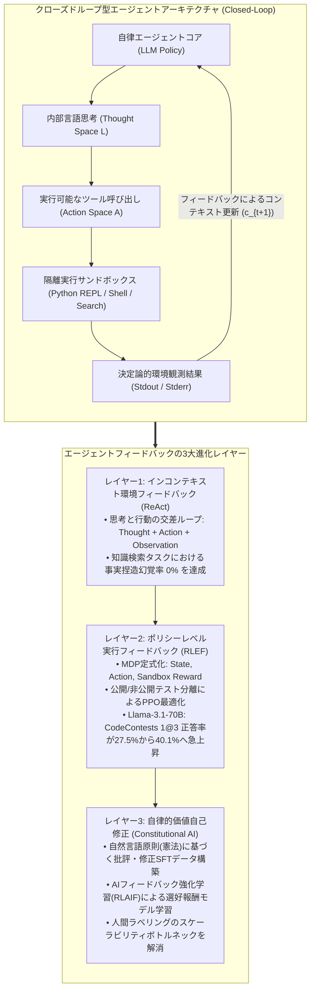
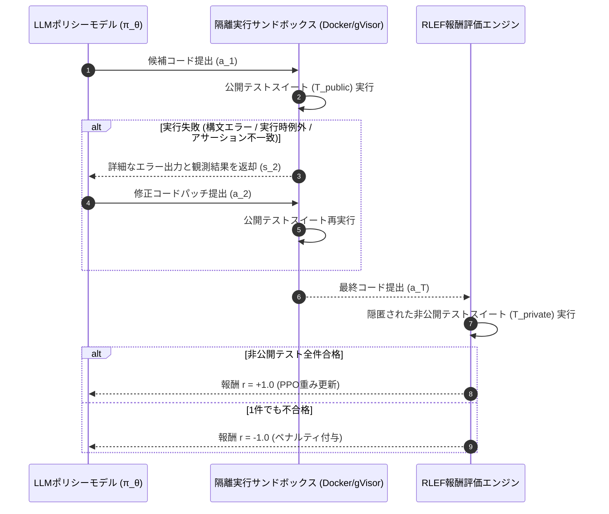
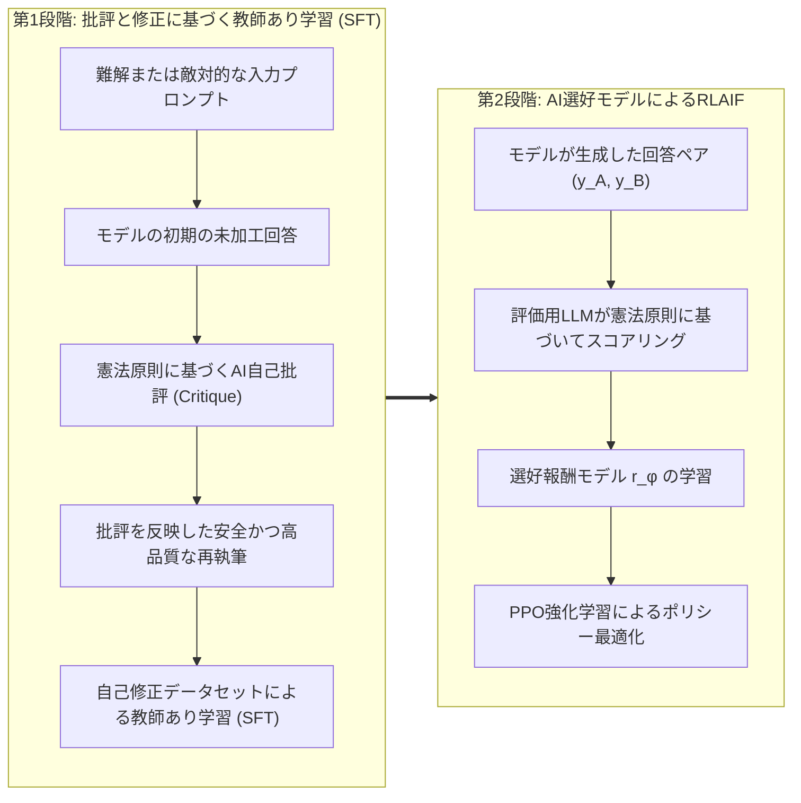

スタンフォード大学の2025年秋学期最新大学院講義、**CS329A: Self-Improving AI Agents（自己進化型AIエージェント）**の第4回エンジニアリング解説へようこそ。

第2講と第3講では、推論時計算量スケーリング（Test-time Compute Scaling）およびプロセス報酬モデル（PRM）を駆使し、言語モデルがいかに推論探索木を展開して中間ステップの正当性を検証するかを学びました。しかし、どれほど洗練された思考連鎖（CoT）を展開できたとしても、純粋なテキスト生成にとどまるモデルは本質的に**「密室に閉じ込められて試験問題を解く受験生」**にすぎません。モデルは事前学習時に脳内に焼き付けられた、静的で凍結されたパラメータメモリ（Parametric Memory）だけに頼っているためです。絶えず変化する外部の事実、動的なWeb API、あるいは厳格なコード実行環境を前にすると、現実世界と切り離されたモデルは不可避的に「もっともらしい幻覚（Hallucination）」を生み出してしまいます。

本日解説する第4講は、モデルをその密室から解き放つ決定的な転換点です。テーマは**「ツール利用（Tool Use）と実行フィードバックループ（Feedback Loops）」**です。

自律型エージェントは、コードやAPI呼び出しを単なる出力テキストとして扱うのではなく、外部環境と相互作用するための**「センサーおよびアクチュエータ」**として活用します。本講義では、静的な言語モデルをクローズドループ型自律エージェントへと昇華させる3つの主要フィードバック層を詳細に解体・再構築します：
1. **プロンプト層の環境フィードバック（In-Context）:** 思考と行動を有機的に結合する **ReAct**（Yao et al., 2022）
2. **ポリシー層の実行フィードバック（Policy-Level）:** コンパイラやテストスイートの診断結果をニューラルネットワークの重みに直接焼き付ける **RLEF**（Reinforcement Learning from Execution Feedback, 2024）
3. **自己教師あり価値アライメント（Self-Supervision）:** 高コストな人間のアノテーションを自然言語の憲法原則による批評・修正ループで置き換える **Constitutional AI**（Anthropic, 2022）



{/* truncate */}

---

### 1. 思考と行動の調和: ReActフレームワーク (Yao et al., 2022)

2022年にプリンストン大学とGoogle ResearchがReActを発表するまで、AIコミュニティは2つの陣営に二極化していました：
1. **純粋推論派 (Chain-of-Thought / CoT):** モデルに「ステップバイステップで思考せよ」と促します。閉じた数学的パズルでは効果を発揮しますが、外部世界と切り離されているため、一度誤った事実（幻覚）を想起すると、その嘘を正当化するためにさらに精緻な虚構を構築してしまいます。
2. **純粋行動派 (Action-only / WebGPT, Act):** モデルに直接API呼び出しや検索コマンドを発行させます。しかし、「今なぜこの検索をしているのか」「次のサブゴールは何か」という作業記憶（Working Memory）を保持できないため、無限ループに陥ったり目的を見失ったりします。

#### 行動空間の数学的拡張

ReActの革新性は、エージェントの全行動空間を**外部物理行動空間 $A$** と **内部自然言語思考空間 $L$** の和集合として定式化した点にあります：

```text
A_hat = A ∪ L
```

ここで：
* `A` は外部環境に対して実行されるアクションの集合です（例: `Search[query]`, `ExecuteCode[script]`, `Click[element]`）。
* `L` は自由な自然言語による思考（Thought）の空間です。

数学的に極めて重要な特性は、思考トークン $a_t \in L$ は**外部環境に対して何ら状態遷移（State Transition）を引き起こさない**という点です。代わりに、エージェント自身の内部履歴コンテキストのみを更新します：

```text
c_{t+1} = ( c_t, a_t )   (a_t ∈ L の場合)
```

一方、エージェントが行動トークン $a_t \in A$ を選択した場合、外部環境が実行され、決定論的な観測結果（Observation）が返却されます：

```text
c_{t+1} = ( c_t, a_t, o_t )   (a_t ∈ A, o_t = Env(a_t) の場合)
```

#### ReActの対話サイクルの実例

ReActにおける実際の実行トレースは、思考、行動、観測が交互に展開されます：

```text
Thought 1: ユーザーの質問を2つのサブタスクに分解する。まずアラン・チューリングの生年を検索する必要がある。
Action 1: Search["アラン・チューリング 生年月日"]
Observation 1: アラン・マシスン・チューリング（1912年6月23日 - 1954年6月7日）はイギリスの数学者...
Thought 2: チューリングは1912年生まれであることを確認した。次に1912年当時のロンドンの推定人口を調べる。
Action 2: Search["ロンドン 人口 1912年"]
Observation 2: 1912年におけるロンドン行政区の公式推定人口は約452万人であった...
Thought 3: 双方の数値が検証された。最終的な答えは452万人である。
Action 3: Finish["452万人"]
```

#### 実験的検証: 幻覚の消滅と自律制御の向上

Yaoらの実験結果は、エージェントの信頼性に劇的な変革をもたらしました：
* **マルチホップ知識検索ベンチマーク (HotpotQA):**
  * CoTモデルの失敗原因を精査したところ、**全エラーの56%が存在しない事実の捏造（幻覚）**によるものでした。
  * これに対し、ReActループを導入したモデルでは事実捏造の幻覚が**0%**へと激減しました。未知の情報に直面した際、外部環境へ直接問い合わせる行動が強制されるためです。
* **対話型テキスト環境 (ALFWorld):**
  * 部屋間を移動して物体を操作するタスクにおいて、純粋行動（Act）モデルは目的喪失により成功率45%にとどまりましたが、ReActは**71%**を達成しました。
* **プロダクション運用の鉄則 (Stop Sequence):**
  * 自己回帰型言語モデルは次のトークンを自律的に予測し続ける性質があります。放置すると、外部ツールの結果を待たずに架空の `Observation:` を自ら勝手に捏造してしまいます。
  * **実装の必須要件:** 推論エンジンに停止シーケンス（`stop=["\nObservation:"]`）を必ず設定し、`Action:` を出力した瞬間に生成を強制中断させます。バックエンドが本物のサンドボックスを実行し、本物の環境出力を文字列として連結した上で次のターンを駆動します。

---

### 2. 実行フィードバックを重みに刻む: RLEF (Reinforcement Learning from Execution Feedback)

ReActがプロンプト主導の対話を開拓したのに対し、複雑なソフトウェア開発ではさらに高度な知能が求められます。すなわち、**コンパイラエラーやテスト失敗のスタックトレースを読み解き、自らの手でバグを修正する自己デバッグ（Self-Debugging）能力**です。

#### プロンプト型自己デバッグのパラドックス

凍結された事前学習済みモデル（Frozen LLM）に対し、エラーが発生したコードとターミナルのトレースバックをプロンプトとして渡し「このエラーを修正せよ」と指示すると、極めて直感に反する現象が観察されます（Olausson et al., 2024; Kapoor et al., 2024）：

> **「凍結されたモデルにエラーメッセージを見せて修正を求めるよりも、エラーを一切見せずに最初から新しいコードを完全に独立して再生成（Independent Sampling）させた方が、正答率がはるかに高い！」**

事前学習済みモデルは、エラーメッセージの行番号と自らのソースコード論理の因果関係を解析する訓練を受けていないためです。エラーを与えられたモデルは混乱し、変数名を変更するだけの無駄な修正を行ったり、改行を変えただけの同一バグを再生成したりします。

2024年末に発表された **RLEF (arxiv:2410.02089)** は、この問題をプロンプトの工夫ではなく**強化学習（PPO）**によって根本から解決しました。

#### 複数ターンのコード生成をMDPとして定式化

RLEFは、「コード生成 $\to$ 実行フィードバック $\to$ パッチ修正」の最大 $T$ 回の試行プロセスを離散時間マルコフ決定プロセス（MDP）としてモデル化します：
* **状態空間 ($S$):** 問題仕様書、過去のコード試行、およびコンパイラ・ランタイムエラーの診断情報：
  ```text
  s_t = ( Problem_Spec, Code_1, Err_1, ..., Code_{t-1}, Err_{t-1} )
  ```
* **行動空間 ($A$):** モデルが生成した修正コードパッチまたは完全なプログラム $a_t$。
* **環境遷移:** 自動テストハーネスを備えた隔離サンドボックス内でコードが実行されます。



#### 二重テストスイート設計: 報酬ハッキング（Reward Hacking）の阻止

RLEFの極めて重要なアーキテクチャ設計は、モデルのチート行為を防ぐ**公開／非公開テストの完全分離**です：
1. **公開テストスイート (`T_public`):** デバッグ中にエージェントに提示されます。コンパイラ警告、例外トレース、標準出力が観測状態 $s_t$ としてフィードバックされます。
2. **非公開テストスイート (`T_private`):** エージェントのコンテキストからは完全に隠匿され、エピソード終了時の最終スカラー報酬計算にのみ使用されます。

もしモデルが公開テストだけをパスしようとしてハードコードされたルックアップテーブル（`if input == test_1: return val_1`）を生成した場合、隠された非公開テストで即座に全滅し、強力なポリシーペナルティを受けます。

#### 目的関数と報酬設計

ポリシー $\pi_\theta$ は、参照モデル $\rho$ とのトークンレベルKLダイバージェンスペナルティを伴うPPOを用いて最適化されます：

```text
R(s_t, a_t) = r(s_t, a_t) - β * log( π_θ(a_t | s_t) / ρ(a_t | s_t) )
```

環境スカラー報酬関数 $r(s_t, a_t)$ の定義：

```text
r(s_t, a_t) = {
    +1.0,  エピソード終了時に T_private の全テストを通過
    -1.0,  最大リトライ回数 T を消費してもテストに失敗
    -0.2,  a_t が構文エラー等でコンパイルすらできない不正コードの場合（中間ペナルティ）
}
```

#### ベンチマーク結果: CodeContestsでAlphaCodiumを撃破

難関競技プログラミング課題を集めた **CodeContests** ベンチマークにおいて、RLEFは目覚ましい飛躍を達成しました：
* オープンモデル `Llama-3.1-70B-Instruct` にRLEFを適用した結果、わずか3回のリトライ試行（$1@3$）だけで正答率が **27.5%から40.1%へと急上昇** しました。
* これは、GPT-4を使い100個の候補プログラムを大掛かりにサンプリングしていた **AlphaCodium（$pass@100$, 29.0%）を、わずか3回の連続ターンで11.1ポイントも上回る結果** です。

#### ランダムフィードバック除去実験 (Ablation Study)

モデルがエラーメッセージを真に理解しているのかを証明するため、研究チームはランダムフィードバック実験を実施しました：
* エージェントに対し、無関係な別の問題のエラーメッセージを偽って与えたところ、正答率はベースライン以下に急落しました。
* これにより、RLEFで訓練されたポリシーが単なる偶然ではなく、**トレースバック内の行番号や例外タイプを自らのコードと照合し、バグの根本原因を狙い撃ちして修正する能力を獲得したこと**が数学的に証明されました。

---

### 3. AIがAIを躾ける: Constitutional AIとRLAIF

ReActはWeb APIを、RLEFは決定論的コンパイラをフィードバックとして利用しました。しかし、以下のような主観的で制約が曖昧な領域ではどのようにフィードバックを与えるべきでしょうか？
* このシステム設計書は、マイクロサービス原則とスケーラビリティを満たしているか？
* このコードレビューは、敬意を保ちつつ潜在的なセキュリティ脆弱性を正確に指摘できているか？
* この出力は、悪意あるプロンプトインジェクションに屈して機密情報を漏洩させていないか？

数千人のクラウドワーカーを雇用して数十万の回答ペアを比較評価させる従来のRLHF（人間フィードバックによる強化学習）は、莫大なコスト、作業者間の主観的バイアス、疲労、評価基準の不透明性という致命的なスケーラビリティの壁に直面します。

2022年、Anthropicは自然言語で書かれた明確な原則（憲法、Constitution）に基づき、AIが自己修正を行う **Constitutional AI（RLAIF: AIフィードバックによる強化学習）** を発表しました。



#### 2段階の憲法型学習パイプライン

1. **第1フェーズ: 批評と修正 (Critique $\to$ Revision $\to$ SFT)**
   * モデルにトリッキーな質問や安全境界を試すプロンプトを与えます。
   * 初期回答 $y_0$ に対し、憲法からランダムに原則を1つ抽出して自己修正を命じます：
     * **批評プロンプト:** *「先ほどの回答を憲法原則（『潜在的セキュリティ脆弱性を排除し、厳格な型安全性を強制せよ』）に照らして吟味せよ。違反箇所を具体的に列挙せよ。」*
     * **修正プロンプト:** *「指摘された欠陥をすべて除去し、高度な技術的深みを保ちながら回答を全面的に書き直せ。」*
   * こうして生成された高品質な自己修正データセット $`{y*}`$ を用いてモデルをSFT学習させます。

2. **第2フェーズ: AIフィードバック強化学習 (RLAIF)**
   * ファインチューニングされたモデルが同一入力 $x$ に対して2つの候補回答 $(y_A, y_B)$ を生成します。
   * 人間の代わりに独立したAI評価モデルに憲法原則を与え、ロジット確率を算出させます：
     ```text
     P( y_A > y_B | x, Constitution )
     ```
   * このAI評価データを教師信号として選好報酬モデル $r_\phi(x, y)$ を学習し、PPO強化学習を通じてエージェントポリシーを最終最適化します。

#### スケーラブル・オーバーサイト (Scalable Oversight) の確立

Constitutional AIは、数万時間に及ぶ人間のラベリング作業を**「1枚の宣言的自然言語原則（憲法）」**に圧縮できることを示しました。人間のシステムアーキテクトは高次の行動規範の定義に集中し、AI評価艦隊が数十億トークン規模の自己整合ループを自動的に拡張します。

---

### 4. エンタープライズアーキテクチャ: 産業用サンドボックス実行基盤の設計

商用本番環境において自律型ツール呼び出しとコードフィードバックを安全に運用するには、強固な多層防御インフラが不可欠です。スタンフォードCS329Aが推奨するエンタープライズ基準の設計図は以下の通りです：

```text
┌────────────────────────────────────────────────────────────────────────┐
│             エンタープライズツールおよびコード実行基盤アーキテクチャ     │
├────────────────────────────────────────────────────────────────────────┤
│                                                                        │
│  [ クライアントタスク / 要求仕様 PRD ]                                  │
│          │                                                             │
│          ▼                                                             │
│  ┌──────────────────────────────────────────────────────────────────┐  │
│  │                  オーケストレーションエージェントコア            │  │
│  │  • 厳格な停止シーケンス(Stop Sequence)を適用したReActプロンプト  │  │
│  │  • コンテキスト管理（スライド式作業記憶 ＋ ASTコードインデックス） │  │
│  │  • JSON-RPCスキーマ検証に基づくツールディスパッチャー            │  │
│  └───────────────────┬──────────────────────────────▲───────────────┘  │
│                      │ 構造化ツール呼び出し         │ 整形された観測値 │
│                      ▼                              │ (Stdout/Stderr)  │
│  ┌──────────────────────────────────────────────────┴───────────────┐  │
│  │                     セキュリティサンドボックスゲートウェイ       │  │
│  │  • MicroVM / gVisorコンテナ隔離（ホストファイルシステムへのアクセス完全遮断）│
│  │  • ネットワークアウトバウンド遮断（許可ドメインのみホワイトリスト制限） │
│  │  • 厳格なリソース制限: 2.0 CPUコア, 2GB RAM, 5秒タイムアウト上限    │  │
│  ├──────────────────────────────────────────────────────────────────┤  │
│  │                     隔離実行ランタイム環境                       │  │
│  │  ┌─────────────────────────┐     ┌────────────────────────────┐  │  │
│  │  │ エフェメラルPython REPL │     │ 制限付きBashシェル         │  │  │
│  │  │ • Pytest公開ハーネス    │     │ • AST静的解析リンター      │  │  │
│  │  │ • トレースバック整形器  │     │ • Semgrepセキュリティスキャン│  │
│  │  └─────────────────────────┘     └────────────────────────────┘  │  │
│  └──────────────────────────────────────────────────────────────────┘  │
│                                                                        │
└────────────────────────────────────────────────────────────────────────┘
```

#### プロダクションにおける3大セキュリティ原則
1. **完全エフェメラル隔離 (Ephemeral Sandboxing):** すべてのコード実行はgVisorやFirecracker等のMicroVM内で使い捨てとして実行され、実行完了と同時にインスタンスごと完全に破棄されます。
2. **ネットワーク外部流出遮断 (Egress Isolation):** 悪意あるプロンプトインジェクションコードが環境変数やAPIキーを外部C2サーバへ送信するのを防ぐため、原則として外部ネットワーク通信を遮断します。
3. **トレースバックのサニタイズ (Traceback Sanitization):** ターミナルの標準エラー出力をモデルコンテキストに戻す前に、ホストの絶対パスや認証トークンをマスク処理し、コンテキスト汚染と漏洩を防止します。

---

### 5. エンジニアリングQ&A: 実践的技術課題の克服

**Q: ReActエージェントがツールの実行を待たずに架空のObservationを捏造してしまう現象を確実に防ぐにはどうすればよいですか？**
**A:** 最も多くのエンジニアが直面する落とし穴です。自己回帰モデルは過去の対話の続きを予測しようとするため、`Action: Search[...]` の後に自ら `Observation: 検索結果...` と書き足してしまいます。これを防ぐ唯一確実な方法は、推論パラメータに停止トークン `stop=["\nObservation:"]` を指定することです。モデルが `Action:` の行を出力し終えた瞬間に生成を強制停止させ、バックエンドが本物のツールを実行した後に、その実環境の出力文字列を結合して次のターンを起動します。

**Q: 静的なエラートレースを用いた教師あり学習（SFT）よりも、RLEF強化学習の方がなぜ汎化性能に優れているのですか？**
**A:** 静的SFTデータセットには不可避の**「分布シフト（Distributional Shift）」**が存在するためです。モデルが運用環境において過去の学習データに存在しなかった独自のミスを犯した際、未経験の状態空間に迷い込んでしまい破滅的に失敗します。対してRLEFは、MDP環境下でモデル自身の固有のコーディングバグを探索し、現実に失敗ペナルティを受け、そこから自力で修復パッチを当てる経験をPPOで重みに刻み込むため、極めて強靭な回復力を発揮します。

---

### 6. まとめと技術的要点

1. **環境接地による知能の確立:** 静的記憶のみに頼るモデルは不可避的に幻覚を生じさせます。ReActは思考と行動空間を統合（$\hat = A \cup L$）することで、知識検索タスクでの事実捏造を0%に抑え込みました。
2. **実行フィードバックの強化学習定式化:** 凍結モデルにエラーを提示するだけのプロンプト手法は限界を迎えています。RLEFはコンパイラとテストスイートをMDPに組み込むことで、70Bモデルが100回サンプリングのGPT-4を上回る成果を実証しました。
3. **自律的憲法アライメント:** Constitutional AIは、労働集約的な人間RLHFを自然言語原則に基づく自己批評・修正ループへ昇華させ、無限にスケール可能な自律監視（Scalable Oversight）を実現しました。
4. **防御的実行サンドボックス:** 産業用エージェントシステムでは、停止シーケンス、使い捨てMicroVM、二重テストスイートによる隔離サンドボックスを構築し、確固たる安全性と信頼性を担保しなければなりません。

---

### 次回講義の予告
次回の**第5講**では、単一ターンのツール利用から数手先を見据える高度な長期的計画の世界へと足を踏み入れます: **《Multi-Step Planning & Tree Search: ADaPT, LATS, SPRINT, そして言語エージェントのためのモンテカルロ木探索（MCTS）》**。チェスのグランドマスターのように探索木を展開し自律的にバックトラッキングを行うエージェント計画アルゴリズムの核心に迫ります。どうぞお楽しみに！