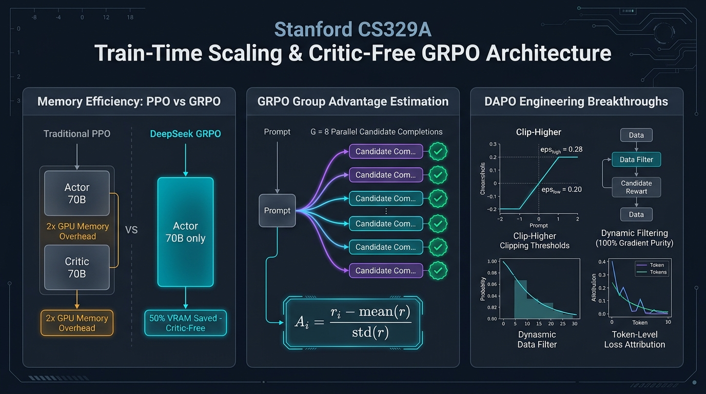
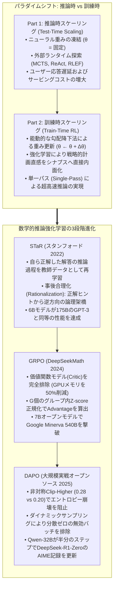
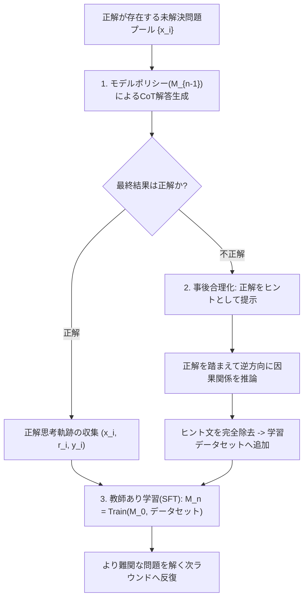
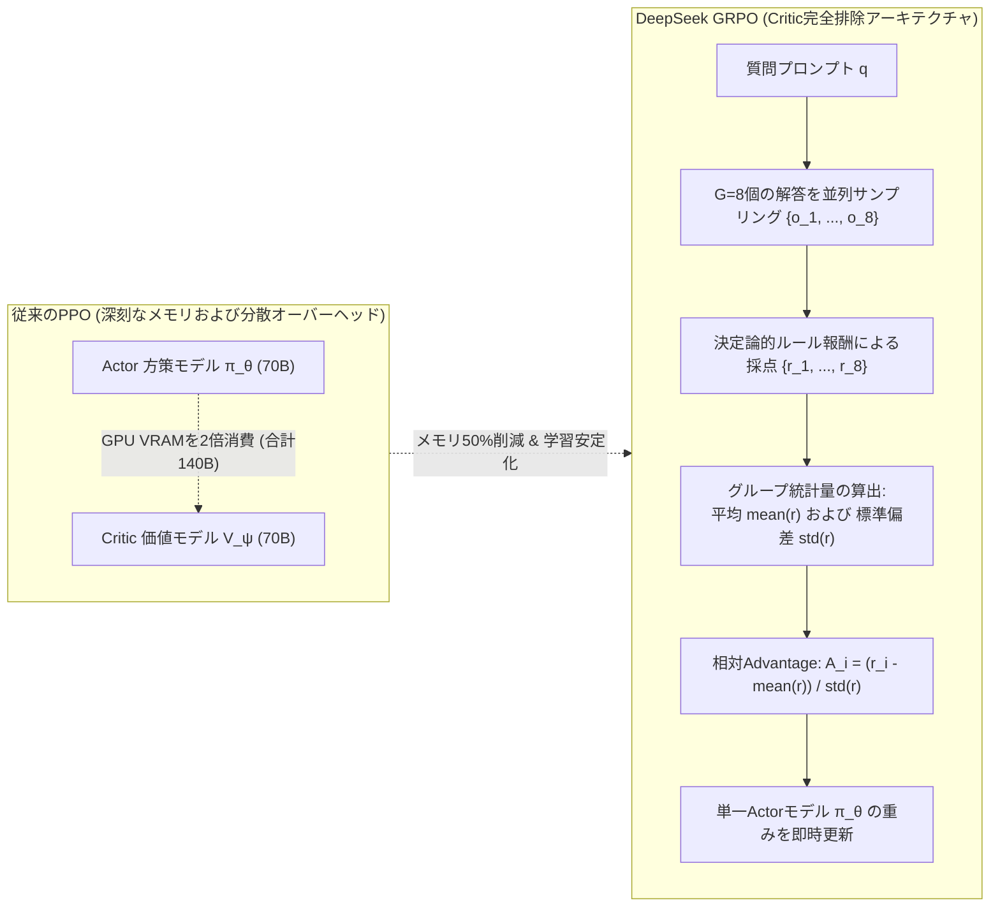

スタンフォード大学の2025年秋学期最新大学院講義、**CS329A: Self-Improving AI Agents（自己進化型AIエージェント）**の第6回エンジニアリング解説へようこそ。

第1講から第5講にわたる**Part 1（Foundation · 基礎理論）**を通じて、私たちは凍結された事前学習済みモデルに対し、推論時計算量（Test-time Compute）を集中的に投入して性能を極限まで引き出す手法を学びました。MCTS木探索を展開し、コンパイラの実行エラーを取り込み、弱検証器アンサンブルで正解を絞り込んできました。

しかし、ここで冷静に根本的な限界を直視しなければなりません：
小学生にテスト時間をさらに10分与えたとしても、大学レベルの微分積分の証明問題を解くことはできません。モデル自身の凍結されたニューラルシナプス（重みパラメータ、$\theta$）の内部に該当する数学的概念や推論ロジックが初めから存在しないならば、数千回のダイスを振ろうとビームサーチを行おうと、それは真の知能ではなく確率的な偶然にすぎません。

本日より幕を開ける**Part 2: Training & Evolution（訓練と自己進化、第6講〜第9講）**は、まさにこの根源的な問いに答える挑戦です：
> **「推論時に高コストな探索を行う代わりに、訓練時（Train-time）に膨大な計算量を注ぎ込み、モデルの頭脳そのものを恒久的に賢く進化させることはできないのか？」**

**第6講**では、人間によるラベリングのボトルネックを打破し、最先端の推論モデルを誕生させた**事後強化学習（Post-Training RL）**の3大革新パラダイムを徹底的に解体・再構築します：
1. **自らの正解から自らを教育する自己ブートストラップ：** **STaR**（Self-Taught Reasoner, Zelikman et al., Stanford 2022）
2. **Criticモデルを葬り去った強化学習革命：** **DeepSeekMathとGRPO**（Group Relative Policy Optimization, 2024）
3. **1000基のGPUクラスタを制御する実戦エンジニアリング：** **DAPO**（Decoupled Clip & Dynamic Sampling, 2025）



{/* truncate */}

---

### 1. 訓練時スケーリング vs 推論時スケーリング: 計算フロンティアの転換

現代のAI研究がなぜ事後強化学習（Post-Training RL）へと急速に舵を切ったのかを理解するには、総計算資源（FLOPs）の配分方程式を捉える必要があります：

```text
Compute_Total = Compute_Train + Compute_Inference
```

1. **推論時スケーリング（Inference-Time Scaling）:** モデルのパラメータベクトル $\theta$ は固定されています。計算量は反復サンプリング、ビームサーチ、MCTS探索木に配分されます。単一のリクエストには有効ですが、システムにアクセスする全ユーザーに対して多大な遅延時間と莫大なGPUサービングコストを転嫁します。
2. **訓練時スケーリング（Train-Time Scaling）:** 訓練段階において大規模な計算資源を投入し、重み $\theta$ そのものを最適化します：

```text
θ* = argmax_θ E_{x ~ D, y ~ π_θ(·|x)} [ R(x, y) ]
```

強化学習を通じてモデルが優れた多段階の演繹パターンを発見すると、誤差逆伝播法によりその戦略的知恵がアテンション層やFFNの重みに恒久的に刻み込まれます。その結果、本番運用時には**重厚な外部探索器を必要とせず、単一の前向き計算（Single Forward Pass）のみでグランドマスター級の直感**を発揮できるようになります。

---

### 2. 思考の自己ブートストラップ: STaR (Zelikman et al., Stanford 2022)

言語モデルを教師あり微調整（SFT）するには、人間が作成した数万件に及ぶ「問題 ＋ 詳細な推論根拠（Rationale） ＋ 正解」のデータセットが必要です。しかし、高度な数学オリンピックや複雑なソフトウェア設計の解答を人間の専門家が逐一書き下ろすのは、天文学的なコストを要します。

2022年、スタンフォード大学のEric Zelikmanらの研究チームは大胆な問いを投げかけました：
> **「正解か不正解かを機械的に判定できるならば、解法の推論過程（Rationale）はモデル自身に自由に生成させ、偶然にも正解に到達した優れた思考の軌跡だけを集めて自分自身を再学習させればよいのではないか？」**

これが自己学習型推論器 **STaR** の誕生です。



#### 数学的正当性: 方策勾配法（Policy Gradient）の精密な近似

STaRは単なるデータ収集のハックではありません。数学的には、**指示関数報酬 $`1(y_hat = y*)`$ を用いた方策勾配強化学習の離散近似**として厳密に成立しています：

```text
∇_θ J(θ) = ∑_i E_{r_hat, y_hat ~ π_θ(·|x_i)} [ 1(y_hat = y_i*) * ∇_θ log π_θ(r_hat, y_hat | x_i) ]
```

不正解となったサンプルは $\mathbb{1} = 0$ となり勾配が消失して破棄され、正解したサンプルに対してのみ最尤推定（MLE）による勾配上昇が働くため、方策分布は自然と検証済みの推論経路へと収束します。

#### 事後合理化（Rationalization）の妙技

ここで重大な疑問が生じます：「モデルが自力では全く解けない超難問は常に不正解になるはずであり、どのようにして新しい知識を獲得できるのか？」

Zelikman教授らは**事後合理化（Rationalization）**という画期的な手法を導入しました：
1. モデルが不正解を出した場合、プロンプトの末尾に真の正解をヒントとして提示します：*「ヒント: 正解は42である。なぜ42が導かれるのか、中間ステップを逆方向に説明せよ。」*
2. 結論が分かっているため、モデルは逆方向から論理の架橋を構築できるようになります。
3. **最重要ポイント:** 学習データセットに登録する際、**ヒント文をプロンプトから完全に削除**します！

```text
学習データ: 入力 [ x_i ] ──► 目標推論 [ r_逆方向推論 ] + 正解 [ y_i* ]
```

モデルはヒントなしで自力でこの見事な演繹を展開して正解に達したかのように学習するため、未知の難問に対しても自発的に正解へ収束する推論直感を習得します。

#### ベンチマーク成果: 6Bモデルが175Bの巨人に並ぶ
* 常識推論ベンチマーク（CommonsenseQA）において、わずか **6BパラメータのGPT-J** にSTaRを適用したところ、精度は60.0%から **72.5%** へと急上昇しました。
* これは、約30倍巨大な **175BパラメータのGPT-3微調整版（73.0%）と同等水準** でした。

---

### 3. Criticの死と強化学習の大衆化: DeepSeekMath & GRPO (2024)

STaRがSFTの枠組みを用いたブートストラップであったのに対し、真の大規模オンライン強化学習の地平を開いたのが、2024年春にDeepSeekチームが発表した **DeepSeekMathとGRPO（Group Relative Policy Optimization）** です。

#### 従来のPPOの致命的欠陥: 巨大Criticモデルの弊害

OpenAIがChatGPTの学習に用いた標準的なPPO（Proximal Policy Optimization）では、2つの巨大モデルを同時にGPUメモリ上に展開する必要がありました：
1. トークンを生成する **方策ネットワーク（Actor, $\pi_\theta$）**
2. 状態ごとの期待報酬を予測する **価値ネットワーク（Critic, $V_\psi$）**

70Bモデルを訓練するには同規模の70B Criticモデルが必要となり、GPUメモリ要件が2倍に跳ね上がります。
さらに深刻な問題として、数学やコードのように数千トークンの長文推論の末尾にのみスカラー値（$+1 / -1$）が与えられる環境では、**中間トークン個々の価値（$V_\psi$）を正確に学習させることが数学的に極めて困難であり、学習が不安定化していました**。

#### GRPOの革新的定式化: 「Criticを完全に排除せよ」

DeepSeek研究陣の着想は極めて明快でした：
> **「なぜ別個の価値ネットワークを学習させる必要があるのか？ 1つの質問 `q` に対して現在の方策から `G` 個の解答 $`{o_1, ..., o_G}`$ を同時にサンプリングせよ。そしてグループ内の報酬の平均と標準偏差を用いてzスコア正規化すれば、それこそが完璧な相対的Advantageではないか！」**



#### GRPOの数学的目的関数

GRPOは別個の価値関数を持たず、基準モデル $`pi_ref`$ とのKLダイバージェンス制約を含めて方策 $\pi_\theta$ を最適化します：

```text
J_GRPO(θ) = E_{q, {o_i}_{i=1}^G} [ 
    (1 / G) * ∑_{i=1}^G (1 / |o_i|) * ∑_{t=1}^{|o_i|} {
        min(
            ( π_θ(o_{i,t}) / π_old(o_{i,t}) ) * A_hat_{i,t},
            clip( π_θ(o_{i,t}) / π_old(o_{i,t}), 1 - ε, 1 + ε ) * A_hat_{i,t}
        )
    } - β * D_KL( π_θ || π_ref )
]
```

各解答 `o_i` のトークン別Advantage `A_hat_{i,t}` は、**グループ内の報酬統計量**のみからシンプルに導出されます：

```text
A_hat_{i,t} = r_tilde_i = ( r_i - mean({r_1, ..., r_G}) ) / ( std({r_1, ..., r_G}) + δ )
```

#### 信用割り当て: 結果監督 vs プロセス監督
1. **結果監督（Outcome Supervision）:** 最終解答が正しければ $r_i = +1$、誤りなら $-1$ を付与します。算出された相対Advantage `r_tilde_i` はその解答内の全トークンに均一にコピーされます。
2. **プロセス監督（Process Supervision）:** 推論ステップごとに部分報酬を与え、特定トークン以降に登場する全ステップの正規化報酬の和をそのトークンのAdvantageとして逆伝播します。

#### ベンチマーク成果: 7Bモデルが540Bモデルを撃破
* `DeepSeekMath-Base 7B` は、高品質な120B数学トークンの事前学習のみで**Googleの540B超巨大モデルMinervaを上回りました**。
* ここにGRPO強化学習を適用すると、MATHベンチマークスコアは46.8%から **51.7%** へと向上し、外部ツールなしの純粋な7Bモデルとしてオープンソース史上初めてMATH 50%の壁を突破しました。
* 64サンプルの自己一貫性（Self-Consistency）を併用すると正答率は **60.9%** に達しました。

---

### 4. 数式から1000基GPUの実戦へ: DAPO (2025)

しかし、世界中の研究機関が論文通りのGRPOを実装した際、厳しい現実に直面しました：
* 米国数学オリンピック AIME 2024 において、DeepSeek-R1-Zeroが47点を記録したのに対し、単純なGRPOで学習させたQwen2.5-32Bは **わずか30点にとどまりました**。

2025年3月に公開された **DAPO（Decoupled Clip and Dynamic Sampling Policy Optimization）** は、数式の背後に隠されていた大規模強化学習の4大実戦工学を解き明かしました：

```text
ナイーブなGRPO (30点) 
  ──► + 長さフィルタ (36点) 
  ──► + Clip-Higher (38点) 
  ──► + トークン損失正規化 (42点) 
  ──► DAPO完成 (50点、DeepSeek-R1-Zero超え!)
```

#### 秘訣1: 非対称クリッピング Clip-Higher ($`eps_low = 0.20, eps_high = 0.28`$)
* **原因:** PPOの対称的な $\pm 0.2$ クリッピングは探索を阻害します。モデルが革新的な推論トークンを発見した際、初期確率が0.01の希少トークンは $1 + 0.2 = 1.2$ 倍になっても確率0.012で抑え込まれます。一方、確率0.9の平凡なトークンは容易に確率を伸ばします。
* **結果:** モデルが挑戦的な思考を止め、安直な定型文ばかりを生成する **エントロピー崩壊（Entropy Collapse）** が発生します。
* **DAPOの解決策:** 下限クリップは $`eps_low`=0.20$ を維持して悪質な行動を抑えつつ、上限クリップを **$`eps_high`=0.28$ へと40%引き上げ**、有望な探索トークンが確率を爆発的に高められるようにしました。

#### 秘訣2: ダイナミックサンプリング (Dynamic Sampling)
* **原因:** 問題が平易すぎて $G$ 個が **全問正解**、あるいは難しすぎて $G$ 個が **全問不正解** となるケースが発生します。
* この場合、グループの標準偏差が $0$ となり、全サンプルのAdvantageが正確に $0$ になります。つまり、**数千基のGPUが計算を行っても勾配が0となり、学習が完全に空転します**。
* **DAPOの解決策:** バッチ構築時に `0 < Correct Rollouts < G` を満たす、すなわち **「正解と不正解が混在し、真に学習価値のある問題」のみを動的に残し、他を破棄する** ことで、常に100%高純度の勾配を確保しました。

#### 秘訣3: トークンレベル損失正規化 (Token-Level Loss)
従来のGRPOはサンプル単位で平均を取っていたため、2000トークンの長文推論内のエラーと50トークンの短文内のエラーが不公平に希釈されていました。DAPOは全バッチの総トークン数合算（$\sum_i |o_i|$）で損失を完全正規化し、モデルが無駄に文章を引き延ばすチート行為を遮断しました。

#### 秘訣4: 超長文ソフト報酬シェイピング (Overlong Reward Shaping)
モデルが思考を深める過程でコンテキスト上限（例: 16,384トークン）直前で切断される（Truncation）場合があります。ここで一律 $-1$ 点の過酷なペナルティを課すと、長期的思考の芽を摘んでしまいます。DAPOは上限直前の4096トークン区間に **線形ソフト減点** を設計し、モデルが自然に長さをコントロールしながら証明を完結させるよう誘導しました。

---

### 5. エンタープライズアーキテクチャ: 大規模分散強化学習基盤

商用環境において数千基のGPUクラスタ上でGRPO/DAPOを安全に運用するための標準パイプライン設計図は以下の通りです：

```text
┌────────────────────────────────────────────────────────────────────────┐
│             エンタープライズ大規模分散GRPO/DAPO強化学習基盤             │
├────────────────────────────────────────────────────────────────────────┤
│                                                                        │
│  [ カリキュラムタスクバンク (定形数学 / コードコンパイラ / 単体テスト) ] │
│          │                                                             │
│          ▼                                                             │
│  ┌──────────────────────────────────────────────────────────────────┐  │
│  │                  動的バッチングおよびサンプリングエンジン        │  │
│  │  • 難易度バランサー: 全問正解 / 全問不正解バッチをリアルタイム排除 │  │
│  │  • コンテキスト長に応じたビンパッキング最適化                    │  │
│  └───────────────────┬──────────────────────────────────────────────┘  │
│                      │ 厳選された高純度バッチ                          │
│                      ▼                                                 │
│  ┌──────────────────────────────────────────────────────────────────┐  │
│  │                   vLLM / TensorRT-LLM ロールアウトフリート       │  │
│  │  • 独立した高速推論ノードクラスタ (G=8 非同期並列サンプリング)    │  │
│  │  • PagedAttentionによる大規模KVキャッシュ分散管理                │  │
│  └───────────────────┬──────────────────────────────▲───────────────┘  │
│                      │ ロールアウト軌跡 {o_1..o_G}  │ 同期された       │
│                      ▼                              │ モデル重み θ     │
│  ┌──────────────────────────────────────────────────┴───────────────┐  │
│  │                   決定論的ルール検証エンジン                     │  │
│  │  • Docker/gVisor Python REPL および SymPy 数式検証               │  │
│  │  • 思考プロセスXMLタグ `<think>` 構造規約の適合判定              │  │
│  │  • グループ統計に基づくAdvantage標準化: A_i = (r - μ) / σ         │  │
│  └───────────────────┬──────────────────────────────────────────────┘  │
│                      │ トークン別Advantageストリーム                   │
│                      ▼                                                 │
│  ┌──────────────────────────────────────────────────────────────────┐  │
│  │                   Megatron-LM / DeepSpeed 訓練クラスタ           │  │
│  │  • 単一方策(Actor)モデルの駆動 (Critic排除でVRAM 50%削減)        │  │
│  │  • 非対称Clip-Higher勾配エンジン (ε_high = 0.28, ε_low = 0.20)    │  │
│  │  • FlashAttention-3によるトークン統合損失の逆伝播                │  │
│  └──────────────────────────────────────────────────────────────────┘  │
│                                                                        │
└────────────────────────────────────────────────────────────────────────┘
```

#### プロダクションにおける3大運用原則
1. **評価ループからの人間評価の完全排除:** 数学オリンピック、コンパイラ検証、単体テストなど、決定論的に正誤判定できるタスクのみを使用します。主観的な人間の評点を推論強化学習の報酬にしてはなりません。
2. **推論フリートと学習フリートの完全分離:** ロールアウトを生成する推論エンジン（vLLM）と勾配降下を行う学習エンジン（Megatron-LM）を物理的に分離し、高速RDMAネットワークで接続します。
3. **厳格なフォーマットガードレール:** `<think> ... </think>` 構造の遵守をルール報酬に組み込み、モデルが推論プロセスを省略して単答を当てずっぽうで出力するチートを阻止します。

---

### 6. エンジニアリングQ&A: 実践的技術課題の克服

**Q: GRPOにおいてKLダイバージェンス正則化項はなぜ依然として必要なのですか？**
**A:** 強化学習を回し続けると、モデルが報酬関数の不備を突いて意味不明な文字列を連呼する **リワードハッキング（Reward Hacking）** や、本来持っていた流暢な言語能力を喪失する **破滅的忘却（Catastrophic Forgetting）** が発生する恐れがあります。基準モデル（$`pi_ref`$）から離れすぎないよう制御する安全装置がKL制約です。（ただし、DeepSeek-R1-Zeroのように長文推論の創発を促す初期フェーズでは、意図的に $\beta \to 0$ に設定して大胆な探索を優先させる場合もあります。）

**Q: STaRの事後合理化（Rationalization）で正解ヒントを与えると、モデルがカンニングを学習してしまいませんか？**
**A:** 核心は **データ生成時点と重み更新時点の完全な分離** にあります。正解ヒントは、逆方向の論理展開を生成させる間だけ一時的に付与されます。その思考プロセスを学習データセットへ格納する際、**プロンプトからヒント文を完全に消去**します。そのため勾配降下の段階において、モデルは「自分がヒントなしで自力でこの見事な演繹を展開した」と認識し、未知の課題でも自力で正解へ収束する直感を習得します。

---

### 7. まとめと技術的要点

1. **訓練時スケーリングの必然性:** 推論時の探索はシナプス内に存在しない知識を創出できません。訓練時スケーリングは強化学習を通じて、モデルの重みに戦略的思考の本能を恒久的に焼き付けます。
2. **自己ブートストラップの成立:** STaRは正解思考のフィルタリングと事後合理化を結びつけ、6Bモデルで175B超巨大モデルに匹敵する推論能力を引き出せることを証明しました。
3. **Critic排除のブレイクスルー:** DeepSeekのGRPOは価値モデルを排除してメモリを50%削減し、グループ内の相対比較から高精度なAdvantageを算出しました。
4. **産業用強化学習の安定化:** DAPOは非対称Clip-Higher（$\epsilon=0.28$）、ダイナミックサンプリング、トークン損失正規化によりエントロピー崩壊を克服し、半分の計算量でDeepSeek-R1-Zeroを凌駕しました。

---

### 次回講義の予告
次回の**第7講**では、単に人間が用意したテストを解く次元を超え、AIが自律的に科学的仮説を立て、研究論文を執筆し進化していく驚異の世界へ突入します：
**《Lecture 7: Open-Ended Evolution: ADAS, The AI Scientist, AlphaEvolve, そして自己改善エージェントの開放型進化》**
AIがAIのアーキテクチャそのものを自ら発明する新時代のフロンティアを解き明かします。どうぞご期待ください！