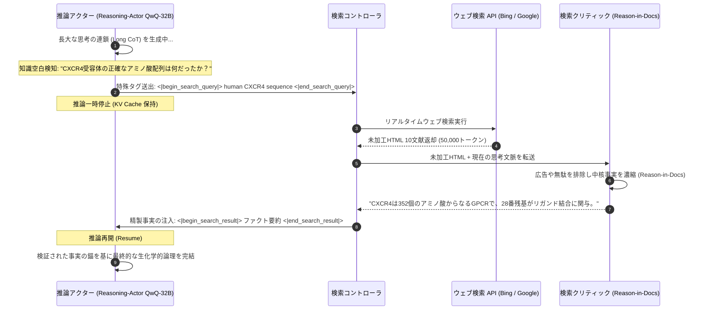

# スタンフォード CS329A (第8講): 探索とディープリサーチ — プログラム空間探索 (AlphaCode) と Search-o1 による知識空間探索

ソフトウェアエンジニアリングや最先端の科学研究において、真の専門性は単なる「暗記力」では測られません。どんなに伝説的な主席エンジニアであっても、数千行に及ぶ複雑な分散並行処理システムを、最初のタイピングでバグ一つなく書き上げることは不可能です。ノーベル賞級の学者であっても、難解な遺伝子治療薬の構造や各国の最新税法を精査する際、自らの脳内記憶だけに頼って論文を執筆することはありません。

人間知性の真価は、体系的な探索（Search）の能力に宿ります：
> **「何百万もの潜在的仮説を幅広く探索し（Search）、無用なノイズを果敢に枝刈りし（Filter）、思考の過程で生じた知識の空白を外部データベースからリアルタイムに補填し（Retrieve）、散在する断片を厳密な洞察へと統合する力。」**

本日の**スタンフォード CS329A: Self-Improving AI Agents（自己改善AIエージェント）**第8講では、「探索（Search）」という概念が、いかにして2つの異なる次元において人工知能の推論能力を爆発的に引き上げるかを学びます：
1. **プログラム空間探索 (Program Space Search):** 数百万のコード候補を生成し実行時の振る舞いシグネチャで集約する **AlphaCode Competitive Programming（アルファコード競技プログラミング）**
2. **知識空間探索 (Knowledge Space Search):** 長大な思考の連鎖（Long CoT）の途中で能動的に検索をトリガーする **Search-o1 Autonomous Investigation（自律的調査）** および **Self-Reflective Search Loops（自己省察的検索ループ）**
3. **自律型ディープリサーチエージェント (Deep Research Workflows):** 複雑な問いを段階的な仮説に分解し、数百のウェブ文献を精読して専門レポートを合成する **Information Synthesis Agent（情報統合エージェント）**のアーキテクチャ

{/* truncate */}


---

## 1. エージェンティック探索の二重地平 (The Dual Nature of Search)

古典的AIにおいて探索は、グリッドマップ（A*探索）やチェス盤（Minimax）のような離散的な状態空間に限定されていました。しかし現代の自律エージェントにおいて探索は、連続的なトークン確率空間と、無限に広がる外部ウェブ環境という2つのフロンティアへと拡張されました：

```
                          ┌─────────────────────────────────────┐
                          │     エージェント探索の二重地平       │
                          └──────────────────┬──────────────────┘
                                             │
             ┌───────────────────────────────┴───────────────────────────────┐
             ▼                                                               ▼
┌─────────────────────────────────────────┐     ┌─────────────────────────────────────────┐
│        プログラム空間探索 (Code)        │     │         知識空間探索 (Knowledge)        │
├─────────────────────────────────────────┤     ├─────────────────────────────────────────┤
│ • AlphaCode 1 & 2 (Google DeepMind)     │     │ • Search-o1 & Agentic RAG               │
│ • 極めて疎な報酬 (Pass / Fail の2値)    │     │ • 無限のウェブ知識と動的クエリ生成      │
│ • 1,000,000個の候補コード並列サンプリング│     │ • 推論途中の知識空白 (Uncertainty) 検知 │
│ • 実行時振る舞いシグネチャ (Output Vec) │     │ • Reason-in-Documents コンテキスト濃縮 │
│ • 同一正解アルゴリズムの巨大クラスタ形成│     │ • 再帰的深層探索とレポート統合合成      │
└─────────────────────────────────────────┘     └─────────────────────────────────────────┘
```

両領域における中核課題は、**限られた計算資源下での適合率と再現率のトレードオフ（Precision-Recall Tradeoff）**です：
- プログラム合成では、数百万のコードをサンプリングすれば正解が含まれる確率（$pass@k$）は極めて高くなりますが、実際の競技規則では提出回数はわずか10回（$10@k$）に制限されます。
- オープンエンドな深層調査では、ウェブ検索を通じて数万行の未加工HTML、広告、相反する主張が押し寄せ、これらを無差別にコンテキストへ注入すると推論の流れが完全に汚染（Context Pollution）されます。

---

## 2. プログラム空間探索：AlphaCode (Science 表紙論文, 2022)

Codeforcesのような国際競技プログラミングの難問は、人間のプログラマにとっても最高難度の知的能力が試されます。長文の仕様から数学的不変量を導き、厳格な計算量（$O(N \log N)$）とメモリ制約（$256\text 256 MB$）をクリアするC++コードを書かなければなりません。不等号が一つ違うだけでも、採点サーバは容赦なく `Wrong Answer` を返します。

Google DeepMindの **AlphaCode** は、この難題を純粋な**「大規模推論計算探索（Scale Inference Search）」**によって突破しました。

```
                  [自然言語アルゴリズム問題仕様]
                                │
                                ▼
        1. 大規模多様性サンプリング (問題あたり1,000,000個のコード生成)
           (難易度タグ・DP/Greedy/Graph分類のランダム注入、温度0.25)
                                │
                                ▼
        2. サンプルテスト (Sample Tests) による1次フィルタリング
           (問題文の例題入出力を実行 -> 構文エラーおよび99%の無効コードを即座に破棄)
                                │
                                ▼
        3. 合成入力生成 & 振る舞いシグネチャ (Behavior Signature) クラスタリング
           (ランダムな有効入力10個を実行 -> 出力結果ベクトルごとに群集化)
                                │
                                ▼
        4. 上位10クラスタ代表コード抽出
           (最大のクラスタ上位10個からそれぞれ1つずつ最優秀候補を厳選)
                                │
                                ▼
                 [公式コンテストに最終10回提出]
                 (人間参加者5,000人中、上位54.3%の中位プログラマ突破)
```

### 振る舞いシグネチャ (Behavior Signature) クラスタリングの真髄
サンプルテストを通過した5,000個の生存コードから、数千に及ぶ未知の非公開テストケースを全て通過する「真の正解コード10個」をどうやって選び出すのでしょうか。

コードの構文的類似度（BLEUやCodeBERT埋め込み）でグループ化しても完全に破綻します：
- 見た目が99%同一であっても、比較演算子（`<` と `<=`）の微小な違いにより無限ループに陥る致命的な誤答コードが存在します。
- 逆に、反復処理と再帰呼び出しのように見た目が180度異なっていても、内部の数学的アルゴリズムは完全に同一の正解コードである場合があります。

DeepMindは**「コードは見かけではなく振る舞いで評価せねばならない」**という根本原理を適用しました：
1. テスト入力生成モデルを用い、問題の入力仕様を満たす有効なランダム入力10個を合成。
2. 生き残った5,000個のプログラムにこの10入力を与え、出力結果のベクトル（振る舞いシグネチャ）を測定：
```text
Signature(P_i) = [ P_i(input_1), P_i(input_2), ..., P_i(input_10) ]
```
3. **決定的な法則:** バグのある誤答コードは境界ケースごとに別々のエラーを起こして四散しますが、**正しい論理を実装したプログラム群は、コードの見た目がどれほど異なっていても全く同一の正解出力を返すため、最も巨大な1つのクラスタを形成**します。
4. AlphaCodeは**最も規模の大きい上位10個のクラスタからそれぞれ1つのコードを抽出し、10回提出**します。

### AlphaCode 2：Geminiベースによる10,000倍のサンプル効率化
2023年末に公開された **AlphaCode 2** は、基底モデルを強力なGemini Proに刷新し、クラスタリングの後段に**専門採点モデル（Scoring Model）**を導入しました：
- 巨大クラスタ内からランダム抽出する代わりに、ファインチューニングされた採点モデルがコードの構造的美しさと時間計算量を精査して最優秀解を選択。
- Codeforces解決率を25%から**43%へ急伸**させ、**上位85パーセンタイル（Candidate Master級）**に到達。
- **最大の衝撃:** AlphaCode 2は、わずか**100個のサンプル**だけで、初代AlphaCodeが100万個をサンプリングして達成したスコアを完全に上回りました。**サンプル効率性が10,000倍（10,000x）改善**され、モデル自身の知能が向上するほど必要な探索演算量が指数関数的に圧縮されることが実証されました。

---

## 3. 知識空間探索：Search-o1 (2025)

プログラム空間を離れ、**人間の言語と知識の空間**へと視点を移します。

OpenAI o1やDeepSeek-R1のような自律長文推論（Long CoT）モデルの思考プロセスを解剖すると、高度な科学問題を解く際、推論チェイン内で *"perhaps（恐らく）"*, *"wait（待てよ）"*, *"likely（あり得る）"* といった不確実性を示す語彙が回答あたり平均**30.4回**も出現します。従来の静的RAGはプロンプト入力時に1度だけ検索するため、7ステップ目や10ステップ目で生じる予期せぬ知識空白を補うことができません。

2025年に登場した **Search-o1** は、思考と能動的ウェブ検索を有機的に融合した革新的フレームワークです：



### Search-o1 の2大コア機構
1. **Reasoning-Actor（推論アクター）:** 推論の進行中、自身のパラメータ知識に確信が持てない場面に直面すると、自律的に検索クエリタグ（`<|begin_search_query|>`）を出力して推論を一時停止し、アテンション状態を退避します。
2. **Retrieval-Critic（「Reason-in-Documents」文書内推論）:** 検索された5万トークンに及ぶ未加工ウェブ文書を思考チェインにそのまま流し込むと、アテンションが散漫（Context Distraction）になります。軽量な別体クリティックモデルが文献を精読し、**現在の思考ステップに真に必要な2〜3行の純粋なファクトのみを濃縮**してメインモデルに補給します。

```text
GPQA Diamond (博士レベル超難関科学推論ベンチマーク) 成績比較：
========================================================================================
アーキテクチャ               総合正解率        化学            生物学          物理学
----------------------------------------------------------------------------------------
生身の専門博士グループ        65.4%           48.9%          37.2%           39.9%
ベース推論モデル (QwQ-32B)     58.1%           45.2%          41.5%           43.2%
従来の静的 RAG エージェント    61.6%           51.0%          44.8%           47.0%
Search-o1 (動的思考検索)       63.6% (+5.5p)   56.4% (+7.5p)  50.2% (+13.0p)  52.8% (+12.9p)
========================================================================================
```

Search-o1はGPQA Diamondにおいて従来の静的RAGを大きく突き放しただけでなく、**化学、生物学、物理学の全分野で生身の専門博士たちの平均正解率を完全に打破**しました。

---

## 4. 自律型ディープリサーチ (Deep Research) エージェントの全容

AlphaCodeの多段階枝刈り探索と、Search-o1の能動的検索ループを結合することで、昨今OpenAIやGoogleが展開する **Deep Research Agent LLM** の完成形が導かれます：

```
                       [複合的なユーザー調査課題の入力]
                                      │
                                      ▼
                   ┌──────────────────────────────────────┐
                   │       研究計画立案と課題の階層分解   │
                   │ (巨大な問いを5〜8のサブ仮説へと分割) │
                   └──────────────────┬───────────────────┘
                                      │
          ┌───────────────────────────┼───────────────────────────┐
          ▼                           ▼                           ▼
┌──────────────────┐        ┌──────────────────┐        ┌──────────────────┐
│  サブ仮説 A      │        │  サブ仮説 B      │        │  サブ仮説 C      │
│  再帰的深層検索  │        │  再帰的深層検索  │        │  再帰的深層検索  │
└─────────┬────────┘        └─────────┬────────┘        └─────────┬────────┘
          │                           │                           │
          └───────────────────────────┼───────────────────────────┘
                                      │
                                      ▼
                   ┌──────────────────────────────────────┐
                   │    クロス検証と矛盾検知クリティック  │
                   │ (情報源間の矛盾を検出し信頼性を評価) │
                   └──────────────────┬───────────────────┘
                                      │
                                      ▼
                   ┌──────────────────────────────────────┐
                   │    根拠に基づく学術・専門レポート合成│
                   │ (出典URL脚注完備、15ページ規模の構成)│
                   └──────────────────────────────────────┘
```

### 自律深層調査の4つの柱
1. **仮説分解 (Hypothesis Decomposition):** 「2026年の全固体電池商用化に向けたボトルネックと主要特許分析」といった大テーマを、具体的な工学的下位仮説へと論理的に分解。
2. **再帰的マルチホップ探索 (Recursive Multi-Hop Traversal):** 一次文献で見つかった引用論文や規制当局の開示資料のリンクを再帰的に巡回し、一次データを徹底追跡。
3. **矛盾検知と信頼性検証:** 企業プレスリリースの主張と第三者機関の実測値が食い違う場合、実験条件の厳密性を比較して信頼度を明示。
4. **追跡可能な出典脚注の付与:** レポート内のすべての数値データや主張にウェブURL脚注を義務付け、ハルシネーションを原理的に排除。

---

## 5. 探索パラダイムの比較

```text
=========================================================================================================
比較軸                古典的静的 RAG (Single-Hop)   AlphaCode (プログラム空間) Search-o1 (知識推論空間)
---------------------------------------------------------------------------------------------------------
探索空間              固定文書ベクトル DB           コードトークン系列空間     公開ウェブおよび API
トリガー契機          ユーザー入力時の1回のみ       推論時の大規模サンプリング 思考中の不確実性を検知時
枝刈り基準            コサイン類似度 Top-K          実行時振る舞いシグネチャ   Reason-in-Docs 濃縮
検証アンカー          埋め込み空間上の距離          サンドボックス実行出力     形式論理および多重クロス検証
主たる課題            多段階推論時の文脈汚染        膨大な推論計算コスト       ウェブ検索による遅延
=========================================================================================================
```

---

## 6. 技術的深掘り Q&A

### Q1. AlphaCodeで構文的類似度ではなく「振る舞いシグネチャ」で束ねるべき理由は？
コードの正当性は、構文木の表面的な形状とは完全に無関係です。

抽象構文木（AST）が99%同一であっても不等号の向き一つで無限ループに陥る致命的バグコードがあり、逆にループ処理と再帰呼び出しのようにASTが全く異なっていても数学的に等価な正解コードが存在します。したがって、合成入力を与えた際の**「実際の出力値ベクトル（振る舞い）」**に基づいてクラスタリングして初めて、ノイズを排除して正しいアルゴリズムを巨大クラスタとして捕捉できます。

### Q2. Search-o1で検索文書を直接入れず「Reason-in-Documents」を挟む理由は？
これを**「アテンションの散漫（Attention Distraction）とコンテキスト汚染」**と呼びます。
長文推論モデルは数千トークンにわたり繊細な論理の糸を張り詰めて思考しています。そこに検索された数万トークンのウェブページ（広告、メニューバー、不要な前置き）が突然乱入すると、アテンション機構が攪乱され、直前まで何を思考していたかを忘却します。別体のクリティックモデルが文献を読み込み、**必要な「純度100%の2〜3行のファクト」に凝縮して渡す**ことで、推論の一貫性が完全に保たれます。

---

## まとめと次回予告

探索（Search）は、AIを閉じた予測モデルから動的な自律探求者へと進化させます。**AlphaCode** はプログラム空間において大規模探索と振る舞いクラスタリングにより競技プログラミングを攻略し、**Search-o1** と **Deep Research** は知識空間において推論と能動検索を統合し、博士レベルの難問を打開しました。

次回 **第9講** では、Part 2（訓練と進化）の集大成として、単なる文章補完モデルがいかにして道具と自律進化を備えたエージェントへと変貌したのかを紐解く **《Post-Training Evolution — 事後学習の進化：チャットボットからエージェントへ (SFT, RLHF, Tool Grounding)》** をお届けします！

---

### 重要ポイント整理
- **計算最適探索の威力:** 大規模サンプリングと厳密な検証フィルタ（AlphaCode）を組み合わせることで、単体生成モデルを圧倒する。
- **構文より振る舞い重視:** プログラムの本質はトークンではなく実行結果であり、振る舞いシグネチャのみが真の正解コードを集約できる。
- **思考途中の能動的検索:** 長大な推論の合間に知識空白を埋めるSearch-o1方式が、知識集約型推論の標準パラダイムとなる。