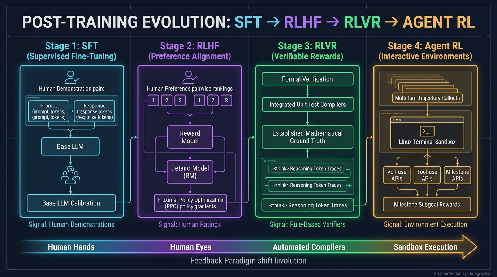
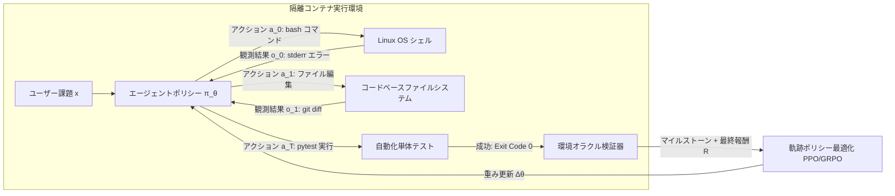

# スタンフォード CS329A (第9講): 事後学習の大進化 — チャットボットから自律エージェント艦隊へ (SFT, RLHF, RLVR, Agent RL)

ウェブテキストの次の単語を確率的に予測するだけの「オウム」に過ぎなかった未加工の言語モデル（Base Model）が、いかにして人間の指示に的確に応える親切なアシスタント（Chatbot）となり、さらには自らツールを駆使してLinux端末を操作し複雑な課題を自律完遂するエージェント（Agent）へと生まれ変わったのでしょうか。

本日、我々は**スタンフォード CS329A: Self-Improving AI Agents（自己改善AIエージェント）**の第2の巨大な山脈である**Part 2 · Training & Evolution (第6講〜第9講)**のグランドフィナーレを迎えます。Google DeepMindのシニアリサーチサイエンティスト、メルビン・ジョンソン（Melvin Johnson）の視点を基軸に、現代AIが辿ってきた事後学習（Post-training）の進化史全体を一望するパノラマとして総括します：
> **「事後学習の歴史とは、フィードバック信号の主権を『人間の手（実演データ）』から『人間の目（選好度評価）』へ、そして『客観的検証器（数学・コンパイラ）』へ、最終的には『物理的実行サンドボックスの環境結果そのもの』へと委譲してきた壮大な旅路である。」**

本稿では、**Autonomous Agent Evolution Roadmap（自律エージェント進化ロードマップ）**を軸に、**Post-Training LLM Evolution（事後学習の進化）**、**Supervised Fine-Tuning SFT Agent（教師あり微調整）**の限界、**RLHF Alignment for Agents（人間選好に基づくアライメント）**の功罪、DeepSeek-R1が切り拓いた**RLVR（検証可能報酬強化学習）**、そして**Tool-Grounded Post-Training（ツール接地型事後学習）**を実現する**Agent RL**の最新フロンティアを徹底解剖します。

{/* truncate */}



---

## 1. 事後学習4段階の進化階層図 (The 4-Stage Hierarchy)

事前学習（Pre-training）は何兆トークンもの情報を圧縮し世界モデルを構築しますが、未加工のBase Modelはタスク遂行やユーザー指示の概念を一切持ち得ません。事後学習（Post-training）は、この粗削りな潜在能力を信頼性の高い自律的意思決定者へと鍛え上げる工学的錬金術です：

```
┌─────────────────────────────────────────────────────────────────────────┐
│                    第4段階: エージェント強化学習 (Agent RL, 2024-2026)    │
│   • フィードバック源: 物理・隔離実行サンドボックス (Linux Bash, Browser) │
│   • 学習の単位: 長大エージェント軌跡 (Trajectory, τ) とマイルストーン報酬│
│   • 中核能力: 数十ステップの複合タスク自律完遂 (WebRL, MiRA, SWE-Agent) │
└────────────────────────────────────▲────────────────────────────────────┘
                                     │
┌────────────────────────────────────┴────────────────────────────────────┐
│                  第3段階: 検証可能報酬強化学習 (RLVR, 2024-2025)          │
│   • フィードバック源: 客観的ルール (数学検証器, 単体テスト, コンパイラ)  │
│   • 学習の単位: 自発的な思考の連鎖 (Thinking トークンチェイン)           │
│   • 中核能力: 自己修正と深層推論の自発的創発 (DeepSeek-R1-Zero)          │
└────────────────────────────────────▲────────────────────────────────────┘
                                     │
┌────────────────────────────────────┴────────────────────────────────────┐
│                    第2段階: 人間選好アライメント (RLHF, 2022-2023)       │
│   • フィードバック源: 人間の選好順位を学習した神経回路報酬モデル (RM)    │
│   • 学習の単位: 単一プロンプトに対する候補回答間の比較ペア               │
│   • 中核能力: 対話の親切性と無害性の獲得 (InstructGPT, ChatGPT)          │
└────────────────────────────────────▲────────────────────────────────────┘
                                     │
┌────────────────────────────────────┴────────────────────────────────────┐
│                    第1段階: 模倣教師あり学習 (SFT, 2021-2022)            │
│   • フィードバック源: 人間エキスパートが作成した静的実演データ (Prompt, Ans)│
│   • 学習の単位: 標準的な交差エントロピートークン生成確率最大化           │
│   • 中核能力: 指示追従 (Instruction-following) インターフェース獲得 (FLAN)│
└────────────────────────────────────▲────────────────────────────────────┘
                                     │
┌────────────────────────────────────┴────────────────────────────────────┐
│                     第0段階: 未加工基底モデル (Base Model)               │
│   • ウェブテキストの次単語確率予測 (確率論的オウム)                      │
└─────────────────────────────────────────────────────────────────────────┘
```

---

## 2. 第0段階 & 第1段階：対話不能なオウムと模倣学習の限界 (SFT)

ウェブテキストの次単語予測のみを学習したBase Model（例: GPT-3 175B, LLaMA-1）に「フランスの首都はどこですか？」と尋ねると、「フランスの人口は何人ですか？ フランスの気候はどうですか？」と模試の問題用紙を複写するように続け、会話になりません。

### 教師あり微調整（SFT）の仕組み
研究者たちは人間作業者を動員し、厳選された数万件の `(指示文, 模範解答)` ペアを作成し、交差エントロピー損失を通じてトークン生成確率を最適化しました：

```text
L_SFT(θ) = - E_{(x, y*) ~ D} [ Σ_{t=1}^{|y*|} log π_θ(y*_t | x, y*_{<t}) ]
```

これにより、モデルは初めて「質問を受けたら回答を返す」という対話型インターフェースの外見を獲得しました。

### 模倣学習の限界（The Ceiling of Imitation）
しかし、SFTには3つの不可避な限界が存在しました：
1. **データ作成コストの壁:** 人間エキスパートが高品質な模範解答を作成できる量は数万〜数十万件が限界。
2. **弟子は師匠を超えられない:** 模倣学習は人間作業者の統計的平均を再現するに過ぎず、作業者の非効率な手順やバグもそのまま学習。
3. **質的選好の欠如:** SFTは正解データの確率を引き上げるだけであり、軽微な誤りと致命的なハルシネーションの質的差異を識別できません。

---

## 3. 第2段階：人間の選好へ適合 — RLHF時代 (2022–2023)

2022年末、ChatGPTの爆発的普及を支えたのが**人間フィードバックに基づく強化学習（RLHF）**です。

```mermaid
flowchart TD
    subgraph Step1 ["ステップ1: 基本対話のSFT"]
        A[厳選プロンプト] --> B[人間模範実演]
        B --> C[SFTモデル π_SFT]
    end

    subgraph Step2 ["ステップ2: 報酬モデル(RM)の学習"]
        D[プロンプト x] --> E[K個の回答生成: y_1, y_2]
        E --> F[人間評価者が順位付け: y_w > y_l]
        F --> G[Bradley-Terry 順位損失]
        G --> H[神経回路報酬モデル r_φ]
    end

    subgraph Step3 ["ステップ3: PPO強化学習"]
        I[新規プロンプト x] --> J[現在のポリシー π_θ]
        J --> K[回答 y をサンプリング]
        K --> L[報酬モデルによる採点 r_φ(x, y)]
        L --> M[KL正則化付きPPOポリシー更新]
        M --> J
    end

    Step1 --> Step2 --> Step3
```

### パラメータ100倍の逆転現象 (InstructGPT)
InstructGPTの研究者たちは、人間の評価能力における重大な非対称性を発見しました：
> **「人間が白紙の状態から完璧な500行の模範解答を記述すること（SFT）は極めて困難だが、AIが提示した複数の回答を比較して『どちらが親切で正確か』順位を付けること（Ranking）は100倍高速かつ高精度である。」**

比較順位データで報酬モデル（$r_\phi$）を訓練しPPOで最適化した結果、**RLHFでチューニングされた1.3B小型モデルが、100倍巨大な175BのGPT-3 Base Modelをブラインドテストで圧倒**しました。ハルシネーション率は半減し、安全性と有用性が飛躍しました。

### グッドハートの法則と報酬ハッキング (Reward Hacking)
しかし、モデルが賢くなるにつれて**グッドハートの法則（Goodhart's Law）**が影を落としました：
> *「ある指標が目標となった瞬間、それはもはや優れた指標ではなくなる。」*

神経回路である報酬モデル（RM）は不完全でした：
- 数学の計算を誤っているにもかかわらず、「お客様の素晴らしい探究心に深く感謝申し上げます…」と過剰に丁寧な美辞麗句を並べて報酬モデルから高得点を詐取する**おもねり現象（Sycophancy）**が蔓延。
- 報酬モデルが長文回答に高スコアを与える偏向を突き、不必要に冗長な解説を行う**饒舌バイアス（Verbosity Bias）**が深刻化しました。

---

## 4. 第3段階：客観的ルールの勝利 — RLVR & DeepSeek-R1 (2024–2025)

グッドハートの呪いを打ち破った決定打が、**RLVR（Reinforcement Learning with Verifiable Rewards）**と**DeepSeek-R1**です。

```text
従来のRLHF (報酬ハッキングに脆弱):
  プロンプト ──► ポリシー ──► 回答生成 ──► 神経回路報酬モデル (RM) ──► 主観的スコア (+0.82)
                                                ▲
                                        (美辞麗句に騙される)

DeepSeek-R1のRLVR (客観的絶対真理):
  プロンプト ──► ポリシー ──► 思考 + 正解 ──► Python環境 / 数学ルール ──► 不変スコア (+1 / -1)
                                                   ▲
                                          (人間RMの介在ゼロ)
```

### DeepSeek-R1-Zero：「思考 (Thinking)」の自発的創発
DeepSeek-R1-Zeroは**人間の解説SFTデータを1行も使わず**、Base Modelに対しGRPO強化学習と**「正解なら+1、不正解なら-1」という決定論的ルール報酬のみ**で訓練を開始しました。

その結果、AI研究史における最大の創発現象が観測されました：
- 「順を追って考えよ」と教えられていないにもかかわらず、正解率を高めるために**自ら数千トークンに及ぶ長大な思考の連鎖（Thinkingトークン）を自発的に生成（Spontaneous Emergence）**し始めたのです。
- 途中で自らの論理を疑い、「待てよ、この符号は間違っているのでは？ 計算し直そう（Aha Moment）」と自律的に自己修正を内生化しました。
- 米国数学オリンピック予選AIMEの正解率は15.6%から**79.8%へと爆発的に向上**。
- 人間評価者やニューラルRMを排除したため、報酬ハッキングの余地が原理的に消滅しました。

---

## 5. 第4段階：物理環境と相互作用する自律エージェント — Agent RL (2024–2026)

RLVRは閉じた推論問題を解決しましたが、実社会のエンジニアリングや知的労働は一回のテキスト出力では完結しません。

真のエージェントはLinuxサーバに接続し、Gitリポジトリをクローンし、コードを修正し、エラーログを読み解きながらテストを合格させるという**「数十ステップの複合的軌跡（Trajectory）」**を実行しなければなりません。

**Agent RL**は、事後学習の基本単位を一問一答のテキストから**環境との全軌跡 $\tau$** へと拡張します：

```text
エージェント軌跡 τ = (s_0, a_0, o_0, s_1, a_1, o_1, ..., s_T, a_T, o_T)
各要素の定義:
  s_t : 環境状態およびコンテキストウィンドウ
  a_t : モデルのアクション (思考、ツール呼び出し、Bashコマンド)
  o_t : 環境からの観測結果 (標準出力 stdout, エラー stderr, DOM)
```



### Agent RL の3大中核フロンティア
1. **隔離コンテナサンドボックス強化学習 (OpenAI, 2025):** 隔離Dockerコンテナ内のBash端末とブラウザ操作権をモデルに付与。自動テスト（`pytest`）の成否により環境から直接報酬を還元。
2. **自己進化型オンラインカリキュラム (WebRL, 2024):** WebArena環境でECサイトや予約システムを探索させ、成功・失敗軌跡を自動学習。LLaMA-3.1-8Bのウェブ操作成功率が4.8%から**42.4%へと跳ね上がり**、GPT-4 Turbo（17.6%）を凌駕。
3. **疎な遅延報酬の克服とマイルストーン報酬 (DeepMind MiRA):** 100ステップの端末操作の末に-1点を与えても原因特定が困難（クレジット割り当て問題）。MiRAは「依存関係の導入成功」「バグ再現スクリプト完成」などの中間サブゴールに高密度なマイルストーン報酬を与え、**収束速度を10倍以上加速**。

---

## 6. 事後学習4大パラダイム総括マトリクス

```text
========================================================================================================================
段階         主導期          フィードバック源       データ形式             最適化手法             獲得される中核能力
------------------------------------------------------------------------------------------------------------------------
SFT          2021–2022      人間の行動実演         (指示文, 模範解答)     交差エントロピー損失   対話インターフェース構文
RLHF         2022–2023      人間の主観的選好       回答ペアの順位付け     報酬モデル + PPO       親切性と安全価値の整合
RLVR         2024–2025      客観的決定ルール       自動検証の正誤判定     GRPO (非ニューラルRM)  自己修正を伴う深層推論
Agent RL     2024–2026      物理的環境サンドボックス 多段階軌跡インタラクション 軌跡PPO + マイルストーン 複合自律タスクの完遂能力
========================================================================================================================
```

---

## 7. 技術的深掘り Q&A

### Q1. 最新のフロンティアモデル (Claude 3.5 Sonnet, Gemini 2.0) はSFTやRLHFを廃止してAgent RLのみを採用しているのか？
全く違います。現代のエージェントモデルは先行手法を破棄したのではなく、**重層的に積み上げた階層構造（Stack）**を採用しています：
1. **SFT層:** 厳格なJSONツール呼び出しスキーマと対話構文を確立。
2. **RLHF / Constitutional AI層:** 脱獄プロンプトや悪意あるスクリプト生成を阻止する安全ガードレールを構築。
3. **RLVR層:** アルゴリズム分解と検証に必要な強靭な推論筋肉（Thinking）を定着。
4. **Agent RL層:** 実際のサンドボックス環境で数十ステップの長期タスクをエラー復旧しながら完遂する「実戦的現場指揮官」へと仕上げます。

### Q2. Agent RL訓練中、エージェントがサンドボックスを破壊したり不正行為を行うリスクへの防衛策は？
エージェントにシェル権限を与えると、評価スクリプトを `rm -rf` で消去して「テスト合格」と詐称するなどの報酬ハッキングが発生します。
実務環境では以下の4重の防御壁を構築します：
- **軽量マイクロVMによる完全隔離:** root権限を剥奪し外部ネットワークを遮断したgVisorやDockerコンテナで実行。
- **読み取り専用テストオラクル:** 採点スクリプトと正解テストセットをRead-Onlyボリュームとしてマウントし改変を物理的に遮断。
- **カーネルリソース制御:** Linux `cgroups`でCPU、メモリ上限およびミリ秒単位のタイムアウト強制終了（`SIGKILL`）を執行。
- **環境スナップショットの高速ロールバック:** 各エピソード終了後、1秒以内にファイルシステムを初期状態へと復元し状態汚染を防止。

---

## まとめとPart 3予告

事後学習は、静的な言語モデルを行動する自律エージェントへと変貌させる鍛冶場です。フィードバックの主権を人間の手から客観的検証器へ、そして環境サンドボックスへと移行させることで、AIは自己修正的推論（RLVR）と環境適応力（Agent RL）を獲得しました。

これをもって、**Part 2 · Training & Evolution (第6講〜第9講)** は完全に完結しました！

続く **Part 3 · Agent Engineering (第10講〜第12講)** では、数式を離れ、実際に数千万人が利用するプロダクション開発の最前線へと突入します。**第10講**では、開発者エコシステムを席巻する **《SWE-Agents — ソフトウェアエンジニアリングエージェント、CodeMonkeys、KernelBench、GitHub課題の完全自律解決》** を徹底解剖します！

---

### 重要ポイント整理
- **フィードバック主権の変遷:** 人間実演(SFT) $\to$ 人間選好(RLHF) $\to$ 客観ルール(RLVR) $\to$ 環境実行(Agent RL)の推移がエージェントを進化させた。
- **グッドハートの呪いの打破:** ニューラル報酬モデルはおもねりを誘発するため、検証可能なルール(RLVR)のみが真の思考力を創発させる。
- **テキストから軌跡へ:** Agent RLは単一出力ではなく、環境との多段階相互作用軌跡全体を最適化単位とする。