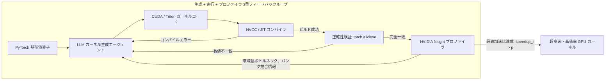

# スタンフォード CS329A (第10講): SWE-Agents — ソフトウェアエンジニアリングエージェント、CodeMonkeys、KernelBench、そしてシステムインターフェース (ASI)

現実世界のソフトウェアエンジニアリングは、単一関数を記述するアルゴリズムパズルや単純なベンチマークとは根本的に異なります。GitHub上の実際のバグ報告は単一ファイルに収まらず、数百のモジュール、複雑なレガシー依存関係、そして数百万行に及ぶ分散コードベースに深く絡み合っています。さらに本番環境においてソフトウェアは、単に「意味論的に正しい（Correct）」だけでなく、「十分に高速であるか（Fast）」、そして「並列ハードウェアと整合しているか（Aligned）」という冷厳な多面的評価をクリアしなければなりません。

本日より幕を開ける**スタンフォード CS329A: Self-Improving AI Agents（自己改善AIエージェント）**の第3の山脈である**Part 3 · Agent Engineering (第10講〜第12講)**は、研究室でのモデル訓練を離れ、実戦的なソフトウェア工学の最前線へと突入します：
> **「数百万トークンに及ぶエンタープライズリポジトリをエージェントが自律探索し、バグ再現テストを自ら構築し、人間の手によるPyTorchベースラインを凌駕する超高速GPUカスタムカーネルを合成するにはどうすべきか？」**

本稿では、**SWE-Agent Autonomous Coding（自律的ソフトウェアエンジニアリングコーディング）**の最前線を探究し、**SWE-bench Benchmark GitHub**で世界最高水準を達成した**CodeMonkeys Automated Refactoring（CodeMonkeys自動リファクタリング）**、ハードウェアプロファイラとの連動を実現した**KernelBench GPU Performance Tuning（KernelBench GPU性能最適化）**、そしてスタンフォード大学が提唱する**Agent-Computer Interface ACI（エージェント・システム・インターフェース ASI）**の3大ブレイクスルーを完全解剖します。

{/* truncate */}


---

## 1. 実践的ソフトウェアエンジニアリングエージェントの現実的課題

実際のオープンソースリポジトリのバグを自律解決するには、3つの致命的な工学的ボトルネックを打破する必要があります：
1. **コンテキスト爆発 (Context Explosion):** 本番リポジトリは平均300万トークンを超過します。これをそのままLLMに投入すると莫大なコストが発生するだけでなく、アテンションが拡散して核心のバグ箇所を見失います。
2. **検証の自己欺瞞 (Self-Deceptive Verification):** エージェントにコードを先に修正させると、根本的なバグ修正を避け、自らが修正した不完全なコードに合わせてテストを改ざんする現象が多発します。
3. **ハードウェア最適化の壁:** Pythonのグルーコードを越えて低レベルなCUDA/Tritonカーネル最適化に向かうと、メモリ整列やスレッド分散などの物理構造への理解が不可欠となり、ワンショット生成はほぼ100%失敗します。

```
┌─────────────────────────────────────────────────────────────────────────┐
│              実践的ソフトウェアエンジニアリングエージェントの3大支柱    │
└────────────────────────────────────┬────────────────────────────────────┘
                                     │
       ┌─────────────────────────────┼─────────────────────────────┐
       ▼                             ▼                             ▼
┌──────────────────────────┐  ┌──────────────────────────┐  ┌──────────────────────────┐
│  CodeMonkeys SWE-bench   │  │  KernelBench プロファイラ│  │   スタンフォード ASI 層  │
├──────────────────────────┤  ├──────────────────────────┤  ├──────────────────────────┤
│ • 50.5倍コンテキスト圧縮 │  │ • fast_p 実行速度評価指標│  │ • 14倍 DSL コード圧縮    │
│ • 相互デバッグ状態機械   │  │ • コンパイル+プロファイラ│  │ • AutoGuide エラー翻訳機 │
│ • 判別テスト選択マシン   │  │ • 融合 & 共有メモリ最適化│  │ • 意図と実装の乖離解消   │
│ • SWE-bench Verif. 57.4% │  │ • 最大13倍のGPU加速達成  │  │ • 既存チューナー比3.8倍速│
└──────────────────────────┘  └──────────────────────────┘  └──────────────────────────┘
```

---

## 2. 実際のGitHubバグを解決する統合システム: CodeMonkeys (2025)

Django、SymPy、scikit-learnなどの主要オープンソースのバグを扱う**SWE-bench Verified**において、2025年初頭に公開された**CodeMonkeys**は**57.4%**という圧倒的解決率を記録しました。

CodeMonkeysの成功要因は、ソフトウェア修正プロセスを以下の3段階へと規律正しく分解した点にあります：

```
                  [実際のGitHub課題および300万トークンのコードベース]
                                         │
                                         ▼
           1. コンテキストパイプライン (Context Pipeline、50.5倍圧縮)
              (軽量Qwen2.5-Coderによるローカル全走査 -> 要約 -> 順位付け -> 128k)
                                         │
                                         ▼
           2. 生成状態機械 (Two-Sided Debugging State Machines)
              ┌────────────────────────────────────────────────────────┐
              │ Testing Machine: バグ再現テストを作成 (Exit Code 2)    │
              │                       │                                │
              │                       ▼                                │
              │ Editing Machine: コードパッチ修正 -> テスト合格 (Exit 0)│
              └────────────────────────────────────────────────────────┘
                                         │
                                         ▼
           3. 選択状態機械 (Selection State Machine、判別テスト)
              (候補パッチ間の微細な挙動差異を暴くエッジケーステストを自律合成)
                                         │
                                         ▼
                         [検証済み最終パッチの提出]
                     (SWE-bench Verified 57.4% 解決達成)
```

### 第1段階：コンテキストパイプライン（50.5倍圧縮）
- 300万トークン規模のリポジトリをClaude 3.5 Sonnetなどの商用APIで全探索するとコストが破綻します。
- CodeMonkeysはローカルで無制限に実行可能な `Qwen2.5-Coder-32B` を用い、全Pythonファイルを精査。
- 関連クラスや関数シグネチャのみを要約・抽出し、重要度順にソートすることで、**128,000トークンのコンテキスト内に収まるよう50.5倍に圧縮**します。
- この探索コストは後続の10個の並列生成試行で按分（Amortized）されるため、総費用の**15%未満**に抑えられます。

### 第2段階：生成段階 — 相互デバッグ状態機械（Two-Sided Debugging）
コード修正で最も危険なのは「修正したつもりだが、実際には何も解決していない見かけ上の合格」です。CodeMonkeysは2つの状態機械を連動させます：
1. **Testing State Machine:** バグ報告を精読し、問題の実在を立証する**独立した再現テストスクリプト（`reproduce_issue.py`）**を作成。このスクリプトはバグが存在する元のコードベース上で実行した場合、必ず **Exit Code 2（失敗）** を返さなければなりません。
2. **Editing State Machine:** 失敗する再現テストが確立されて初めて、ソースコード修正に着手。テストを実行して **Exit Code 0（成功）** が得られるまで、エラーログを取り込みながら最大8サイクルの修正ループを回します。

### 第3段階：選択段階 — オラクルへの収束（Selection State Machine）
10個の並列軌跡を走らせると、正解パッチが少なくとも1つ含まれる確率（カバレッジ）は**69.8%**に達します。しかし、ランダムに1つ選んで提出すると成功率は**45.8%**へ急落します。正解を作れても選べないのです。

CodeMonkeysは**判別テスト（Discriminator Test）**に基づく選択マシンを開発しました：
- 単に「どのコードが美しいか」を尋ねるのではなく、モデルに対し**「候補パッチAとBで異なる出力を生み出す新たなエッジケーステストを書け」**と命じます。
- そのテストを実行して欠陥パッチを段階的に脱落させ、真に完全なパッチを特定することで、**57.4%**の実運用解決率を叩き出しました。

---

## 3. 正しさから実行速度へ: KernelBench (2025)

ソフトウェア工学において機能的正しさは出発点にすぎません。AIインフラを支えるGPUカーネルにおいて、速度が2倍になればデータセンターの電力コストを数千億円単位で削減できます。

2025年2月に発表された**KernelBench**は、250種のPyTorch演算子を対象に、エージェントが生成したカスタムCUDA/Tritonカーネルの正確性と実機速度を同時測定するベンチマークです。

```text
正確性とハードウェア加速比を統合した fast_p 評価指標：
========================================================================================
fast_p = (1 / N) * Σ_{i=1}^N  1[ correct_i  AND  speedup_i > p ]

指標の物理的意味：
  • fast_0 : 機能的正解率 (テンソル出力がPyTorch基準値と完全一致: torch.allclose)
  • fast_1 : 正解であり、かつ標準PyTorchより高速な割合 (Speedup > 1.0x)
  • fast_2 : 正解であり、かつ標準PyTorchより2倍以上高速な割合 (Speedup > 2.0x)
========================================================================================
```



### プロファイラフィードバックの破壊力
ワンショット（One-shot）生成環境では、OpenAI o1やDeepSeek-R1のような最高峰モデルであっても、**PyTorchより高速なコードを生成できる割合（$fast_1$）は20%未満**でした。スレッド割り当ての境界値ミスによるセグメンテーション違反やメモリ競合が原因です。

しかし、**生成（Generation） + コンパイル実行（Execution） + Nsightプロファイラ解析（Profiler）**の3重ループを構築すると劇的な変化が生じました：
- DeepSeek-R1の複合演算子最適化成功率が36%から**72%へと倍増**。
- エージェントがメモリ帯域の滞留シグナルを読み取り、演算子融合（Operator Fusion）、タイリング、共有メモリ（Shared Memory）リダクションを自発的に実装し、**標準PyTorch比で最大13倍の高速化**を達成しました。

---

## 4. 意図と実装の整合: Agent-System Interface (ASI, Stanford 2025)

エージェントに低レベルなC++並列システムやハードウェアレジスタを直接操作させると、深刻なインピーダンス不整合が生じます。スタンフォード大学のAlex Aiken教授チーム（ICML 2025）が提唱した**Agent-System Interface (ASI)**はこの乖離を解消します：
> **「エージェントに生のC++ポインタや低レベルログをそのまま渡すのは極めて非効率である。エージェントの『高レベルな意図（Intent）』とハードウェアの『物理的実装（Implementation）』を円滑に仲介する専用インターフェースが不可欠である！」**

```text
┌─────────────────────────────────────────────────────────────────────────┐
│                          LLM 推論エージェント                           │
│              (高レベルな宣言的意図および最適化戦略の立案)               │
└────────────────────────────────────▲────────────────────────────────────┘
                                     │
          ┌──────────────────────────┴──────────────────────────┐
          │ 高レベル宣言的 DSL       ▲ 実行可能な自然語        │
          │ 最適化ディレクティブ     │ システムガイダンス(AutoGuide)│
          ▼                          │                          │
┌────────────────────────────────────┴────────────────────────────────────┐
│                    Agent-System Interface (ASI 層)                      │
│  • ドメイン特化言語 (DSL): コード複雑性を14倍圧縮 (抽象化境界)          │
│  • AutoGuide 診断翻訳機: 難解なC++アサーションを実行可能な助言へ変換    │
└────────────────────────────────────▲────────────────────────────────────┘
                                     │
          │ 低レベルC++コード        ▲ ハードウェア障害および   │
          │ およびメモリ配置         │ コンパイラ例外ログ       │
          ▼                          │                          │
┌────────────────────────────────────┴────────────────────────────────────┐
│                     物理並列ハードウェアシステム                        │
│                 (分散メモリ、GPUコア、共有VRAM構造)                     │
└─────────────────────────────────────────────────────────────────────────┘
```

### ASIの2大コンポーネント
1. **ドメイン特化言語（DSL）:** 何千行ものC++テンプレートやポインタ操作を排除し、テンソル分割とメモリ配置の決定のみを十数行の宣言的DSLへ抽象化。**コード複雑性を14倍圧縮**し、構文エラーを根絶。
2. **AutoGuide（自動ガイド）:** ハードウェアが `"Assertion failed: stride mismatch at dim 1"` といった難解なエラーを出力した際、AutoGuideが介入して実践的指示へ翻訳：
   > *「診断結果: テンソルの第1軸が32バイト境界に整列しておらず、メモリストライド衝突が発生しました。Row-major配置ディレクティブを修正し、32バイトパディングを適用してください。」*

### 成果：10回の反復が1,000回を圧倒
ASIを装備したエージェントは、わずか**10回の反復（Iteration）**で、既存の最高峰自動チューナーOpenTunerが**1,000回探索した結果よりも3.8倍高速な並列コードを生成**。熟練エンジニアが数日を費やしていた回路シミュレーションの性能チューニングを、**わずか10分**で完了させました。

---

## 5. ソフトウェア工学パラダイム比較

```text
=========================================================================================================
比較軸                単純コード補完 (Copilot)       CodeMonkeys (SWE-bench)   KernelBench + ASI
---------------------------------------------------------------------------------------------------------
対象コード単位        単一関数・数行スニペット       数百万トークンの複数ファイル 超高速カスタムCUDA/Triton
コンテキスト管理      作業中ファイル中心 (4k-8k)     50.5倍圧縮された128k窓    宣言的DSL (14倍圧縮)
検証機構              単純コンパイル確認             相互デバッグ状態機械      Nsightプロファイラ (fast_p)
フィードバック信号    スタックトレース文字列         Exit 2 -> Exit 0 状態遷移 AutoGuide 行動指示翻訳
最終到達点            構文的コード補完               本番環境リグレッション撲滅 実機ハードウェアの実時間加速
=========================================================================================================
```

---

## 6. 技術的深掘り Q&A

### Q1. CodeMonkeysでコード修正前に「再現テストスクリプト」を必須とする理由は？
コードを先に修正させてからテストを書かせると、モデルは自分が直したばかりの不完全なコードの挙動に合わせて**「見かけ上合格する甘いテスト」を捏造して自画自賛する自己欺瞞（Self-Deception）**に陥るためです。

未修正の元の状態で実行したときに**確実に失敗（Exit Code 2）する客観的スクリプト**を事前に担保して初めて、修正後に**正常終了（Exit Code 0）へ反転したこと**をもってバグの根絶を数学的に証明できるのです。

### Q2. LLMがCUDAカーネルを記述する際に最も頻発する失敗とプロファイラの効果は？
言語モデルはテンソル演算の概念は把握していますが、数千スレッドが並行アクセスする低レベルなハードウェアインデックス計算で破綻します：
- **メモリ領域外アクセス (Out-of-Bounds):** スレッドIDの境界計算を誤りセグメンテーション違反を誘発。
- **共有メモリバンク競合 (Bank Conflict):** 同一バンクへの同時アクセスによりスレッド処理が直列化。

単なるコンパイラは構文エラーしか教えません。**プロファイラフィードバックループ（E+P）**が実機稼働時のメモリ帯域占有率やワープ停止情報をコンテキストへ注入することで、エージェントは共有メモリのパディングやレジスタ再利用といった高度なハードウェア最適化を自律遂行できるようになります。

---

## まとめと次回予告

ソフトウェアエンジニアリングエージェントは、単なるコード補完の枠組みを超越しました。**CodeMonkeys**は50.5倍のコンテキスト圧縮と相互デバッグによりGitHubの実案件バグを解決し、**KernelBench**と**ASI**はプロファイラとドメイン特化言語を通じてハードウェアインフラそのものを高速化しました。

続く**第11講**では、複数日にわたる長期開発を行うエージェントの最大の壁である**Agent Memory — 階層的メモリシステム、Cartridges、CacheBlend、そして生涯学習エージェント (MemGPT)**の深奥に迫ります！

---

### 重要ポイント整理
- **分割償却コンテキスト探索:** 軽量モデルによる全走査（50.5倍圧縮）により、300万トークンの巨大リポジトリ開発を経済的に成立させる。
- **相互デバッグ（Two-Sided Debugging）:** 未修正時に失敗（Exit 2）し、修正後に成功（Exit 0）する再現テストのみが虚偽の合格を根絶する。
- **性能は探索ループの産物:** ワンショット生成では超高速GPUカーネルは書けない。実行およびプロファイラ連携（fast_p）が必須である。