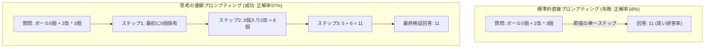
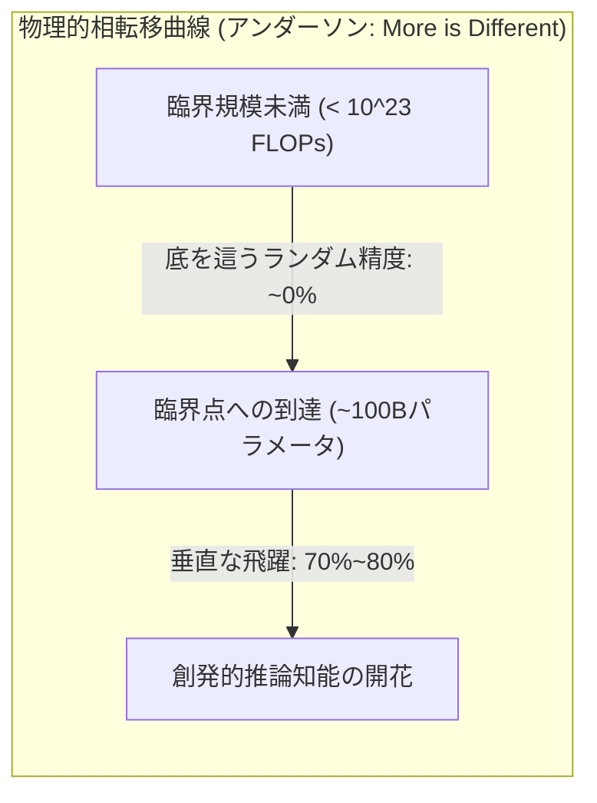

# Stanford CS329A (第13回): LLM Reasoning — 言語モデル推論の本質と思考の連鎖 (CoT, Self-Consistency, 創発的能力)

長年にわたり、人工知能の研究者たちの間にはニューラルネットワークに対する深い懐疑論が根強く存在していました：
> *「大規模言語モデルは、統計的にもっともらしい単語を繋ぎ合わせる『確率論的オウム（Stochastic Parrot）』に過ぎない。多段階の計算、形式論理、因果関係の連鎖を要求する課題を与えても、もっともらしい嘘（ハルシネーション）を並べるだけで、真の論理的演繹を行うことは原理的に不可能である。」*

実際、初期のフロンティアモデルに小学校レベルの算数の文章題を与えると、途中の思考プロセスを省略して即座に誤った数値を答え、惨敗を喫していました。

本講義から幕を開ける**Stanford CS329A: Self-Improving AI Agents**の最終章**Part 4: フロンティア（Frontiers, Lectures 13 through 17）**では、機械知能の最も深遠な知の未踏峰である**LLM Reasoning Foundations**へと踏み込みます。Google DeepMindの推論研究統括であり思考の連鎖（CoT）の生みの親である**デニー・チョウ（Denny Zhou）**博士の金字塔的研究を軸に、言語モデルの中で「推論」という神秘的な火花がどのように点火されるのかを解き明かします：
- **思考の連鎖プロンプティング (Chain of Thought CoT Prompting, NeurIPS 2022):** 自然言語による中間思考ステップを導入するだけで、モデルの重みを一切変更せずにPaLM 540Bの数学正解率を18%から57%へと急伸させた原理。
- **自己無矛盾性デコーディング (Self-Consistency Decoding LLM, ICLR 2023):** 「正解に至る道は一つに収束し、誤答への道は無数に発散する」というトルストイの収束法則に基づくサンプリングと多数決統合。
- **創発的認知能力 (Emergent Cognitive Abilities AI, 2022):** 複雑系物理学の相転移（「More is Different」）と、「創発は非線形指標がもたらした蜃気楼（Mirage）か？」を巡る歴史的学術論争。

{/* truncate */}


---

## 1. 「確率論的オウム」神話の崩壊

初期の研究者たちは、言語モデルに少数例（Few-Shot Exemplars）を提示する際、以下のように問題と答えを直結させていました：

```text
[標準的な少数例プロンプティング (失敗パターン)]
-----------------------------------------------------------------------------------------
Q: ロジャーはテニスボールを5個持っています。テニスボールの缶をさらに2缶買いました。
   各缶には3個のボールが入っています。現在ロジャーは何個のボールを持っていますか？
A: 答えは11個です。
-----------------------------------------------------------------------------------------
```

このアプローチは、複雑な計算グラフ全体を「次の単一トークンの予測ステップ」の中に圧縮することをモデルに強要していました。中間状態を計算する思考のメモ用紙（Scratchpad）が与えられていなかったため、モデルは適当な数値を捏造して失敗していたのです。

デニー・チョウとジェイソン・ウェイの研究チームは、提示例のわずか1行を書き換えることで、AIの歴史を根底から塗り替えました：

```text
[思考の連鎖プロンプティング (Chain-of-Thought)]
-----------------------------------------------------------------------------------------
Q: ロジャーはテニスボールを5個持っています。テニスボールの缶をさらに2缶買いました。
   各缶には3個のボールが入っています。現在ロジャーは何個のボールを持っていますか？
A: ロジャーは最初に5個のボールを持っていました。
   3個入りの缶2個は、2 × 3 = 6個のテニスボールです。
   5 + 6 = 11です。
   したがって、答えは11個です。
-----------------------------------------------------------------------------------------
```

```
┌─────────────────────────────────────────────────────────────────────────┐
│               機械の認知推論を支える3大主要ピラー                      │
└────────────────────────────────────┬────────────────────────────────────┘
                                     │
       ┌─────────────────────────────┼─────────────────────────────┐
       ▼                             ▼                             ▼
┌──────────────────────────┐  ┌──────────────────────────┐  ┌──────────────────────────┐
│ 思考の連鎖 (CoT)         │  │ 自己無矛盾性 (Self-Cons.)│  │   創発的能力 (Emergent)  │
├──────────────────────────┤  ├──────────────────────────┤  ├──────────────────────────┤
│ • <問, 思考過程, 答>     │  │ • Sample-and-Marginalize │  │ • アンダーソンの相転移論 │
│ • 重み更新は完全ゼロ     │  │ • トルストイの収束法則   │  │ • 臨界計算量 > 10^23 FL  │
│ • GSM8K: 18% -> 57% 急伸 │  │ • 多数決統合 (T=0.7)     │  │ • 蜃気楼仮説論争 (p^L)   │
│ • 自然言語による順次論理 │  │ • 正解率: 56% -> 74.4%   │  │ • マクロな認知的飛躍     │
│ • 数式・点アブレーション │  │ • 自己確信度・不確実性   │  │ • 非線形な知能の開花     │
└──────────────────────────┘  └──────────────────────────┘  └──────────────────────────┘
```

---

## 2. 思考の連鎖プロンプティング (Wei, Zhou et al., NeurIPS 2022)

2022年末に発表された記念碑的論文**《Chain-of-Thought Prompting Elicits Reasoning in Large Language Models》**は、推論計算の常識を一変させました。

それまで、高度な推論を解かせるには数万件の教師データでモデルをファインチューニングするか、外部の検証器（Verifier）を訓練する必要があると考えられていました：
- 小学校レベルの算数推論ベンチマーク**GSM8K**において、当時世界最大級であった`PaLM 540B`の標準プロンプトでの正解率はわずか**18%**でした。
- しかし、自然言語による解法ステップを含んだ**わずか8個のCoT例**をプロンプトに加えただけで、正解率は**57%へと垂直上昇**しました！
- これは、OpenAIが数万件のデータでモデルを微調整し検証器を付加して達成していた当時の最高水準（33%）を、**重みの更新を1回も行わずにプロンプトの工夫だけで24ポイント以上も上回った衝撃的事件**でした。



### 厳密なアブレーション実験：推論の真の原動力は何か？
懐疑論者たちは「CoTが効いたのは単に数式を含めたからではないか」「ドット（`......`）のように計算時間を稼いだだけではないか」と疑問を呈しました。デニー・チョウの研究チームは緻密なアブレーション実験によって反論しました：
1. **数式のみのアブレーション (Equation Only):** 自然言語の解説を省き、`5 + (2 * 3) = 11`のように数式だけを与えたところ、性能は**18%へと急落**しました。
2. **計算遅延シミュレーション (Dots Only):** 考える時間を稼ぐために途中に`......`と点を打たせても、性能向上はゼロでした。
3. **回答後解説 (Reasoning after Answer):** 最初に答えの数値を出力させ、その後に解説を書かせた場合も失敗しました。
- **結論:** 機械に真の推論力を授けた核心は、数式でも思考時間の引き延ばしでもなく、**「人間の論理展開を模倣し、自然言語で1ステップずつ前提を積み上げる順次言語論理（Natural Language Reasoning Steps）」**そのものであることが実証されました。

---

## 3. 多様な思考の民主主義: Self-Consistency (Wang, Zhou et al., ICLR 2023)

CoTは画期的でしたが、標準的な**貪欲法（Greedy Decoding）**に起因する致命的な弱点を抱えていました：
> *「貪欲法は各ステップで最も確率の高い単一の単語だけを選んで一本道を進む。もし10段階の推論の3段階目で微細な計算ミスを犯せば、続く4〜10段階がどれほど完璧であっても破滅的な誤答へと直行してしまう。」*

2023年、デニー・チョウとワン・シュエジ（Xuezhi Wang）らは、この単一経路の脆弱性を統計学的に克服する**Self-Consistency Decoding LLM**を提唱しました。

### トルストイの収束法則：「正解に至る道は一つに集まり、誤謬への道は散り散りになる」
レフ・トルストイの名作『アンナ・カレーニナ』は有名な一節から始まります：
> *「幸福な家庭はどれも似たものだが、不幸な家庭はいずれもそれぞれに不幸である。」*

デニー・チョウ博士はこの原則が推論空間のトポロジーにも完璧に当てはまることを発見しました：
- 複雑な数学課題を解く際、代数的な式変形を用いようと、幾何学的な補助線を引こうと、逆算を用いようと、**正しい論理を紡いだ多様な思考経路は、最終的に唯一絶対の真理（答え: 42）へと力強く収束（Converge）**します。
- 一方で、論理の飛躍や計算ミスを犯した誤った経路は、あるものは$-14$、あるものは$108$、あるものは$3.14$を出力し、**無限の誤答空間へと無秩序に発散（Diverge）**していきます！

```text
                                [問題入力プロンプト]
                                         │
        ┌────────────────┬───────────────┼───────────────┬────────────────┐
        ▼                ▼               ▼               ▼                ▼
   [経路1: 代数的]  [経路2: 幾何的]  [経路3: 符号ミス][経路4: 帰納法]  [経路5: 公式誤用]
    ... 各段階 ...  ... 各段階 ...   ... 各段階 ...  ... 各段階 ...   ... 各段階 ...
        │                │               │               │                │
        ▼                ▼               ▼               ▼                ▼
     答: 42           答: 42          答: -14         答: 42           答: 108
     (1票獲得!)       (1票獲得!)                      (1票獲得!)
        │                │                               │
        └────────────────┴───────────────┬───────────────┘
                                         ▼
                         [多数決による最頻値採用: 42]
                        (ノイズを除去した最終正解)
```

### サンプリングと周辺化 (Sample-and-Marginalize)
Self-Consistencyは適度な温度（$T = 0.7$）を設定して$m$本の多様なCoT推論軌跡をサンプリングし、最終回答空間で多数決投票を行います：

```text
========================================================================================
自己無矛盾性 (Self-Consistency) 多数決投票の定式化:
========================================================================================
Final Answer = argmax_a  Σ_{i=1}^m  1[ a_i = a ]

ここで:
  • m   : サンプリングされた独立推論経路の数 (通常5〜40本)
  • a_i : i番目の推論経路が出力した最終的な離散回答
  • 1[·]: 経路の回答が候補aと一致する場合に1を返す指示関数
========================================================================================
```

### ベンチマーク成果と自己不確実性の測定
- `PaLM 540B`においてCoT（56.5%）にSelf-Consistencyを組み合わせた結果、正解率は**74.4% (+17.9ポイント)**へと急伸しました。
- **内的確信度の測定:** 最頻値となった回答の得票率（例：40票中38票獲得 vs 40票中12票獲得）は、モデル自身の正答確率と極めて高い正の相関を示しました。外部の検証モデルなしに、**エージェントが自らの推論に対する信頼度を自律的に測定するメタ認知シグナル**が得られたのです。

---

## 4. 「More is Different」: 創発的能力と蜃気楼論争

なぜCoTやSelf-Consistencyのような驚異的な推論力は、1Bや7Bといった小型モデルでは一切発現しなかったのでしょうか？

1977年にノーベル物理学賞を受賞したフィリップ・アンダーソン（Philip Anderson）は、「More is Different（量が増せば質が変わる）」という名言を残しました。水素原子1個をいくら調べても水の流動性は理解できず、砂粒1個を観察しても砂山の崩壊は予測できません。

デニー・チョウとジェイソン・ウェイは論文**《Emergent Abilities of Large Language Models》**において、ニューラルネットワークでも同様の物理学的**相転移（Phase Transition）**が発生することを証明しました：
> **「創発的能力（Emergent Ability）とは、小型モデルでは性能がほぼランダム正解レベルで推移していたものが、計算量が一定の臨界規模（通常 $10^{23}$ FLOPs、約100Bパラメータ）を超えた瞬間に、何の前触れもなく垂直に立ち上がる非線形な知能である。」**



### 歴史的学術論争：創発は評価指標が作った蜃気楼（Mirage）か？
2024年、スタンフォード大学のサンジブ・アローラ（Sanjeev Arora）教授らの研究チームは、世界に波紋を広げる反論論文を発表しました：**《Are Emergent Abilities of Large Language Models a Mirage?（創発的能力は蜃気楼か？）》**

#### 反論側の主張：非線形な階段型指標の錯覚
- 長さ $L$ の多段階推論において、各トークンの正解確率を $p$ と仮定します。
- モデル規模の拡大に伴い、各トークンの予測確率 $p$ は $0.6 \to 0.7 \to 0.8 \to 0.9$ と**完全に滑らかな線形（Linear）成長**を遂げています。
- しかし、テスト採点者が「最後の文字まで一言一句間違えずに一致して初めて1点を与える」という極めて厳格な**完全一致（Exact Match）**指標を採用すると、全体の正解率は $p^L$ となります：
  $$0.6^5 = 0.07 \; (7\%) \quad \longrightarrow \quad 0.9^5 = 0.59 \; (59\%)$$
- **蜃気楼仮説の核心:** モデル内部の能力は線形かつ滑らかに向上していたにもかかわらず、**非線形な階段型指標で観察したために、能力が突如階段状に爆発したかのように見誤った「測定上の錯覚（Mirage）」**に過ぎないという主張です。

```text
========================================================================================
非線形指標による蜃気楼仮説の数式:
========================================================================================
Accuracy_ExactMatch = ( p_token )^L

ここで:
  • p_token : トークン単位の基本予測確率 (規模に応じて滑らかに線形増加)
  • L       : 相互に依存する推論ステップのシーケンス長
  • Lが大きくなるほど、線形な成長がマクロな階段状の相転移として観測される
========================================================================================
```

#### デニー・チョウらの再反論と知見の統合
デニー・チョウの研究チームは、これに対して確固たる根拠で反論しました：
1. 連続的な損失関数である**交差エントロピー損失（Cross-Entropy Loss）**自体を追跡しても、高度な論理課題では臨界規模を超えるまで損失が減少しない真の相転移が依然として観測される。
2. 多肢選択式や連続的な意味的類似度指標（BLEU、ROUGE）を用いても、依然として多数の推論課題において急激な跳躍現象が確認される。

**導き出された均衡ある結論:**
> *「創発の劇的な立ち上がりには非線形指標による誇張の側面が確かに存在する。しかし同時に、人間の論理体系自体が『前提Aが成立して初めて結論Bが導かれる』という順次的因果性を持つため、ミクロな確率の向上が臨界点を超えた瞬間にシステム全体のマクロな演繹能力が飛躍する複雑系の相転移は、否定できない物理的実体である。」*

---

## 5. 推論パラダイム間の構造比較表

```text
=============================================================================================================
比較次元              標準的直接プロンプティング    思考の連鎖 (CoT)             自己無矛盾性 (Self-Cons.)
-------------------------------------------------------------------------------------------------------------
推論の軌跡構造        単一直接写像 (Q -> A)         自然言語による順次論理展開   複数軌跡の多数決 (m個サンプル)
デコード戦略          貪欲法 (Greedy argmax)        貪欲法 (Greedy argmax)       サンプリングと最頻値集計
追加計算コスト        基準 1x FLOPs                 質問あたり約3倍のトークン消費基準比 15倍〜30倍の計算量
GSM8K 正解率          18% (PaLM 540B)               57% (+39ポイント向上)        74.4% (+17.4ポイント再向上)
主な失敗要因          即座のハルシネーション        1ステップのミスによる連鎖破綻同一エラーへの票の偏り
不確実性の測定        不可 (過信ソフトマックス)     不可                         最頻値の得票率で測定可能
モデル規模の閾値      全規模モデルで適用可能        100B / 10^23 FLOPs以上で創発 CoTが創発したモデルで機能
=============================================================================================================
```

---

## 6. 技術深層Q&A

### Q1: 今日の7Bや8Bといった小型オープンソースモデルでもCoT推論は可能ですか？
2022年当時の事前学習ベースモデルでは、100B未満でCoTが機能しなかったのは事実です。

しかし、その後のポストトレーニング技術の劇的な進歩がこの壁を打ち破りました：
- **知識蒸留 (Distillation):** 最先端フロンティアモデルが生成した高品質なCoT軌跡を小型モデルに直接学習させます。
- **強化学習 (RLVR):** 検証可能な報酬モデルと組み合わせることで、現代の`DeepSeek-R1-Distill-Qwen-7B`や`Llama-3.1-8B-Instruct`などは、GSM8Kで85%以上の精度を叩き出し、かつてのPaLM 540Bを圧倒しています。
- 創発の物理的閾値は固定された定数ではなく、アルゴリズムとデータの純度が高まるにつれて小型モデルへと降りてきています。

### Q2: 実務においてSelf-Consistencyを適用する際、最も費用対効果の高いサンプル数（m）は？
実験データによると、正解率はサンプル数 $m$ の増加に伴って対数線形（Log-Linear）に向上し、やがて飽和します：
- **5〜10サンプルの区間:** 得られる性能向上全体の**80%以上を達成**します。
- サンプル数を10個から40個に増やしてもAPIコストが4倍に跳ね上がるのに対し、正解率の向上は1〜2%にとどまります。
- **実務上の推奨:** 本番運用環境では、**温度 $T=0.7$ のもとで5〜8本の経路をサンプリングして多数決を取ること**が、計算コストと精度のバランスが最も優れたパレート最適点（Sweet Spot）となります。

---

## まとめと次回講義の予告

機械推論は実現不可能な幻想ではありませんでした。**Chain-of-Thought (CoT)**を通じてデニー・チョウ博士は、自然言語による思考の連鎖がモデルの重みを変更せずとも眠れる論理能力を覚醒させることを証明しました。**Self-Consistency**によって私たちは多数決の統合により単一経路のエラーを治癒する統計的知恵を獲得し、**創発論争**を通じてAIが物理学的な相転移の渦中にあることを確認しました。

しかし、自然言語によるCoT推論は確率論的言語モデルに基づいているため、「ときたまもっともらしい嘘をつく」ハルシネーションの可能性を完全には排除できません。

一切の論理の飛躍が許されない**国際数学オリンピック（IMO）の金メダル級の難問**のように、完全な形式的検証が求められる極限の領域では何が必要になるでしょうか？

次回**Lecture 14**では、ニューラルネットワークの直感と記号論理学の厳密性を融合させ、世界で初めてIMO金メダル水準の数学定理証明を達成したDeepMindの歴史的傑作、**《AlphaProof & Mathematical Reasoning: 数学的推論と形式検証 (AlphaGeometry, AlphaProof, Lean 4)》**を徹底解剖します。

---

### 今回の重要ポイント
- **言語は思考の媒体である:** 課題を自然言語の中間ステップに分解するだけで、重み更新なしにPaLM 540Bの数学正解率は39ポイント急伸しました。
- **真理は収束し、誤謬は発散する:** Self-Consistencyの多数決統合は推論ノイズをフィルタリングし、正解率を74.4%へと引き上げます。
- **複雑系相転移の実在:** 計算量が臨界規模（$10^{23}$ FLOPs）を超えた瞬間、ミクロな確率の向上がマクロな認知的飛躍へと転換します。