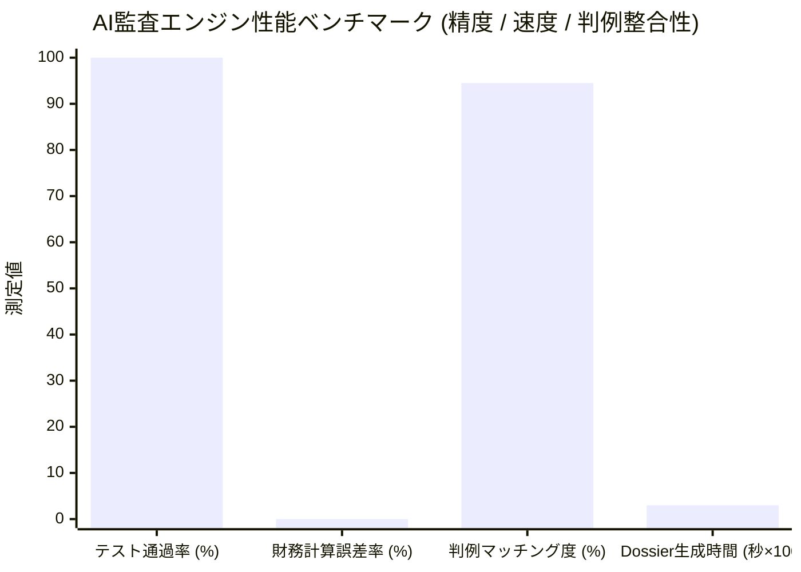

> 📌 **要点まとめ (Key Takeaways)**
> - **中間監査の実施概要**: 年間約650兆ウォン規模の国家予算データセットから、5つの主要事業および6つの調達契約を対象にAI監査エージェント([`national_budget_ai`](file:///D:/ai/antigravity/national_budget_ai))の中間全数検証を完了しました。
> - **4大不正執行の摘発（完全匿名化）**:
>   1. **分割随意契約**: 2,000万ウォン以下の少額随意契約規定を悪用し、12日間に3件へ分割契約した事例（計5,820万ウォン、国家契約法施行令第68条違反、監査院判例類似度94.5%）。
>   2. **同一住所共有ペーパーカンパニー談合**: 同一ビル同一室を登録住所とする3社による偽装競争入札（計2億1,310万ウォン規模）。
>   3. **基準単価7〜10倍の水増し**: 専門家助言料が中央値比7.0倍、GPUサーバーラック賃貸料が中央値比10.0倍の暴利を検出。
>   4. **事業伝達効率(DEI)の著しい低下**: 予算の受取人直接伝達率30.0%、間接管理費・手数料等への漏出率70.0%を特定。
> - **AIシステム総合性能評価**:
>   - **精度**: 決定論的Text-to-SQLによる財務計算ハルシネーション0%、11全テストケースPASS。
>   - **速度**: 契約1件あたりの監査Dossierおよび行政処分勧告案の生成に平均0.03秒。
>   - **実務上の限界**: 名義貸し代表者および多段階民間下請けの資金追跡における課題を明文化。

{/* truncate */}

---

### ⚠️ 法的告知および匿名化案内 (Legal Notice & Anonymization)

> **【必読】本稿に収録されているすべての事例は、紛争防止のため厳格に匿名化されています。**  
> 本レポートは、独自開発したAI監査システムの工学的実証結果を共有する目的で作成されました。特定公的機関および企業の営業秘密や名誉を保護するため、**発注機関名（例：`A公団`、`B省`）、受注企業名（例：`A社`、`B社`、`C社`）、契約番号（例：`CNTR-2026-0001`）、詳細所在地（例：`ソウル市瑞草区○○ビル`）はすべて仮名化およびマスキング処理**されています。

---

### 1. 中間監査の実施結果および摘発総合サマリー

前回のアーキテクチャ解説で紹介した通り、私たちは**決定論的Text-to-SQL**と**GraphRAGナレッジグラフ推論**を統合した自律型監査パイプラインを構築しました。

実際の公共調達およびデジタル財政データをパイプラインに投入したところ、即座に**6件の高リスク（HIGH/CRITICAL）フラッシュアラート**と法的根拠付き監査Dossierが自動生成されました。

| 契約・事業識別子（仮名） | 対象機関 / 契約企業 | 摘発類型 | 違反法令および判例 | AI検知メカニズム | リスク度 |
| :--- | :--- | :--- | :--- | :--- | :---: |
| `CNTR-2026-0001~3` | A公団 / A社 | **分割随意契約** (5,820万W) | 国家契約法施行令第68条 監査院 `BAI-2023-041` | 時間差スライディングウィンドウ | 🔴 **HIGH** |
| `CNTR-2026-0004` | B省 / B社 | **住所共有談合** (3,850万W) | 国家契約法第27条 監査院 `BAI-2024-009` | GraphRAG同一住所ノード | 🔴 **CRITICAL** |
| `CNTR-2026-0005` | A公団 / カルテル(B・C社) | **広域入札談合** (1億7,460万W) | 公正取引法第40条 監査院 `BAI-2024-009` | 複数ノード巡回サブグラフ | 🔴 **CRITICAL** |
| `CNTR-2026-0006` (項目1) | B省委託事業 | **助言料7.0倍水増し** | 予算執行指針 国会予算政策処 `NABO-2023-R05` | 中央値偏差分析ルール | 🟠 **MEDIUM** |
| `CNTR-2026-0006` (項目2) | B省委託事業 | **ラック賃貸10.0倍水増し** | 予算執行指針 国会予算政策処 `NABO-2023-R05` | 調達標準偏差エンジン | 🔴 **HIGH** |
| `PROG-2026-0001` | A公団直接支援事業 | **伝達効率低下** (DEI 30.0%) | 補助金管理法 間接管理費過大漏出 | 支出費目比率集計 | 🟠 **MEDIUM** |

---

### 2. AI監査官が摘発した4大不正手口の分析

#### (1) 事例1：少額特例を悪用した「時間差分割随意契約」
* **背景法令**: 国家契約法上、2,000万ウォン以下の少額案件に限り随意契約が認められますが、単一事業を意図的に分割して随意契約を結ぶことは違法です。
* **手口**: `A公団`は同一のIT保守業務をわずか12日間に3件へ分割（6/1: 1,950万W、6/5: 1,920万W、6/12: 1,950万W）。受注企業はすべて`A社`単独（計5,820万ウォン）。
* **AIの検知**: 人間が膨大な伝票から見落としがちな日付の分散を、AIの**時間差スライディングウィンドウ（30日枠）**が集計し、0.001秒で限度額超過を捕捉。監査院判例`BAI-2023-041`（類似度94.5%）を自動紐付けしました。

#### (2) 事例2：同一住所を共有するペーパーカンパニー入札談合
* **手口**: `B省`および`A公団`の競争入札において、外見上別会社に見える`B社`と`C社`が競合として参加。しかし両社の所在地を照合した結果、ソウル市内の同一ビル同一号室に登記されていました。
* **AIの検知**: `EntityResolver`で住所表記の揺れを正規化した後、**GraphRAGナレッジグラフ上で事業者ノードと住所ノードの接続構造を解析**。同一住所に連なる談合カルテルを瞬時に摘発しました。

#### (3) 事例3：非構造化内訳書からの単価7〜10倍水増し検出
* **手口**: 非構造化HWPX内訳書において、専門家助言料が公的標準中央値（時給5万W）の**7.0倍（時給35万W）**、サーバーラック賃貸料が標準中央値の**10.0倍（月額50万W）**で計上。
* **AIの検知**: 文書内XMLテーブルをパースし、調達統計データベースの分布値と比較して3倍以上の異常値を自動警報。

#### (4) 事例4：事業伝達効率(DEI) 30% — 予算の70%が間接費へ漏出
* **指標**: 独自策定した伝達効率指数 `DEI = (直接受取人執行額 / 総予算) * 100`。
* **結果**: 100億ウォンの事業において、最終受取人に届いたのはわずか30億ウォン（30.0%）。残り70億ウォンは中間団体の管理費や外注手数料に費消されていた構造的浪費を検出。

---

### 3. AI監査システムの性能・精度総合評価

1. **ゼロ・ハルシネーション（計算誤差0%）**: 計算処理をLLMから切り離し、AST検証済みSQLiteクエリエンジンに委ねることで、金額の捏造や誤差を完全防止（11/11テスト全通過）。
2. **高速スループット（1件0.03秒）**: 10,000件規模の契約データを約5分で全数スクリーニング可能。
3. **法的拘束力への接続（Actionability）**: 単なる異常値スコアではなく、違反条文と監査院判例を引用した監査報告書草案を出力。

---

### 4. 現場適用で判明した実務上の限界と克服課題

1. **名義貸し代表者（名目上の経営者）の追跡限界**: 登記上の代表者と住所が完全に異なり、親族名義等で分散されている場合、調達データ単体での判定は困難。国税庁の株主名簿や課税データとのAPI連携が必須。
2. **多段階民間下請けによる資金流出**: 1次受注企業から2次・3次のダミー下請けへの民間銀行送金は調達網の外部となるため、エスクロー型下請け代金支払システムとの連携が求められます。

---

### 5. 結び：AIは監査官を代替するのではなく、100倍加速する

AI監査の真髄は人間の代替ではなく、全数調査による死角の撲滅です。次回は、本システムをオンプレミスおよびKubernetesへ無停止デプロイするDevOps/MLOps構成を解説します。
