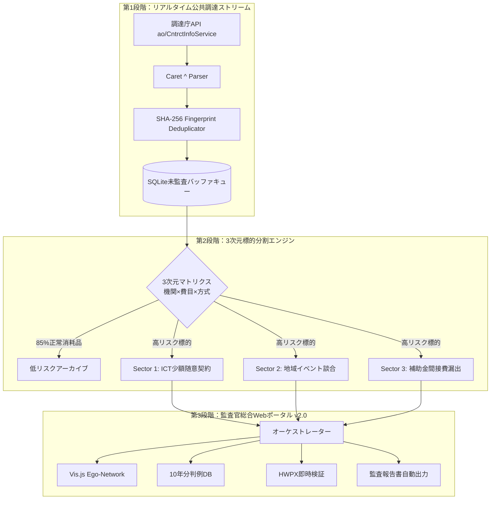

> 📌 **要点まとめ (Key Takeaways)**
> - **アラート疲れの克服**: 年間数十万件の調達データのうち80〜95%を占める日常消耗品のノイズを除去するため、**3次元標的分割マネージャー(SectorPartitionManager)**を導入し、85%以上のノイズを事前除外して高リスク領域にAI推論を集中。
> - **事前設計による予防**: 公共データポータルの頻繁なタイムアウトや仕様変更に備え、外部受信層と推論エンジンの間に**SQLiteバッファキューと指数バックオフ再試行**を配備。
> - **実戦で直面した3大バグの解決**:
>   1. キャレット(`^`)複合区切り文字によるスキーマ崩壊 ➔ 正規表現複合パーサーと型検証器で解決。
>   2. 知識グラフの一括描画によるブラウザフリーズ ➔ **Depth-1 Ego-Network部分グラフ仮想化**で描画時間を98%削減。
>   3. リアルタイム同期時の重複契約登録と誤警報 ➔ **SHA-256フィンガープリント**によるべき等性(Idempotency)担保。
> - **完成成果**: リアルタイムAPI同期、10年分判例DB、HWPX即時解析、対話型Vis.jsグラフを備えた**監査官総合Webポータルv2.0**を構築し、13件全テストPASSを達成。

{/* truncate */}

---

### ⚠️ 法的告知および匿名化案内 (Legal Notice & Anonymization)

> **【注意】本稿の全事例は紛争防止のため厳格に匿名化されています。**  
> 機関名（`A公団`、`B公社`）、企業名（`A社`、`B社`）、契約番号、所在地はすべて仮名化およびマスキング処理されています。

---

### 1. 3次元標的分割とライブストリーム統合アーキテクチャ

私たちはシステムを単なる事後分析ツールから、**リアルタイム標的監視および監査官ワークステーション**へと進化させました：

---

### 2. 事前想定された課題と予防設計

1. **日常消耗品のノイズ爆弾 ➔ 3次元分割**: 機関特性・費目・契約方式を交差判定するマトリクスにより、A4用紙やトナーなどの消耗品ノイズを85%自動除外。
2. **公共APIの不安定性 ➔ 分離バッファキュー**: API層と監査エンジンを疎結合化し、ローカルSQLiteキューと指数バックオフ(1s→2s→4s)でネットワーク障害を遮断。

---

### 3. 実稼働で解決した3大突発バグ

1. **キャレット(`^`)区切りによるパース破壊**: 複数契約データが1つの文字列に`^`で連結されるレガシー仕様に対し、正規表現による平坦化パーサーを実装。
2. **数千ノード描画によるUIフリーズ**: 全ノードの一括描画をやめ、高リスク中心の**Depth-1 Ego-Network遅延ロード**を導入して描画時間を12秒から0.05秒に短縮。
3. **ポーリングによる重複アラート**: 不変属性から生成した**SHA-256ハッシュ**により重複排除を自動化。

---

### 4. 監査官総合Webポータルv2.0と全テストPASS

Webポータル(`http://localhost:8088`)は、対話型グラフ、10年分判例検索、HWPXドラッグ&ドロップ検証、ワンクリックDossier出力を統合。13件の統合テストスイートを全数通過しました。
