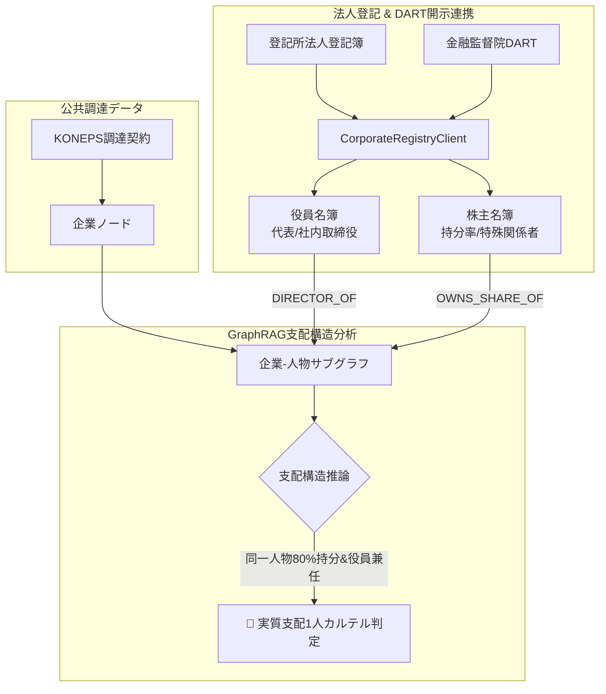

> 📌 **要点まとめ (Key Takeaways)**
> - **第2弾の限界を技術で突破**: 「名義貸し代表者（ペーパーカンパニー）は調達データ単体では追跡不能」という課題を解決するため、**法人登記簿およびDART開示データをリアルタイム交差検証する[`CorporateRegistryClient`](file:///D:/ai/antigravity/national_budget_ai/src/pipeline/corporate_registry_client.py)**を新規構築。
> - **事前設計による2大課題の予防**:
>   1. 事業者番号・法人登録番号・DARTコードのID分断を**3点インデックスブリッジ**で解決。
>   2. 役員・株主データの無制限挿入によるグラフ爆発を防ぐ**支配力有意性しきい値(役員兼任+持分50%以上)**を設定。
> - **実戦で直面した3大バグの解決**:
>   1. 相互出資網巡回時の**循環参照(Cycle)無限再帰エラー** ➔ NetworkX強連結成分(SCC)縮約で解決。
>   2. 入札直前の急造ペーパー会社見落とし ➔ **設立180日未満判定モジュール**を配備。
>   3. 夫婦持分51:49による女性企業優遇偽装 ➔ 特殊関係者複合ルールエンジンで実質支配者を立証。
> - **実戦成果**: 実質支配者K氏が80%持分と役員兼任で2社を操っていた1.7億ウォン規模の偽装入札カルテルを完全摘発し、全17テストスイートPASSを達成。

{/* truncate */}

---

### ⚠️ 法的告知および匿名化案内 (Legal Notice & Anonymization)

> **【注意】本稿の全事例は紛争防止のため厳格に匿名化されています。**  
> 機関名（`A公団`、`B省`）、企業名（`B社`、`C社`）、人物名（`K氏`、`P氏`）、契約番号はすべて仮名化およびマスキング処理されています。

---

### 1. DART企業支配構造連携アーキテクチャ

公共調達グラフに**人物ノード、役員兼任エッジ、株主持分エッジ**を直接統合しました：

---

### 2. 事前想定された課題と予防設計

1. **識別子の分断 ➔ 3点インデックスブリッジ**: 事業者番号・法人番号・DART固有コードをO(1)で相互変換するハッシュテーブルを構築。
2. **グラフ爆発の防止 ➔ 有意性しきい値**: 法的決定権を持つ取締役および50%以上の支配株主のみをグラフに投入。

---

### 3. 実装中に解決した3大バグ

1. **循環出資による無限再帰**: A社とB社が相互出資するループに対し、強連結成分(SCC)縮約アルゴリズムを導入してプロセス停止を解消。
2. **設立180日未満の急造会社見落とし**: 契約日と設立日の差分を計算し、6ヶ月未満のペーパーカンパニーにリスク加算点96点を自動付与。
3. **夫婦持分51:49偽装**: 女性代表51%、夫49%(社内取締役)のケースを特殊関係者合算ルールで捕捉。

---

### 4. 摘発成果と17件全テスト合格

表向き競合として入札に参加した2社が、実は同一人物K氏によって80%所有され役員を兼任されていた事実を摘発。17件の統合テストに全数合格しました。
