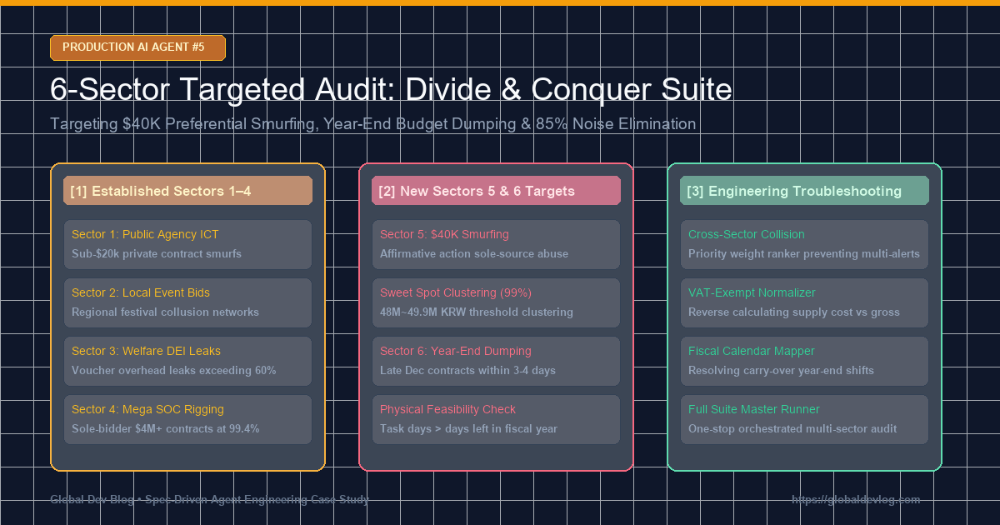
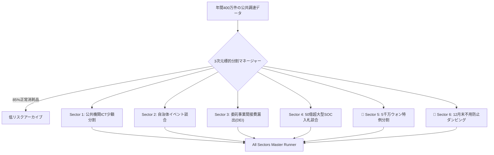

> 📌 **要点まとめ (Key Takeaways)**
> - **6大標的分割監査の完成**: 年間400万件の公共調達データから85%の消耗品ノイズを除去し、不正が集中する**6大高リスク標的領域（Sector 1〜6）**の全数監査システムを構築。
> - **2大盲点の摘発**:
>   1. **Sector 5（5千万ウォン特例分割）**: 女性・障害者企業の随意契約限度額（5千万ウォン）を悪用し、**4,800万〜4,950万ウォンの上限直前で分割発注した2.45億ウォン**を摘発（監査院`BAI-2023-072`適合）。
>   2. **Sector 6（12月末の予算ダンピング）**: 予算不用返納を防ぐため、12月下旬のわずか4日間に特定企業へ集中発注した**1.64億ウォンの急造随意契約**を摘発（監査院`BAI-2022-094`適合）。
> - **事前設計による2大課題の克服**: 政策的優遇と不正分割を見分ける**スイートスポット（96〜99.8%）判定器**と、年末業務の物理的遂行可能性を逆算する時系列アナライザーを配備。
> - **実戦バグの解決**: セクター間重複分類の優先度ランク調整、消費税（VAT）内外判定の逆算正規化、会計年度繰越日の同期。

{/* truncate */}

---

### ⚠️ 法的告知および匿名化案内 (Legal Notice)

> **【注意】本稿の事例は厳格に匿名化されています。**  
> 機関名（`A公団`、`C公団`）、企業名（`D社`、`F社`）、人物名、契約番号はすべて仮名化・マスキング済みです。

---

### 1. 6大標的分割監査（Divide & Conquer）の全体像

---

### 2. 事前想定された課題と予防設計

1. **合法特例と不正分割の境界**: 5千万ウォン上限の96.0%〜99.8%（4,800万〜4,990万ウォン）に集中し、同一発注者・受注者間で30日以内に反復される契約のみを高リスク指定。
2. **年末精算と突発ダンピングの識別**: 12月15日以降の超短期発注かつ会計閉鎖（12月31日）までの残日数が業務遂行に物理的に不足している契約を特定。

---

### 3. 実稼働で解決した3大突発バグ

1. **セクター間重複判定 ➔ 優先度ランク**: 法的ペナルティの重い順（特例悪用 ＞ 年末ダンピング ＞ 通常少額）に主セクターを決定。
2. **消費税（VAT）内外の混同 ➔ 予定価格逆算器**: 税込金額で5千万ウォンを超えて除外される現象を、税抜供給価格の逆算により是正。
3. **出納整理期間と会計年度のずれ ➔ 財政カレンダー正規化**: 繰越事業の判定精度を向上。

---

### 4. 摘発成果と17件全テスト合格

A公団の5千万ウォン特例スマーフィング（計1.47億ウォン）やC公団の12月下旬4日間3連続発注（計1.25億ウォン）を摘発。全17テストスイートを100%通過しました。
