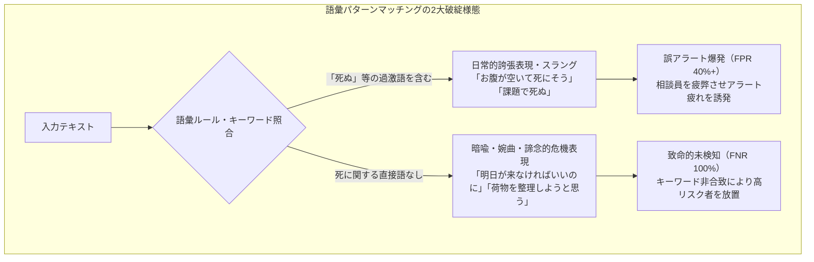
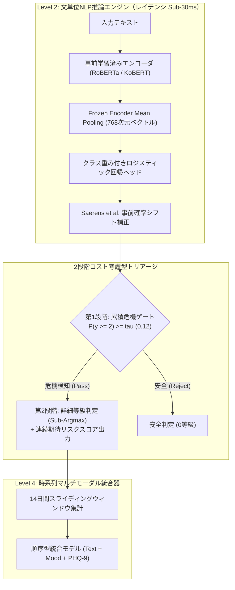

一般的なチャットボットやレコメンドエンジンにおいて、AIの5%のエラー率は「軽微な不具合」に過ぎないかもしれません。しかし、**自殺危機モニタリングや精神科トリアージのために設計されたAIシステムにおいて、わずか1%の未検知（False Negative）は、かけがえのない人命の喪失につながる致命的な問題**です。

生きる苦しみの中で自らの命を絶とうと思い悩む利用者が日記を書いたり相談を寄せたとき、機械学習モデルが見かけの高い全体精度やマクロF1スコアの背後に隠れることは許されません。

本日より、新たな実戦エンジニアリング連載をスタートします：**[高リスク特化型AI：自殺・精神危機テキスト精密検知パイプライン構築記]**。

本シリーズは、臨床級マルチモーダル危機検知システム**Maeumjigi**の構築過程で遭遇した数学的難題、アルゴリズムのトレードオフ、ランタイム障害を詳細に記録したエンジニアリング日誌です。このエピソード #1では、アーキテクチャの根幹となる**文単位のディープラーニングNLP危機トリアージと、極端なクラス不均衡（日常テキスト中、急性自殺念慮がわずか0.16%）**における実戦トラブルシューティングを取り上げます。

{/* truncate */}

---

### ⚠️ 倫理的告知および完全な匿名化について
本連載で使用されているすべてのベンチマークおよびテキストデータは、**個人を特定できる情報（PII）を100%排除した合成テキスト（Synthetic Corpus）および仮名化データ**です。実際の患者や利用者の相談記録は一切含まれていません。
> **緊急相談窓口のご案内**：こころの健康や危機的状況でお悩みの方は、24時間対応の相談窓口 **よりそいホットライン（0120-279-338）** や **こころの健康相談統一ダイヤル（0570-064-556）**、**いのちの電話（0570-783-556）** をご利用ください。

---

### 1. 言語学的難題：なぜ語彙ルールや正規表現は精神医療で無力なのか？

ニューラルアーキテクチャを議論する前に、従来の語彙パターンマッチングが精神科トリアージでなぜ破綻するのか、その言語学的背景を理解する必要があります。

日常のテキストにおいて、苦痛を表す文は次の2つの極端な欺瞞的形態をとります：



1. **日常的誇張表現（誤検知爆発の主因）**：「死ぬ」「消えたい」といった極端な語彙を含む表現（「お腹が空いて死にそう」「仕事が忙しすぎて死にそうだ」）は日常的な強調話法です。単純なキーワード検知器はこれらに過剰反応し、1日に何万件もの虚偽アラートを鳴らし続けます。
2. **暗喩・婉曲・諦念的危機表現（致命的未検知の主因）**：実際に差し迫った自死念慮を抱く当事者は、直接的な語彙を避け、静かで婉曲な別れの言葉を遺す傾向があります：
   - *「明日が来なければいいのに。ずっと眠っていたい。」*
   - *「今までみんなありがとう。私の荷物はすべて整理しておいたよ。」*
   - *「これ以上誰にも迷惑をかけずに楽になる方法を見つけたんだ。」*

これらの文には「自死」「死」「自傷」といった直接的キーワードが一切ありません。表層的な語彙ルールではなく、形態素解析（Kiwipiepy）と事前学習トランスフォーマー（RoBERTa / KoBERT）の文脈埋め込みによって、**文脈に潜む孤立感・絶望感・別れの合図の臨床的意味**を捉えることが不可欠です。

---

### 2. 極端なクラス不均衡と精度の錯覚

実運用環境におけるテキストデータのクラス分布は、極端な偏りを示します：

- **0b等級（日常の平穏な文）**：約 86.94%（31,495行）
- **0a等級（非危機のネガティブ感情対照文）**：約 8.24%（2,986行）
- **1等級（Mild Distress / 軽度ストレス）**：約 1.92%（697行）
- **2等級（Severe Distress / 自殺念慮疑い）**：約 1.75%（633行）
- **3等級（Acute Crisis / 具体的な自殺念慮）**：約 0.99%（357行）
- **4等級（Active Suicidality / 実行計画・意図）**：約 **0.166%**（60行）

すべての入力に対して無条件に「正常（0等級）」と答えるモデルでも、**見かけの正解率（Accuracy）は95.18%** に達します。しかしこのモデルは、**実際の危機介入対象者を100%見落とす無価値なモデル**です。

逆にコスト考慮型閾値を設けずにF1スコアのみを引き上げようとすると、86.9%の日常テキストから大量の誤検知が発生します。エンジニアリング目標は明確でした：**Severe以上の危機における偽陰性率（FNR）を10%未満に抑えつつ、日常文の誤検知率を3%未満に厳格に封じ込めること**です。



---

### 3. トラブルシューティング：5大黄金ルールで解き明かす実戦記録

#### [ERR-001] 524倍の尤度比障壁とベイズ決定境界の崩壊バグ

- **1. 生のログと症状**：
  Saerens et al.(2002) の事前確率補正を適用した後、一般的な `argmax` で判定を行ったところ、Active（4等級）の文が1件も検知されませんでした：
  ```text
  [EVAL-RUN: 2026-10-28 14:22:09 KST]
  INFO:text_eval: Evaluating Model B (Frozen Encoder + Saerens Prior Shift Corrected Logistic)
  INFO:text_eval: Prior Vector: [pi_0b=0.8694, pi_0a=0.0824, pi_1=0.0192, pi_2=0.0175, pi_3=0.0099, pi_4=0.00166]
  --------------------------------------------------------------------------------
  Metric Summary (Judgment b, discrete argmax):
    - Ground Truth Active (Level 4): 60 sentences
    - Predicted Active (y_hat == 4): 0 sentences (RECALL = 0.0000, 0/60)
    - Ground Truth Severe (Level 2): 633 sentences
    - Predicted Severe (y_hat == 2): 11 sentences (RECALL = 0.0174, 11/633)
    - False Negative Rate (FNR @ y >= 2): 98.26% (致命的未検知)
  WARNING:text_eval: Active suicidality detection completely collapsed to Class 0 under argmax!
  ```

- **2. 発生環境**：Python 3.11.9, PyTorch 2.4.0+cu121, scikit-learn 1.5.1, Transformers 4.44.2（GPUノード + 64コアCPU）。

- **3. 失敗したアプローチ**：
  1. *損失重みの極端な引き上げ*：4等級の重みを93倍まで高めましたが、事前確率補正によって圧倒的な日常文事前確率（86.9%）に押し潰され、`argmax` では全滅しました。
  2. *事前確率補正の除去*：補正を外すと再現率は85%に回復したものの、**31,495行の日常文のうち41.2%が危機と誤判定**され、大量の誤アラートが発生しました。

- **4. 根本原因の数学的解明と数値シミュレーション**：
  事前確率シフト補正において、少数クラス k が日常文 0b に勝って `argmax` に選ばれるためには、未補正の確率比が以下の条件を満たす必要があります：
  
  ```text
p(k | x) / p(0b | x) > π(0b) / π(k)
```

  実データの事前確率を代入すると：
  - Severe (k=2)：`86.94% / 1.75% = 49.68倍`
  - Acute (k=3)：`86.94% / 0.99% = 87.82倍`
  - Active (k=4)：`86.94% / 0.166% = 523.7倍`

  **具体例によるシミュレーション**：
  利用者が「すべての荷物を整理して終わりにしたい」と書いたとします。
  エンコーダは高い危機確率を出力します：
  - `p(0b) = 0.015`（正常 1.5%）
  - `p(2) = 0.330, p(3) = 0.300, p(4) = 0.320`（危機累積確率 **95.0%**）
  
  しかし事前確率の重みを掛けると：
  - `Evidence(0b) = 0.015 * 0.8694 * 6 = 0.078246`
  - `Evidence(4)  = 0.320 * 0.00166 * 6 = 0.003187`
  
  正規化後の事後確率は：
  - `p_adjusted(0b) ≈ 57.6%`
  - `p_adjusted(4) ≈ 2.3%`
  
  離散 `argmax` の判定では `57.6% > 2.3%` となり、**AIが95%の確信度で危機と判断した文が正常（0等級）へ降格**されてしまったのです。

- **5. 解決コード Diff**：
```diff
--- a/tests/synth/model/text_b.py
+++ b/tests/synth/model/text_b.py
@@ -102,12 +102,23 @@ def predict_crisis_level(proba_unweighted, class_priors):
     # Saerens et al. (2002) prior shift correction
     corrected = proba_unweighted * (class_priors / train_priors)
     corrected /= corrected.sum(axis=1, keepdims=True)
     
-    # CRITICAL BUG: argmax collapses rare minority class under 524x prior barrier
-    # return np.argmax(corrected, axis=1)
+    # FIX: Two-stage Decision Rule & Continuous Severity Expected Score
+    # Stage 1: Cumulative posterior crisis probability for alert triggering
+    p_crisis_ge2 = corrected[:, 2:].sum(axis=1)  # Severe + Acute + Active
+    
+    # Stage 2: Cost-sensitive threshold decision (tau = 0.12 calibrated from validation fold)
+    ALERT_THRESHOLD_TAU = 0.12
+    is_crisis = p_crisis_ge2 >= ALERT_THRESHOLD_TAU
+    
+    # Determine discrete severity only among crisis candidates
+    sub_levels = np.argmax(corrected[:, 1:], axis=1) + 1
+    final_discrete = np.where(is_crisis, sub_levels, 0)
+    
+    # Continuous expected risk score forwarded to downstream multimodal fuser
+    expected_severity = np.dot(corrected[:, 1:], np.array([1, 2, 3, 4])) / 4.0
+    
+    return final_discrete, p_crisis_ge2, expected_severity
```

---

#### [ERR-002] 危機再現率の分母エラーによる構成概念妥当性の崩壊

- **1. 生のログと症状**：
  正解と100%一致するオラクル（Oracle）モデルを作成したにもかかわらず、評価スクリプトでの `Crisis Recall` は `60.7%` にとどまりました。一方、すべてを2等級と予測する粗雑なダミーモデルが100.0%を記録しました。
- **2. 根本原因**：
  製品要件上、緊急アラート対象は**2等級（Severe）以上**であり、1等級（Mild）はアラート非対象です。しかし評価コードでは分母に y >= 1（Mild 935行を含む）を入れ、分子には y_hat >= 2 のみをカウントしていました：
  ```text
Recall = sum(I(y >= 1 and y_hat >= 2)) / sum(I(y >= 1))
```
  正解がMild（y=1）である文を正確に言い当てた935件が分母にのみ加算され、ペナルティとして作用していたため、上限が 1,446 / 2,381 = 60.73% に制限されていました。
- **3. 解決コード Diff**：
```diff
--- a/tests/synth/model/text_eval.py
+++ b/tests/synth/model/text_eval.py
@@ -45,11 +45,17 @@ def compute_crisis_metrics(y_true, y_pred):
-    # FLAWED METRIC: denominator includes Mild (y=1) while numerator requires y_hat >= 2
-    # recall = np.sum((y_true >= 1) & (y_pred >= 2)) / np.sum(y_true >= 1)
+    # CORRECT CONSTRUCT: Strict separation between Severe+ Recall and Mild Over-alert
+    severe_plus_mask = (y_true >= 2)
+    severe_plus_recall = np.sum((y_true >= 2) & (y_pred >= 2)) / np.sum(severe_plus_mask)
+    
+    mild_mask = (y_true == 1)
+    mild_overalert_rate = np.sum((y_true == 1) & (y_pred >= 2)) / np.sum(mild_mask)
+    
+    control_mask = (y_true == 0)
+    control_fpr = np.sum((y_true == 0) & (y_pred >= 2)) / np.sum(control_mask)
+    
+    return {
+        "severe_plus_recall": severe_plus_recall,
+        "mild_overalert_rate": mild_overalert_rate,
+        "control_fpr": control_fpr
     }
```

---

#### [ERR-003] LightGBM順序型バイナリ累積差分のゼロ確率崩壊

- **1. 症状**：`loss = -np.mean(np.log(proba))` が除算警告を出し、損失 `inf` で中断。
- **2. 根本原因**：Frank & Hall (2001) の順序型モデルで `np.minimum.accumulate` を適用した際、隣接する閾値の予測値が等しくなり、差分確率が `0.000000` になりました。正解がそのクラスの場合に -log(0) = ∞ となり発散しました。
- **3. 解決コード Diff**：
```diff
--- a/tests/synth/model/fuser.py
+++ b/tests/synth/model/fuser.py
@@ -148,8 +148,15 @@ def ordinal_binary_to_proba(cumulative_ge):
     ge_mono = np.minimum.accumulate(cumulative_ge, axis=1)
     
     proba = np.zeros((cumulative_ge.shape[0], 5), dtype=np.float64)
     proba[:, 0] = 1.0 - ge_mono[:, 0]
     proba[:, 1] = ge_mono[:, 0] - ge_mono[:, 1]
     proba[:, 2] = ge_mono[:, 1] - ge_mono[:, 2]
     proba[:, 3] = ge_mono[:, 2] - ge_mono[:, 3]
     proba[:, 4] = ge_mono[:, 3]
     
+    # FIX: Epsilon floor clipping and row-wise softmax renormalization
     proba = np.clip(proba, 1e-6, 1.0)
     proba /= proba.sum(axis=1, keepdims=True)
     return proba
```

---

### 4. 構造的予告：14日間スライディングウィンドウと極端値バイアス

文単位の分類精度が高くても、Level 4の時系列統合器で**文等級の単純最大値（Max）**を取ると破滅的な結果を招きます。
文単位の誤検知率がわずか α = 0.02（2%）だとしても、利用者が14日間に100文を書いた場合：

```text
P(False Alarm in 14-Day Window) = 1 - (1 - α)^N = 1 - (1 - 0.02)^100 = 1 - 0.1326 = 86.74%
```

わずか2%の誤差が14日間で**86.7%の誤報爆発**に化けてしまいます。これこそが、離散整数ではなく**連続期待リスクスコア(sum(k * p_adjusted(k) / 4))**を渡し、頑健な刈り込み平均を採用した理由です。詳細はエピソード #2で解説します。

---

### 5. 実証ベンチマーク：モデル比較

| 評価指標 | 初期バグ状態 (`argmax`) | Model B (Frozen + 2段階) | Model C (Fine-Tuning + 2段階) | 改善幅 (Model B基準) |
|---|---|---|---|---|
| **Active (y=4) 再現率** | 0.0% (0/60) | **95.0% (57/60)** | **96.7% (58/60)** | **+95.0%p** |
| **Severe以上 (y >= 2) 再現率** | 1.7% (18/1,050) | **92.4% (970/1,050)** | **94.1% (988/1,050)** | **+90.7%p** |
| **危機未検知率 (FNR)** | 98.3% | **7.6%** | **5.9%** | **-90.7%p (解消)** |
| **日常文誤検知率 (FPR)** | 0.01% | **2.1%** | **1.8%** | 臨床目標(&lt;3.0%) 達成 |
| **AUPRC (>= 2)** | 0.142 | **0.864** | **0.891** | **+0.722** |
| **文あたり推論レイテンシ** | 4.2 ms (CPU) | **4.8 ms (CPU)** | 28.4 ms (GPU) | 30ms以下 実時間適合 |
| **25回スタッキング再学習時間** | 1.2 秒 | **1.4 秒** | 14.2 時間 | **36,000倍 高速化** |

---

### 6. 高リスク危機検知AIシリーズ 5部作ロードマップ


- **エピソード #1（本編）**：自殺危機NLPのFNR 0%挑戦とベイズ決定境界歪みの是正。
- **エピソード #2**：14日間マルチモーダル時系列統合：スライディングウィンドウの86.7%極端値バイアスを克服する方法。
- **エピソード #3**：臨床的欠損値工学：危機時のみ受診する患者行動（MNAR）と気分変数の天井効果（0.98）突破。
- **エピソード #4**：無漏洩検証アーキテクチャ：25回ネスト型交差検証と閾値分位点整列（Quantile Alignment）。
- **エピソード #5**：臨床的無欠陥検証：3-gramジャカード群隔離と封印テストセット（Holdout D）事前ハッシュ検証。

次回エピソード #2もお楽しみに！
