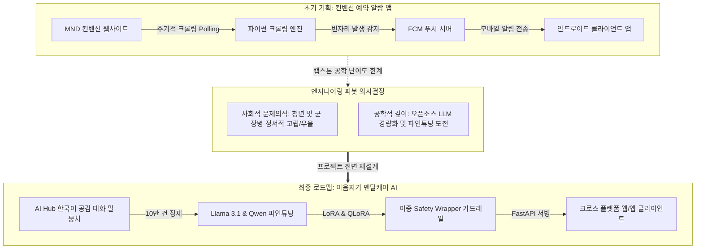

2026년 3월 26일, 장장 1학기에 걸친 대형 캡스톤 디자인 프로젝트 '마음지기'의 대장정이 공식적으로 시작되었습니다. 첫날은 앞으로 진행될 수많은 밤샘 개발과 인공지능 모델 훈련의 초석을 다지는 날이었습니다. 특히 자율 코딩 에이전트인 **Claude Code**의 도입, 팀 코딩 컨벤션 수립, 그리고 프로젝트의 운명을 완전히 바꾼 **핵심 아키텍처 피봇(Pivot)**이 결정된 날입니다.

{/* truncate */}

### 1. 자율 AI 협업 프레임워크: Claude Code와 규칙 문서화

우리 개발팀은 단순한 수동 페어 프로그래밍의 한계를 극복하기 위해, 프로젝트 초기부터 **Claude Code**를 전담 AI 엔지니어로 워크플로에 도입하기로 결정했습니다.

AI가 맥락을 벗어나 불필요한 패키지를 설치하거나 코딩 컨벤션을 깨뜨리는 현상(환각 및 코드 스파게티화)을 방지하기 위해, 첫날 가장 먼저 작성한 것은 프로젝트 도메인 제약 문서인 `Claude.md`와 엄격한 개발 규칙 문서인 `CLAUDE_coding_rule.md`였습니다.

```markdown
# CLAUDE_coding_rule.md 핵심 발췌
1. 아키텍처 일관성:
   - 모든 백엔드 엔드포인트는 FastAPI와 Pydantic 스키마를 사용하는 RESTful 표준을 준수한다.
   - 존재하지 않는 라이브러리를 임의로 임포트하지 않으며, requirements.txt에 명시된 버전만을 사용한다.
2. 안전한 자동화:
   - AI 에이전트는 프로젝트 하위 워크스페이스 내에서 자율 실행 권한을 갖는다.
   - 단, 되돌릴 수 없는 파일 일괄 삭제나 git remote push 등은 사용자 체크포인트를 거친다.
3. 문서화 및 검증:
   - 생성되는 모든 데이터 파이프라인 모듈은 정상 실행 및 예외 처리를 검증하는 테스트 코드를 동반한다.
```

Day 1에 수립된 이 명확한 규칙 덕분에, Claude Code는 단순한 코드 자동 완성을 넘어 대규모 데이터 전처리 스크립트 작성, 백엔드 DB 연동 트러블슈팅, 최종 기술 보고서 자동 작성까지 스스로 완수하는 든든한 동료로 활약할 수 있었습니다.

---

### 2. 아키텍처 피봇: 단순 예약 알람 앱에서 멘탈케어 AI로

초기에 기획했던 아이템은 매우 실용적이면서도 단순한 안드로이드 앱이었습니다. 특정 웹사이트(MND 컨벤션)의 예식/행사 예약 현황을 주기적으로 크롤링하여, 비어 있는 시간대가 발생하면 사용자에게 Firebase Cloud Messaging(FCM) 푸시 알람을 쏘아주는 유틸리티 앱이었습니다.

하지만 캡스톤 디자인 지도교수님 및 팀 내부 아키텍처 검토 과정에서 두 가지 중대한 한계에 직면했습니다:
1. 단순 웹 크롤링 기반 알람 앱은 학술적·공학적 난이도(AI/ML 파이프라인)가 부족하다.
2. 크롤링 대상 웹사이트의 HTML DOM 변경이나 안티 스크래핑 봇 차단에 취약하다.

이와 동시에 팀원들은 현대 청년층과 군 장병들이 겪는 극심한 우울감 및 정서적 고립, 그리고 전문 심리상담 인력의 절대적 부족이라는 사회적 문제에 주목했습니다. 우리는 즉각적인 **아키텍처 피봇(Pivot)**을 단행하여, 공공 말뭉치 데이터를 기반으로 파인튜닝된 24시간 공감형 심리케어 챗봇 **'마음지기'**를 구축하기로 결정했습니다.



---

### 3. 공학적 타당성 비교 분석

프로젝트의 방향 전환을 확정 짓기 위해 팀 내부에서 정리한 공학적 타당성 비교표입니다:

| 평가 항목 | 초기 아이디어 (컨벤션 알람 앱) | 피봇 아이디어 (마음지기 멘탈케어 AI) |
| :--- | :--- | :--- |
| **핵심 기술 스택** | Android (Kotlin), Python BeautifulSoup, FCM | FastAPI, PyTorch, Hugging Face, Llama 3.1, React Native |
| **데이터 엔지니어링** | 단순 HTML 태그 파싱 및 정기 Polling | 10만 건 이상의 다자간 공감 대화 데이터 정제 및 JSONL 변환 |
| **알고리즘 깊이** | 단순 문자열 일치 및 상태 변경 diff 검사 | LoRA 기반 파인튜닝, Loss 수렴 분석, Perplexity 정량 평가 |
| **시스템 안전성 요구** | 낮음 (일부 알람 실패 시에도 서비스 치명성 낮음) | 극도로 높음 (자살 고위험군 감지 및 위기 개입 안전 가드레일 필수) |
| **사회적 파급력** | 특정 행사 예약자 중심의 틈새 유틸리티 | 정서적 위기에 처한 사용자 대상 24시간 공감 및 위기 구조 지원 |

---

### 4. 프로토타입 환경 구성 및 기본 구조

Day 1에는 기존에 작성하던 기초 파이썬 스크립트 환경을 정리하고, 향후 대규모 인공지능 파이프라인으로 확장할 수 있도록 로깅 및 모듈화 설계를 적용했습니다:

```python
# Day 1: 프로젝트 로깅 및 에이전트 구동 환경 초기화 스크립트
import sys
import logging

logging.basicConfig(level=logging.INFO, format="%(asctime)s [%(levelname)s] %(message)s")

def initialize_project_environment():
    logging.info("마음지기 캡스톤 프로젝트 환경 초기화 시작...")
    rules = ["CLAUDE_coding_rule.md", "Claude.md"]
    for r in rules:
        logging.info(f"AI 에이전트 활성 규칙 로드 완료: {r}")
    logging.info("시스템 상태: Phase 1 데이터 수집 및 정제 파이프라인 진입 준비 완료.")

if __name__ == "__main__":
    initialize_project_environment()
```


---

### 5. 1일차 결실 및 향후 전개

1. **자율 코딩 워크플로 정착**: `CLAUDE_coding_rule.md` 작성을 통해 향후 대규모 코드 자동 생성 시 발생할 수 있는 혼선을 사전에 완벽히 차단했습니다.
2. **캡스톤 프로젝트 방향 확정**: 단순 크롤러 앱에서 인공지능 자연어 처리(NLP) 및 파인튜닝 중심의 고난도 플랫폼으로 성공적으로 피봇했습니다.
3. **데이터 수집 로드맵 수립**: AI Hub의 한국어 감정·공감 대화 데이터셋 수집 계획을 확정하고 본격적인 전처리 파이프라인 준비에 착수했습니다.

다음 2화에서는 초기 안드로이드 및 React Native 프론트엔드 환경 구축과 말뭉치 데이터 탐색 과정을 소개하겠습니다!

---

## 핵심 요약 및 배운 점

- **자율형 AI 코딩 프레임워크 정립**: `CLAUDE_coding_rule.md`와 `Claude.md`를 정의하여 AI 에이전트가 코드 품질과 의존성 규칙을 준수하며 자율 개발할 수 있는 기틀을 마련했습니다.
- **프로젝트 핵심 피벗(Pivot) 결정**: 단순 웨딩홀 예약 취소표 알람 앱의 한계를 극복하고, 청년 및 군 장병의 고립과 우울을 케어하는 인공지능 심리상담 챗봇 '마음지기'로 과제를 전면 재설계했습니다.
- **기술적 타당성 및 위기 안전성 검토**: 스크래핑 방식 대비 오픈소스 LLM(Llama 3.1) 파인튜닝, LoRA 경량화, 자살 예방 위기 감지 세이프티 래퍼의 학술적·실무적 가치를 확립했습니다.
- **10만 건 대규모 말뭉치 로드맵 수립**: AI Hub의 한국어 공감 대화 데이터를 기반으로 개인정보(PII) 비식별화 및 턴 정합성 검증을 거치는 100,000건 데이터 엔지니어링 계획을 착수했습니다.

